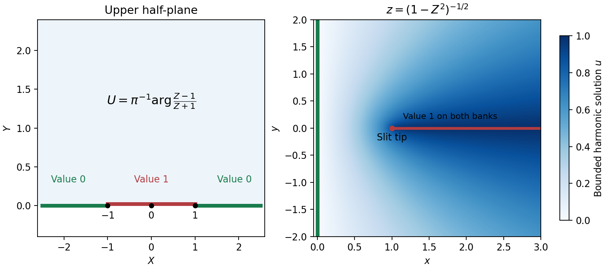

<h1 id="b/5/solution">Solution</h1>

↑ **Parent:** [5](../5.md)

Choose each factor with its argument between zero and $\pi$ in the [upper half-plane](../../../../upper-half-plane-complex-analysis.md). On an interval between consecutive real prevertices, each factor has a constant boundary argument, so $f'$ has constant argument and the image is a straight side. Crossing $X_j$ from left to right decreases $\arg(Z-X_j)$ by $\pi$, hence increases $\arg f'$ by $\beta_j\pi$, giving the prescribed exterior turn. Locally,

$$
f(Z)-z_j\sim C_j(Z-X_j)^{1-\beta_j},
$$

so an upper half-disc maps to angle $(1-\beta_j)\pi$, the required interior angle. The overall constant rotates and scales the polygon; integration adds translation. For a general prescribed polygon, the [prevertex](../../../../prevertex-of-a-schwarz-christoffel-map.md) positions must also satisfy the side-length conditions: the [derivative](../../../../derivative.md) formula fixes angles but arbitrary choices do not fix arbitrary side lengths.

For the slit domain, the slit tip has interior angle $2\pi$, so its exterior parameter is $-1$. The two vertices at infinity give the factors at $\pm1$, leading to $f'(Z)$ proportional to $Z(1-Z^2)^{-3/2}$. Integrating and imposing the tip value gives

$$
\boxed{z=f(Z)=\frac1{\sqrt{1-Z^2}}.}
$$

The [square root](../../../../square-root.md) is the principal one: for $\Im Z>0$, $1-Z^2$ never lies on the nonpositive real axis. Thus $\Re f>0$. Boundary points $-1<X<1$ map to the two banks of the slit, with $X=0$ at the tip; the outside intervals map to the imaginary axis. The [derivative](../../../../derivative.md) is nonzero in the open [half-plane](../../../../half-plane.md). Conversely each point of the slit domain determines exactly one root $Z$ of $Z^2=1-z^{-2}$ with positive [imaginary part](../../../../imaginary-part.md), proving bijectivity.

The [Möbius map](../../../../mobius-transformation.md) $(Z-1)/(Z+1)$ takes the [upper half-plane](../../../../upper-half-plane-complex-analysis.md) to itself, so its [principal argument](../../../../principal-argument.md) lies in $(0,\pi)$. The [imaginary part](../../../../imaginary-part.md) of its analytic [logarithm](../../../../logarithm.md) is [harmonic](../../../../harmonic-function.md), equals $\pi$ on $(-1,1)$ and zero on the other real intervals. Thus

$$
U(X,Y)=\frac1\pi\arg\frac{Z-1}{Z+1}.
$$

It lies between zero and one and has the required boundary limits away from the two discontinuities. Pulling this [harmonic function](../../../../harmonic-function.md) back by the inverse [conformal map](../../../../conformal-map.md) yields

$$
\boxed{u(x,y)=\frac1\pi\arg\frac{Z(z)-1}{Z(z)+1},\qquad
Z(z)^2=1-z^{-2},\quad\Im Z(z)>0.}
$$

This specifies all branches and remains bounded even as $z$ tends to either end at infinity.

To exhibit nonuniqueness without the growth restriction, put

$$
H(z)=\Im\frac{Z(z)}{1-Z(z)^2}.
$$

This is [harmonic](../../../../harmonic-function.md) in the domain. On its boundary the corresponding $Z$ is real and the rational expression is real, except at $\pm1$, which represent infinity. At $Z=\infty$, representing $z=0$, the expression tends to zero. Thus $H$ has zero finite boundary data. It is nonzero, since for $Z=iY$ its value is $Y/(1+Y^2)>0$, and it is unbounded as $Z$ approaches either pole $\pm1$ non-tangentially. Therefore **$u+cH$ gives distinct solutions** with the same finite boundary data when boundedness at infinity is removed.

**[Figure 2](#b/5/image-prevertices-the-slit-domain-and-the-bounded-harmonic-boundary-values). Prevertices, the slit domain, and the bounded harmonic boundary values**.

## ↑ Ancestors (12)

1. [5](../5.md)
2. [B](../../b.md)
3. [2007](../../../2007-split.md)
4. [Past exam of the perturbation methods and applied complex variables course of the University of Oxford](../../../split.md)
5. [Perturbation methods and applied complex variables course of the University of Oxford](../../../../perturbation-methods-and-applied-complex-variables-course-of-the-university-of-oxford.md)
6. [Year 4 of the mathematics course of the University of Oxford](../../../../year-4-of-the-mathematics-course-of-the-university-of-oxford.md)
7. [Mathematics course of the University of Oxford](../../../../mathematics-course-of-the-university-of-oxford.md)
8. [Undergraduate course of the University of Oxford](../../../../undergraduate-course-of-the-university-of-oxford.md)
9. [Course of the University of Oxford](../../../../course-of-the-university-of-oxford.md)
10. [University of Oxford](../../../../university-of-oxford-split.md)
11. [List of universities](../../../../list-of-universities.md)
12. [Codex Wiki](../../../../split.md)
