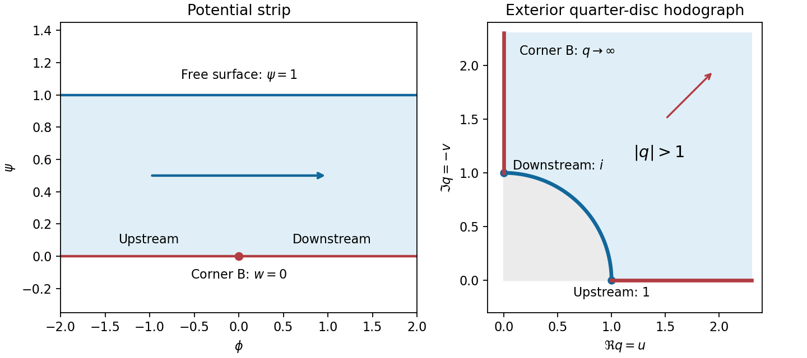

<h1 id="b/6/b/solution">Solution</h1>

↑ **Parent:** [B](../b.md)

The potential plane is the strip $0<\psi<1$. The wall maps to its lower boundary, with upstream $\phi\to-\infty$, the corner at $w=0$, and downstream $\phi\to+\infty$. The [free surface](../../../../../free-surface.md) maps to its upper boundary.

Write $q=w'=u-iv$. Far upstream $q=1$; far downstream the flow points vertically down and $q=i$. On the two wall rays, $q$ runs along the positive real and positive imaginary axes. The reentrant fluid corner has angle $3\pi/2$, so its potential behaves locally as $(z-B)^{2/3}$ and its speed diverges like $|z-B|^{-1/3}$. Thus **the corner corresponds to $q=\infty$, not $q=0$**. The [free surface](../../../../../free-surface.md) has $|q|=1$, giving the hodograph domain

$$
\Re q>0,\qquad\Im q>0,\qquad |q|>1.
$$

It is the exterior of a quarter [unit disc](../../../../../unit-disc.md) in the first quadrant.

Now $s=q^2$ maps this domain to the part of the [upper half-plane](../../../../../upper-half-plane-complex-analysis.md) outside the [unit disc](../../../../../unit-disc.md). The map

$$
t=\frac{s-1}{s+1}
$$

takes it to the first quadrant: its real and imaginary parts are positive because $|s|>1$ and $\Im s>0$. Finally $\eta=t^2$ maps that quadrant to the [upper half-plane](../../../../../upper-half-plane-complex-analysis.md). The corresponding strip map is $\eta=e^{\pi w}$. Both give upstream $\eta=0$, corner $\eta=1$, and downstream $\eta=\infty$, so the three boundary normalizations fix the remaining real Möbius freedom. Consequently

$$
\boxed{e^{\pi w}=\left(\frac{q^2-1}{q^2+1}\right)^2,\qquad q=w'.}
$$

On the [free surface](../../../../../free-surface.md) $q=e^{i\theta}$, $t=i\tan\theta$, so $\eta$ is negative and $\Im w=1$ as required. On the wall $\eta>0$, giving $\Im w=0$.

**[Figure 3](#b/6/b/image-the-strip-and-the-exterior-quarter-disc-hodograph-domain). The strip and the exterior quarter-disc hodograph domain**.

## ↑ Ancestors (13)

1. [B](../b.md)
2. [6](../../6.md)
3. [B](../../../b.md)
4. [2007](../../../../2007-split.md)
5. [Past exam of the perturbation methods and applied complex variables course of the University of Oxford](../../../../split.md)
6. [Perturbation methods and applied complex variables course of the University of Oxford](../../../../../perturbation-methods-and-applied-complex-variables-course-of-the-university-of-oxford.md)
7. [Year 4 of the mathematics course of the University of Oxford](../../../../../year-4-of-the-mathematics-course-of-the-university-of-oxford.md)
8. [Mathematics course of the University of Oxford](../../../../../mathematics-course-of-the-university-of-oxford.md)
9. [Undergraduate course of the University of Oxford](../../../../../undergraduate-course-of-the-university-of-oxford.md)
10. [Course of the University of Oxford](../../../../../course-of-the-university-of-oxford.md)
11. [University of Oxford](../../../../../university-of-oxford-split.md)
12. [List of universities](../../../../../list-of-universities.md)
13. [Codex Wiki](../../../../../split.md)
