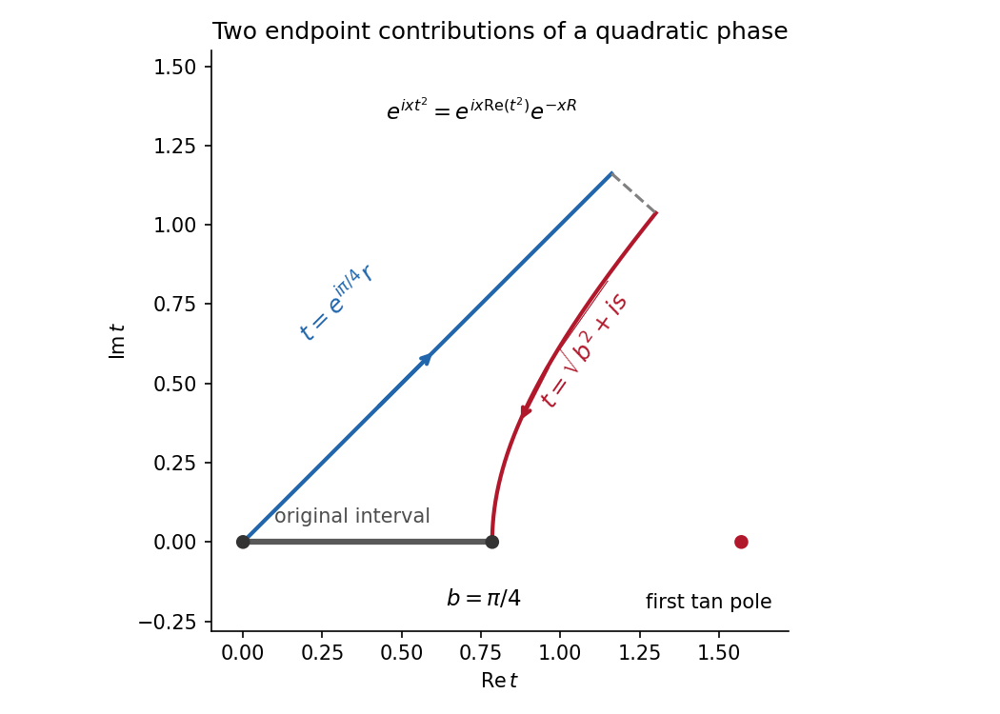

<h1 id="a/3/i/solution">Solution</h1>

↑ **Parent:** [I](../i.md)

Let $b=\pi/4$ and introduce

$$
J(x)=\int_0^b e^{ixt^2}\tan^2t\,dt,\qquad I(x)=\operatorname{Re}J(x).
$$

Deform the [contour](../../../../../complex-integration-contour.md) upward to the [steepest descent contour](../../../../../steepest-descent-contour.md) $t=e^{i\pi/4}r$ from zero and the endpoint path $t=(b^2+is)^{1/2}$ from $b$. More precisely the original integral is the first path traversed forward minus the endpoint path traversed forward. Connect the truncated paths where $\operatorname{Im}(t^2)=R$ and let $R\to\infty$. That connector has exponentially small factor $e^{-xR}$, and no [pole](../../../../../pole.md) of $\tan t$ is crossed: all its [poles](../../../../../pole.md) are real and outside the original segment.

On the first path $\tan^2t=t^2+O(t^4)$, so its leading contribution is

$$
J_0(x)=e^{3i\pi/4}\int_0^\infty r^2e^{-xr^2}\,dr
+O(x^{-5/2})
=e^{3i\pi/4}\frac{\sqrt\pi}{4x^{3/2}}
+O(x^{-5/2}).
$$

The last equality follows by $u=xr^2$, $\Gamma(3/2)=\sqrt\pi/2$.

On the endpoint path $dt=i\,ds/(2\sqrt{b^2+is})$, and $\tan^2b=1$. Its negative orientation gives the leading endpoint term

$$
J_b(x)=-i e^{ixb^2}\int_0^\infty
e^{-xs}\frac{\tan^2\sqrt{b^2+is}}{2\sqrt{b^2+is}}\,ds
=-\frac{i e^{ixb^2}}{2bx}+O(x^{-2}).
$$

Taking real parts and inserting $b=\pi/4$ gives

$$
\boxed{I(x)=\frac2{\pi x}\sin\!\left(\frac{\pi^2x}{16}\right)
-\frac{\sqrt{2\pi}}{8x^{3/2}}+O(x^{-2}).}
$$

The oscillatory first coefficient can vanish at particular values of $x$; the stated remainder still holds as an additive [asymptotic expansion](../../../../../asymptotic-expansion-split.md).

**[Figure 1](#a/3/i/image-the-quadratic-phase-descends-from-the-stationary-endpoint-and-from-the-nonstationary-upper-endpoint). The quadratic phase descends from the stationary endpoint and from the nonstationary upper endpoint**.

## ↑ Ancestors (13)

1. [I](../i.md)
2. [3](../../3.md)
3. [A](../../../a.md)
4. [2008](../../../../2008-split.md)
5. [Past exam of the perturbation methods and applied complex variables course of the University of Oxford](../../../../split.md)
6. [Perturbation methods and applied complex variables course of the University of Oxford](../../../../../perturbation-methods-and-applied-complex-variables-course-of-the-university-of-oxford.md)
7. [Year 4 of the mathematics course of the University of Oxford](../../../../../year-4-of-the-mathematics-course-of-the-university-of-oxford.md)
8. [Mathematics course of the University of Oxford](../../../../../mathematics-course-of-the-university-of-oxford.md)
9. [Undergraduate course of the University of Oxford](../../../../../undergraduate-course-of-the-university-of-oxford.md)
10. [Course of the University of Oxford](../../../../../course-of-the-university-of-oxford.md)
11. [University of Oxford](../../../../../university-of-oxford-split.md)
12. [List of universities](../../../../../list-of-universities.md)
13. [Codex Wiki](../../../../../split.md)
