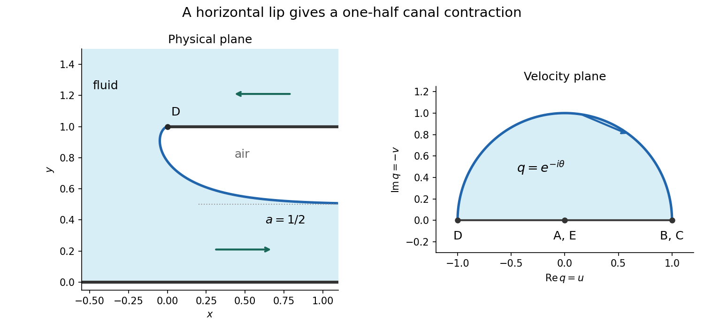

<h1 id="b/6/iv/solution">Solution</h1>

↑ **Parent:** [Iv](../iv.md)

Integrate real and imaginary parts from the lip value $z(-\pi)=i$:

$$
x(\theta)=-\frac a\pi\int_{-\pi}^\theta
\cos s\,\cot(s/2)\,ds,\qquad
y(\theta)=1-\frac a\pi\int_{-\pi}^\theta
\sin s\,\cot(s/2)\,ds.
$$

The identities $\sin s\cot(s/2)=1+\cos s$ and

$$
\int\cos s\cot(s/2)\,ds=\log(1-\cos s)+\cos s
$$

give the explicit parametrization

$$
x(\theta)=-\frac a\pi
\bigl[\log(1-\cos\theta)+\cos\theta-\log2+1\bigr],
$$

$$
y(\theta)=1-\frac a\pi(\theta+\pi+\sin\theta),
\qquad-\pi<\theta<0.
$$

As $\theta\uparrow0$, $x\to+\infty$ and $y\to1-a$. This must be the downstream height $a$, so

$$
\boxed{a=\frac12.}
$$

The surface initially moves slightly left of the lip before turning right. Its leftmost point occurs at $\theta=-\pi/2$, with $x_{\min}=-(1-\log2)/(2\pi)$. This is the [half-contraction free streamline at a horizontal canal lip](../../../../../half-contraction-free-streamline-at-a-horizontal-canal-lip.md).

**[Figure 2](#b/6/iv/image-the-fluid-free-boundary-contracts-to-half-the-lip-height-and-traces-the-upper-hodograph-plane). The fluid free boundary contracts to half the lip height and traces the upper hodograph plane**.

## ↑ Ancestors (13)

1. [Iv](../iv.md)
2. [6](../../6.md)
3. [B](../../../b.md)
4. [2008](../../../../2008-split.md)
5. [Past exam of the perturbation methods and applied complex variables course of the University of Oxford](../../../../split.md)
6. [Perturbation methods and applied complex variables course of the University of Oxford](../../../../../perturbation-methods-and-applied-complex-variables-course-of-the-university-of-oxford.md)
7. [Year 4 of the mathematics course of the University of Oxford](../../../../../year-4-of-the-mathematics-course-of-the-university-of-oxford.md)
8. [Mathematics course of the University of Oxford](../../../../../mathematics-course-of-the-university-of-oxford.md)
9. [Undergraduate course of the University of Oxford](../../../../../undergraduate-course-of-the-university-of-oxford.md)
10. [Course of the University of Oxford](../../../../../course-of-the-university-of-oxford.md)
11. [University of Oxford](../../../../../university-of-oxford-split.md)
12. [List of universities](../../../../../list-of-universities.md)
13. [Codex Wiki](../../../../../split.md)
