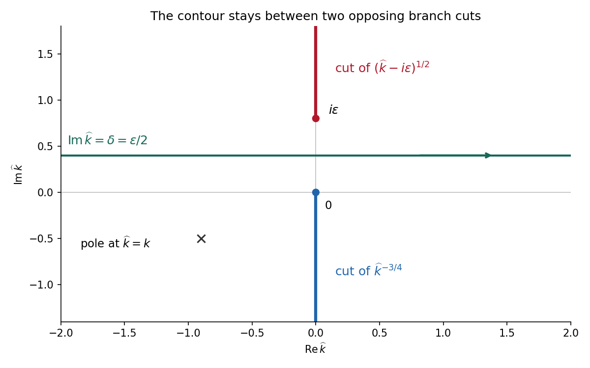

<h1 id="b/8/ii/b/solution">Solution</h1>

↑ **Parent:** [B](../b.md)

Use the [Fourier transform](../../../../../../fourier-transform-split.md) convention $\overline U(k,y)=\int_{\mathbb R}u(x,y)e^{ikx}dx$, initially in a class where the [integral transforms](../../../../../../integral-transform-split.md) and subsequent limits are defined. Transforming [Laplace's equation](../../../../../../laplace-equation.md) gives $\overline U_{yy}-k^2\overline U=0$ on real $k$. Decay for $y\to\infty$ selects

$$
\overline U(k,y)=\overline U(k,0)e^{-|k|y}.
$$

The boundary trace is the sum of its negative-half-line unknown and the given positive-half-line datum. The normal [derivative](../../../../../../derivative.md) is zero on the negative side. Therefore

$$
\boxed{-|k|(\bar f+H_+)=\bar g,\qquad
H_+(k)=\Gamma(3/4)e^{3i\pi/8}k^{-3/4}.}
$$

For the $e^{ikx}$ convention, negative support gives a [integral transform](../../../../../../integral-transform-split.md) analytic for $\operatorname{Im}k<0$, and positive support gives one analytic for $\operatorname{Im}k>0$, subject to the appropriate endpoint interpretation. The normal trace in this particular problem requires a finite-part interpretation, detailed below.

For the [Wiener-Hopf method](../../../../../../wiener-hopf-method.md), regularize the real-axis kernel by

$$
|k|_\epsilon=a_+(k)a_-(k),\qquad
a_+(k)=(k+i\epsilon)^{1/2},\quad
a_-(k)=(k-i\epsilon)^{1/2}.
$$

Take the [branch cut](../../../../../../branch-cut.md) of $a_+$ vertically downward from $-i\epsilon$ and that of $a_-$ vertically upward from $i\epsilon$. Their product on the [real axis](../../../../../../real-axis.md) is the positive square root $\sqrt{k^2+\epsilon^2}$. The branch of $H_+$ has its cut downward from zero. Dividing the regularized equation by $a_+$ gives

$$
a_-\bar f+\frac{\bar g}{a_+}=-P,\qquad
P=a_-H_+.
$$

The forcing $P$ is analytic in $0<\operatorname{Im}k<\epsilon$, between its two cuts. Decompose $P=P_+-P_-$ by [Cauchy integrals](../../../../../../cauchy-transform.md) on two horizontal lines within that strip. Separation gives

$$
a_-\bar f-P_-=-\frac{\bar g}{a_+}-P_+=A,
$$

when the endpoint growth class makes the common entire remainder bounded. For $\operatorname{Im}k<0$ one can take the minus [Cauchy integral](../../../../../../cauchy-transform.md) on $\operatorname{Im}\widehat k=\delta$, with $0<\delta<\epsilon$, obtaining

$$
\bar f_\epsilon(k)=\frac{A_\epsilon}{(k-i\epsilon)^{1/2}}
+\frac{\Gamma(3/4)e^{3i\pi/8}}{2\pi i(k-i\epsilon)^{1/2}}
\int_{-\infty+i\delta}^{\infty+i\delta}
\frac{(\widehat k-i\epsilon)^{1/2}\widehat k^{-3/4}}
{\widehat k-k}\,d\widehat k.
$$

The integrand is $O(|\widehat k|^{-5/4})$ at infinity, so the [Cauchy integral](../../../../../../cauchy-transform.md) converges there. In the limit choose $\delta=\delta(\epsilon)$, for example $\delta=\epsilon/2$; a fixed positive $\delta$ cannot remain between zero and $\epsilon$. With $\sqrt k$ denoting the limiting lower-analytic branch and with the prescribed limiting interpretation,

$$
\boxed{\bar f(k)=\frac A{\sqrt k}
+\frac{\Gamma(3/4)e^{3i\pi/8}}{2\pi i\sqrt k}
\lim_{\epsilon\downarrow0}
\int_{-\infty+i\delta(\epsilon)}^{\infty+i\delta(\epsilon)}
\frac{(\widehat k-i\epsilon)^{1/2}\widehat k^{-3/4}}
{\widehat k-k}\,d\widehat k.}
$$

The numerator square root has a cut going upward from $i\epsilon$; the power $\widehat k^{-3/4}$ has a cut going downward from zero. The [contour](../../../../../../complex-integration-contour.md) passes between them. The [pole](../../../../../../pole.md) $\widehat k=k$ is below this [contour](../../../../../../complex-integration-contour.md) when $k$ is in the lower [integral transform](../../../../../../integral-transform-split.md) domain. These branch choices are essential, rather than independent principal powers of the factors.

**[Figure 3](#b/8/ii/b/image-the-wiener-hopf-contour-lies-between-the-upward-square-root-cut-and-the-downward-quarter-power-cut). The Wiener-Hopf contour lies between the upward square-root cut and the downward quarter-power cut**.

There is an important mathematical limitation in the source's ordinary integral definition of $\bar g$. An explicit [harmonic function](../../../../../../harmonic-function.md) particular solution in [polar coordinates](../../../../../../polar-coordinates.md) $0<\theta<\pi$ is

$$
u_{\rm p}(r,\theta)=r^{-1/4}
\bigl(\cos(\theta/4)+\sin(\theta/4)\bigr).
$$

Each separated polar power is [harmonic function](../../../../../../harmonic-function.md); at $\theta=0$ it has the required [Dirichlet boundary condition](../../../../../../dirichlet-boundary-condition.md) value, and at $\theta=\pi$ its angular [derivative](../../../../../../derivative.md) vanishes, giving the required zero normal [derivative](../../../../../../derivative.md). It also decays at infinity. Its unknown boundary traces are

$$
f_{\rm p}(x)=\sqrt2\,|x|^{-1/4}\quad(x<0),\qquad
g_{\rm p}(x)=\frac14x^{-5/4}\quad(x>0).
$$

The last [function](../../../../../../function-split.md) is not locally integrable at zero. Therefore the printed ordinary integral $\int_0^\infty g(x)e^{ikx}dx$ diverges, even for $\operatorname{Im}k>0$. The [integral transform](../../../../../../integral-transform-split.md) calculation is valid for this solution only after specifying a [Hadamard finite-part integral](../../../../../../hadamard-finite-part-integral.md), or equivalently a [distribution](../../../../../../distribution-mathematical-analysis.md) boundary trace.

For the canonical homogeneous extension of this power, the two transformed traces are

$$
\bar f_{\rm p}(k)=\sqrt2\,\Gamma(3/4)(ik)^{-3/4},\qquad
\bar g_{\rm p}(k)=-\Gamma(3/4)(-ik)^{1/4}.
$$

The first is analytic below and the second above. The second formula follows from $\Gamma(3/4)=(-1/4)\Gamma(-1/4)$ and the finite-part continuation of the [Laplace transform](../../../../../../laplace-transform.md). Substituting their real-axis boundary values directly verifies the boxed [integral transform](../../../../../../integral-transform-split.md) relation for both signs of $k$, so the qualification can be checked without relying only on formal factorization.

There is also homogeneous corner freedom:

$$
u_{\rm h}=C r^{-1/2}\sin(\theta/2)
$$

satisfies zero [Dirichlet boundary condition](../../../../../../dirichlet-boundary-condition.md) data on the positive axis, zero [Neumann boundary condition](../../../../../../neumann-boundary-condition.md) data on the negative axis and decay at infinity. Its negative trace has [integral transform](../../../../../../integral-transform-split.md) $C\Gamma(1/2)(ik)^{-1/2}$, corresponding to the term $A/\sqrt k$. Higher singular modes $r^{-(n+1/2)}\sin((n+1/2)\theta)$ would also satisfy the homogeneous [boundary conditions](../../../../../../boundary-condition.md) for integers $n\geq1$, but are excluded if the negative trace is required to be locally integrable. Thus the one-constant formula belongs to a specified corner-growth class. The original [boundary conditions](../../../../../../boundary-condition.md) alone, without that class, do not assert uniqueness. These facts form the [finite-part normal trace for mixed quarter-power boundary data](../../../../../../finite-part-normal-trace-for-mixed-quarter-power-boundary-data.md).

## ↑ Ancestors (14)

1. [B](../b.md)
2. [Ii](../../ii.md)
3. [8](../../../8.md)
4. [B](../../../../b.md)
5. [2008](../../../../../2008-split.md)
6. [Past exam of the perturbation methods and applied complex variables course of the University of Oxford](../../../../../split.md)
7. [Perturbation methods and applied complex variables course of the University of Oxford](../../../../../../perturbation-methods-and-applied-complex-variables-course-of-the-university-of-oxford.md)
8. [Year 4 of the mathematics course of the University of Oxford](../../../../../../year-4-of-the-mathematics-course-of-the-university-of-oxford.md)
9. [Mathematics course of the University of Oxford](../../../../../../mathematics-course-of-the-university-of-oxford.md)
10. [Undergraduate course of the University of Oxford](../../../../../../undergraduate-course-of-the-university-of-oxford.md)
11. [Course of the University of Oxford](../../../../../../course-of-the-university-of-oxford.md)
12. [University of Oxford](../../../../../../university-of-oxford-split.md)
13. [List of universities](../../../../../../list-of-universities.md)
14. [Codex Wiki](../../../../../../split.md)
