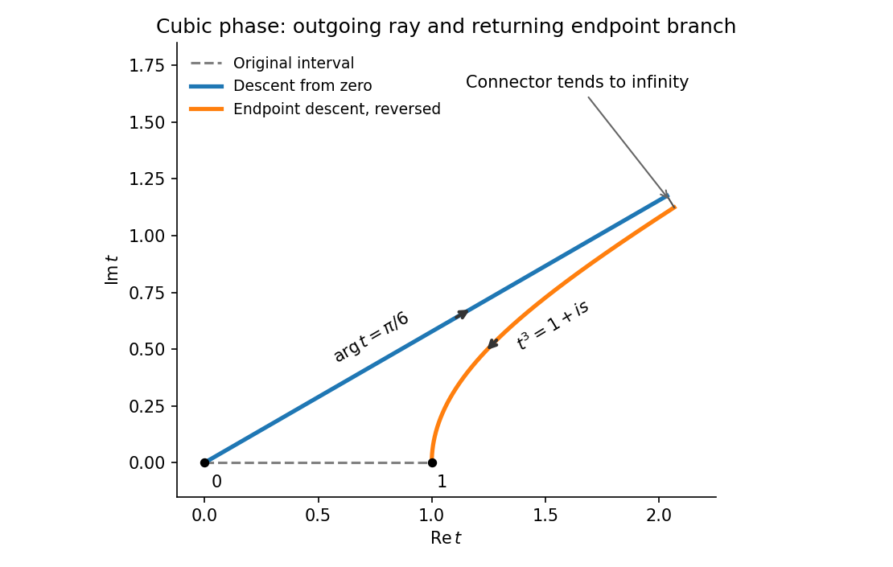
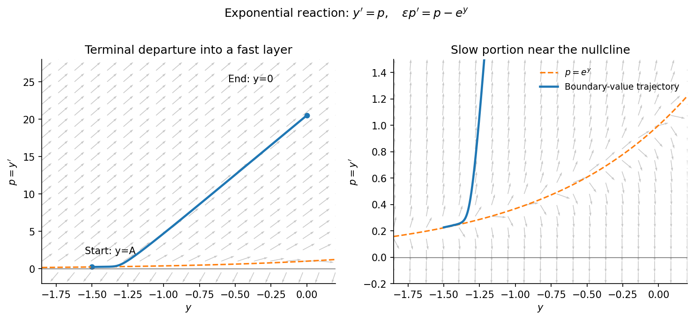
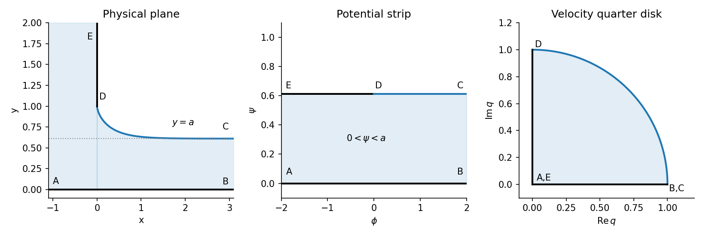

# 2009

↑ **Parent:** [Past exam of the perturbation methods and applied complex variables course of the University of Oxford](../past-exam-of-the-perturbation-methods-and-applied-complex-variables-course-of-the-university-of-oxford.md)

**Table of contents**

- [A](#a)
  - [1](#a/1)
    - [i](#a/1/i)
      - [Solution](#a/1/i/solution)
    - [ii](#a/1/ii)
      - [Solution](#a/1/ii/solution)
    - [iii](#a/1/iii)
      - [Solution](#a/1/iii/solution)
    - [iv](#a/1/iv)
      - [Solution](#a/1/iv/solution)
  - [2](#a/2)
    - [i](#a/2/i)
      - [Solution](#a/2/i/solution)
    - [ii](#a/2/ii)
      - [Solution](#a/2/ii/solution)
    - [iii](#a/2/iii)
      - [Solution](#a/2/iii/solution)
  - [3](#a/3)
    - [i](#a/3/i)
      - [Solution](#a/3/i/solution)
    - [ii](#a/3/ii)
      - [Solution](#a/3/ii/solution)
    - [iii](#a/3/iii)
      - [Solution](#a/3/iii/solution)
- [B](#b)
  - [4](#b/4)
    - [i](#b/4/i)
      - [Solution](#b/4/i/solution)
    - [ii](#b/4/ii)
      - [Solution](#b/4/ii/solution)
    - [iii](#b/4/iii)
      - [Solution](#b/4/iii/solution)
    - [iv](#b/4/iv)
      - [Solution](#b/4/iv/solution)
  - [5](#b/5)
    - [i](#b/5/i)
      - [Solution](#b/5/i/solution)
    - [ii](#b/5/ii)
      - [Solution](#b/5/ii/solution)
  - [6](#b/6)
    - [Solution](#b/6/solution)

## A

↑ **Parent:** [2009](2009.md)

<h3 id="a/1">1</h3>

↑ **Parent:** [A](#a)

<h4 id="a/1/i">i</h4>

↑ **Parent:** [1](#a/1)

<h5 id="a/1/i/solution">Solution</h5>

↑ **Parent:** [I](#a/1/i)

For $x>0$, the real and imaginary parts of the exponent divided by $x$ are

$$
\operatorname{Re}(it^3)=v^3-3u^2v=-r^3\sin3\theta,\qquad
\operatorname{Im}(it^3)=u^3-3uv^2=r^3\cos3\theta.
$$

Thus [constant-phase contours](../asymptotic-expansion.md#constant-phase-contour) satisfy $u^3-3uv^2=c$. Through zero, $c=0$ gives the six rays $\theta=\pi/6+j\pi/3$. The three rays $\theta=\pi/6,5\pi/6,3\pi/2$ have decreasing real part of the exponent and are [steepest descent contours](../asymptotic-expansion.md#steepest-descent-contour); the alternating three are steepest ascent rays.

Through one, the phase is $c=1$. Its branch passing through that point can be written

$$
t=(1+is)^{1/3},\qquad s\in\mathbb R,
$$

with the cube root continuous from $t=1$. The exponent is $ix-xs$, so increasing $s$ from zero gives descent and decreasing $s$ gives ascent.

Deform the finite interval into the ray $t=e^{i\pi/6}r$, $0\leq r<\infty$, followed by the reverse of the descent branch from one. The integrand is entire, so [Cauchy's integral theorem](../complex-analysis.md#cauchy-s-integral-theorem) permits the deformation.

**[Figure 1](#a/1/i/image-cubic-descent-deformation-with-the-endpoint-branch-traversed-back-toward-one). Cubic descent deformation with the endpoint branch traversed back toward one**.

For a precise connector at infinity, use $t=(a+iR)^{1/3}$, $0\leq a\leq1$. Its length is $O(R^{-2/3})$ and the exponential has modulus $e^{-xR}$. Its contribution is therefore $O(R^{-2/3}e^{-xR})\to0$. This avoids relying on an undifferentiated claim that every large circular arc decays.

<h4 id="a/1/ii">ii</h4>

↑ **Parent:** [1](#a/1)

<h5 id="a/1/ii/solution">Solution</h5>

↑ **Parent:** [Ii](#a/1/ii)

A [saddle point](../analysis.md#saddle-point) of the exponential phase occurs where $(it^3)'=3it^2=0$. Hence the only saddle is

$$
\boxed{t=0.}
$$

It is degenerate: the second phase derivative vanishes there, while the third is $6i\ne0$. This cubic degeneracy produces the $x^{-1/3}$ scale. The other endpoint $t=1$ is not a saddle, since the phase derivative there is $3i$.

<h4 id="a/1/iii">iii</h4>

↑ **Parent:** [1](#a/1)

<h5 id="a/1/iii/solution">Solution</h5>

↑ **Parent:** [Iii](#a/1/iii)

On the selected [steepest descent contour](../asymptotic-expansion.md#steepest-descent-contour) put $t=e^{i\pi/6}r$, $r\geq0$. Then $it^3=-r^3$ and $dt=e^{i\pi/6}\,dr$. Its exact contribution is

$$
I_0(x)=e^{i\pi/6}\int_0^\infty e^{-xr^3}\,dr
=\frac{e^{i\pi/6}}{3x^{1/3}}\int_0^\infty e^{-s}s^{-2/3}\,ds.
$$

Use the [Gamma function](../complex-analysis.md#gamma-function) integral and its recurrence $\Gamma(4/3)=\Gamma(1/3)/3$ to obtain

$$
\boxed{I_0(x)=e^{i\pi/6}\Gamma(4/3)x^{-1/3}.}
$$

There is no remainder here: the complete infinite descent ray was integrated exactly.

<h4 id="a/1/iv">iv</h4>

↑ **Parent:** [1](#a/1)

<h5 id="a/1/iv/solution">Solution</h5>

↑ **Parent:** [Iv](#a/1/iv)

The endpoint branch has $t=(1+is)^{1/3}$ and $dt=(i/3)(1+is)^{-2/3}ds$. Its reversed orientation in the deformed contour gives

$$
I_1(x)=-\frac{ie^{ix}}3\int_0^\infty e^{-xs}(1+is)^{-2/3}\,ds.
$$

At $s=0$,

$$
(1+is)^{-2/3}=1-\frac{2i}{3}s+O(s^2).
$$

[Watson's lemma](../analysis.md#watson-s-lemma), or elementary [Laplace's method](../asymptotic-expansion.md#laplace-s-method) with a Taylor remainder, now yields

$$
I_1(x)=-\frac{ie^{ix}}{3x}-\frac{2e^{ix}}{9x^2}+O(x^{-3}).
$$

Adding the exact cubic-saddle contribution gives the two leading terms

$$
\boxed{I(x)=e^{i\pi/6}\Gamma(4/3)x^{-1/3}-\frac{ie^{ix}}{3x}+O(x^{-2}).}
$$

If the next term is retained, it is $-2e^{ix}/(9x^2)$. The different powers reflect a degenerate saddle at zero and an ordinary endpoint at one.

<h3 id="a/2">2</h3>

↑ **Parent:** [A](#a)

<h4 id="a/2/i">i</h4>

↑ **Parent:** [2](#a/2)

<h5 id="a/2/i/solution">Solution</h5>

↑ **Parent:** [I](#a/2/i)

Set $x=\delta X$ and write $y(x)=Y(X)$. The equation becomes

$$
\frac{\epsilon}{\delta^2}Y''+\delta^{\alpha-1}X^\alpha Y'+Y=0.
$$

A [dominant balance](../asymptotic-expansion.md#dominant-balance) must compare all three coefficients, rather than just the two derivative terms.

For $-1<\alpha<1$, balancing diffusion and drift gives $\delta=\epsilon^{1/(\alpha+1)}$. Their common coefficient tends to infinity, so the reaction term is smaller and the leading inner equation is

$$
Y''+X^\alpha Y'=0,\qquad
Y'=C\exp[-X^{\alpha+1}/(\alpha+1)].
$$

This derivative is integrable at infinity, allowing an ordinary localized endpoint adjustment. Thus **the thickness is $\epsilon^{1/(\alpha+1)}$** in this range.

For $\alpha=1$, $\delta=\sqrt\epsilon$ makes all three terms comparable. Keep all of them:

$$
Y''+XY'+Y=0.
$$

One decaying solution is $e^{-X^2/2}$, and reduction of order gives the other. This is a **square-root-thickness layer with all terms retained**.

For $\alpha>1$, the first variation scale is $\delta=\sqrt\epsilon$. Keep diffusion and reaction, and drop drift at this scale:

$$
Y''+Y=0.
$$

This leading motion is oscillatory, not a monotone decaying boundary-layer profile. To describe localization one must also resolve the slower damping envelope. Removing the first derivative in the original equation by

$$
y=\exp\left[-\frac{x^{\alpha+1}}{2\epsilon(\alpha+1)}\right]v
$$

gives

$$
v''+\left[\frac1\epsilon-\frac{\alpha x^{\alpha-1}}{2\epsilon}
-\frac{x^{2\alpha}}{4\epsilon^2}\right]v=0.
$$

Near the endpoint the wavelength is $O(\sqrt\epsilon)$, while the envelope changes on $x=O(\epsilon^{1/(\alpha+1)})$. Hence an oscillatory endpoint region is possible, but **it has distinct wavelength and envelope scales**; calling the diffusion-drift balance alone its leading equation would incorrectly discard the reaction term. This generalizes the [oscillatory endpoint with a quadratically vanishing drift](../singular-perturbation.md#oscillatory-endpoint-with-a-quadratically-vanishing-drift).

For $\alpha\leq-1$, the diffusion-drift balance would require $\delta^{\alpha+1}=\epsilon$, which gives no shrinking positive power scale. At every shrinking scale the singular drift dominates diffusion, so no regular finite-amplitude diffusion boundary layer of the preceding kind occurs. The coefficient itself is singular at zero; singular endpoint solutions are a different issue from a bounded boundary-layer correction.

<h4 id="a/2/ii">ii</h4>

↑ **Parent:** [2](#a/2)

<h5 id="a/2/ii/solution">Solution</h5>

↑ **Parent:** [Ii](#a/2/ii)

Put $p=y'$. The [dynamical system](../dynamical-systems.md#dynamical-system) is

$$
y'=p,\qquad p'=\frac{p-e^y}{\epsilon}.
$$

The [nullclines](../dynamical-systems.md#nullcline) are $p=0$ and $p=e^y$. There are no equilibria, since they never intersect. To the right in the $(y,p)$ plane means $p>0$, and to the left means $p<0$. The arrows point upwards above $p=e^y$ and downwards below it.

Near the repelling [critical manifold](../singular-perturbation.md#critical-manifold) $p=e^y$, an orbit can move on the slow $x=O(1)$ scale, with $y'\simeq e^y$. More precisely the slow trajectory has $p=e^y+\epsilon e^{2y}+\cdots$. Away from this narrow region, $p$ changes rapidly on $x=O(\epsilon)$; an $O(1)$ change of $y$ in a fast layer has $p=O(\epsilon^{-1})$.

**[Figure 2](#a/2/ii/image-slow-motion-near-the-exponential-nullcline-and-fast-terminal-departure). Slow motion near the exponential nullcline and fast terminal departure**.

For example, take a fixed $A<-\log2$. A trajectory starting at $y=A$ can shadow the slow curve, then depart upwards so that $y$ rapidly increases to zero at the right endpoint. This gives a terminal [outflow boundary layer](../singular-perturbation.md#outflow-boundary-layer) at $x=1$, of width $O(\epsilon)$. For $-\log2<A<0$, the outer trajectory reaches a positive value near one, and the terminal adjustment is downwards: the orbit turns below the nullcline, crosses $p=0$, and returns to $y=0$. The boundary layer is still at $x=1$. These directions follow from the phase portrait and agree with the matched solution below.

<h4 id="a/2/iii">iii</h4>

↑ **Parent:** [2](#a/2)

<h5 id="a/2/iii/solution">Solution</h5>

↑ **Parent:** [Iii](#a/2/iii)

In the [outer expansion](../singular-perturbation.md#outer-expansion), omit $\epsilon y''$ to get $y_0'=e^{y_0}$. Integrating and imposing the left boundary condition gives

$$
y_{\rm out}(x)=-\log(C-x),\qquad C=e^{-A}>1.
$$

This is regular throughout $[0,1]$. Its right-end value is $B=-\log(C-1)$, generally different from zero.

At $x=1$ set $X=(x-1)/\epsilon$. The equation is $Y''-Y'+\epsilon e^Y=0$, so the leading [inner expansion](../singular-perturbation.md#inner-expansion) is $Y=C_0+C_1e^X$. Matching as $X\to-\infty$ gives $C_0=B$, while $Y(0)=0$ gives $C_1=-B$. Thus

$$
y_{\rm in}(x)=B\left[1-\exp\left(\frac{x-1}{\epsilon}\right)\right].
$$

The common part is $B$. Subtract it once when forming the [additive composite expansion](../singular-perturbation.md#additive-composite-expansion):

$$
\boxed{y_c(x)=-\log(e^{-A}-x)+\log(e^{-A}-1)
\exp\left(\frac{x-1}{\epsilon}\right).}
$$

There is one generic boundary layer, at the right endpoint, of width $\epsilon$. A left-end exponential would grow into the interval and cannot supply a decaying matching correction. At $A=-\log2$ the displayed layer amplitude vanishes; the leading outer solution already meets the right condition, though a smaller correction can still be needed at higher order. The composite meets $y(1)=0$ exactly and $y(0)=A$ up to an exponentially small term.

<h3 id="a/3">3</h3>

↑ **Parent:** [A](#a)

<h4 id="a/3/i">i</h4>

↑ **Parent:** [3](#a/3)

<h5 id="a/3/i/solution">Solution</h5>

↑ **Parent:** [I](#a/3/i)

Choose $\delta=\sqrt\epsilon$ in the [WKB approximation](../analysis.md#wkb-approximation) and substitute $y=\exp(S_0/\delta+S_1+\cdots)$. The leading equation is

$$
(S_0')^2=x,
$$

so take $S_0=\pm2x^{3/2}/3$. At the next order,

$$
2S_0'S_1'+S_0''+(x-1)S_0'=0,
$$

giving

$$
S_1=-\tfrac14\log x-\tfrac14x^2+\tfrac12x
$$

up to an absorbed constant. Label the recessive and dominant branches respectively by

$$
y_1=x^{-1/4}e^{-x^2/4+x/2}e^{-2x^{3/2}/(3\sqrt\epsilon)},\qquad
y_2=x^{-1/4}e^{-x^2/4+x/2}e^{2x^{3/2}/(3\sqrt\epsilon)}.
$$

The formal outer solution is $c_1y_1+c_2y_2$. The point zero is a simple [wave turning point](../analysis.md#wave-turning-point): $S_0'$ vanishes and the WKB amplitude diverges.

The boundary condition at infinity selects **$c_2=0$**, with $c_1$ to be fixed by matching. This statement concerns the actual recessive branch. One cannot literally send $x\to\infty$ in the truncated small-$\epsilon$ formulas: their ordering fails when $\epsilon x$ is no longer small, and their common Gaussian factor would then spuriously suggest that both branches decay.

To justify the selection, remove the first derivative exactly with $y=e^{-x^2/4+x/2}v$. Then

$$
v''=\left[\frac x\epsilon+\frac{(x-1)^2}4+\frac12\right]v.
$$

The coefficient is positive for $x\geq0$, so it has distinct dominant and recessive branches. For very large $x$, the dominant branch restores $y$ growth of exponential rate $1/\epsilon$, while the recessive branch decays. Matching to this recessive branch removes $c_2$.

<h4 id="a/3/ii">ii</h4>

↑ **Parent:** [3](#a/3)

<h5 id="a/3/ii/solution">Solution</h5>

↑ **Parent:** [Ii](#a/3/ii)

Balance $\epsilon y''$ against $xy$ near the [wave turning point](../analysis.md#wave-turning-point). With $x=\gamma X$, their equality requires $\epsilon/\gamma^2=\gamma$, hence $\gamma=\epsilon^{1/3}$. The rescaled equation is

$$
Y''+\epsilon^{1/3}(\epsilon^{1/3}X-1)Y'-XY=0.
$$

Its leading equation is the [Airy ordinary differential equation](../linear-ordinary-differential-equation.md#airy-ordinary-differential-equation) $Y''=XY$. Thus

$$
Y=\alpha\operatorname{Ai}(X)+\beta\operatorname{Bi}(X).
$$

Let $a_0=\operatorname{Ai}(0)=3^{-2/3}/\Gamma(2/3)$; then $\operatorname{Bi}(0)=\sqrt3\,a_0$. The left boundary condition becomes $a_0(\alpha+\sqrt3\beta)=1$, or

$$
\boxed{\beta=3^{1/6}\Gamma(2/3)-\frac{\alpha}{\sqrt3}.}
$$

This determines one linear relation before the far-boundary matching condition is used.

<h4 id="a/3/iii">iii</h4>

↑ **Parent:** [3](#a/3)

<h5 id="a/3/iii/solution">Solution</h5>

↑ **Parent:** [Iii](#a/3/iii)

In the [overlap region](../singular-perturbation.md#overlap-region) $\epsilon^{1/3}\ll x\ll1$, write $X=x/\epsilon^{1/3}$. The supplied [Airy function](../linear-ordinary-differential-equation.md#airy-function) asymptotics give

$$
Y\sim\frac{\alpha\epsilon^{1/12}}{2\sqrt\pi}x^{-1/4}
e^{-2x^{3/2}/(3\sqrt\epsilon)}
+\frac{\beta\epsilon^{1/12}}{\sqrt\pi}x^{-1/4}
e^{2x^{3/2}/(3\sqrt\epsilon)}.
$$

The outer prefactor $e^{-x^2/4+x/2}$ tends to one in this overlap. Therefore

$$
c_1=\frac{\alpha\epsilon^{1/12}}{2\sqrt\pi},\qquad
c_2=\frac{\beta\epsilon^{1/12}}{\sqrt\pi}.
$$

The recessive condition $c_2=0$ gives $\beta=0$ and $\alpha=1/a_0=3^{2/3}\Gamma(2/3)$. Hence the leading inner answer is

$$
\boxed{y_{\rm in}(x)=\frac{\operatorname{Ai}(x/\epsilon^{1/3})}{\operatorname{Ai}(0)}.}
$$

Away from the turning point, the matched [WKB approximation](../analysis.md#wkb-approximation) is

$$
\boxed{y(x)\sim
\frac{\epsilon^{1/12}}{2\sqrt\pi\,\operatorname{Ai}(0)}
x^{-1/4}\exp\left[-\frac{2x^{3/2}}{3\sqrt\epsilon}-\frac{x^2}4+\frac x2\right].}
$$

A useful [multiplicative composite expansion](../singular-perturbation.md#multiplicative-composite-expansion) through the turning region is $e^{-x^2/4+x/2}\operatorname{Ai}(x/\epsilon^{1/3})/\operatorname{Ai}(0)$: it is finite and normalized at zero and matches the displayed outer expression for fixed positive $x$. It is a small-$\epsilon$ approximation across the turning point, not a claim of relative uniform accuracy out to arbitrarily large $x$.

## B

↑ **Parent:** [2009](2009.md)

<h3 id="b/4">4</h3>

↑ **Parent:** [B](#b)

<h4 id="b/4/i">i</h4>

↑ **Parent:** [4](#b/4)

<h5 id="b/4/i/solution">Solution</h5>

↑ **Parent:** [I](#b/4/i)

Write the [complex potential of a two-dimensional potential flow](../fluid-mechanics.md#complex-potential-of-a-two-dimensional-potential-flow) as $w=\phi+i\psi$, and the complex velocity as $q=w'=u-iv$. The lower solid wall has $\psi=0$. The upper solid wall and its continuing free streamline have constant $\psi$ equal to the far-field volume flux per unit depth, namely $a$. Consequently the potential domain is the infinite strip

$$
\boxed{0<\operatorname{Im}w<a.}
$$

The points $A,E$ correspond to $\phi\to-\infty$, $B,C$ to $\phi\to+\infty$, and $D$ is $w=ia$ by the chosen potential normalization.

In the [hodograph plane](../fluid-mechanics.md#hodograph-plane), the horizontal wall has $q$ real positive, the vertical wall has $q$ imaginary positive because the physical velocity is downward, and the [fluid free boundary](../fluid-mechanics.md#fluid-free-boundary) has $|q|=1$. The upstream reservoir velocity tends to zero, the outgoing velocity is one, and the velocity at $D$ is $i$. Thus the hodograph is **the first-quadrant unit quarter disk**, with $A,E$ at $q=0$, $B,C$ at $q=1$, and $D$ at $q=i$.

<h4 id="b/4/ii">ii</h4>

↑ **Parent:** [4](#b/4)

<h5 id="b/4/ii/solution">Solution</h5>

↑ **Parent:** [Ii](#b/4/ii)

For the potential strip, exponentiation followed by a [Möbius transformation](../group-theory.md#mobius-transformation) gives

$$
\zeta=-\frac1{1+e^{\pi w/a}}.
$$

Since $e^{\pi w/a}$ lies in the upper half-plane, so does $\zeta$. The map sends $A,E$ to $-1$, $D=ia$ to infinity, and $B,C$ to zero.

For the first-quadrant [hodograph plane](../fluid-mechanics.md#hodograph-plane), successively square $q$, apply $(q^2-1)/(q^2+1)$, and then use a negative square:

$$
\zeta=-\left(\frac{q^2-1}{q^2+1}\right)^2.
$$

The first map takes the quarter disk into the upper half of the unit disk. The fractional transformation takes this to the second quadrant, whose negative square is the upper half-plane. The boundary points $0,i,1$ map to $-1,\infty,0$, as required. Uniqueness of the normalized [conformal map](../geometry-and-topology.md#conformal-map) therefore identifies the two expressions:

$$
\boxed{\frac1{e^{\pi w/a}+1}
=\left(\frac{(w')^2-1}{(w')^2+1}\right)^2.}
$$

<h4 id="b/4/iii">iii</h4>

↑ **Parent:** [4](#b/4)

<h5 id="b/4/iii/solution">Solution</h5>

↑ **Parent:** [Iii](#b/4/iii)

On the free streamline choose $q=e^{-i\theta}$ with $-\pi/2\leq\theta<0$. The lower endpoint of this parameter interval is $D$, and $\theta\to0^-$ approaches $C$. The fractional expression in the map is

$$
\frac{e^{-2i\theta}-1}{e^{-2i\theta}+1}=-i\tan\theta.
$$

Hence $e^{\pi w/a}=-\csc^2\theta$, and the branch on the upper edge of the potential strip is

$$
w=\frac a\pi\log(\csc^2\theta)+ia.
$$

Differentiate to obtain $dw/d\theta=-2a\cot\theta/\pi$. Since $dw/dz=q$, the [chain rule](../calculus.md#chain-rule) gives

$$
\boxed{\frac{dz}{d\theta}=\frac1q\frac{dw}{d\theta}
=-\frac{2ae^{i\theta}\cot\theta}{\pi}.}
$$

The sign and interval are consistent with the free surface moving to the right and downward from $D$.

<h4 id="b/4/iv">iv</h4>

↑ **Parent:** [4](#b/4)

<h5 id="b/4/iv/solution">Solution</h5>

↑ **Parent:** [Iv](#b/4/iv)

Separate the real and imaginary parts of the derivative and integrate from $D=(0,1)$:

$$
x(\theta)=-\frac{2a}{\pi}\int_{-\pi/2}^{\theta}\cos s\cot s\,ds,\qquad
y(\theta)=1-\frac{2a}{\pi}\int_{-\pi/2}^{\theta}\sin s\cot s\,ds.
$$

Because $\cos s\cot s=\csc s-\sin s$ and $\sin s\cot s=\cos s$, these integrals are

$$
x(\theta)=-\frac{2a}{\pi}\left[\log|\tan(\theta/2)|+\cos\theta\right],\qquad
y(\theta)=1-\frac{2a}{\pi}(1+\sin\theta).
$$

As $\theta\to0^-$, $x\to+\infty$ and $y\to1-2a/\pi$. This must equal the outgoing stream depth $a$, so

$$
\boxed{a=\frac{\pi}{\pi+2}.}
$$

**[Figure 3](#b/4/iv/image-draining-free-surface-and-its-potential-strip-and-hodograph-representations). Draining free surface and its potential-strip and hodograph representations**.

The solution has a vertical tangent at $D$ and approaches the horizontal line $y=a$ downstream, agreeing with both solid-wall and free-streamline conditions.

<h3 id="b/5">5</h3>

↑ **Parent:** [B](#b)

<h4 id="b/5/i">i</h4>

↑ **Parent:** [5](#b/5)

<h5 id="b/5/i/solution">Solution</h5>

↑ **Parent:** [I](#b/5/i)

Orient the contour so that the plus side is on the left; for a positively oriented simple closed contour this is its interior. If $\zeta(s)$ is a smooth arclength parametrization with $\zeta(0)=t$, define the [Cauchy principal value](../complex-analysis.md#cauchy-principal-value) by deleting a symmetric interval $|s|<\eta$ and taking $\eta\downarrow0$. This pairs the two singular sides at equal local arclength.

Near $t$, write $f(\zeta)=f(t)+[f(\zeta)-f(t)]$. The second term divided by $\zeta-t$ is regular because $f$ is analytic there. For the constant term, indent the contour on either side of $t$ by a small semicircle. Its limiting contribution to the Cauchy integral is $\pm f(t)/2$, while the remaining contour tends to its principal value. This proves the [Sokhotski–Plemelj theorem](../holomorphic-function.md#sokhotski-plemelj-theorem):

$$
w_\pm(t)=\pm\frac12 f(t)+\frac1{2\pi i}
\operatorname{PV}\int_\Gamma\frac{f(\zeta)}{\zeta-t}\,d\zeta.
$$

In particular $w_+-w_-=f$ and $w_++w_-=g$ for the given integral equation.

Define $W=w$ inside and $W=-w$ outside. Its jump is $W_+-W_-=w_++w_-=g$, and it vanishes at infinity. Therefore

$$
W(z)=\frac1{2\pi i}\int_\Gamma\frac{g(t)}{t-z}\,dt.
$$

Indeed, the difference between the two sides has no jump, extends analytically across the smooth contour, and vanishes at infinity; [Liouville's theorem](../complex-analysis.md#liouville-theorem) makes it zero. Applying the [Sokhotski–Plemelj theorem](../holomorphic-function.md#sokhotski-plemelj-theorem) again,

$$
f=W_++W_-=\boxed{\frac1{\pi i}
\operatorname{PV}\int_\Gamma\frac{g(t)}{t-z}\,dt}.
$$

Thus the normalized closed-contour singular integral operator is its own inverse.

<h4 id="b/5/ii">ii</h4>

↑ **Parent:** [5](#b/5)

<h5 id="b/5/ii/solution">Solution</h5>

↑ **Parent:** [Ii](#b/5/ii)

For an admissible [Laplace integral solution](../asymptotic-expansion.md#laplace-integral-solution), differentiation under the integral sign and [integration by parts](../calculus.md#integration-by-parts) give

$$
\begin{aligned}
2w''+2zw'+w
&=\int_\Gamma(2\zeta^2+1)g\,e^{z\zeta}\,d\zeta
+2\int_\Gamma\zeta g\,\frac{d}{d\zeta}e^{z\zeta}\,d\zeta\\
&=[2\zeta g e^{z\zeta}]_{\partial\Gamma}
+\int_\Gamma\{(2\zeta^2-1)g-2\zeta g'\}e^{z\zeta}\,d\zeta.
\end{aligned}
$$

Choose endpoints for which the boundary term vanishes. Setting the density in braces to zero gives

$$
\frac{g'}g=\zeta-\frac1{2\zeta},\qquad
\boxed{g=A\zeta^{-1/2}e^{\zeta^2/2}.}
$$

Two suitable contours are the rays $\Gamma_+:0\to+i\infty$ and $\Gamma_-:0\to-i\infty$, with a continuous square-root branch on each ray. The Gaussian decays at infinity, and $\zeta g=O(\zeta^{1/2})$ tends to zero at the finite endpoint. The integrals converge for every finite $z$.

To check independence rather than merely exhibit different paths, define

$$
J_0=\int_0^\infty s^{-1/2}e^{-s^2/2}\,ds>0,\qquad
J_1=\int_0^\infty s^{1/2}e^{-s^2/2}\,ds>0.
$$

With unit normalization, the two solutions satisfy $w_\pm(0)=e^{\pm i\pi/4}J_0$ and $w_\pm'(0)=\pm i e^{\pm i\pi/4}J_1$. Their [Wronskian](../linear-ordinary-differential-equation.md#wronskian) at zero is $-2iJ_0J_1\ne0$, so they form an independent pair.

Strictly, the printed necessity claim requires an injective contour-transform class as well as vanishing endpoint terms. An arbitrary contour representation may contain a [null weight in a contour Laplace representation](../asymptotic-expansion.md#null-weight-in-a-contour-laplace-representation), so a nonzero solution alone does not force every representing $g$ to have the displayed form. The calculation constructs the canonical density and two valid independent solutions; it does not assume uniqueness for unrestricted contour densities.

<h3 id="b/6">6</h3>

↑ **Parent:** [B](#b)

<h4 id="b/6/solution">Solution</h4>

↑ **Parent:** [6](#b/6)

Extend $f$ to be zero for $x<0$. Define $h(x)=0$ for $x>0$ and

$$
h(x)=\int_0^\infty K(x-t)f(t)\,dt\quad(x<0).
$$

Then the full-line equation is $K*f=f+h$. Use the [Fourier transform](../fourier-transform.md) convention

$$
\bar f(k)=\int_0^\infty e^{ikx}f(x)\,dx,\qquad
\bar h(k)=\int_{-\infty}^0e^{ikx}h(x)\,dx.
$$

Under the corresponding growth bounds, the positive-support transform is analytic above a horizontal line and the negative-support transform below a horizontal line. If both functions have suitable subexponential growth, the basic domains are respectively the upper and lower half-planes; exponential decay can enlarge these to overlapping strips. The [convolution theorem](../fourier-analysis.md#convolution-theorem) gives $(\bar K-1)\bar f=\bar h$.

The [Wiener-Hopf method](../boundary-value-problem.md#wiener-hopf-method) factors $\bar K-1$ into functions analytic and nonzero in the respective domains. After multiplicative or additive separation, the two sides continue to one entire function, whose growth determines a polynomial by [Liouville's theorem](../complex-analysis.md#liouville-theorem). Real-axis zeros must be assigned consistently with the inversion contour, rather than divided out without specifying a side.

For $K=e^{-|x|}$, direct integration gives $\bar K=2/(1+k^2)$, so

$$
\frac{1-k^2}{1+k^2}\bar f=\bar h.
$$

Rearrange the [Wiener-Hopf factorization](../boundary-value-problem.md#wiener-hopf-factorization) as

$$
\frac{k^2-1}{k+i}\bar f=-(k-i)\bar h.
$$

The left side has the positive-support analytic continuation and the right side the negative-support one. Their $O(1)$ growth, from the supplied $O(k^{-1})$ bounds, makes the common continued function a constant $C$. Consequently

$$
\bar f=C\frac{k+i}{k^2-1},\qquad \bar h=-\frac C{k-i}.
$$

For this kernel, $h$ on the negative axis is a multiple of $e^x$, so the latter transform is analytic for $\operatorname{Im}k<1$. The common strip can therefore be chosen as $0<\operatorname{Im}k<1$. In particular **the inversion line must pass above both real poles $k=\pm1$** of $\bar f$.

Set $C=iA$. Then

$$
\bar f=A\frac{ik-1}{k^2-1}.
$$

This is the transform, on $\operatorname{Im}k>0$, of

$$
\boxed{f(x)=A(\cos x+\sin x),\qquad x>0.}
$$

Equivalently, [Fourier inversion](../fourier-analysis.md#fourier-inversion-theorem) closed below the inversion line for $x>0$ picks up the two real poles with clockwise orientation.

As a direct check, let $G(x)=\int_0^\infty e^{-|x-t|}f(t)\,dt$. Since $(d^2/dx^2)e^{-|x|}=e^{-|x|}-2\delta_0$, the equation $G=f$ gives $f''=-f$. At zero, differentiation of the integral gives $G'(0)=G(0)$, so $f'(0)=f(0)$; this sets the sine and cosine coefficients equal. Direct substitution, or the transforms above, then verifies the full integral equation, not merely its differentiated form.

## ↑ Ancestors (9)

1. [Past exam of the perturbation methods and applied complex variables course of the University of Oxford](../past-exam-of-the-perturbation-methods-and-applied-complex-variables-course-of-the-university-of-oxford.md)
2. [Perturbation methods and applied complex variables course of the University of Oxford](../university-of-oxford.md#perturbation-methods-and-applied-complex-variables-course-of-the-university-of-oxford)
3. [Year 4 of the mathematics course of the University of Oxford](../university-of-oxford.md#year-4-of-the-mathematics-course-of-the-university-of-oxford)
4. [Mathematics course of the University of Oxford](../university-of-oxford.md#mathematics-course-of-the-university-of-oxford)
5. [Undergraduate course of the University of Oxford](../university-of-oxford.md#undergraduate-course-of-the-university-of-oxford)
6. [Course of the University of Oxford](../university-of-oxford.md#course-of-the-university-of-oxford)
7. [University of Oxford](../university-of-oxford.md)
8. [List of universities](../README.md#list-of-universities)
9. [Codex Wiki](../README.md)
