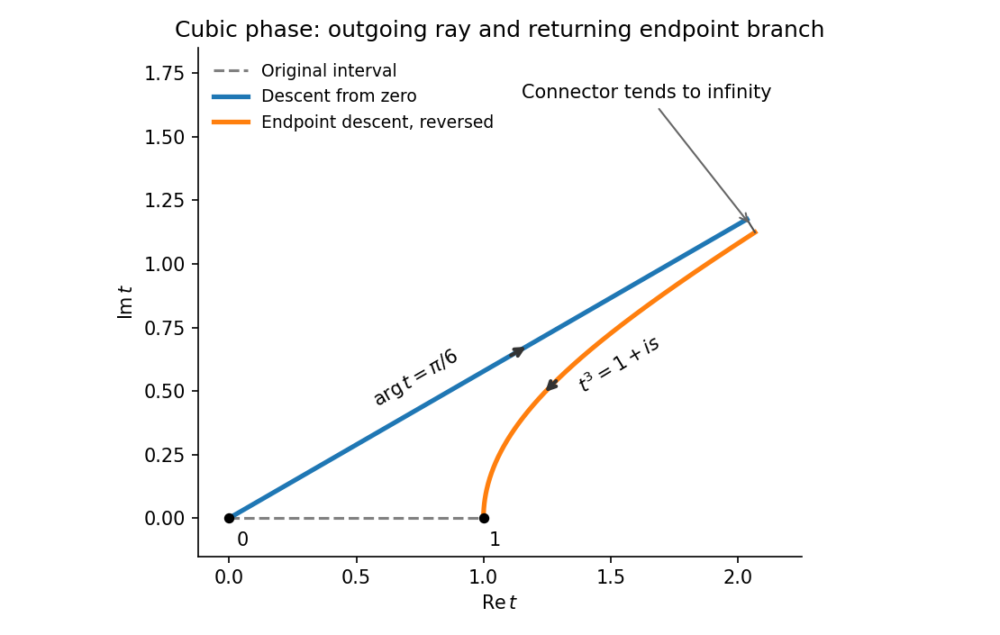

<h1 id="a/1/i/solution">Solution</h1>

↑ **Parent:** [I](../i.md)

For $x>0$, the real and imaginary parts of the exponent divided by $x$ are

$$
\operatorname{Re}(it^3)=v^3-3u^2v=-r^3\sin3\theta,\qquad
\operatorname{Im}(it^3)=u^3-3uv^2=r^3\cos3\theta.
$$

Thus [constant-phase contours](../../../../../constant-phase-contour.md) satisfy $u^3-3uv^2=c$. Through zero, $c=0$ gives the six rays $\theta=\pi/6+j\pi/3$. The three rays $\theta=\pi/6,5\pi/6,3\pi/2$ have decreasing real part of the exponent and are [steepest descent contours](../../../../../steepest-descent-contour.md); the alternating three are steepest ascent rays.

Through one, the phase is $c=1$. Its branch passing through that point can be written

$$
t=(1+is)^{1/3},\qquad s\in\mathbb R,
$$

with the cube root continuous from $t=1$. The exponent is $ix-xs$, so increasing $s$ from zero gives descent and decreasing $s$ gives ascent.

Deform the finite interval into the ray $t=e^{i\pi/6}r$, $0\leq r<\infty$, followed by the reverse of the descent branch from one. The integrand is entire, so [Cauchy's integral theorem](../../../../../cauchy-s-integral-theorem.md) permits the deformation.

**[Figure 1](#a/1/i/image-cubic-descent-deformation-with-the-endpoint-branch-traversed-back-toward-one). Cubic descent deformation with the endpoint branch traversed back toward one**.

For a precise connector at infinity, use $t=(a+iR)^{1/3}$, $0\leq a\leq1$. Its length is $O(R^{-2/3})$ and the exponential has modulus $e^{-xR}$. Its contribution is therefore $O(R^{-2/3}e^{-xR})\to0$. This avoids relying on an undifferentiated claim that every large circular arc decays.

## ↑ Ancestors (13)

1. [I](../i.md)
2. [1](../../1.md)
3. [A](../../../a.md)
4. [2009](../../../../2009-split.md)
5. [Past exam of the perturbation methods and applied complex variables course of the University of Oxford](../../../../split.md)
6. [Perturbation methods and applied complex variables course of the University of Oxford](../../../../../perturbation-methods-and-applied-complex-variables-course-of-the-university-of-oxford.md)
7. [Year 4 of the mathematics course of the University of Oxford](../../../../../year-4-of-the-mathematics-course-of-the-university-of-oxford.md)
8. [Mathematics course of the University of Oxford](../../../../../mathematics-course-of-the-university-of-oxford.md)
9. [Undergraduate course of the University of Oxford](../../../../../undergraduate-course-of-the-university-of-oxford.md)
10. [Course of the University of Oxford](../../../../../course-of-the-university-of-oxford.md)
11. [University of Oxford](../../../../../university-of-oxford-split.md)
12. [List of universities](../../../../../list-of-universities.md)
13. [Codex Wiki](../../../../../split.md)
