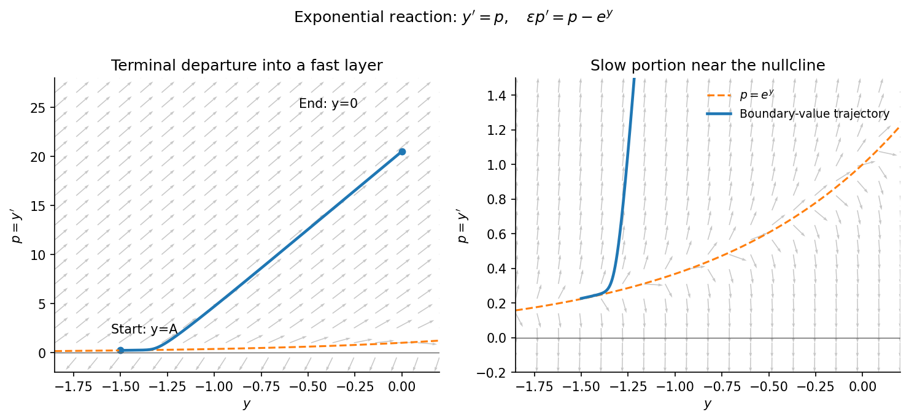

<h1 id="a/2/ii/solution">Solution</h1>

↑ **Parent:** [Ii](../ii.md)

Put $p=y'$. The [dynamical system](../../../../../dynamical-system.md) is

$$
y'=p,\qquad p'=\frac{p-e^y}{\epsilon}.
$$

The [nullclines](../../../../../nullcline.md) are $p=0$ and $p=e^y$. There are no equilibria, since they never intersect. To the right in the $(y,p)$ plane means $p>0$, and to the left means $p<0$. The arrows point upwards above $p=e^y$ and downwards below it.

Near the repelling [critical manifold](../../../../../critical-manifold.md) $p=e^y$, an orbit can move on the slow $x=O(1)$ scale, with $y'\simeq e^y$. More precisely the slow trajectory has $p=e^y+\epsilon e^{2y}+\cdots$. Away from this narrow region, $p$ changes rapidly on $x=O(\epsilon)$; an $O(1)$ change of $y$ in a fast layer has $p=O(\epsilon^{-1})$.

**[Figure 2](#a/2/ii/image-slow-motion-near-the-exponential-nullcline-and-fast-terminal-departure). Slow motion near the exponential nullcline and fast terminal departure**.

For example, take a fixed $A<-\log2$. A trajectory starting at $y=A$ can shadow the slow curve, then depart upwards so that $y$ rapidly increases to zero at the right endpoint. This gives a terminal [outflow boundary layer](../../../../../outflow-boundary-layer.md) at $x=1$, of width $O(\epsilon)$. For $-\log2<A<0$, the outer trajectory reaches a positive value near one, and the terminal adjustment is downwards: the orbit turns below the nullcline, crosses $p=0$, and returns to $y=0$. The boundary layer is still at $x=1$. These directions follow from the phase portrait and agree with the matched solution below.

## ↑ Ancestors (13)

1. [Ii](../ii.md)
2. [2](../../2.md)
3. [A](../../../a.md)
4. [2009](../../../../2009-split.md)
5. [Past exam of the perturbation methods and applied complex variables course of the University of Oxford](../../../../split.md)
6. [Perturbation methods and applied complex variables course of the University of Oxford](../../../../../perturbation-methods-and-applied-complex-variables-course-of-the-university-of-oxford.md)
7. [Year 4 of the mathematics course of the University of Oxford](../../../../../year-4-of-the-mathematics-course-of-the-university-of-oxford.md)
8. [Mathematics course of the University of Oxford](../../../../../mathematics-course-of-the-university-of-oxford.md)
9. [Undergraduate course of the University of Oxford](../../../../../undergraduate-course-of-the-university-of-oxford.md)
10. [Course of the University of Oxford](../../../../../course-of-the-university-of-oxford.md)
11. [University of Oxford](../../../../../university-of-oxford-split.md)
12. [List of universities](../../../../../list-of-universities.md)
13. [Codex Wiki](../../../../../split.md)
