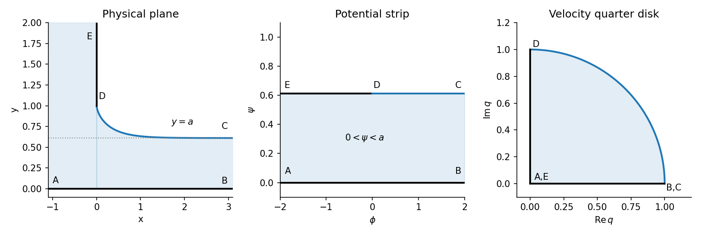

<h1 id="b/4/iv/solution">Solution</h1>

↑ **Parent:** [Iv](../iv.md)

Separate the real and imaginary parts of the derivative and integrate from $D=(0,1)$:

$$
x(\theta)=-\frac{2a}{\pi}\int_{-\pi/2}^{\theta}\cos s\cot s\,ds,\qquad
y(\theta)=1-\frac{2a}{\pi}\int_{-\pi/2}^{\theta}\sin s\cot s\,ds.
$$

Because $\cos s\cot s=\csc s-\sin s$ and $\sin s\cot s=\cos s$, these integrals are

$$
x(\theta)=-\frac{2a}{\pi}\left[\log|\tan(\theta/2)|+\cos\theta\right],\qquad
y(\theta)=1-\frac{2a}{\pi}(1+\sin\theta).
$$

As $\theta\to0^-$, $x\to+\infty$ and $y\to1-2a/\pi$. This must equal the outgoing stream depth $a$, so

$$
\boxed{a=\frac{\pi}{\pi+2}.}
$$

**[Figure 3](#b/4/iv/image-draining-free-surface-and-its-potential-strip-and-hodograph-representations). Draining free surface and its potential-strip and hodograph representations**.

The solution has a vertical tangent at $D$ and approaches the horizontal line $y=a$ downstream, agreeing with both solid-wall and free-streamline conditions.

## ↑ Ancestors (13)

1. [Iv](../iv.md)
2. [4](../../4.md)
3. [B](../../../b.md)
4. [2009](../../../../2009-split.md)
5. [Past exam of the perturbation methods and applied complex variables course of the University of Oxford](../../../../split.md)
6. [Perturbation methods and applied complex variables course of the University of Oxford](../../../../../perturbation-methods-and-applied-complex-variables-course-of-the-university-of-oxford.md)
7. [Year 4 of the mathematics course of the University of Oxford](../../../../../year-4-of-the-mathematics-course-of-the-university-of-oxford.md)
8. [Mathematics course of the University of Oxford](../../../../../mathematics-course-of-the-university-of-oxford.md)
9. [Undergraduate course of the University of Oxford](../../../../../undergraduate-course-of-the-university-of-oxford.md)
10. [Course of the University of Oxford](../../../../../course-of-the-university-of-oxford.md)
11. [University of Oxford](../../../../../university-of-oxford-split.md)
12. [List of universities](../../../../../list-of-universities.md)
13. [Codex Wiki](../../../../../split.md)
