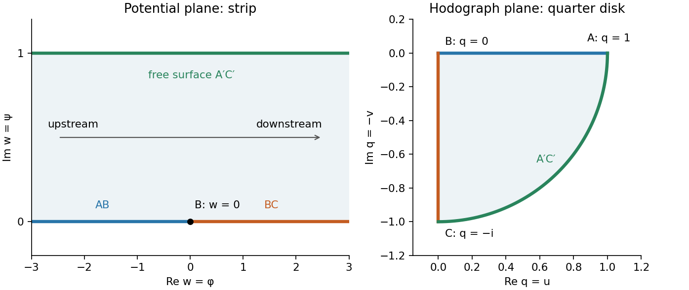
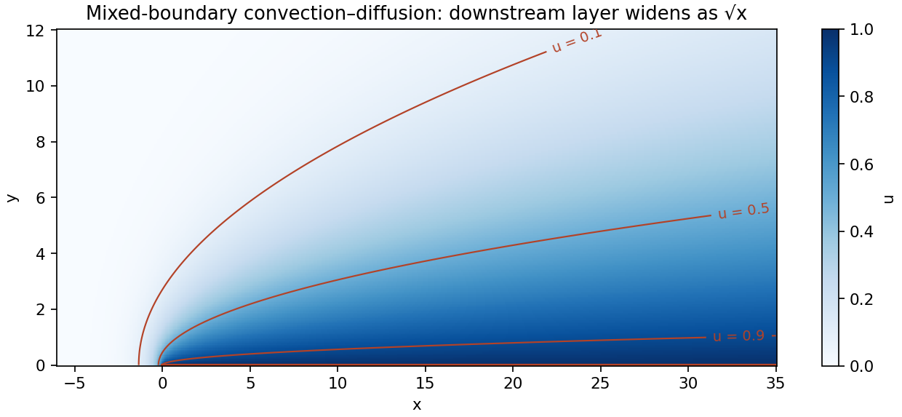

# 2010

↑ **Parent:** [Past exam of the perturbation methods and applied complex variables course of the University of Oxford](../past-exam-of-the-perturbation-methods-and-applied-complex-variables-course-of-the-university-of-oxford.md)

Source: [released examination bundle](https://www.whatdotheyknow.com/request/maths_past_papers_3), `Part C 2007 11.pdf`, pages 345–350. The complete scanned paper, including both halves, is covered. No mark allocations are printed.

**Table of contents**

- [A](#a)
  - [1](#a/1)
    - [i](#a/1/i)
      - [Solution](#a/1/i/solution)
    - [ii](#a/1/ii)
      - [Solution](#a/1/ii/solution)
    - [iii](#a/1/iii)
      - [Solution](#a/1/iii/solution)
  - [2](#a/2)
    - [i](#a/2/i)
      - [Solution](#a/2/i/solution)
    - [ii](#a/2/ii)
      - [Solution](#a/2/ii/solution)
    - [iii](#a/2/iii)
      - [Solution](#a/2/iii/solution)
    - [iv](#a/2/iv)
      - [Solution](#a/2/iv/solution)
  - [3](#a/3)
    - [i](#a/3/i)
      - [Solution](#a/3/i/solution)
    - [ii](#a/3/ii)
      - [Solution](#a/3/ii/solution)
    - [iii](#a/3/iii)
      - [Solution](#a/3/iii/solution)
- [B](#b)
  - [4](#b/4)
    - [i](#b/4/i)
      - [Solution](#b/4/i/solution)
    - [ii](#b/4/ii)
      - [Solution](#b/4/ii/solution)
    - [iii](#b/4/iii)
      - [Solution](#b/4/iii/solution)
  - [5](#b/5)
    - [i](#b/5/i)
      - [Solution](#b/5/i/solution)
    - [ii](#b/5/ii)
      - [Solution](#b/5/ii/solution)
  - [6](#b/6)
    - [i](#b/6/i)
      - [a](#b/6/i/a)
        - [Solution](#b/6/i/a/solution)
      - [b](#b/6/i/b)
        - [Solution](#b/6/i/b/solution)
    - [ii](#b/6/ii)
      - [Solution](#b/6/ii/solution)
    - [iii](#b/6/iii)
      - [Solution](#b/6/iii/solution)

## A

↑ **Parent:** [2010](2010.md)

<h3 id="a/1">1</h3>

↑ **Parent:** [A](#a)

<h4 id="a/1/i">i</h4>

↑ **Parent:** [1](#a/1)

<h5 id="a/1/i/solution">Solution</h5>

↑ **Parent:** [I](#a/1/i)

Put $\delta=\sqrt\epsilon$ and write the outer [asymptotic expansion](../asymptotic-expansion.md) as $y_0+\delta y_{1/2}+\delta^2y_1+\cdots$. Equating powers in the [differential equation](../differential-equation.md) gives

$$
y_0'-xy_0=0,\qquad y_{1/2}'-xy_{1/2}=0,\qquad y_1'-xy_1=y_0^{(3)}.
$$

The first two equations give $y_0=Ae^{x^2/2}$ and $y_{1/2}=Be^{x^2/2}$. Since $y_0^{(3)}=A(x^3+3x)e^{x^2/2}$, an [integrating factor](../linear-ordinary-differential-equation.md#integrating-factor) yields

$$
\boxed{y_0=Ae^{x^2/2},\quad y_{1/2}=Be^{x^2/2},\quad
 y_1=e^{x^2/2}\left[C+A\left(\frac{x^4}4+\frac{3x^2}2\right)\right].}
$$

Here $A,B,C$ are matching constants; boundary conditions have not yet been imposed.

<h4 id="a/1/ii">ii</h4>

↑ **Parent:** [1](#a/1)

<h5 id="a/1/ii/solution">Solution</h5>

↑ **Parent:** [Ii](#a/1/ii)

In a layer of thickness $\ell\ll1$, the third-[derivative](../calculus.md#derivative) and first-[derivative](../calculus.md#derivative) terms have sizes $\epsilon\ell^{-3}y$ and $\ell^{-1}y$. Their [dominant balance](../asymptotic-expansion.md#dominant-balance) requires $\ell^2\sim\epsilon$, so

$$
\boxed{\ell=O(\sqrt\epsilon).}
$$

The local fast modes are exponentials with rates $\pm1/\sqrt\epsilon$. A mode decaying into the interval can occur at either endpoint: $e^{-x/\sqrt\epsilon}$ at zero and $e^{-(1-x)/\sqrt\epsilon}$ at one. The zero fast exponent represents the matching outer component. The term $xy$ is lower order on either fast scale, and even smaller near zero; it creates no further independent layer thickness.

<h4 id="a/1/iii">iii</h4>

↑ **Parent:** [1](#a/1)

<h5 id="a/1/iii/solution">Solution</h5>

↑ **Parent:** [Iii](#a/1/iii)

For the left inner coordinate $X=x/\delta$, the equation becomes $Y_{XXX}-Y_X+\delta^2XY=0$. At leading order the solution that matches a bounded outer expansion is $Y_0=A+De^{-X}$; the growing exponential is excluded. The boundary value gives $A+D=1$. Since $y'(0)=1$ is finite, the possible $O(\delta^{-1})$ [derivative](../calculus.md#derivative) must vanish, so $D=0$ and $A=1$.

At the next order, $Y_{1/2}=B+Ee^{-X}$. Its boundary value is zero, giving $E=-B$, while its physical [derivative](../calculus.md#derivative) at zero is $-E=1$. Hence $B=1$, and the left inner expansion is $1+\delta(1-e^{-X})+O(\delta^2)$.

At the right endpoint put $\xi=(1-x)/\delta$. The equation is $Y_{\xi\xi\xi}-Y_\xi=\delta(1-\delta\xi)Y$. Matching the outer expansion at one and imposing $Y(0)=1$ give

$$
Y_0=\sqrt e+(1-\sqrt e)e^{-\xi}.
$$

At the next order, $Y_{1/2}^{(3)}-Y_{1/2}'=Y_0$. The solution with no growing exponential, the correct matching polynomial, and $Y_{1/2}(0)=0$ is

$$
Y_{1/2}=\sqrt e(1-\xi)+
\left[\frac{1-\sqrt e}{2}\xi-\sqrt e\right]e^{-\xi}.
$$

Indeed the operator $D^3-D$ sends $-\sqrt e\,\xi$ to $\sqrt e$ and sends $\xi e^{-\xi}$ to $2e^{-\xi}$.

Add the two decaying inner corrections to the [outer solution](../singular-perturbation.md#outer-expansion), subtracting their common matching parts. Since $\delta\xi=1-x$, the [composite asymptotic expansion](../singular-perturbation.md#additive-composite-expansion) is

$$
\boxed{\begin{aligned}
y_c(x)={}&e^{x^2/2}(1+\delta)-\delta e^{-x/\delta}\\
&+e^{-(1-x)/\delta}\left[(\sqrt e-1)\left(\frac x2-\frac32\right)-\delta\sqrt e\right].
\end{aligned}}
$$

It reproduces all three boundary conditions to the retained algebraic orders, with exponentially small interactions between endpoints. The right endpoint has an $O(1)$ [boundary layer](../continuum-mechanics.md#boundary-layer) in $y$. The left correction has only [amplitude](../wave.md#wave-amplitude) $O(\sqrt\epsilon)$ in $y$, but its [derivative](../calculus.md#derivative) is $O(1)$ and is necessary for the [derivative](../calculus.md#derivative) [boundary condition](../differential-equation.md#boundary-condition). Thus the left layer is a [weak derivative boundary layer](../continuum-mechanics.md#weak-derivative-boundary-layer); if “genuine” refers specifically to an order-one change in the function itself, only the right layer is genuine in that sense. Both nonzero corrections belong in the expansion through $O(\sqrt\epsilon)$.

<h3 id="a/2">2</h3>

↑ **Parent:** [A](#a)

<h4 id="a/2/i">i</h4>

↑ **Parent:** [2](#a/2)

<h5 id="a/2/i/solution">Solution</h5>

↑ **Parent:** [I](#a/2/i)

For an [asymptotic sequence](../asymptotic-expansion.md#asymptotic-sequence) $a_{n+1}(\epsilon)=o(a_n(\epsilon))$, the [asymptotic expansion](../asymptotic-expansion.md) condition is that every fixed truncation has remainder smaller than its last retained term:

$$
\boxed{f(\epsilon)-\sum_{n=0}^Na_n(\epsilon)=o(a_N(\epsilon))\quad\text{for every fixed }N.}
$$

This limit is taken as $\epsilon\to0$ in the specified direction or sector. The number $N$ stays fixed while taking that limit. The infinite series need not converge for any nonzero parameter.

<h4 id="a/2/ii">ii</h4>

↑ **Parent:** [2](#a/2)

<h5 id="a/2/ii/solution">Solution</h5>

↑ **Parent:** [Ii](#a/2/ii)

Let $g_x(t)=(1+xt)^{-1}$. Repeated [integration by parts](../calculus.md#integration-by-parts) using the factor $e^{-t}$ gives

$$
I(x)=\sum_{n=0}^Ng_x^{(n)}(0)+\int_0^\infty e^{-t}g_x^{(N+1)}(t)dt.
$$

Boundary terms at infinity vanish, and $g_x^{(n)}(t)=(-1)^nn!x^n(1+xt)^{-n-1}$. Therefore

$$
I(x)=\sum_{n=0}^N(-1)^nn!x^n+R_N(x),\qquad
|R_N(x)|\leq(N+1)!x^{N+1}\quad(x>0).
$$

For every fixed $N$, this is $o(x^N)$ as $x\downarrow0$, proving

$$
\boxed{I(x)\sim\sum_{n\geq0}(-1)^nn!x^n.}
$$

For each fixed $x>0$ the displayed infinite series diverges, since successive term magnitudes have ratio $(n+1)x\to\infty$. Its usefulness is precisely that of an [asymptotic expansion](../asymptotic-expansion.md), not a convergent power series.

<h4 id="a/2/iii">iii</h4>

↑ **Parent:** [2](#a/2)

<h5 id="a/2/iii/solution">Solution</h5>

↑ **Parent:** [Iii](#a/2/iii)

Fix $0<\epsilon<\pi/2$. On $[\epsilon,\pi/2]$, $\sin^2t\geq\sin^2\epsilon>0$, so that part of the integral is bounded by $(\pi/2)e^{-x\sin^2\epsilon}$, exponentially smaller than $x^{-1/2}$.

By the assumed local equivalence, the remaining part is asymptotic to $\int_0^\epsilon e^{-xt^2}dt$. Substitute $s=\sqrt x\,t$:

$$
\int_0^\epsilon e^{-xt^2}dt=x^{-1/2}\int_0^{\epsilon\sqrt x}e^{-s^2}ds
\sim\frac{\sqrt\pi}{2\sqrt x}.
$$

The last step uses the [Gaussian integral](../integral.md#gaussian-integral) and monotone convergence of the upper limit to infinity. Hence

$$
\boxed{\int_0^{\pi/2}e^{-x\sin^2t}dt\sim\tfrac12\sqrt{\pi/x}.}
$$

<h4 id="a/2/iv">iv</h4>

↑ **Parent:** [2](#a/2)

<h5 id="a/2/iv/solution">Solution</h5>

↑ **Parent:** [Iv](#a/2/iv)

A fixed small-angle approximation alone is insufficient because its error is multiplied by $x$. Introduce the shrinking cutoff $\eta=x^{-1/3}$, which satisfies $\eta\ll\epsilon$ but $\sqrt x\,\eta\to\infty$.

On $[0,\eta]$, the [Taylor expansion](../calculus.md#taylor-expansion) $\sin^2t=t^2+O(t^4)$ gives $x(\sin^2t-t^2)=O(x\eta^4)=O(x^{-1/3})$ uniformly. Thus

$$
e^{-x\sin^2t}=e^{-xt^2}[1+O(x^{-1/3})]
$$

uniformly there, and the two central integrals are asymptotically equal. On $[\eta,\epsilon]$, choose a fixed $c>0$ with $\sin t\geq ct$ for $0\leq t\leq\epsilon$. The [sine](../geometry-and-topology.md#sine)-integral tail is at most $\epsilon e^{-c^2x\eta^2}=\epsilon e^{-c^2x^{1/3}}$; the Gaussian tail has the same exponential bound with $c=1$. Both are $o(x^{-1/2})$, while the central [Gaussian integral](../integral.md#gaussian-integral) is asymptotic to $\sqrt\pi/(2\sqrt x)$. Hence

$$
\boxed{\int_0^\epsilon e^{-x\sin^2t}dt\sim\int_0^\epsilon e^{-xt^2}dt.}
$$

This justifies the localized [Laplace method](../asymptotic-expansion.md#laplace-s-method) rather than interchanging a nonuniform approximation with integration.

<h3 id="a/3">3</h3>

↑ **Parent:** [A](#a)

<h4 id="a/3/i">i</h4>

↑ **Parent:** [3](#a/3)

<h5 id="a/3/i/solution">Solution</h5>

↑ **Parent:** [I](#a/3/i)

Matching powers of $\epsilon$ gives $u_0''+u_0=0$, $u_1''+u_1=u_0^2$, and $u_2''+u_2=2u_0u_1$, with $u_0(0)=2$ and homogeneous initial data for every higher correction. Thus

$$
u_0=2\cos t,\qquad u_1=2-\tfrac43\cos t-\tfrac23\cos2t.
$$

There is no resonant fundamental forcing at first order. At second order,

$$
2u_0u_1=\tfrac{20}3\cos t-\tfrac83-\tfrac83\cos2t-\tfrac43\cos3t.
$$

The first term resonates with the homogeneous oscillator. Solving with the initial data gives

$$
u_2=\tfrac{10}3t\sin t-\tfrac83+\tfrac{29}{18}\cos t+\tfrac89\cos2t+\tfrac16\cos3t.
$$

Consequently the regular perturbation approximation is $u=u_0+\epsilon u_1+\epsilon^2u_2+O(\epsilon^3)$ for fixed $t$. **The first [secular term](../singular-perturbation.md#secular-term) is $(10/3)\epsilon^2t\sin t$, at order $\epsilon^2$**. It makes the regular expansion nonuniform on times of order $\epsilon^{-2}$.

<h4 id="a/3/ii">ii</h4>

↑ **Parent:** [3](#a/3)

<h5 id="a/3/ii/solution">Solution</h5>

↑ **Parent:** [Ii](#a/3/ii)

Use the fast time $T_0=t$ and slow time $T=\epsilon^2t$. A possible intermediate scale $\epsilon t$ has no leading modulation: the absence of first-order [resonance](../dynamical-systems.md#resonance) imposes independence of that scale. Write

$$
U_0=A(T)e^{iT_0}+\overline A(T)e^{-iT_0}.
$$

At first order choose the nonresonant particular solution

$$
U_1=2|A|^2-\tfrac13A^2e^{2iT_0}-\tfrac13\overline A^{,2}e^{-2iT_0},
$$

with any needed fundamental homogeneous correction assigned consistently when matching the initial data. At second order,

$$
(D_0^2+1)U_2=2U_0U_1-2D_0D_TU_0.
$$

The coefficient of $e^{iT_0}$ on the right is $(10/3)|A|^2A-2iA_T$. A bounded oscillatory correction requires this [resonance](../dynamical-systems.md#resonance) coefficient, and its conjugate, to vanish. The [quadratic oscillator phase-modulation condition](../singular-perturbation.md#quadratic-oscillator-phase-modulation-condition) is therefore

$$
\boxed{A_T=-\frac{5i}{3}|A|^2A.}
$$

It resums the secular phase accumulation into a slow modulation instead of leaving it as a growing term in the correction.

<h4 id="a/3/iii">iii</h4>

↑ **Parent:** [3](#a/3)

<h5 id="a/3/iii/solution">Solution</h5>

↑ **Parent:** [Iii](#a/3/iii)

Write $A=a e^{i\phi}$. The modulation equation gives $a_T=0$ and $\phi_T=-5a^2/3$. Matching the leading initial conditions gives $a=1$, $\phi(0)=0$. Therefore

$$
\boxed{U_0=2\cos(T_0-5T/3),\qquad
u(t)\sim2\cos\bigl[(1-5\epsilon^2/3)t\bigr].}
$$

The leading [amplitude](../wave.md#wave-amplitude) remains two and has no slow growth or decay. The [frequency](../wave.md#frequency) changes from one to $1-5\epsilon^2/3+O(\epsilon^3)$; expanding this shifted [cosine](../geometry-and-topology.md#cosine) recovers the second-order [secular term](../singular-perturbation.md#secular-term) from part (i).

There are bounded first-order waveform changes as well. If they are retained while matching $u(0)=2$, one may write $2\cos\tau+\epsilon[2-(4/3)\cos\tau-(2/3)\cos2\tau]+\cdots$, where $\tau=(1-5\epsilon^2/3)t$. Thus the first harmonic's coefficient is $2-4\epsilon/3$, with a mean shift and a second harmonic. These bounded shape corrections are distinct from the constant leading [amplitude](../wave.md#wave-amplitude) in the zeroth-order multiple-scales solution.

## B

↑ **Parent:** [2010](2010.md)

<h3 id="b/4">4</h3>

↑ **Parent:** [B](#b)

<h4 id="b/4/i">i</h4>

↑ **Parent:** [4](#b/4)

<h5 id="b/4/i/solution">Solution</h5>

↑ **Parent:** [I](#b/4/i)

At a vertex with exterior turning angle $\beta_j\pi$, the interior angle is $(1-\beta_j)\pi$. A local [conformal map](../geometry-and-topology.md#conformal-map) from a half-plane therefore behaves as $f(Z)-z_j\sim c_j(Z-X_j)^{1-\beta_j}$, so its [derivative](../calculus.md#derivative) has local exponent $-\beta_j$.

On each real boundary interval between prevertices, $\arg f'$ is constant because the image is a straight side. Across a prevertex its change is the exterior turning angle. Taking $\arg(Z-X_j)\in(0,\pi)$, the product $\prod_j(Z-X_j)^{-\beta_j}$ has exactly these changes. Dividing $f'$ by that product removes the corner singularities and leaves a holomorphic nonzero function with constant boundary argument. Schwarz reflection and the regular behavior at infinity make it constant. This gives the [Schwarz-Christoffel formula](../geometry-and-topology.md#schwarz-christoffel-mapping)

$$
\boxed{f'(Z)=C\prod_{j=1}^n(Z-X_j)^{-\beta_j}.}
$$

There are **three freely normalizable real prevertices**, because an automorphism of the [upper half-plane](../complex-analysis.md#upper-half-plane-complex-analysis) has three real parameters. After those are fixed, the remaining $n-3$ prevertex parameters are determined by the polygon's shape through the side-length conditions. They are not further independent normalization choices.

If the last prevertex is at infinity, absorb its constant scale into $C$ and omit its finite factor:

$$
\boxed{f'(Z)=C\prod_{j=1}^{n-1}(Z-X_j)^{-\beta_j}.}
$$

For a bounded polygon, $\sum_j\beta_j=2$, so this [derivative](../calculus.md#derivative) behaves like $Z^{\beta_n-2}$, consistent with the corner described in the local coordinate $1/Z$.

<h4 id="b/4/ii">ii</h4>

↑ **Parent:** [4](#b/4)

<h5 id="b/4/ii/solution">Solution</h5>

↑ **Parent:** [Ii](#b/4/ii)

Use the branch of $\sqrt{1-Z^2}$ that is positive for $Z=iY$, $Y>0$. The [right-half-plane slit map](../geometry-and-topology.md#right-half-plane-slit-map)

$$
\boxed{f(Z)=(1-Z^2)^{-1/2}}
$$

is holomorphic in the [upper half-plane](../complex-analysis.md#upper-half-plane-complex-analysis), with [derivative](../calculus.md#derivative) $Z(1-Z^2)^{-3/2}$, the required [Schwarz-Christoffel formula](../geometry-and-topology.md#schwarz-christoffel-mapping) form. Its [derivative](../calculus.md#derivative) has no interior zero.

To verify the image and global injectivity, factor the construction. Squaring maps the [upper half-plane](../complex-analysis.md#upper-half-plane-complex-analysis) bijectively onto $\mathbb C\setminus[0,\infty)$. Thus $1-Z^2$ ranges over $\mathbb C\setminus(-\infty,1]$. The positive-real-part square root maps this onto the [right half-plane](../complex-analysis.md#right-half-plane) with the interval $(0,1]$ removed; reciprocation maps it onto the [right half-plane](../complex-analysis.md#right-half-plane) slit along $[1,\infty)$. This also identifies the slit tip as a boundary point; the strict inequality in the printed slit description must be understood with that boundary convention.

Approaching the real axis from above gives

$$
\begin{array}{c|cccc}
Z&(-\infty,-1)&(-1,0)&(0,1)&(1,\infty)\\\hline
f(Z)&\text{negative imaginary axis}&\text{lower slit bank}&\text{upper slit bank}&\text{positive imaginary axis}.
\end{array}
$$

In particular $Z=-1$ maps to the lower infinite prime end $A$, $Z=0$ to the tip $B=1$, and $Z=1$ to the upper infinite prime end $C$. The real-axis point at infinity maps to zero on the vertical wall.

<h4 id="b/4/iii">iii</h4>

↑ **Parent:** [4](#b/4)

<h5 id="b/4/iii/solution">Solution</h5>

↑ **Parent:** [Iii](#b/4/iii)

Let $g=f^{-1}$, so $g(z)=\sqrt{1-z^{-2}}$, choosing the analytic branch with $\operatorname{Im}g>0$; for example $g(1/2)=i\sqrt3$. Let $\zeta\in\Omega$ be the source point. For the convention $-\Delta G=\delta_\zeta$, the [Dirichlet Green function](../green-s-function.md#dirichlet-green-function) in the [upper half-plane](../complex-analysis.md#upper-half-plane-complex-analysis) is obtained by an opposite-sign reflected source:

$$
G_H(Z,W)=\frac1{2\pi}\log\left|\frac{Z-\overline W}{Z-W}\right|.
$$

It vanishes for real $Z$, has the [logarithmic singularity](../analysis.md#logarithmic-singularity) $-(2\pi)^{-1}\log|Z-W|$, and is harmonic elsewhere. Conformal invariance of two-dimensional harmonic functions now gives

$$
\boxed{G_\Omega(z,\zeta)=\frac1{2\pi}\log\left|
\frac{g(z)-\overline{g(\zeta)}}{g(z)-g(\zeta)}\right|.}
$$

The branch specified above maps every boundary bank to the real axis, so the Green function vanishes on both slit banks and the vertical wall. Local conformality preserves the coefficient of the [logarithmic singularity](../analysis.md#logarithmic-singularity). If the convention is instead $\Delta G=\delta_\zeta$, negate this expression.

<h3 id="b/5">5</h3>

↑ **Parent:** [B](#b)

<h4 id="b/5/i">i</h4>

↑ **Parent:** [5](#b/5)

<h5 id="b/5/i/solution">Solution</h5>

↑ **Parent:** [I](#b/5/i)

Orient the smooth contour so the plus side is to its left. Assume the density is Hölder continuous near the observation point and the integrals converge at any other endpoints. The [Cauchy principal value](../complex-analysis.md#cauchy-principal-value) is

$$
\operatorname{PV}\int_\Gamma\frac{f(\zeta)}{\zeta-t}d\zeta
=\lim_{\eta\downarrow0}\int_{\Gamma\setminus B_\eta(t)}\frac{f(\zeta)}{\zeta-t}d\zeta.
$$

Subtract $f(t)$ from the numerator. The resulting quotient is locally integrable, so its limits from the two sides coincide. For the remaining constant density, straightening the contour gives a half-circle contribution $\pm i\pi f(t)$. Division by $2\pi i$ yields the [Sokhotski–Plemelj formula](../holomorphic-function.md#sokhotski-plemelj-theorem)

$$
\boxed{w_\pm(t)=\pm\tfrac12f(t)+\frac1{2\pi i}\operatorname{PV}\int_\Gamma\frac{f(\zeta)}{\zeta-t}d\zeta.}
$$

For the requested real integral assume $0<\alpha<1$ and $-1<x<1$, ensuring integrable endpoints and an interior principal-value [pole](../isolated-singularity.md#pole). Put $W(t)=(1-t)^{\alpha-1}/(1+t)^\alpha$. Choose $w(z)=(z-1)^{\alpha-1}/(z+1)^\alpha$ analytic off $[-1,1]$, positive for $z>1$, and $w(z)\sim1/z$ at infinity. Its two boundary values are $w_\pm(t)=-e^{\pm i\pi\alpha}W(t)$.

The jump is $-2i\sin(\pi\alpha)W(t)$. The Cauchy representation for this decaying analytic function is therefore $w(z)=-\sin(\pi\alpha)\int_{-1}^1W(t)/(t-z)dt\,/\pi$. Taking the mean of its two boundary values removes the half-[residue](../analysis.md#residue) terms and gives

$$
\boxed{\operatorname{PV}\int_{-1}^1\frac{(1-t)^{\alpha-1}}{(1+t)^\alpha(t-x)}dt
=\pi\cot(\pi\alpha)\frac{(1-x)^{\alpha-1}}{(1+x)^\alpha}.}
$$

<h4 id="b/5/ii">ii</h4>

↑ **Parent:** [5](#b/5)

<h5 id="b/5/ii/solution">Solution</h5>

↑ **Parent:** [Ii](#b/5/ii)

The [complex potential of a two-dimensional potential flow](../fluid-mechanics.md#complex-potential-of-a-two-dimensional-potential-flow) maps the fluid region to the strip $0<\operatorname{Im}w<1$. Its lower boundary is the wall, with $B$ at $w=0$; upstream is $\operatorname{Re}w\to-\infty$ and downstream is $\operatorname{Re}w\to+\infty$. The free streamline is the upper strip boundary.

Write $q=w'=u-iv$. The horizontal wall gives positive real velocities running from $q=1$ to the stagnation value $q=0$ at $B$. The vertical wall gives negative imaginary velocities from zero to $-i$. On the [free surface](../fluid-mechanics.md#free-surface) $|q|=1$, with the angle turning continuously from zero to $-\pi/2$. Thus the [hodograph plane](../fluid-mechanics.md#hodograph-plane) domain is the fourth-quadrant quarter of the [unit disk](../euclidean-geometry.md#unit-disk), bounded by those two radii and the unit-circle arc.

The following successive conformal maps straighten it. First $r=q^2$ maps to the lower half [unit disk](../euclidean-geometry.md#unit-disk). Next $s=(r-1)/(r+1)$ maps to the third quadrant, since $\operatorname{Re}s=(|r|^2-1)/|r+1|^2<0$ and $\operatorname{Im}s=2\operatorname{Im}r/|r+1|^2<0$. Finally $s^2$ maps onto the [upper half-plane](../complex-analysis.md#upper-half-plane-complex-analysis). The three wall landmarks $q=1,0,-i$ go to $0,1,\infty$ respectively.

The strip map $e^{\pi w}$ also maps onto the [upper half-plane](../complex-analysis.md#upper-half-plane-complex-analysis), with these same landmarks $0,1,\infty$. The unique half-plane automorphism fixing all three is the identity. Therefore

$$
\boxed{e^{\pi w}=\left(\frac{q^2-1}{q^2+1}\right)^2,\qquad q=w'.}
$$

The [free surface](../fluid-mechanics.md#free-surface) maps to the negative real axis in either construction, as required by its [streamfunction](../fluid-mechanics.md#stream-function) value one. This completes the [right-angle free-streamline hodograph map](../fluid-mechanics.md#right-angle-free-streamline-hodograph-map) construction.

**[Figure 1](#b/5/ii/image-the-potential-strip-and-quarter-disk-velocity-hodograph-for-right-angle-free-streamline-flow). The potential strip and quarter-disk velocity hodograph for right-angle free-streamline flow**.

<h3 id="b/6">6</h3>

↑ **Parent:** [B](#b)

<h4 id="b/6/i">i</h4>

↑ **Parent:** [6](#b/6)

<h5 id="b/6/i/a">a</h5>

↑ **Parent:** [I](#b/6/i)

<h6 id="b/6/i/a/solution">Solution</h6>

↑ **Parent:** [A](#b/6/i/a)

Glue the two analytic functions on their overlap, where their values agree. Since $\alpha<\beta$, the two half-planes cover the whole complex plane. The gluing therefore defines an [entire function](../holomorphic-function.md#entire-function). It is bounded outside a sufficiently large disk by the two given infinity bounds, and bounded on the remaining compact disk by continuity. The [Liouville theorem](../complex-analysis.md#liouville-theorem) then gives **one common constant**.

<h5 id="b/6/i/b">b</h5>

↑ **Parent:** [I](#b/6/i)

<h6 id="b/6/i/b/solution">Solution</h6>

↑ **Parent:** [B](#b/6/i/b)

For the standard canonical [Wiener-Hopf factorization](../boundary-value-problem.md#wiener-hopf-factorization), first assume the nonzero kernel has [Index of a Wiener-Hopf kernel](../boundary-value-problem.md#index-of-a-wiener-hopf-kernel) zero and a continuous analytic logarithm $\ell=\log F$ tending to zero at both ends of the strip, with sufficient decay for the Cauchy projections. Choose $\alpha<a<b<\beta$. Let $\Gamma_+$ be the line $\operatorname{Im}\zeta=a$ oriented left to right, with its factor used above that line; let $\Gamma_-$ be the line $\operatorname{Im}\zeta=b$ oriented left to right, with its factor used below that line.

For $a<\operatorname{Im}z<b$, closing the rectangle between the two lines and using the [Cauchy integral formula](../analysis.md#cauchy-integral-formula) gives

$$
\log F_+(z)-\log F_-(z)
=\frac1{2\pi i}\left(\int_{\Gamma_+}-\int_{\Gamma_-}\right)\frac{\ell(\zeta)}{\zeta-z}d\zeta
=\ell(z).
$$

Thus $F=F_+/F_-$. Multiplying $Fw_+=w_-$ gives $F_+w_+=F_-w_-$ in the overlap. The canonical factors are analytic, nonzero, and normalized at infinity in their respective half-planes, so part (a) yields

$$
\boxed{F_+w_+=F_-w_-=\text{constant}.}
$$

Contours may be shifted within the strip without changing their factors on the appropriate side. When necessary, a subtracted Cauchy kernel fixes convergence and the common normalization constant.

The printed hypotheses omit the index and factor-growth qualifications; $F\to1$ alone does not ensure them. An explicit counterexample is $F(z)=(z+i)/(z-i)$ on $-1/2<\operatorname{Im}z<1/2$, with $w_+=(z-i)/(z+i)$ and $w_-=1$. Both $w$ functions are analytic and bounded at infinity in their prescribed half-planes, and the relation holds. If admissible analytic factors made their common product a nonzero constant, $w_-=1$ would force $F_-$ constant and hence $F_+$ proportional to $F$, impossible because $F$ has a [pole](../isolated-singularity.md#pole) at $i$ in the plus half-plane. The natural factors $F_+=z+i$, $F_-=z-i$ instead give the nonconstant common polynomial $z-i$. Thus the boxed constant conclusion is the intended index-zero result, not a consequence of the literal assumptions alone.

<h4 id="b/6/ii">ii</h4>

↑ **Parent:** [6](#b/6)

<h5 id="b/6/ii/solution">Solution</h5>

↑ **Parent:** [Ii](#b/6/ii)

Let $k=s+i\eta$. On the negative half-line, the integrand magnitude is bounded at infinity by a constant times $e^{(\alpha-\eta)x}$, which is integrable as $x\to-\infty$ when $\eta<\alpha$. On the positive half-line the corresponding bound is $e^{(\beta-\eta)x}$, integrable when $\eta>\beta$. Thus

$$
\boxed{\overline f\text{ is analytic for }\operatorname{Im}k<\alpha,\qquad
\overline g\text{ is analytic for }\operatorname{Im}k>\beta.}
$$

On compact subsets strictly inside these half-planes, the same exponential domination absorbs every power of $|x|$. Differentiation under the integral is therefore valid and proves holomorphy, rather than only absolute convergence. The bars here denote the printed one-sided Fourier transforms, not complex conjugation.

<h4 id="b/6/iii">iii</h4>

↑ **Parent:** [6](#b/6)

<h5 id="b/6/iii/solution">Solution</h5>

↑ **Parent:** [Iii](#b/6/iii)

Use the Fourier convention $\widehat u(k,y)=\int_{\mathbb R}u(x,y)e^{ikx}dx$. Transforming the [differential equation](../differential-equation.md) gives

$$
\widehat u_{yy}-(k^2-ik)\widehat u=0.
$$

Define $k_+(k)=\sqrt k$ analytic above the downward cut from zero, and $k_-(k)=\sqrt{k-i}$ analytic below the upward cut from $i$. More explicitly take $\arg k\in(-\pi/2,3\pi/2)$ and $\arg(k-i)\in(-3\pi/2,\pi/2)$. In the strip $0<\operatorname{Im}k<1$, put $q=k_+k_-$. Then $q^2=k^2-ik$ and $\operatorname{Re}q>0$; at $k=i/2$, $q=1/2$, fixing the choice throughout the strip. The decaying $y$ mode is $e^{-qy}$.

The positive-half-line boundary value has transform $\int_0^\infty e^{ikx}dx=i/k$ for $\operatorname{Im}k>0$. Thus $\widehat u(k,0)=\overline f+i/k$ and $\widehat u_y(k,0)=\overline g$. The transformed boundary relation is

$$
\overline g=-k_+k_-(\overline f+i/k).
$$

Let $c=k_-(0)=e^{-i\pi/4}$. Splitting off the [pole](../isolated-singularity.md#pole) at zero gives

$$
k_-\overline f+i\frac{k_--c}{k}
=-\frac{\overline g}{k_+}-\frac{ic}{k}.
$$

The left side is analytic in the lower domain up to $\operatorname{Im}k<1$: its apparent [pole](../isolated-singularity.md#pole) at zero is removable. The right side is analytic for $\operatorname{Im}k>0$. By the supplied boundedness of $k\overline f$ and $\overline g$, both sides tend to zero at infinity in their half-planes. The gluing and [Liouville theorem](../complex-analysis.md#liouville-theorem) argument therefore makes their common value zero. Consequently

$$
\overline g=-\frac{ic}{\sqrt k},\qquad
\overline f=\frac{i(c-k_-)}{kk_-},\qquad
\widehat u(k,0)=\frac{ic}{k\sqrt{k-i}}.
$$

Choose the inversion contour $\Gamma=\{s+i\eta:s\in\mathbb R\}$ oriented left to right, with any fixed $0<\eta<1$. It passes above the [pole](../isolated-singularity.md#pole) at zero and below the [branch point](../complex-analysis.md#branch-point) at $i$. [Fourier inversion](../fourier-analysis.md#fourier-inversion-theorem) gives exactly

$$
\boxed{u(x,y)=\frac1{2\pi}\int_\Gamma
\frac{i e^{-i\pi/4}}{k\sqrt{k-i}}\,e^{-\sqrt{k^2-ik}\,y}e^{-ikx}dk.}
$$

Thus the appropriate value is **$\sqrt{-i}=e^{-i\pi/4}$**. The other proposed value reverses the [residue](../analysis.md#residue) of the boundary step and violates its prescribed positive value.

There is also a far-field qualification in the source. The formula is the intended bounded mixed-boundary solution, but it does not tend to zero along every path to infinity. This can be checked explicitly: in parabolic coordinates $x=a^2-b^2$, $y=2ab$, with $a,b>0$, the [mixed-boundary convection-diffusion solution in parabolic coordinates](../diffusion-equation.md#mixed-boundary-convection-diffusion-solution-in-parabolic-coordinates) is

$$
u(x,y)=\operatorname{erfc}b,\qquad
b=\sqrt{\frac{\sqrt{x^2+y^2}-x}{2}}.
$$

Indeed $\Delta u=u_{bb}/[4(a^2+b^2)]$ and $u_x=-b u_b/[2(a^2+b^2)]$; the identity $u_{bb}=-2b u_b$ proves the [differential equation](../differential-equation.md). At $b=0$ the boundary value is one, and at $a=0$ its normal [derivative](../calculus.md#derivative) is zero. Its traces are $f(x)=\operatorname{erfc}\sqrt{-x}$ for $x<0$ and $g(x)=-1/\sqrt{\pi x}$ for $x>0$, whose one-sided transforms are the expressions derived above.

At a fixed angle away from the positive $x$ axis, $b\to\infty$ and $u\to0$. But at fixed $y>0$ and $x\to+\infty$, $b\sim y/(2\sqrt x)$ and $u\to1$. Hence **the radial decay statement cannot hold uniformly as printed**; the intended decay is away from the downstream [boundary layer](../continuum-mechanics.md#boundary-layer). The exact expression also identifies its thickness as $O(\sqrt x)$.

**[Figure 2](#b/6/iii/image-the-exact-mixed-boundary-solution-decays-away-from-the-downstream-boundary-layer). The exact mixed-boundary solution decays away from the downstream boundary layer**.

## ↑ Ancestors (9)

1. [Past exam of the perturbation methods and applied complex variables course of the University of Oxford](../past-exam-of-the-perturbation-methods-and-applied-complex-variables-course-of-the-university-of-oxford.md)
2. [Perturbation methods and applied complex variables course of the University of Oxford](../university-of-oxford.md#perturbation-methods-and-applied-complex-variables-course-of-the-university-of-oxford)
3. [Year 4 of the mathematics course of the University of Oxford](../university-of-oxford.md#year-4-of-the-mathematics-course-of-the-university-of-oxford)
4. [Mathematics course of the University of Oxford](../university-of-oxford.md#mathematics-course-of-the-university-of-oxford)
5. [Undergraduate course of the University of Oxford](../university-of-oxford.md#undergraduate-course-of-the-university-of-oxford)
6. [Course of the University of Oxford](../university-of-oxford.md#course-of-the-university-of-oxford)
7. [University of Oxford](../university-of-oxford.md)
8. [List of universities](../README.md#list-of-universities)
9. [Codex Wiki](../README.md)
