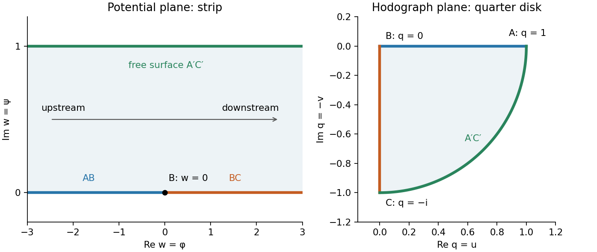

<h1 id="b/5/ii/solution">Solution</h1>

↑ **Parent:** [Ii](../ii.md)

The [complex potential of a two-dimensional potential flow](../../../../../complex-potential-of-a-two-dimensional-potential-flow.md) maps the fluid region to the strip $0<\operatorname{Im}w<1$. Its lower boundary is the wall, with $B$ at $w=0$; upstream is $\operatorname{Re}w\to-\infty$ and downstream is $\operatorname{Re}w\to+\infty$. The free streamline is the upper strip boundary.

Write $q=w'=u-iv$. The horizontal wall gives positive real velocities running from $q=1$ to the stagnation value $q=0$ at $B$. The vertical wall gives negative imaginary velocities from zero to $-i$. On the [free surface](../../../../../free-surface.md) $|q|=1$, with the angle turning continuously from zero to $-\pi/2$. Thus the [hodograph plane](../../../../../hodograph-plane.md) domain is the fourth-quadrant quarter of the [unit disk](../../../../../unit-disk.md), bounded by those two radii and the unit-circle arc.

The following successive conformal maps straighten it. First $r=q^2$ maps to the lower half [unit disk](../../../../../unit-disk.md). Next $s=(r-1)/(r+1)$ maps to the third quadrant, since $\operatorname{Re}s=(|r|^2-1)/|r+1|^2<0$ and $\operatorname{Im}s=2\operatorname{Im}r/|r+1|^2<0$. Finally $s^2$ maps onto the [upper half-plane](../../../../../upper-half-plane-complex-analysis.md). The three wall landmarks $q=1,0,-i$ go to $0,1,\infty$ respectively.

The strip map $e^{\pi w}$ also maps onto the [upper half-plane](../../../../../upper-half-plane-complex-analysis.md), with these same landmarks $0,1,\infty$. The unique half-plane automorphism fixing all three is the identity. Therefore

$$
\boxed{e^{\pi w}=\left(\frac{q^2-1}{q^2+1}\right)^2,\qquad q=w'.}
$$

The [free surface](../../../../../free-surface.md) maps to the negative real axis in either construction, as required by its [streamfunction](../../../../../stream-function.md) value one. This completes the [right-angle free-streamline hodograph map](../../../../../right-angle-free-streamline-hodograph-map.md) construction.

**[Figure 1](#b/5/ii/image-the-potential-strip-and-quarter-disk-velocity-hodograph-for-right-angle-free-streamline-flow). The potential strip and quarter-disk velocity hodograph for right-angle free-streamline flow**.

## ↑ Ancestors (13)

1. [Ii](../ii.md)
2. [5](../../5.md)
3. [B](../../../b.md)
4. [2010](../../../../2010-split.md)
5. [Past exam of the perturbation methods and applied complex variables course of the University of Oxford](../../../../split.md)
6. [Perturbation methods and applied complex variables course of the University of Oxford](../../../../../perturbation-methods-and-applied-complex-variables-course-of-the-university-of-oxford.md)
7. [Year 4 of the mathematics course of the University of Oxford](../../../../../year-4-of-the-mathematics-course-of-the-university-of-oxford.md)
8. [Mathematics course of the University of Oxford](../../../../../mathematics-course-of-the-university-of-oxford.md)
9. [Undergraduate course of the University of Oxford](../../../../../undergraduate-course-of-the-university-of-oxford.md)
10. [Course of the University of Oxford](../../../../../course-of-the-university-of-oxford.md)
11. [University of Oxford](../../../../../university-of-oxford-split.md)
12. [List of universities](../../../../../list-of-universities.md)
13. [Codex Wiki](../../../../../split.md)
