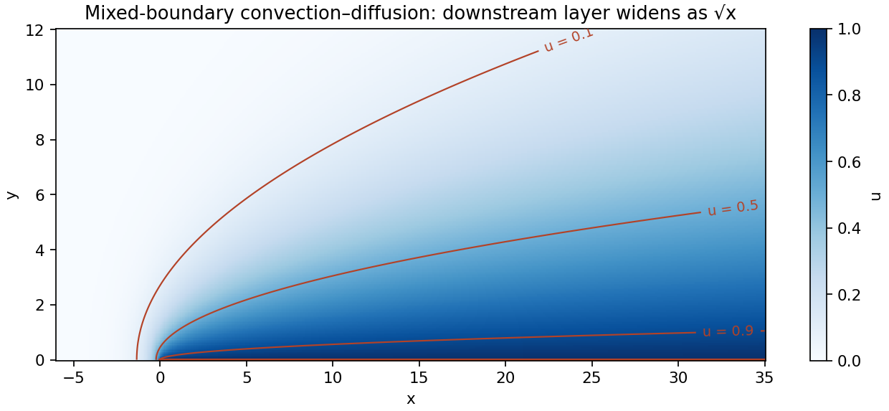

<h1 id="b/6/iii/solution">Solution</h1>

↑ **Parent:** [Iii](../iii.md)

Use the Fourier convention $\widehat u(k,y)=\int_{\mathbb R}u(x,y)e^{ikx}dx$. Transforming the [differential equation](../../../../../differential-equation-split.md) gives

$$
\widehat u_{yy}-(k^2-ik)\widehat u=0.
$$

Define $k_+(k)=\sqrt k$ analytic above the downward cut from zero, and $k_-(k)=\sqrt{k-i}$ analytic below the upward cut from $i$. More explicitly take $\arg k\in(-\pi/2,3\pi/2)$ and $\arg(k-i)\in(-3\pi/2,\pi/2)$. In the strip $0<\operatorname{Im}k<1$, put $q=k_+k_-$. Then $q^2=k^2-ik$ and $\operatorname{Re}q>0$; at $k=i/2$, $q=1/2$, fixing the choice throughout the strip. The decaying $y$ mode is $e^{-qy}$.

The positive-half-line boundary value has transform $\int_0^\infty e^{ikx}dx=i/k$ for $\operatorname{Im}k>0$. Thus $\widehat u(k,0)=\overline f+i/k$ and $\widehat u_y(k,0)=\overline g$. The transformed boundary relation is

$$
\overline g=-k_+k_-(\overline f+i/k).
$$

Let $c=k_-(0)=e^{-i\pi/4}$. Splitting off the [pole](../../../../../pole.md) at zero gives

$$
k_-\overline f+i\frac{k_--c}{k}
=-\frac{\overline g}{k_+}-\frac{ic}{k}.
$$

The left side is analytic in the lower domain up to $\operatorname{Im}k<1$: its apparent [pole](../../../../../pole.md) at zero is removable. The right side is analytic for $\operatorname{Im}k>0$. By the supplied boundedness of $k\overline f$ and $\overline g$, both sides tend to zero at infinity in their half-planes. The gluing and [Liouville theorem](../../../../../liouville-theorem.md) argument therefore makes their common value zero. Consequently

$$
\overline g=-\frac{ic}{\sqrt k},\qquad
\overline f=\frac{i(c-k_-)}{kk_-},\qquad
\widehat u(k,0)=\frac{ic}{k\sqrt{k-i}}.
$$

Choose the inversion contour $\Gamma=\{s+i\eta:s\in\mathbb R\}$ oriented left to right, with any fixed $0<\eta<1$. It passes above the [pole](../../../../../pole.md) at zero and below the [branch point](../../../../../branch-point.md) at $i$. [Fourier inversion](../../../../../fourier-inversion-theorem.md) gives exactly

$$
\boxed{u(x,y)=\frac1{2\pi}\int_\Gamma
\frac{i e^{-i\pi/4}}{k\sqrt{k-i}}\,e^{-\sqrt{k^2-ik}\,y}e^{-ikx}dk.}
$$

Thus the appropriate value is **$\sqrt{-i}=e^{-i\pi/4}$**. The other proposed value reverses the [residue](../../../../../residue.md) of the boundary step and violates its prescribed positive value.

There is also a far-field qualification in the source. The formula is the intended bounded mixed-boundary solution, but it does not tend to zero along every path to infinity. This can be checked explicitly: in parabolic coordinates $x=a^2-b^2$, $y=2ab$, with $a,b>0$, the [mixed-boundary convection-diffusion solution in parabolic coordinates](../../../../../mixed-boundary-convection-diffusion-solution-in-parabolic-coordinates.md) is

$$
u(x,y)=\operatorname{erfc}b,\qquad
b=\sqrt{\frac{\sqrt{x^2+y^2}-x}{2}}.
$$

Indeed $\Delta u=u_{bb}/[4(a^2+b^2)]$ and $u_x=-b u_b/[2(a^2+b^2)]$; the identity $u_{bb}=-2b u_b$ proves the [differential equation](../../../../../differential-equation-split.md). At $b=0$ the boundary value is one, and at $a=0$ its normal [derivative](../../../../../derivative.md) is zero. Its traces are $f(x)=\operatorname{erfc}\sqrt{-x}$ for $x<0$ and $g(x)=-1/\sqrt{\pi x}$ for $x>0$, whose one-sided transforms are the expressions derived above.

At a fixed angle away from the positive $x$ axis, $b\to\infty$ and $u\to0$. But at fixed $y>0$ and $x\to+\infty$, $b\sim y/(2\sqrt x)$ and $u\to1$. Hence **the radial decay statement cannot hold uniformly as printed**; the intended decay is away from the downstream [boundary layer](../../../../../boundary-layer.md). The exact expression also identifies its thickness as $O(\sqrt x)$.

**[Figure 2](#b/6/iii/image-the-exact-mixed-boundary-solution-decays-away-from-the-downstream-boundary-layer). The exact mixed-boundary solution decays away from the downstream boundary layer**.

## ↑ Ancestors (13)

1. [Iii](../iii.md)
2. [6](../../6.md)
3. [B](../../../b.md)
4. [2010](../../../../2010-split.md)
5. [Past exam of the perturbation methods and applied complex variables course of the University of Oxford](../../../../split.md)
6. [Perturbation methods and applied complex variables course of the University of Oxford](../../../../../perturbation-methods-and-applied-complex-variables-course-of-the-university-of-oxford.md)
7. [Year 4 of the mathematics course of the University of Oxford](../../../../../year-4-of-the-mathematics-course-of-the-university-of-oxford.md)
8. [Mathematics course of the University of Oxford](../../../../../mathematics-course-of-the-university-of-oxford.md)
9. [Undergraduate course of the University of Oxford](../../../../../undergraduate-course-of-the-university-of-oxford.md)
10. [Course of the University of Oxford](../../../../../course-of-the-university-of-oxford.md)
11. [University of Oxford](../../../../../university-of-oxford-split.md)
12. [List of universities](../../../../../list-of-universities.md)
13. [Codex Wiki](../../../../../split.md)
