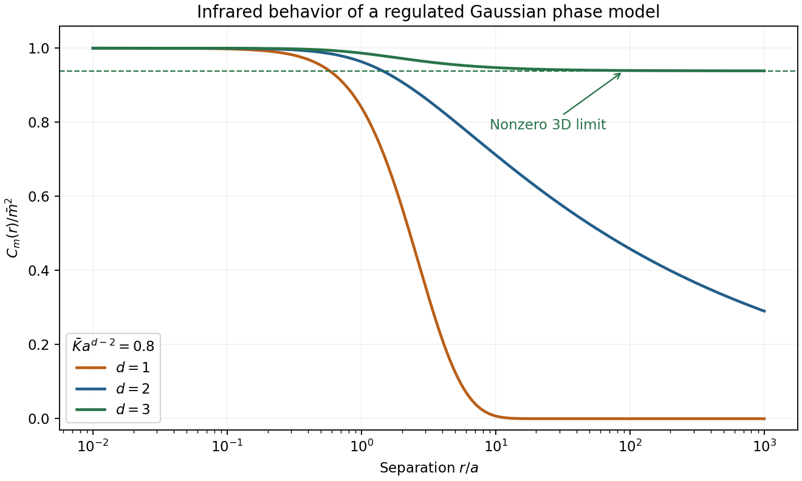
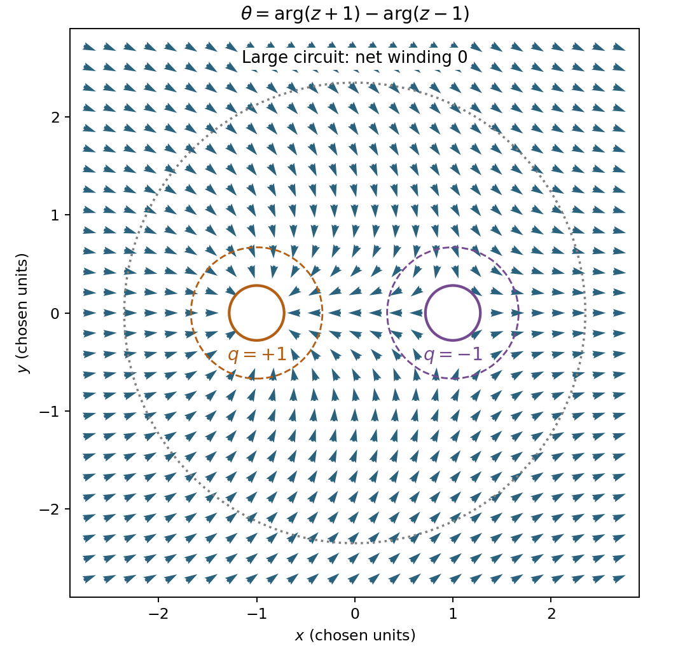
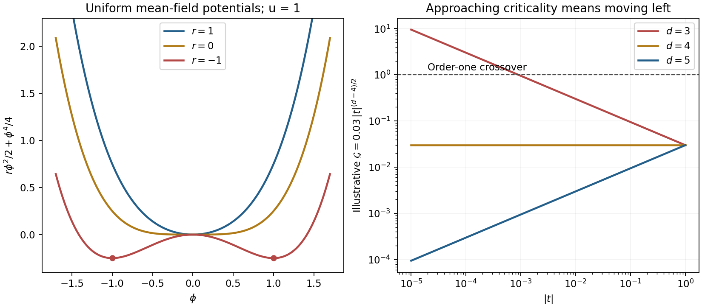

# Paper 1

↑ **Parent:** [2012](../2012.md)

Original paper: [Public original PDF, physical pages 486–489; cover on page 486, Q1 on page 487, its experimental plot on page 488, Q2–Q3 on page 489](https://www.whatdotheyknow.com/request/natural_science_tripos_physics_e_2/response/2340776/attach/2/FOI%202023%20399%20Zahid%20materials.pdf?cookie_passthrough=1#page=486).

**Table of contents**

- [1](#1)
  - [a](#1/a)
    - [Solution](#1/a/solution)
  - [b](#1/b)
    - [Solution](#1/b/solution)
  - [c](#1/c)
    - [Solution](#1/c/solution)
  - [d](#1/d)
    - [Solution](#1/d/solution)
  - [e](#1/e)
    - [Solution](#1/e/solution)
  - [f](#1/f)
    - [Solution](#1/f/solution)
- [2](#2)
  - [Solution](#2/solution)
  - [a](#2/a)
    - [Solution](#2/a/solution)
  - [b](#2/b)
    - [Solution](#2/b/solution)
  - [c](#2/c)
    - [Solution](#2/c/solution)
- [3](#3)
  - [a](#3/a)
    - [Solution](#3/a/solution)
  - [b](#3/b)
    - [Solution](#3/b/solution)
  - [c](#3/c)
    - [Solution](#3/c/solution)

## 1

↑ **Parent:** [Paper 1](paper-1.md)

<h3 id="1/a">a</h3>

↑ **Parent:** [1](#1)

<h4 id="1/a/solution">Solution</h4>

↑ **Parent:** [A](#1/a)

Use $s=|t|$, $x=h/s^\Delta$ and separate scaling functions above and below the transition. Up to a nonsingular conversion between physical and dimensionless field, [magnetization scaling-function matching](../../critical-phenomenon.md#magnetization-scaling-function-matching) gives

$$
m=-\partial_h f_s=s^{2-\alpha-\Delta}g_{m,\pm}(x),\qquad g_{m,\pm}=-g'_{f,\pm}.
$$

On the ordered side take $h\to0^+$ after the [thermodynamic limit](../../statistical-physics.md#thermodynamic-limit), selecting one [pure thermodynamic phase](../../critical-phenomenon.md#pure-thermodynamic-phase). A finite nonzero $g_{m,-}(0^+)$ implies

$$
\boxed{\beta=2-\alpha-\Delta.}
$$

The critical isotherm must have a finite nonzero limit at fixed small $h$ as $s\to0$. Thus $g_m(x)\sim C\operatorname{sgn}(x)|x|^{1/\delta}$ at large $|x|$. Cancellation of the residual power of $s$ requires

$$
2-\alpha-\Delta-\frac\Delta\delta=0,\qquad
\boxed{\delta=\frac{\Delta}{2-\alpha-\Delta},\qquad\Delta=\beta\delta.}
$$

The absolute value and branch choice matter: spontaneous zero-field [magnetization](../../electromagnetism.md#magnetization) is below $T_c$, whereas the symmetry-unbroken [thermodynamic phase](../../thermodynamics.md#thermodynamic-phase) has $m(t,0)=0$. The [field crossover exponent](../../critical-phenomenon.md#field-crossover-exponent) is not the [scaling dimension](../../string-theory.md#scaling-dimension) of the [magnetization](../../electromagnetism.md#magnetization) field.

<h3 id="1/b">b</h3>

↑ **Parent:** [1](#1)

<h4 id="1/b/solution">Solution</h4>

↑ **Parent:** [B](#1/b)

A further field derivative of the [magnetization](../../electromagnetism.md#magnetization) scaling form gives

$$
\chi=\partial_hm=s^{2-\alpha-2\Delta}g'_{m,\pm}(x).
$$

At zero field, on a branch with a finite nonzero susceptibility [amplitude](../../wave.md#wave-amplitude), comparison with $\chi\sim s^{-\gamma}$ yields

$$
\boxed{\gamma=2\Delta-2+\alpha=\Delta-\beta.}
$$

Consequently $\alpha+2\beta+\gamma=2$ and $\gamma=\beta(\delta-1)$, the Rushbrooke and [Widom scaling relations](../../critical-phenomenon.md#widom-scaling-relation). Regular analytic terms do not change the leading divergent susceptibility.

<h3 id="1/c">c</h3>

↑ **Parent:** [1](#1)

<h4 id="1/c/solution">Solution</h4>

↑ **Parent:** [C](#1/c)

At fixed zero field, $\partial_T=T_c^{-1}\partial_t$. Therefore, away from $t=0$ on either branch,

$$
c_{h,s}=-T\left(\frac{\partial^2 f_s}{\partial T^2}\right)_h
=-\frac{T}{T_c^2}(2-\alpha)(1-\alpha)g_{f,\pm}(0)s^{-\alpha}.
$$

Thus **the singular [heat capacity](../../heat.md#heat-capacity) has exponent $\alpha$**. An arbitrary analytic background must be added to obtain the full [heat capacity](../../heat.md#heat-capacity). Vanishing branch [amplitudes](../../wave.md#wave-amplitude) or the marginal case $\alpha=0$ need care: a finite jump is compatible with this power counting, while a logarithmic singularity requires a logarithmic refinement of the assumed homogeneous form.

<h3 id="1/d">d</h3>

↑ **Parent:** [1](#1)

<h4 id="1/d/solution">Solution</h4>

↑ **Parent:** [D](#1/d)

[Hyperscaling](../../critical-phenomenon.md#hyperscaling-relation) adds the physical assumption that the singular [free energy](../../thermodynamic-potential.md#thermodynamic-free-energy) associated with one [correlation volume](../../critical-phenomenon.md#correlation-volume) is of order $k_BT_c$:

$$
f_s\xi^d\sim k_BT_c,\qquad f_s\sim\xi^{-d}.
$$

At fixed scaled field $x=h/s^\Delta$, this predicts $f_s\sim s^{d\nu}$, whereas the given thermodynamic form has power $2-\alpha$. Hence

$$
\boxed{d\nu=2-\alpha.}
$$

The product $g_f(x)[g_\xi(x)]^d$ can be a finite dimensionless function of fixed $x$; it need not be constant. The homogeneity of $\xi$ alone is insufficient: the correlation-volume free-energy assumption supplies the connection. Above an [upper critical dimension](../../critical-phenomenon.md#upper-critical-dimension), a [dangerously irrelevant coupling](../../critical-phenomenon.md#dangerously-irrelevant-coupling) can invalidate this [argument](../../complex-analysis.md#argument-complex-analysis); at a marginal dimension logarithms may qualify pure [powers](../../energy.md#power).

<h3 id="1/e">e</h3>

↑ **Parent:** [1](#1)

<h4 id="1/e/solution">Solution</h4>

↑ **Parent:** [E](#1/e)

The susceptibility is the integrated [connected correlation function](../../critical-phenomenon.md#connected-correlation-function), up to a nonsingular field-normalization factor:

$$
\chi\propto\int d^dx\,G_c(\mathbf x),\qquad
G_c(\mathbf x)=\langle m(\mathbf x)m(0)\rangle-\langle m\rangle^2.
$$

Above the transition at zero field the subtraction vanishes. In an ordered [thermodynamic phase](../../thermodynamics.md#thermodynamic-phase) it is essential; integrating the disconnected constant would incorrectly give a [volume](../../geometry-and-topology.md#volume) divergence unrelated to the desired response.

With a microscopic cutoff $a$ and $r=|\mathbf x|$, radial integration and $u=r/\xi$ give

$$
\chi_s\propto S_d\int_a^\infty r^{1-\eta}g(r/\xi)\,dr
=S_d\xi^{2-\eta}\int_{a/\xi}^\infty u^{1-\eta}g(u)\,du.
$$

If $g(0)$ is finite, its large-distance tail decays sufficiently rapidly and $\eta<2$, the dimensionless integral approaches a finite nonzero constant. Thus

$$
\boxed{\chi_s\sim\xi^{2-\eta}\sim s^{-(2-\eta)\nu},\qquad\gamma=(2-\eta)\nu.}
$$

Short-distance contributions give a regular background. This is the [Fisher scaling relation](../../critical-phenomenon.md#fisher-scaling-relation); it concerns the fluctuating connected part of the source [correlation](../../variance.md#pearson-correlation-coefficient) ansatz.

<h3 id="1/f">f</h3>

↑ **Parent:** [1](#1)

<h4 id="1/f/solution">Solution</h4>

↑ **Parent:** [F](#1/f)

The annotations on the original plot give $\beta=0.368$ and $\gamma=1.215$. Use those displayed values rather than fitting the linear-axis curve as though its slope were a logarithmic exponent. [Exponent inference from a magnetic data collapse](../../critical-phenomenon.md#exponent-inference-from-a-magnetic-data-collapse) identifies $\Delta=\gamma+\beta$.

$$
\begin{aligned}
\Delta&=\beta+\gamma=1.583,\\
\alpha&=2-2\beta-\gamma=0.049,\\
\delta&=1+\gamma/\beta=4.30163\ldots,\\
\nu&=(2-\alpha)/3=0.650333\ldots,\\
\eta&=2-\gamma/\nu=0.131727\ldots .
\end{aligned}
$$

Therefore

$$
\boxed{\alpha\approx0.049,\quad\Delta\approx1.583,\quad\delta\approx4.30,\quad\nu\approx0.650,\quad\eta\approx0.132.}
$$

These estimates inherit both the empirical collapse exponents and the assumed scaling identities, including three-dimensional [hyperscaling](../../critical-phenomenon.md#hyperscaling-relation). They are not independent high-precision measurements of five exponents. In particular, the small difference defining $\alpha$ and the subtraction defining $\eta$ amplify uncertainties. No experimental curve or source image is reproduced.

## 2

↑ **Parent:** [Paper 1](paper-1.md)

<h3 id="2/solution">Solution</h3>

↑ **Parent:** [2](#2)

[Spontaneous symmetry breaking](../../quantum-field-theory.md#spontaneous-symmetry-breaking) means that a [pure thermodynamic phase](../../critical-phenomenon.md#pure-thermodynamic-phase) is less symmetric than the [Hamiltonian](../../hamiltonian-mechanics.md#hamiltonian) even when the selecting external field is removed. For example,

$$
\mathbf m_0=\lim_{\mathbf h\to0^+}\lim_{V\to\infty}\langle\mathbf m\rangle_{V,\mathbf h}\ne0.
$$

The direction of the infinitesimal field is held fixed in this limit. Reversing the limits in a finite symmetric sample normally gives zero. For the [XY model](../../statistical-physics.md#xy-model), an ordered state chooses one direction from a circle of energetically equivalent directions.

A [Goldstone mode](../../critical-phenomenon.md#goldstone-boson) is a long-wavelength fluctuation along this continuously degenerate family. A uniform angle rotation costs no [energy](../../energy.md); a slowly varying one costs only [gradient](../../multivariable-calculus.md#gradient) [energy](../../energy.md). In the stated static phase-only model the quadratic kernel is $\bar K q^2$, tending to zero as $q\to0$. **There is one independent soft [order-parameter phase](../../critical-phenomenon.md#order-parameter-phase) coordinate for broken $O(2)$ rotation.** The static [Hamiltonian](../../hamiltonian-mechanics.md#hamiltonian) does not specify a dynamical dispersion $\omega(q)$; that requires a dynamical law. Magnitude fluctuations instead have a restoring local curvature and have been excluded from this low-energy model.

<h3 id="2/a">a</h3>

↑ **Parent:** [2](#2)

<h4 id="2/a/solution">Solution</h4>

↑ **Parent:** [A](#2/a)

For an [infrared-regulated phase covariance](../../critical-phenomenon.md#infrared-regulated-phase-covariance), fix the uniform [order-parameter phase](../../critical-phenomenon.md#order-parameter-phase) zero mode and introduce ultraviolet and [infrared cutoffs](../../fourier-analysis.md#infrared-cutoff) before taking limits. With the Fourier convention

$$
\theta(\mathbf x)=\int\frac{d^dq}{(2\pi)^d}\,\theta_{\mathbf q}e^{i\mathbf q\cdot\mathbf x},
$$

the dimensionless quadratic [Hamiltonian](../../hamiltonian-mechanics.md#hamiltonian) diagonalizes as

$$
\beta H=\frac{\bar K}{2}\int\frac{d^dq}{(2\pi)^d}q^2\theta_{\mathbf q}\theta_{-\mathbf q}.
$$

Completing the square with a source gives $Z[J]/Z[0]=\exp[\tfrac12\int JGJ]$, with inverse kernel

$$
\langle\theta_{\mathbf q}\theta_{\mathbf q'}\rangle
=\frac{(2\pi)^d\delta^{(d)}(\mathbf q+\mathbf q')}{\bar Kq^2},\qquad
G(\mathbf x)=\frac1{\bar K}\int\frac{d^dq}{(2\pi)^d}\frac{e^{i\mathbf q\cdot\mathbf x}}{q^2}.
$$

There is no additional $k_BT$ factor: it is already included in $\bar K$ because the supplied [Hamiltonian](../../hamiltonian-mechanics.md#hamiltonian) is $\beta H$.

It is simplest to evaluate the real-space dependence by its defining Green equation, $-\bar K\nabla^2G=\delta^{(d)}$. Rotational invariance gives $r^{d-1}G'(r)=$ constant for $r>0$. Integrating over a small [sphere](../../euclidean-geometry.md#sphere) fixes $-\bar KS_dr^{d-1}G'(r)=1$, where $S_d=2\pi^{d/2}/\Gamma(d/2)$. Integrating once more,

$$
\boxed{G(r)=-\frac{r^{2-d}}{(2-d)S_d\bar K}+C,\qquad d\ne2.}
$$

In two dimensions, take the limit after absorbing the divergent $r$-independent piece into $C$:

$$
\boxed{G(r)=-\frac1{2\pi\bar K}\log(r/a)+C.}
$$

For $d\le2$, $G$ itself has an infrared-divergent constant in the infinite system; it is not a finite thermodynamic [covariance](../../variance.md#covariance) without a regulator. The physical [phase-difference variance](../../critical-phenomenon.md#phase-difference-variance) is finite at fixed separation and cancels that constant. These are smooth [spin wave](../../critical-phenomenon.md#spin-wave) [correlations](../../variance.md#pearson-correlation-coefficient); compact-field [vortex](../../critical-phenomenon.md#phase-vortex) sectors are considered separately below.

<h3 id="2/b">b</h3>

↑ **Parent:** [2](#2)

<h4 id="2/b/solution">Solution</h4>

↑ **Parent:** [B](#2/b)

The [magnetization](../../electromagnetism.md#magnetization) correlator is an average of a [phase difference](../../wave.md#phase-difference), not merely its lowest Taylor expansion. [Gaussian phase averaging](../../partial-differential-equation.md#gaussian-phase-averaging) gives

$$
C_m(r)=\bar m^2\langle\cos[\theta(\mathbf x)-\theta(0)]\rangle
=\bar m^2\exp\!\left[-\frac12D(r)\right],
$$

where

$$
D(r)=\langle[\theta(\mathbf x)-\theta(0)]^2\rangle
=\frac2{\bar K}\int\frac{d^dq}{(2\pi)^d}\frac{1-\cos(\mathbf q\cdot\mathbf x)}{q^2}
=2[G(0)-G(r)].
$$

The coincident value is ultraviolet-regularized at a microscopic scale $a$. At large $r$:

- For $d>2$, the infrared integral for $G(0)$ converges. Choosing $G(\infty)=0$, $D(\infty)=2G(0)<\infty$, so **$C_m(\infty)=m_0^2=\bar m^2e^{-G(0)}>0$** within the low-temperature [spin wave](../../critical-phenomenon.md#spin-wave) [thermodynamic phase](../../thermodynamics.md#thermodynamic-phase).
- For $d=2$, $D(r)=(\pi\bar K)^{-1}\log(r/a)+O(1)$, hence **$C_m(r)\propto r^{-1/(2\pi\bar K)}\to0$**.
- For $0<d<2$, the leading growth is $D(r)=2r^{2-d}/[(2-d)S_d\bar K]+O(1)$, hence **$C_m(r)\propto\exp\{-r^{2-d}/[(2-d)S_d\bar K]\}\to0$**. In particular $d=1$, $S_1=2$, gives $C_m(r)\propto e^{-r/(2\bar K)}$.

**[Figure 1](#2/b/image-infrared-spin-wave-correlation-limits). Infrared spin-wave correlation limits**. Original regulated phase-only model curves for dimensions one, two and three. They illustrate exponential decay, algebraic decay and a nonzero limit respectively; no experimental dataset or phase-transition temperature is fitted.

Thus **two is the [lower critical dimension](../../critical-phenomenon.md#lower-critical-dimension) for conventional positive-temperature continuous-symmetry order** under the short-range assumptions. Two dimensions can still have [quasi-long-range order](../../critical-phenomenon.md#quasi-long-range-order) and a thermodynamic transition; zero limiting [magnetization](../../electromagnetism.md#magnetization) does not forbid them. The $d>2$ [spin wave](../../critical-phenomenon.md#spin-wave) result describes an admissible low-temperature ordered [thermodynamic phase](../../thermodynamics.md#thermodynamic-phase), not order at arbitrarily high [temperature](../../temperature.md). The [Mermin-Wagner theorem](../../critical-phenomenon.md#mermin-wagner-theorem) supplies the more general no-order statement below or at two dimensions.[§4.2.3: infrared phase fluctuations and continuous-symmetry order](../../physics-bibliography.md#statistical-field-theory-by-david-tong)

<h3 id="2/c">c</h3>

↑ **Parent:** [2](#2)

<h4 id="2/c/solution">Solution</h4>

↑ **Parent:** [C](#2/c)

The [compact phase sectors](../../critical-phenomenon.md#compact-phase-sectors) arise because the angle is compact, $\theta\equiv\theta+2\pi$. A circuit avoiding a defect core can have integer winding

$$
\boxed{q=\frac1{2\pi}\oint\nabla\theta\cdot d\boldsymbol\ell\in\mathbb Z.}
$$

Smooth single-valued small fluctuations remain in the zero-winding sector. Vortices with $q\ne0$ cannot be unwound without a core or a boundary crossing; the smooth [Gaussian](../../probability-distribution.md#normal-distribution) theory misses those sectors. For $\theta=q\arg(x+iy)$ outside a core of [radius](../../topology.md#radius) $a$,

$$
\beta E_q=\frac{\bar K}{2}\int_a^L2\pi r\,dr\,\frac{q^2}{r^2}+\beta E_c
=\pi\bar Kq^2\log(L/a)+\beta E_c.
$$

The positional [entropy](../../entropy.md) of a freely placed defect is approximately $S/k_B=2\log(L/a)$. For unit charge the corresponding heuristic free-energy cost is

$$
\beta F_1\simeq(\pi\bar K-2)\log(L/a)+\beta E_c.
$$

Actual bulk configurations obey net-charge constraints, with vortex-antivortex pairs attracted logarithmically. At low [temperature](../../temperature.md) they remain bound; they renormalize the [phase stiffness](../../critical-phenomenon.md#phase-stiffness) but do not screen away the algebraic [correlations](../../variance.md#pearson-correlation-coefficient). Heating can unbind the pairs into a screening [vortex](../../critical-phenomenon.md#phase-vortex) plasma with short-range [correlations](../../variance.md#pearson-correlation-coefficient): this is the [Berezinskii–Kosterlitz–Thouless transition](../../critical-phenomenon.md#berezinskii-kosterlitz-thouless-transition).

**[Figure 2](#2/c/image-compact-phase-with-opposite-winding). Compact phase with opposite winding**. Original constructed XY orientation field theta=arg(z+1)-arg(z-1), with unit positive and negative winding about the two excluded cores. Arrows show magnetization orientation, not fluid velocity; a circuit around both cores has zero net winding.

The sharp criterion uses the long-distance renormalized stiffness $K_R$, not a bare coefficient: $K_R(T_{\rm BKT}^-)=2/\pi$, giving algebraic exponent $\eta_c=1/4$. Both [phases](../../wave.md#phase-waves) have zero conventional spontaneous [magnetization](../../electromagnetism.md#magnetization) at positive [temperature](../../temperature.md); they differ in [vortex](../../critical-phenomenon.md#phase-vortex) binding, [correlations](../../variance.md#pearson-correlation-coefficient) and stiffness.[§4.4 and §4.4.1: compact angle, vortex energy/entropy and the two-dimensional transition](../../physics-bibliography.md#statistical-field-theory-by-david-tong)

## 3

↑ **Parent:** [Paper 1](paper-1.md)

<h3 id="3/a">a</h3>

↑ **Parent:** [3](#3)

<h4 id="3/a/solution">Solution</h4>

↑ **Parent:** [A](#3/a)

A coarse-grained scalar [order parameter](../../critical-phenomenon.md#order-parameter) $\phi(\mathbf x)$ describes a short-range Ising-like transition with sign [symmetry](../../physics.md#symmetry-physics). Write the dimensionless Landau-Ginzburg functional as

$$
\mathcal H[\phi]=\frac{F[\phi]}{k_BT}
=\int d^dx\left[\frac c2(\nabla\phi)^2+\frac r2\phi^2+\frac u4\phi^4-h\phi\right],\qquad c,u>0.
$$

Here $r=a_t t$, with the relevant critical-mass shift understood when fluctuations are included. Higher local [powers](../../energy.md#power) and [gradients](../../multivariable-calculus.md#gradient) are negligible only within a justified long-distance expansion. The [partition function](../../canonical-ensemble.md#canonical-partition-function) is $Z=\int\mathcal D\phi\,e^{-\mathcal H}$ with a microscopic cutoff. The local functional is not already the fluctuation-integrated thermodynamic [free energy](../../thermodynamic-potential.md#thermodynamic-free-energy).

[Mean-field theory](../../statistical-physics.md#mean-field-theory) replaces this integral by its stable uniform saddle, $r\phi_0+u\phi_0^3=h$. At $h=0$,

$$
\phi_0=0\quad(r>0),\qquad\phi_0=\pm\sqrt{|r|/u}\quad(r<0),\qquad
f_{\min}-f_0=\begin{cases}0&r>0,\\-r^2/(4u)&r<0.\end{cases}
$$

The branch curvature is $r_L=r+3u\phi_0^2$: it is $r$ above and $2|r|$ below. Hence

$$
\chi_+=r^{-1},\quad\chi_-=(2|r|)^{-1},\quad
\xi=\sqrt{c/r_L},\quad h=u\phi_0^3\text{ at }r=0.
$$

Together with the finite heat-capacity jump from $f_{\min}$, this yields

$$
\boxed{\beta_{\rm MF}=\tfrac12,\quad\gamma_{\rm MF}=1,\quad\delta_{\rm MF}=3,
\quad\nu_{\rm MF}=\tfrac12,\quad\eta_{\rm MF}=0,\quad\alpha_{\rm MF}=0.}
$$

The equal-$|t|$ susceptibility [amplitude](../../wave.md#wave-amplitude) ratio is two. Uniform saddles also miss [domain walls](../../critical-phenomenon.md#domain-wall) and spatial texture. For an $n$-component [order parameter](../../critical-phenomenon.md#order-parameter), [symmetry](../../physics.md#symmetry-physics) allows a vector generalization; ordered transverse directions additionally carry Goldstone fluctuations.

To include small fluctuations set $\phi=\phi_0+\delta\phi$. The [Gaussian](../../probability-distribution.md#normal-distribution) action is $\tfrac12\int[c(\nabla\delta\phi)^2+r_L(\delta\phi)^2]$, giving

$$
G(q)=\langle|\delta\phi_q|^2\rangle_{\rm spectral}=\frac1{cq^2+r_L},\qquad
\delta f=\frac12\int^{\Lambda}\frac{d^dq}{(2\pi)^d}\log(cq^2+r_L)+\text{normalization}.
$$

The displayed $G(q)$ is a spectral [covariance](../../variance.md#covariance) per Fourier delta, avoiding an extra [volume](../../geometry-and-topology.md#volume) factor. As $r_L\to0$, a growing [correlation length](../../critical-phenomenon.md#correlation-length) lets increasingly large correlated regions fluctuate. The singular [Gaussian](../../probability-distribution.md#normal-distribution) heat correction contains $\int d^dq/(cq^2+r_L)^2$, which is infrared singular for $d<4$ and logarithmic at four. This signals failure of a simple saddle expansion; the [Gaussian](../../probability-distribution.md#normal-distribution) heat exponent obtained by extrapolation is not the exact interacting [critical exponent](../../critical-phenomenon.md#critical-exponent).

The [Ginzburg criterion](../../critical-phenomenon.md#ginzburg-criterion) compares the fluctuation of a correlation-volume average with $\phi_0^2$, rather than using all ultraviolet fluctuations at a point. Keeping $q\lesssim\xi^{-1}$ below the transition gives, up to finite convention-dependent constants,

$$
\langle(\delta\phi)_\xi^2\rangle
\sim\int_{|q|\lesssim\xi^{-1}}\frac{d^dq}{(2\pi)^d}\frac1{cq^2+2|r|}
\sim c^{-d/2}|r|^{(d-2)/2}.
$$

Dividing by $\phi_0^2=|r|/u$ yields

$$
\boxed{\mathcal G\sim u c^{-d/2}|r|^{(d-4)/2}\ll1.}
$$

For $d<4$, writing $r=a_t t$ gives a nonuniversal [Ginzburg reduced-temperature window](../../critical-phenomenon.md#ginzburg-reduced-temperature-window)

$$
\boxed{|t|\gg\mathrm{Gi},\qquad
\mathrm{Gi}\sim\left[u c^{-d/2}a_t^{(d-4)/2}\right]^{2/(4-d)}.}
$$

Inside $|t|\lesssim\mathrm{Gi}$, interacting fluctuations must be treated. For example, in three dimensions $\mathrm{Gi}\sim u^2/(c^3a_t)$ in this normalization. Above four dimensions the long-wavelength ratio vanishes at criticality; at four it is marginal and interaction-generated logarithms require further analysis.

**[Figure 3](#3/a/image-mean-field-wells-and-the-ginzburg-test). Mean-field wells and the Ginzburg test**. Original scalar quartic potentials and dimensionless illustrative Ginzburg ratios. The three-dimensional ratio grows towards criticality, the four-dimensional power estimate is constant and the five-dimensional one falls. A unit-ratio line marks a chosen crossover convention, not measured material data.

The spatial [gradient](../../multivariable-calculus.md#gradient) term supplies [correlations](../../variance.md#pearson-correlation-coefficient) absent from uniform [Landau theory](../../critical-phenomenon.md#landau-theory). The Ginzburg test bounds where its mean-field saddle remains self-consistent; it does not compute nonclassical exponents or a universal material-independent window.[§2.2.3–§2.2.4: correlation length, upper critical dimension and limits of Gaussian fluctuations](../../physics-bibliography.md#statistical-field-theory-by-david-tong)

<h3 id="3/b">b</h3>

↑ **Parent:** [3](#3)

<h4 id="3/b/solution">Solution</h4>

↑ **Parent:** [B](#3/b)

[Renormalization](../../perturbative-quantum-field-theory.md#renormalization) compares the same long-distance physics at different observation scales. The starting object is a microscopic or cutoff [statistical Hamiltonian](../../statistical-physics.md#statistical-hamiltonian) $\mathcal H_g$ with every symmetry-allowed coupling $g$. Because a critical [correlation length](../../critical-phenomenon.md#correlation-length) is much larger than a lattice spacing, repeatedly eliminating short-distance detail can reveal scale-invariant behavior.

In a real-space transformation choose a [normalized blocking kernel](../../critical-phenomenon.md#normalized-blocking-kernel) $B(S|s)$ for retained variables. Define

$$
e^{-\mathcal H_{g'}(S)}=\sum_sB(S|s)e^{-\mathcal H_g(s)},\qquad\sum_SB(S|s)=1.
$$

Summing over $S$ proves exact preservation of $Z$ before truncation. The transformed [Hamiltonian](../../hamiltonian-mechanics.md#hamiltonian) generally gains longer-range and many-body interactions and a field-independent constant. Observables must be blocked consistently. In momentum-shell language split $\phi=\phi_<+\phi_>$, integrate $\Lambda/b<|q|<\Lambda$, then use $x'=x/b$ and a field rescaling to restore cutoff and kinetic normalization. **Coarse-graining, rescaling and tracking generated interactions are distinct steps.**

Repeated transformations generate a flow $g'=R_b(g)$ with composition $R_bR_c=R_{bc}$ when the same exact coarse-graining family is used. Losing degrees of freedom generally makes this a semigroup, despite its conventional group name. A [renormalization-group fixed point](../../critical-phenomenon.md#renormalization-group-fixed-point) is invariant after rescaling. At a continuous transition the large-distance theory approaches a critical [renormalization-group fixed point](../../critical-phenomenon.md#renormalization-group-fixed-point); finite [correlation length](../../critical-phenomenon.md#correlation-length) instead eventually flows into an ordinary [thermodynamic phase](../../thermodynamics.md#thermodynamic-phase) regime.

Linearize in scaling coordinates $u_i$:

$$
u'_i=b^{y_i}u_i.
$$

For increasing observation [length](../../physics.md#length), $y_i>0$ is relevant and must be tuned, $y_i<0$ is irrelevant, and $y_i=0$ is marginal and needs nonlinear analysis. Discrete multipliers $b^{y_i}$ must be compared with one, not with zero. The stable manifold forms the [critical surface](../../critical-phenomenon.md#critical-surface) after relevant directions have been set to zero.

After subtracting regular additive contributions, ordinary [hyperscaling](../../critical-phenomenon.md#hyperscaling-relation) gives

$$
f_s(t,h)=b^{-d}f_s(b^{y_t}t,b^{y_h}h).
$$

Choosing $b=|t|^{-1/y_t}$ or choosing the field as scale yields

$$
\boxed{\nu=1/y_t,\quad\Delta=y_h/y_t,\quad
2-\alpha=d/y_t,\quad\beta=(d-y_h)/y_t,\quad
\gamma=(2y_h-d)/y_t,\quad\delta=y_h/(d-y_h).}
$$

For a critical two-point function $G(r)\sim r^{-(d-2+\eta)}$, the [order parameter](../../critical-phenomenon.md#order-parameter) [scaling dimension](../../string-theory.md#scaling-dimension) is $x_m=(d-2+\eta)/2$, and its [conjugate field](../../critical-phenomenon.md#field-conjugate-to-an-order-parameter) has $y_h=d-x_m=(d+2-\eta)/2$. This recovers the Q1 identities while distinguishing the gap exponent $\Delta$ from the field's [scaling dimension](../../string-theory.md#scaling-dimension) $y_h$.

As a concrete dimensional check, start from a scalar [gradient](../../multivariable-calculus.md#gradient) action. Restoring its coefficient uses $\phi'(x')=b^{(d-2)/2}\phi_<(bx')$, so at the [Gaussian fixed point](../../critical-phenomenon.md#gaussian-fixed-point)

$$
r'=b^2r,\qquad u'=b^{4-d}u,\qquad h'=b^{(d+2)/2}h.
$$

Quartic interactions are relevant below four dimensions. They can produce an interacting [Wilson-Fisher fixed point](../../critical-phenomenon.md#wilson-fisher-fixed-point), whose exponents differ from naive [Gaussian](../../probability-distribution.md#normal-distribution) counting. Above four, the quartic coupling is irrelevant at the [Gaussian fixed point](../../critical-phenomenon.md#gaussian-fixed-point) but dangerous for ordered observables: $\phi_0^2=-r/u$ is singular when $u$ is dropped. Thus the simple two-variable [hyperscaling](../../critical-phenomenon.md#hyperscaling-relation) formula is not universal above the [upper critical dimension](../../critical-phenomenon.md#upper-critical-dimension).

Different microscopic systems can flow to the same long-distance [renormalization-group fixed point](../../critical-phenomenon.md#renormalization-group-fixed-point), explaining [universality](../../critical-phenomenon.md#universality-of-critical-phenomena) of exponents and normalized scaling forms. [Critical temperatures](../../quantum-ideal-gas-statistics.md#critical-temperature), metric factors and regular [free energies](../../thermodynamic-potential.md#thermodynamic-free-energy) remain nonuniversal. Dimension, [order parameter](../../critical-phenomenon.md#order-parameter) [symmetry](../../physics.md#symmetry-physics), interaction range and additional soft variables constrain the [universality class](../../critical-phenomenon.md#universality-class). Truncations, perturbative expansions and numerics approximate the flow; they must not be confused with the exact elimination definition.[§3.1–§3.3: coarse-graining, scaling, relevance and dangerously irrelevant interactions](../../physics-bibliography.md#statistical-field-theory-by-david-tong)

<h3 id="3/c">c</h3>

↑ **Parent:** [3](#3)

<h4 id="3/c/solution">Solution</h4>

↑ **Parent:** [C](#3/c)

For a ferromagnetic nearest-neighbour [Ising model](../../spin-model.md#ising-model) on a chain let $s_i=\pm1$, $K=J/(k_BT)>0$ and $h=H/(k_BT)$. The dimensionless [Hamiltonian](../../hamiltonian-mechanics.md#hamiltonian) is $-K\sum_i s_is_{i+1}-h\sum_i s_i$. In one dimension, decimating every other spin closes exactly within the nearest-neighbour family, including its additive constant. This is the exact chain building block of the [Migdal-Kadanoff approach](../../critical-phenomenon.md#migdal-kadanoff-approximation); [bond moving](../../critical-phenomenon.md#bond-moving) becomes an additional approximation in higher-dimensional lattices.

For [exact zero-field Ising-chain decimation](../../critical-phenomenon.md#exact-zero-field-ising-chain-decimation), sum over an intermediate spin $\sigma$ between two retained spins:

$$
W(s,s')=\sum_{\sigma=\pm1}e^{K(s\sigma+\sigma s')}
=2\cosh[K(s+s')]=A(K)e^{K'ss'}.
$$

Parallel and antiparallel end spins give $Ae^{K'}=2\cosh2K$ and $Ae^{-K'}=2$. Hence

$$
\boxed{K'=\tfrac12\log\cosh2K,\qquad
A=2\sqrt{\cosh2K},\qquad\tanh K'=(\tanh K)^2.}
$$

For an even periodic chain, $Z_N(K)=A^{N/2}Z_{N/2}(K')$. Rescaling the lattice spacing $2a$ back to $a$ completes the [renormalization](../../perturbative-quantum-field-theory.md#renormalization) step. Decimation of $b$ successive links gives $\tanh K'=(\tanh K)^b$, as follows by multiplying the [transfer matrix](../../combinatorics.md#transfer-matrix) $b$ times.

Let $v=\tanh K$. Then $v'=v^2$ on $0\le v\le1$. The infinite-temperature [renormalization-group fixed point](../../critical-phenomenon.md#renormalization-group-fixed-point) $v=0$ attracts every $0\le v<1$; the zero-temperature [renormalization-group fixed point](../../critical-phenomenon.md#renormalization-group-fixed-point) $v=1$ is unstable to heating, with slope two. There is no intermediate ferromagnetic [renormalization-group fixed point](../../critical-phenomenon.md#renormalization-group-fixed-point). Equivalently $K'\simeq K^2$ for small $K$, while $K'\simeq K-\tfrac12\log2$ for large finite $K$. Thus **there is no finite-temperature ordered [thermodynamic phase](../../thermodynamics.md#thermodynamic-phase) in the short-range chain**.

The [domain-wall scaling coordinate of an Ising chain](../../critical-phenomenon.md#domain-wall-scaling-coordinate-of-an-ising-chain) near $T=0$ is the domain-wall [Boltzmann factor](../../canonical-ensemble.md#boltzmann-factor) $w=e^{-2K}$. Its recursion and the zero-field [correlation length](../../critical-phenomenon.md#correlation-length) are

$$
w'=\frac{2w}{1+w^2}\simeq2w,\qquad
\langle s_0s_n\rangle=(\tanh K)^{|n|},\qquad
\boxed{\frac\xi a=-\frac1{\log\tanh K}\sim\frac1{2w}=\frac12e^{2J/(k_BT)}.}
$$

Since $\xi(K')/a=[\xi(K)/a]/2$, the recursion has the correct [length](../../physics.md#length) scaling. Its exponent is one with respect to $w$; **it is not a finite power of physical [temperature](../../temperature.md) about $T_c=0$**. In the [thermodynamic limit](../../statistical-physics.md#thermodynamic-limit), a bond is a [domain wall](../../critical-phenomenon.md#domain-wall) with [probability](../../probability-theory.md#probability) $(1-\tanh K)/2\sim e^{-2K}$, giving the same exponentially large [length](../../physics.md#length) scale. Their finite [energy](../../energy.md) allows [entropy](../../entropy.md) to proliferate walls at any positive [temperature](../../temperature.md).

**[Figure 4](#3/c/image-exact-ising-chain-decimation-and-length). Exact Ising-chain decimation and length**. Original one-dimensional recursion v'=v squared, finite-temperature iterates flowing to zero and the exact correlation length with its low-temperature asymptote. The coordinate v is tanh(J/kBT); no finite-temperature critical point is introduced.

The [Ising-chain decimation constant](../../critical-phenomenon.md#ising-chain-decimation-constant) matters for thermodynamics. With dimensionless [free energy](../../thermodynamic-potential.md#thermodynamic-free-energy) per spin $f=-\lim N^{-1}\log Z_N$,

$$
f(K)=-\tfrac12\log A(K)+\tfrac12 f(K'),\qquad
\boxed{f(K)=-\log(2\cosh K).}
$$

The second expression follows independently from transfer [eigenvalues](../../linear-operator-theory.md#eigenvalue) $2\cosh K$ and $2\sinh K$ and satisfies the recursion. Multiplying it by $k_BT$ restores the physical [free energy](../../thermodynamic-potential.md#thermodynamic-free-energy). Dropping $A$ would preserve normalized retained-spin [probabilities](../../probability-theory.md#probability) but lose the eliminated-spin [entropy](../../entropy.md).

[Finite-field Ising-chain decimation](../../critical-phenomenon.md#finite-field-ising-chain-decimation) is also exact. Use the symmetric [transfer matrix](../../combinatorics.md#transfer-matrix)

$$
T=\begin{pmatrix}e^{K+h}&e^{-K}\\e^{-K}&e^{K-h}\end{pmatrix},\quad W=T^2,
$$

and read the new couplings from

$$
\boxed{K'=\frac14\log\frac{W_{++}W_{--}}{W_{+-}^2},\qquad
h'=\frac12\log\frac{W_{++}}{W_{--}},\qquad
A=(W_{++}W_{--}W_{+-}^2)^{1/4}.}
$$

Here $W_{++}=e^{2K+2h}+e^{-2K}$, $W_{--}=e^{2K-2h}+e^{-2K}$ and $W_{+-}=2\cosh h$. The latter off-diagonal entry, the field convention split between adjacent bonds and the constant must all be tracked consistently. Near the zero-temperature zero-field [renormalization-group fixed point](../../critical-phenomenon.md#renormalization-group-fixed-point) $h'\simeq2h$, while at $K=0$ the independent-spin field is unchanged.

In the higher-dimensional [Migdal-Kadanoff approximation](../../critical-phenomenon.md#migdal-kadanoff-approximation), moving bonds creates chains that can be decimated. With [bond moving](../../critical-phenomenon.md#bond-moving) first on a $d$-dimensional hypercubic lattice and [length](../../physics.md#length) factor $b$, the strengthened links have $b^{d-1}K$, giving the convention

$$
K'=\operatorname{artanh}\!\left[\tanh^b(b^{d-1}K)\right].
$$

For $d=1$ no transverse bonds move, so this reduces to the exact chain result. In higher dimensions it discards geometric [correlations](../../variance.md#pearson-correlation-coefficient) and is generally approximate on the original lattice; moving and decimating in another order yields another approximation, not a contradictory exact chain formula.[lecture 13, printed pp. 79–81, equations V.18–V.27: exact chain; lecture 14, printed pp. 86–87, equations V.51–V.54: bond-moving convention](../../physics-bibliography.md#position-space-renormalization-group-by-mehran-kardar)

## ↑ Ancestors (11)

1. [2012](../2012.md)
2. [Past exam of the phase transitions and collective phenomena course of the University of Cambridge](../../past-exam-of-the-phase-transitions-and-collective-phenomena-course-of-the-university-of-cambridge.md)
3. [Phase Transitions and Collective Phenomena course of the University of Cambridge](../../university-of-cambridge.md#phase-transitions-and-collective-phenomena-course-of-the-university-of-cambridge)
4. [Physics course of the year 4 of the natural sciences course of the University of Cambridge](../../university-of-cambridge.md#physics-course-of-the-year-4-of-the-natural-sciences-course-of-the-university-of-cambridge)
5. [Year 4 of the natural sciences course of the University of Cambridge](../../university-of-cambridge.md#year-4-of-the-natural-sciences-course-of-the-university-of-cambridge)
6. [Year of the natural sciences course of the University of Cambridge](../../university-of-cambridge.md#year-of-the-natural-sciences-course-of-the-university-of-cambridge)
7. [Natural sciences course of the University of Cambridge](../../university-of-cambridge.md#natural-sciences-course-of-the-university-of-cambridge)
8. [Course of the University of Cambridge](../../university-of-cambridge.md#course-of-the-university-of-cambridge)
9. [University of Cambridge](../../university-of-cambridge.md)
10. [List of universities](../../README.md#list-of-universities)
11. [Codex Wiki](../../README.md)
