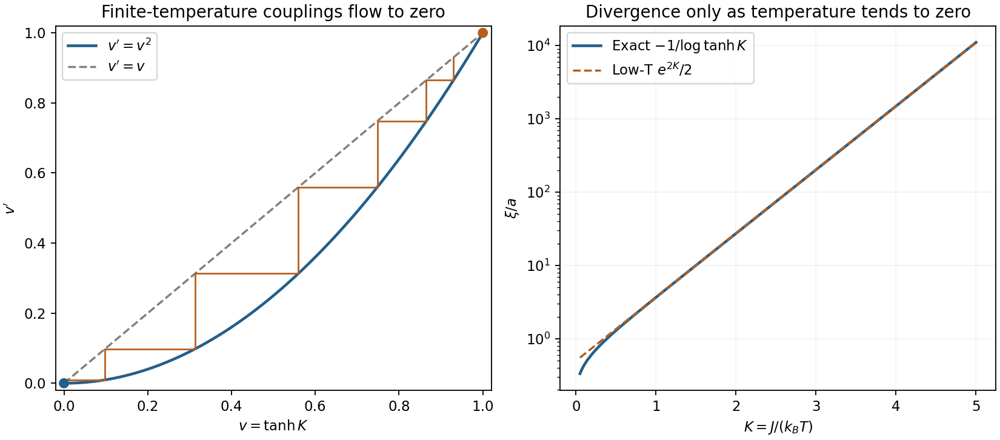

<h1 id="3/c/solution">Solution</h1>

↑ **Parent:** [C](../c.md)

For a ferromagnetic nearest-neighbour [Ising model](../../../../../ising-model.md) on a chain let $s_i=\pm1$, $K=J/(k_BT)>0$ and $h=H/(k_BT)$. The dimensionless [Hamiltonian](../../../../../hamiltonian.md) is $-K\sum_i s_is_{i+1}-h\sum_i s_i$. In one dimension, decimating every other spin closes exactly within the nearest-neighbour family, including its additive constant. This is the exact chain building block of the [Migdal-Kadanoff approach](../../../../../migdal-kadanoff-approximation.md); [bond moving](../../../../../bond-moving.md) becomes an additional approximation in higher-dimensional lattices.

For [exact zero-field Ising-chain decimation](../../../../../exact-zero-field-ising-chain-decimation.md), sum over an intermediate spin $\sigma$ between two retained spins:

$$
W(s,s')=\sum_{\sigma=\pm1}e^{K(s\sigma+\sigma s')}
=2\cosh[K(s+s')]=A(K)e^{K'ss'}.
$$

Parallel and antiparallel end spins give $Ae^{K'}=2\cosh2K$ and $Ae^{-K'}=2$. Hence

$$
\boxed{K'=\tfrac12\log\cosh2K,\qquad
A=2\sqrt{\cosh2K},\qquad\tanh K'=(\tanh K)^2.}
$$

For an even periodic chain, $Z_N(K)=A^{N/2}Z_{N/2}(K')$. Rescaling the lattice spacing $2a$ back to $a$ completes the [renormalization](../../../../../renormalization.md) step. Decimation of $b$ successive links gives $\tanh K'=(\tanh K)^b$, as follows by multiplying the [transfer matrix](../../../../../transfer-matrix.md) $b$ times.

Let $v=\tanh K$. Then $v'=v^2$ on $0\le v\le1$. The infinite-temperature [renormalization-group fixed point](../../../../../renormalization-group-fixed-point.md) $v=0$ attracts every $0\le v<1$; the zero-temperature [renormalization-group fixed point](../../../../../renormalization-group-fixed-point.md) $v=1$ is unstable to heating, with slope two. There is no intermediate ferromagnetic [renormalization-group fixed point](../../../../../renormalization-group-fixed-point.md). Equivalently $K'\simeq K^2$ for small $K$, while $K'\simeq K-\tfrac12\log2$ for large finite $K$. Thus **there is no finite-temperature ordered [thermodynamic phase](../../../../../thermodynamic-phase.md) in the short-range chain**.

The [domain-wall scaling coordinate of an Ising chain](../../../../../domain-wall-scaling-coordinate-of-an-ising-chain.md) near $T=0$ is the domain-wall [Boltzmann factor](../../../../../boltzmann-factor.md) $w=e^{-2K}$. Its recursion and the zero-field [correlation length](../../../../../correlation-length.md) are

$$
w'=\frac{2w}{1+w^2}\simeq2w,\qquad
\langle s_0s_n\rangle=(\tanh K)^{|n|},\qquad
\boxed{\frac\xi a=-\frac1{\log\tanh K}\sim\frac1{2w}=\frac12e^{2J/(k_BT)}.}
$$

Since $\xi(K')/a=[\xi(K)/a]/2$, the recursion has the correct [length](../../../../../length.md) scaling. Its exponent is one with respect to $w$; **it is not a finite power of physical [temperature](../../../../../temperature-split.md) about $T_c=0$**. In the [thermodynamic limit](../../../../../thermodynamic-limit.md), a bond is a [domain wall](../../../../../domain-wall.md) with [probability](../../../../../probability.md) $(1-\tanh K)/2\sim e^{-2K}$, giving the same exponentially large [length](../../../../../length.md) scale. Their finite [energy](../../../../../energy-split.md) allows [entropy](../../../../../entropy-split.md) to proliferate walls at any positive [temperature](../../../../../temperature-split.md).

**[Figure 4](#3/c/image-exact-ising-chain-decimation-and-length). Exact Ising-chain decimation and length**. Original one-dimensional recursion v'=v squared, finite-temperature iterates flowing to zero and the exact correlation length with its low-temperature asymptote. The coordinate v is tanh(J/kBT); no finite-temperature critical point is introduced.

The [Ising-chain decimation constant](../../../../../ising-chain-decimation-constant.md) matters for thermodynamics. With dimensionless [free energy](../../../../../thermodynamic-free-energy.md) per spin $f=-\lim N^{-1}\log Z_N$,

$$
f(K)=-\tfrac12\log A(K)+\tfrac12 f(K'),\qquad
\boxed{f(K)=-\log(2\cosh K).}
$$

The second expression follows independently from transfer [eigenvalues](../../../../../eigenvalue.md) $2\cosh K$ and $2\sinh K$ and satisfies the recursion. Multiplying it by $k_BT$ restores the physical [free energy](../../../../../thermodynamic-free-energy.md). Dropping $A$ would preserve normalized retained-spin [probabilities](../../../../../probability.md) but lose the eliminated-spin [entropy](../../../../../entropy-split.md).

[Finite-field Ising-chain decimation](../../../../../finite-field-ising-chain-decimation.md) is also exact. Use the symmetric [transfer matrix](../../../../../transfer-matrix.md)

$$
T=\begin{pmatrix}e^{K+h}&e^{-K}\\e^{-K}&e^{K-h}\end{pmatrix},\quad W=T^2,
$$

and read the new couplings from

$$
\boxed{K'=\frac14\log\frac{W_{++}W_{--}}{W_{+-}^2},\qquad
h'=\frac12\log\frac{W_{++}}{W_{--}},\qquad
A=(W_{++}W_{--}W_{+-}^2)^{1/4}.}
$$

Here $W_{++}=e^{2K+2h}+e^{-2K}$, $W_{--}=e^{2K-2h}+e^{-2K}$ and $W_{+-}=2\cosh h$. The latter off-diagonal entry, the field convention split between adjacent bonds and the constant must all be tracked consistently. Near the zero-temperature zero-field [renormalization-group fixed point](../../../../../renormalization-group-fixed-point.md) $h'\simeq2h$, while at $K=0$ the independent-spin field is unchanged.

In the higher-dimensional [Migdal-Kadanoff approximation](../../../../../migdal-kadanoff-approximation.md), moving bonds creates chains that can be decimated. With [bond moving](../../../../../bond-moving.md) first on a $d$-dimensional hypercubic lattice and [length](../../../../../length.md) factor $b$, the strengthened links have $b^{d-1}K$, giving the convention

$$
K'=\operatorname{artanh}\!\left[\tanh^b(b^{d-1}K)\right].
$$

For $d=1$ no transverse bonds move, so this reduces to the exact chain result. In higher dimensions it discards geometric [correlations](../../../../../pearson-correlation-coefficient.md) and is generally approximate on the original lattice; moving and decimating in another order yields another approximation, not a contradictory exact chain formula.[lecture 13, printed pp. 79–81, equations V.18–V.27: exact chain; lecture 14, printed pp. 86–87, equations V.51–V.54: bond-moving convention](../../../../../position-space-renormalization-group-by-mehran-kardar.md)

## ↑ Ancestors (14)

1. [C](../c.md)
2. [3](../../3.md)
3. [Paper 1](../../../paper-1-split.md)
4. [2012](../../../split.md)
5. [Past exam of the phase transitions and collective phenomena course of the University of Cambridge](../../../../split.md)
6. [Phase Transitions and Collective Phenomena course of the University of Cambridge](../../../../../phase-transitions-and-collective-phenomena-course-of-the-university-of-cambridge.md)
7. [Physics course of the year 4 of the natural sciences course of the University of Cambridge](../../../../../physics-course-of-the-year-4-of-the-natural-sciences-course-of-the-university-of-cambridge.md)
8. [Year 4 of the natural sciences course of the University of Cambridge](../../../../../year-4-of-the-natural-sciences-course-of-the-university-of-cambridge.md)
9. [Year of the natural sciences course of the University of Cambridge](../../../../../year-of-the-natural-sciences-course-of-the-university-of-cambridge.md)
10. [Natural sciences course of the University of Cambridge](../../../../../natural-sciences-course-of-the-university-of-cambridge.md)
11. [Course of the University of Cambridge](../../../../../course-of-the-university-of-cambridge.md)
12. [University of Cambridge](../../../../../university-of-cambridge-split.md)
13. [List of universities](../../../../../list-of-universities.md)
14. [Codex Wiki](../../../../../split.md)
