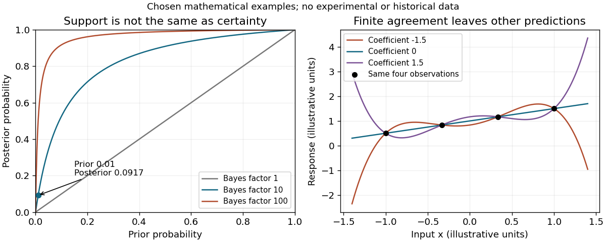

<h1 id="4/solution">Solution</h1>

↑ **Parent:** [4](../4.md)

[Bayes' theorem](../../../bayes-theorem.md) solves a precise part of the [scientific confirmation](../../../scientific-confirmation.md) problem: it gives a coherent relation between prior commitments, evidential [likelihoods](../../../likelihood-function.md) and updated [probabilities](../../../probability.md). It does not select those commitments from no premises, and it should not be identified with every meaning of confirmation.

For background information $K$, a [hypothesis](../../../hypothesis.md) $H$ and newly considered evidence $E$, let $p=P(H\mid K)$, $a=P(E\mid H,K)$ and $b=P(E\mid\neg H,K)$. With a positive denominator,

$$
P(H\mid E,K)=\frac{pa}{pa+(1-p)b},\qquad
\frac{P(H\mid E,K)}{P(\neg H\mid E,K)}=\frac{p}{1-p}\frac ab.
$$

The first formula requires a positive denominator; the odds formula additionally assumes $0<p<1$ and $b>0$. The second equation separates [prior odds](../../../prior-odds.md) from the [Bayes factor](../../../bayes-factor.md). For $0<p<1$, the evidence raises the [probability](../../../probability.md) of $H$ exactly when $a>b$. It is not enough that $E$ is likely under $H$; it must be more likely than under the relevant alternative mixture. This guards against an inverse-[probability](../../../probability.md) error in evaluating scientific tests.

For example, let the prior be 0.01 and the two [likelihoods](../../../likelihood-function.md) be 0.8 and 0.08. The [Bayes factor](../../../bayes-factor.md) is ten, but the [posterior probability](../../../posterior-probability.md) is only $10/109\simeq0.0917$. The evidence strongly favours $H$ relative to its previous odds without making $H$ probable in an absolute sense. Evidence can therefore confirm a [hypothesis](../../../hypothesis.md) while leaving a rational investigator doubtful. The comparison also depends on which alternatives are included in $\neg H$ and how their [probabilities](../../../probability.md) are distributed.

The [raven paradox](../../../raven-paradox.md) shows another benefit. Logically equivalent claims receive identical [probabilities](../../../probability.md) in the same probabilistic model, but this does not force every investigation of a white object to provide the same evidence about ravens. If an object is selected because it is already known to be a shoe, observing that it is not a raven may have equal [likelihood](../../../likelihood-function.md) under the rival [hypotheses](../../../hypothesis.md) and provide a [Bayes factor](../../../bayes-factor.md) of one. Random selection from a specified population can give different [likelihoods](../../../likelihood-function.md). The sampling procedure and background information must be represented, rather than letting a grammatical positive-instance rule determine evidential support.[Section 5: equivalence and the paradox of positive-instance confirmation](../../../studies-in-the-logic-of-confirmation-i-by-carl-hempel.md)[Analysis of dependence on background knowledge, sampling assumptions and alternative hypotheses](../../../how-bayesian-confirmation-theory-handles-the-paradox-of-the-ravens-by-branden-fitelson-and-james-hawthorne.md)

The [problem of old evidence](../../../problem-of-old-evidence.md) is a genuine limit of the simplest updating account. If $E$ already belongs to $K$, conditioning on it again produces no increase. Yet an old [measurement](../../../measurement.md) can be important support for a newly formulated theory. One may assess support relative to a specified earlier or counterfactual background, or model learning a previously unrecognized connection between theory and evidence. These are substantive additions. Simply applying the same conditioning rule to an already certain fact does not represent the new intellectual achievement.[Chapter 3 of Theory and Evidence: old evidence and newly considered theory](../../../why-i-am-not-a-bayesian-by-clark-glymour.md)

Other limitations concern model construction and priors. A [hypothesis](../../../hypothesis.md) assigned zero [prior probability](../../../prior-probability.md) remains at zero after ordinary conditioning on evidence of positive total [probability](../../../probability.md). A badly specified [likelihood](../../../likelihood-function.md) can generate confident but unreliable results. Different reasonable priors need not disappear under finite or non-discriminating evidence. Nor does the theorem supply a noncircular solution to the [problem of induction](../../../problem-of-induction.md): the model's connection to future physical events remains an empirical commitment.

**[Figure 1](#4/image-posterior-probability-depends-on-prior-odds-while-finite-observations-leave-alternative-continuations). Posterior probability depends on prior odds, while finite observations leave alternative continuations**. Original mathematical illustrations with explicitly chosen probabilities and functions, not historical or experimental data.

Thus the Bayesian framework gives a rigorous account of [probability](../../../probability.md) change, comparison of alternatives and some apparent paradoxes. These are real achievements. It is incomplete as a general recipe for scientific judgment unless the [hypotheses](../../../hypothesis.md), backgrounds, [likelihoods](../../../likelihood-function.md) and forms of learning are also defended. A mathematical rule of coherent updating can organize evidential reasoning without establishing that every coherent input represents nature correctly.

## ↑ Ancestors (11)

1. [4](../4.md)
2. [2016](../../2016-split.md)
3. [Past exam of the philosophy of science supplementary subject of the University of Oxford](../../split.md)
4. [Philosophy of science supplementary subject of the University of Oxford](../../../philosophy-of-science-supplementary-subject-of-the-university-of-oxford.md)
5. [Supplementary subject of the physics course of the University of Oxford](../../../supplementary-subject-of-the-physics-course-of-the-university-of-oxford.md)
6. [Physics course of the University of Oxford](../../../physics-course-of-the-university-of-oxford.md)
7. [Undergraduate course of the University of Oxford](../../../undergraduate-course-of-the-university-of-oxford.md)
8. [Course of the University of Oxford](../../../course-of-the-university-of-oxford.md)
9. [University of Oxford](../../../university-of-oxford-split.md)
10. [List of universities](../../../list-of-universities.md)
11. [Codex Wiki](../../../split.md)
