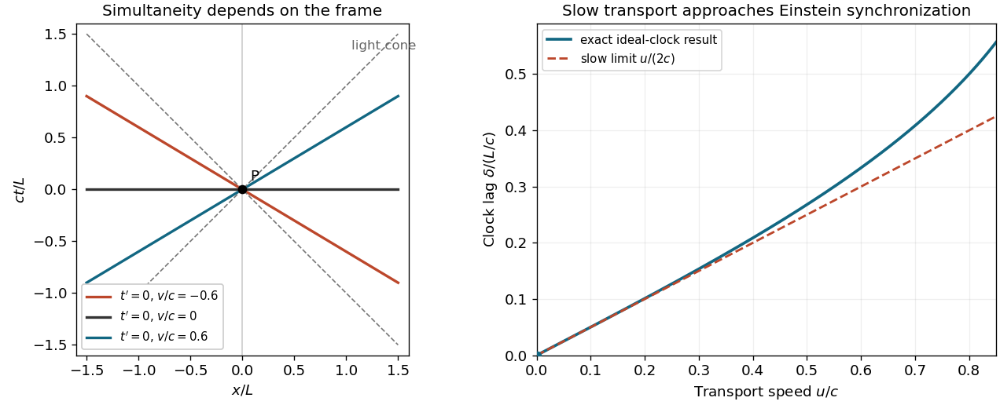

# 2019

↑ **Parent:** [Past exam of the philosophy of space-time and philosophy of quantum mechanics paper of Parts A and B of the physics course of the University of Oxford](../past-exam-of-the-philosophy-of-space-time-and-philosophy-of-quantum-mechanics-paper-of-parts-a-and-b-of-the-physics-course-of-the-university-of-oxford.md)

Source paper: [https://www.whatdotheyknow.com/request/oxford_physics_past_papers_2/response/2340696/attach/7/Physics%20Papers%202018.pdf?cookie_passthrough=1](https://www.whatdotheyknow.com/request/oxford_physics_past_papers_2/response/2340696/attach/7/Physics%20Papers%202018.pdf?cookie_passthrough=1)

The cover dates this combined paper to Trinity Term 2019 and prints both formal codes. The public bundle's filename says 2018; the cover controls the year. All fourteen requests, including both alternatives in 1 and 8, have solutions below.

**Table of contents**

- [1](#1)
  - [a](#1/a)
    - [Solution](#1/a/solution)
  - [b](#1/b)
    - [Solution](#1/b/solution)
- [2](#2)
  - [Solution](#2/solution)
- [3](#3)
  - [Solution](#3/solution)
- [4](#4)
  - [Solution](#4/solution)
- [5](#5)
  - [Solution](#5/solution)
- [6](#6)
  - [Solution](#6/solution)
- [7](#7)
  - [Solution](#7/solution)
- [8](#8)
  - [a](#8/a)
    - [Solution](#8/a/solution)
  - [b](#8/b)
    - [Solution](#8/b/solution)
- [9](#9)
  - [Solution](#9/solution)
- [10](#10)
  - [Solution](#10/solution)
- [11](#11)
  - [Solution](#11/solution)
- [12](#12)
  - [Solution](#12/solution)

## 1

↑ **Parent:** [2019](2019.md)

<h3 id="1/a">a</h3>

↑ **Parent:** [1](#1)

<h4 id="1/a/solution">Solution</h4>

↑ **Parent:** [A](#1/a)

**There is no unconditional logical dependence of [Newton's first law](../force.md#newton-s-first-law) on [Newton's third law](../force.md#newton-s-third-law).** There is, however, a dependence if one applies the first to an extended, isolated composite and interprets its [motion](../classical-mechanics.md#motion) as the [motion](../classical-mechanics.md#motion) of its [centre of mass](../classical-mechanics.md#center-of-mass). The difference is between the behaviour of an elementary body with zero total [force](../force.md) and a theorem about cancellation of internal [forces](../force.md). [Isaac Newton](../mathematics.md#isaac-newton)'s own first-law discussion includes projectiles and spinning bodies, so the composite-body issue is physically significant.[Axioms, Laws I–III and Corollary III; distinguish impressed forces and the common centre of gravity](../physics-bibliography.md#the-mathematical-principles-of-natural-philosophy-by-isaac-newton-1846-edition)

For a constant positive [mass](../classical-mechanics.md#mass) in an [inertial frame](../mathematical-physics.md#inertial-frame), [Newton's second law](../force.md#newton-s-second-law) gives $m\ddot{\mathbf x}=\mathbf F$. Setting the total [force](../force.md) to zero yields uniform rectilinear [motion](../classical-mechanics.md#motion); it uses no action–reaction assumption. The first law additionally identifies a common class of [inertial frames](../mathematical-physics.md#inertial-frame) in which such a statement applies. One cannot establish that class by arbitrarily straightening a single [trajectory](../classical-mechanics.md#trajectory), and one cannot test the claim by defining every observed [acceleration](../classical-mechanics.md#acceleration) to be an unspecified [force](../force.md).

A concrete countermodel separates these issues. Suppose two bodies obey the second-law equations with internal [forces](../force.md) $\mathbf F_{12}=\mathbf f$ and $\mathbf F_{21}=-2\mathbf f$, with nonzero constant $\mathbf f$. Every elementary body with zero total [force](../force.md) still has constant [velocity](../classical-mechanics.md#velocity), but the two-body [momentum](../momentum.md) satisfies

$$
\frac{d}{dt}(\mathbf p_1+\mathbf p_2)=-\mathbf f.
$$

Thus the elementary-body first law is compatible with failure of the third. Calling the pair isolated does not make its internal total [force](../force.md) zero: that is precisely what has not been assumed. This countermodel establishes logical independence, not a proposal for a successful fundamental interaction.

Now strengthen the first-law claim: every isolated composite has an inertially moving [centre of mass](../classical-mechanics.md#center-of-mass) whenever the total [external force](../force.md#external-force) vanishes. With $M=\sum_i m_i$, [Newton's second law](../force.md#newton-s-second-law) gives

$$
M\ddot{\mathbf R}=\sum_i\mathbf F_i^{\rm ext}
+\sum_{i<j}(\mathbf F_{ij}+\mathbf F_{ji}).
$$

For an isolated pair, the strengthened claim requires $\mathbf F_{12}+\mathbf F_{21}=0$. This is the weak, equal-and-opposite form of [Newton's third law](../force.md#newton-s-third-law). It does not by itself require collinearity with the bodies' separation; the central-force condition is stronger and bears on [conservation of angular momentum](../momentum.md#conservation-of-angular-momentum). For many bodies, cancellation of the sum does not alone imply pairwise cancellation without assumptions about the decomposition into interactions.

The right conclusion is therefore conditional. A first law for individual force-free bodies does not presuppose the third law. A first law for all isolated material composites, combined with the usual [centre of mass](../classical-mechanics.md#center-of-mass) and [Newton's second law](../force.md#newton-s-second-law), imports an internal-[momentum](../momentum.md)-balance condition. In theories with dynamical [fields](../algebra.md#field), material bodies can exchange [momentum](../momentum.md) with those [fields](../algebra.md#field); [conservation of momentum](../momentum.md#momentum-conservation) then concerns the combined system and need not imply instantaneous pairwise action–reaction between particles.

<h3 id="1/b">b</h3>

↑ **Parent:** [1](#1)

<h4 id="1/b/solution">Solution</h4>

↑ **Parent:** [B](#1/b)

**The familiar result follows if the [force laws](../force.md#force-law) have [Galilean invariance](../special-relativity.md#galilean-invariance); the three abstract [Newton's laws of motion](../force.md#newton-s-laws-of-motion) do not guarantee that invariance.** [Isaac Newton](../mathematics.md#isaac-newton)'s Corollary V correctly identifies a central feature of ordinary [Newtonian mechanics](../newtonian-mechanics.md), but its general physical scope requires assumptions about interactions as well as about the relation between [force](../force.md) and [acceleration](../classical-mechanics.md#acceleration).[Axioms, Corollary V and the accompanying equal-acceleration argument](../physics-bibliography.md#the-mathematical-principles-of-natural-philosophy-by-isaac-newton-1846-edition)

Take a constant [velocity](../classical-mechanics.md#velocity) $\mathbf U$ and a [Galilean transformation](../special-relativity.md#galilean-transformation)

$$
\mathbf x_i'=\mathbf x_i-\mathbf U t,\qquad t'=t.
$$

Then $\ddot{\mathbf x}'_i=\ddot{\mathbf x}_i$, $\mathbf x_i'-\mathbf x_j'=\mathbf x_i-\mathbf x_j$, and $\dot{\mathbf x}'_i-\dot{\mathbf x}'_j=\dot{\mathbf x}_i-\dot{\mathbf x}_j$. Any interaction depending only on these relative quantities, with unchanged parameters, supplies the same [forces](../force.md) for the transformed initial data. [Newton's second law](../force.md#newton-s-second-law) consequently gives the same relative [accelerations](../classical-mechanics.md#acceleration); uniqueness of the resulting [initial value problem](../differential-equation.md#initial-value-problem) supplies the same relative histories. An inverse-square central interaction is a standard example. [Newton's third law](../force.md#newton-s-third-law) helps establish the common [centre of mass](../classical-mechanics.md#center-of-mass) result, but the boost argument principally needs invariant interactions and the second law.

Here is a counterexample to deduction from the three laws alone. Give two equal [masses](../classical-mechanics.md#mass) a preferred [inertial frame](../mathematical-physics.md#inertial-frame) and write $\mathbf r=\mathbf x_1-\mathbf x_2$, $\mathbf V=(\dot{\mathbf x}_1+\dot{\mathbf x}_2)/2$. For fixed $k>0$ and speed scale $u_*>0$, specify

$$
\mathbf F_{12}=-k\left(1+\frac{|\mathbf V|^2}{u_*^2}\right)\mathbf r,
\qquad \mathbf F_{21}=-\mathbf F_{12}.
$$

The [forces](../force.md) are equal, opposite and central, the [centre of mass](../classical-mechanics.md#center-of-mass) is inertial, and each body obeys $m\ddot{\mathbf x}_i=\mathbf F_i$. An elementary body with no [force](../force.md) is inertial. Nevertheless,

$$
\ddot{\mathbf r}=-\frac{2k}{m}\left(1+\frac{|\mathbf V|^2}{u_*^2}\right)\mathbf r.
$$

Boosting an isolated pair from $\mathbf V=0$ to $\mathbf V=\mathbf U$ changes its internal oscillation frequency. All three motion laws hold, but the proposed universal boost equivalence fails. The extra preferred structure in the [force law](../force.md#force-law) is what makes the failure possible.

A passive [coordinate transformation](../differential-geometry.md#smooth-transition-map) of this same model remains possible: transform the preferred frame's description too. That mathematical freedom does not establish an active [dynamical symmetry](../physics.md#dynamical-symmetry) which changes the physical pair's [velocity](../classical-mechanics.md#velocity) relative to the preferred structure while holding the laws' background data fixed. Confusing those operations would hide the counterexample.

Finally, a change to rotating coordinates introduces [centrifugal forces](../mathematical-physics.md#centrifugal-force) and [Coriolis forces](../mathematical-physics.md#coriolis-force); their dependence on [position](../classical-mechanics.md#position) or [velocity](../classical-mechanics.md#velocity) can change internal experiments. Constant translational [velocity](../classical-mechanics.md#velocity) has no analogous effect when the interactions have [Galilean invariance](../special-relativity.md#galilean-invariance). Corollary V expresses that physical symmetry, with the interaction assumption made explicit, rather than a consequence of action–reaction alone.

## 2

↑ **Parent:** [2019](2019.md)

<h3 id="2/solution">Solution</h3>

↑ **Parent:** [2](#2)

**One can derive a family containing the [Lorentz transformations](../special-relativity.md#lorentz-transformation) without assuming anything about [light](../optics.md#light), but the [Einstein's principle of relativity](../special-relativity.md#einstein-s-principle-of-relativity) alone does not select that family member over the [Galilean transformation](../special-relativity.md#galilean-transformation).** Extra assumptions must be stated: spatial and temporal [translational symmetry](../physics.md#translational-symmetry), [isotropy](../continuum-mechanics.md#isotropy) of [SPACE](../theoretical-computer-science.md#deterministic-space-complexity-class), continuous transformations between equivalent [inertial frames](../mathematical-physics.md#inertial-frame), reciprocity, and closure under composition. These are substantive restrictions, rather than consequences of the bare assertion that physical laws agree between [inertial frames](../mathematical-physics.md#inertial-frame).

Here is the algebraic content. [Translational symmetry](../physics.md#translational-symmetry) makes the transformation between coincident origins a [linear transformation](../vector-space.md#linear-map). In one spatial direction the moving origin $x=vt$ fixes $x'=a(v)(x-vt)$. [Isotropy](../continuum-mechanics.md#isotropy) and the inverse transformation at $-v$ allow the standard calibrated form

$$
\begin{pmatrix}t'\\x'\end{pmatrix}
=\frac{1}{\sqrt{1-Kv^2}}
\begin{pmatrix}1&-Kv\\-v&1\end{pmatrix}
\begin{pmatrix}t\\x\end{pmatrix}.
$$

To see why $K$ is universal, temporarily write the upper-right entry as $-b(v)$, leaving the lower-left entry $-v$. Equality of the two diagonal entries in a composite boost gives $b(u)v=u b(v)$, so $b(v)/v=K$ is constant for nonzero boosts. Inversion fixes $a(v)^2(1-Kv^2)=1$, with the positive branch continuous at zero. This is the [universality of an invariant speed under boost composition](../special-relativity.md#universality-of-an-invariant-speed-under-boost-composition).

The resulting [velocity-addition formula](../special-relativity.md#velocity-addition-formula) law and invariant quadratic expression are

$$
w=\frac{u+v}{1+Kuv},\qquad dt'^2-K\,dx'^2=dt^2-K\,dx^2.
$$

For $K>0$, $C=K^{-1/2}$ is an invariant limiting [speed](../classical-mechanics.md#speed); setting the empirically determined $C$ equal to the vacuum [speed of light](../special-relativity.md#speed-of-light) gives the standard [Lorentz transformation](../special-relativity.md#lorentz-transformation). For $K=0$, $t'=t$ and $x'=x-vt$: an entirely consistent [Galilean transformation](../special-relativity.md#galilean-transformation) satisfying the stated [Einstein's principle of relativity](../special-relativity.md#einstein-s-principle-of-relativity). Thus the general assumptions do not establish that an invariant finite [speed](../classical-mechanics.md#speed) exists, much less identify it with [light](../optics.md#light).

There is also a formal negative-$K$ branch, which has a rotation-like geometry in the time–space plane. Standard derivations exclude it using additional global assumptions, such as a preserved [time orientation](../general-relativity.md#time-orientation) and unrestricted composition of admissible boosts. Without identifying those assumptions it is misleading to claim a two-way classification from the [Einstein's principle of relativity](../special-relativity.md#einstein-s-principle-of-relativity) alone. In three spatial dimensions [isotropy](../continuum-mechanics.md#isotropy) requires the same constant in every direction.

The [light](../optics.md#light) postulate is therefore dispensable as the starting point for a conditional kinematical derivation; empirical input remains indispensable in identifying our world's value and sign of $K$. [Albert Einstein](../physicist.md#albert-einstein)'s original construction uses the [light](../optics.md#light) postulate and [Einstein synchronisation](../special-relativity.md#einstein-synchronisation), making that empirical connection explicit.[§§1–3, synchronization and the derivation from the two postulates](../physics-bibliography.md#on-the-electrodynamics-of-moving-bodies-by-albert-einstein) Replacing the postulate by an independently established finite invariant [speed](../classical-mechanics.md#speed) changes the route, rather than deriving all of [special relativity](../special-relativity.md) from relativity alone.

## 3

↑ **Parent:** [2019](2019.md)

<h3 id="3/solution">Solution</h3>

↑ **Parent:** [3](#3)

**Matching [spacetime symmetries](../physics.md#spacetime-symmetry) to [dynamical symmetries](../physics.md#dynamical-symmetry) is a powerful demand for a coherent interpretation, but an unconditional equality theorem does not follow from logic or from [general covariance](../general-relativity.md#general-covariance).** A [spacetime symmetry](../physics.md#spacetime-symmetry) preserves the structure declared physically significant: for [Minkowski spacetime](../special-relativity.md#minkowski-spacetime), the [metric tensor](../general-relativity.md#metric-tensor) and relevant orientations. A [dynamical symmetry](../physics.md#dynamical-symmetry) takes solutions to solutions with the laws' fixed backgrounds held fixed. The appropriate comparison concerns external transformations on the same physical quantities; internal [gauge symmetries](../relativistic-quantum-field.md#gauge-invariance) have no reason to be isometries of [spacetime](../special-relativity.md#spacetime).

One direction becomes a theorem after important premises are supplied. Suppose all fixed background structure is geometrical and the matter equations are constructed covariantly from it. An automorphism of that full structure then takes solutions of those equations to solutions. For example, the [Klein-Gordon equation](../wave-equation.md#klein-gordon-equation) $(\eta^{ab}\partial_a\partial_b+m^2)\phi=0$, in units $c=\hbar=1$, has the [Poincaré symmetry](../special-relativity.md#poincare-symmetry) of the fixed [Minkowski metric](../special-relativity.md#minkowski-metric). This is an explanation of symmetry inheritance conditional on a coupling prescription; it does not derive that prescription from the bare existence of a [metric tensor](../general-relativity.md#metric-tensor).

A counterexample exposes the missing premise. On the same [Minkowski spacetime](../special-relativity.md#minkowski-spacetime), add a fixed timelike [vector field](../multivariable-calculus.md#vector-field) $n^a$ and a matter term

$$
\mathcal L=-\frac12\eta^{ab}\partial_a\phi\partial_b\phi
-\frac{\alpha}{2}(n^a\partial_a\phi)^2.
$$

For generic nonzero $\alpha$, a boost which preserves $\eta$ but changes $n$ is not a symmetry with that background held fixed. The full background has fewer symmetries than the [metric tensor](../general-relativity.md#metric-tensor) alone. Writing the equations in arbitrary coordinates and transforming $n$ as a [vector field](../multivariable-calculus.md#vector-field) gives [general covariance](../general-relativity.md#general-covariance), not [Lorentz invariance](../special-relativity.md#lorentz-invariance). Conversely, redundant unobservable geometrical structure could make the declared [spacetime symmetry](../physics.md#spacetime-symmetry) group artificially too small. Accidental symmetries of a restricted matter sector could make its [dynamical symmetry](../physics.md#dynamical-symmetry) group too large.

There are deeper motivations for avoiding such mismatches. If all measuring devices obey [Lorentz-invariant dynamics](../special-relativity.md#lorentz-invariant-dynamics), their behaviour supports a common [Minkowski metric](../special-relativity.md#minkowski-metric) interpretation; adding an undetectable preferred rest structure sacrifices explanatory economy. If a preferred structure affects some device, then the original metric-only geometry was incomplete as a description of physical background structure. These observations support either revising the geometry or explaining the universal matter symmetry, but they are methodological and interpretive arguments, not an automatic metaphysical identity.[§§3–5, rods, clocks and the relation between geometry and matter dynamics](../physics-bibliography.md#minkowski-space-time-a-glorious-non-entity-by-harvey-r-brown-and-oliver-pooley)

Two qualifications matter. [Boundary conditions](../differential-equation.md#boundary-condition) and [initial conditions](../differential-equation.md#initial-condition) can select a rest frame in an individual solution while the laws remain boost symmetric. Also, a symmetry of the complete theory need not be detectable by transforming only a subsystem relative to its environment. The best principle therefore matches the physically relevant geometry to the external symmetries of the complete laws, after all backgrounds and couplings are included. Calling it merely a bookkeeping preference understates its explanatory value; calling it an unavoidable consequence of covariance overstates its logical force.

## 4

↑ **Parent:** [2019](2019.md)

<h3 id="4/solution">Solution</h3>

↑ **Parent:** [4](#4)

**The ideal [slow clock transport synchronization](../special-relativity.md#slow-clock-transport-synchronization) procedure reproduces [Einstein synchronisation](../special-relativity.md#einstein-synchronisation) in an [inertial frame](../mathematical-physics.md#inertial-frame), as a limiting result about [proper time](../special-relativity.md#proper-time).** It does not determine distant simultaneity without assumptions about [clocks](../classical-mechanics.md#clock) and their [dynamics](../physics.md#dynamics-mechanics). Begin with identical ideal [clocks](../classical-mechanics.md#clock) together at $x=0$, with matching rates and readings. Leave one there and transport the other to a laboratory position $L$ at small constant [speed](../classical-mechanics.md#speed) $u$, neglecting [gravity](../physics.md#gravity). Use Einstein-synchronised laboratory coordinates to calculate the result, rather than assuming that the transported [clock](../classical-mechanics.md#clock) already displays coordinate [time](../classical-mechanics.md#time-in-physics).

The journey takes laboratory [time](../classical-mechanics.md#time-in-physics) $T=L/u$. The transported [clock](../classical-mechanics.md#clock)'s [proper time](../special-relativity.md#proper-time) is $\tau=T\sqrt{1-u^2/c^2}$, giving the lag

$$
\delta=T-\tau=\frac{L}{u}\left(1-\sqrt{1-u^2/c^2}\right)
=\frac{Lu}{c^2\left(1+\sqrt{1-u^2/c^2}\right)}.
$$

Consequently

$$
\boxed{\delta\sim\frac{Lu}{2c^2}\longrightarrow0\quad(u\longrightarrow0).}
$$

The small [time dilation](../special-relativity.md#time-dilation) accumulates over a long journey, but its quadratic dependence on $u$ dominates the journey's inverse dependence on $u$. Saying that the journey is arbitrarily long is therefore not an objection to this limit. For a nonuniform journey with $|v|\leq u$, $\delta=\int(1-\sqrt{1-v^2/c^2})dt$; a simple monotonic path of fixed [length](../physics.md#length) has the same vanishing bound. Acceleration stages can be arranged with vanishing displacement and [proper time](../special-relativity.md#proper-time) deficit, assuming the [clock hypothesis](../special-relativity.md#clock-hypothesis).[§4, transported clocks and the leading quadratic retardation](../physics-bibliography.md#on-the-electrodynamics-of-moving-bodies-by-albert-einstein)

This procedure establishes synchronization operationally for stationary laboratory [clocks](../classical-mechanics.md#clock), once ideal-clock behaviour has empirical support. It does not show that every actual device is insensitive to transport: thermal shifts, [acceleration](../classical-mechanics.md#acceleration)-dependent mechanisms or differing [gravitational potentials](../newton-s-law-of-universal-gravitation.md#newtonian-potential-of-a-point-mass) can spoil the idealization. Nor does the same construction define global synchronization for rotating laboratories, where path dependence is significant.

The conventionality question is separate. Resynchronize the same laboratory with $t_\kappa=t+\kappa x/c$, where $|\kappa|<1$. At the arrival event the transported [clock](../classical-mechanics.md#clock) approaches the reading $t$, whereas a stationary [clock](../classical-mechanics.md#clock) displaying $t_\kappa$ reads $t+\kappa L/c$. Slow transport has not eliminated that difference. The transformed [metric tensor](../general-relativity.md#metric-tensor) has an off-diagonal term, and the [proper time](../special-relativity.md#proper-time) calculation still gives the same physical [clock](../classical-mechanics.md#clock) reading: changing labels cannot change its ticks. This is the [invariance of reunion ages under clock resynchronization](../special-relativity.md#invariance-of-reunion-ages-under-clock-resynchronization), applied to transport comparisons.

[Slow clock transport synchronization](../special-relativity.md#slow-clock-transport-synchronization) is thus a useful physical realization of a preferred conventional coordinate choice given [Lorentz-invariant dynamics](../special-relativity.md#lorentz-invariant-dynamics) and ideal [clocks](../classical-mechanics.md#clock). It does not independently prove that the one-way [speed of light](../special-relativity.md#speed-of-light) must be isotropic in every admissible synchronization. It supplies a reproducible convention with a strong physical rationale, rather than a convention-free observation of an absolute present.

## 5

↑ **Parent:** [2019](2019.md)

<h3 id="5/solution">Solution</h3>

↑ **Parent:** [5](#5)

**[Spacetime](../special-relativity.md#spacetime) geometry gives an acceptable structural explanation of [length contraction](../special-relativity.md#length-contraction), provided the relation between material [rods](../physics.md#measuring-rod), measurement and the [metric tensor](../general-relativity.md#metric-tensor) is included.** It is not a force that squeezes a rod, and the mere existence of a quadratic form cannot guarantee how arbitrary matter behaves. The explanatory issue is whether a common geometrical constraint is sufficient for the phenomenon at issue, or whether a [constructive theory](../physics.md#constructive-theory) of the rod is also required.

For an equilibrium [rod](../physics.md#measuring-rod) with [proper length](../special-relativity.md#proper-length) $L_0$, use its [rest frame](../mathematical-physics.md#rest-frame) $S'$, where its endpoint histories are $x'_A=0$ and $x'_B=L_0$. In a laboratory frame use

$$
x'=\gamma(x-vt),\qquad \gamma=(1-v^2/c^2)^{-1/2}.
$$

A laboratory measurement compares endpoints at the same laboratory [time](../classical-mechanics.md#time-in-physics). Subtract the two endpoint equations at $\Delta t=0$ to obtain

$$
\boxed{L=\Delta x=L_0/\gamma.}
$$

The two frames measure different pairs of [spacetime events](../special-relativity.md#event-relativity). There is no contradiction in each assigning the other's moving [rods](../physics.md#measuring-rod) smaller [lengths](../physics.md#length); their [simultaneity](../special-relativity.md#simultaneity) relations differ. This is neither an optical distortion nor an invariant compression diagnosed by an attached strain gauge. A photograph also involves unequal emission [times](../classical-mechanics.md#time-in-physics) and propagation of [light](../optics.md#light), so it is not this simultaneous endpoint measurement.

The geometrical explanation has genuine unifying content. Once all suitable equilibrium [rods](../physics.md#measuring-rod) measure the spatial distances induced by the same [Minkowski metric](../special-relativity.md#minkowski-metric), the result is independent of chemical composition. It relates [length contraction](../special-relativity.md#length-contraction) to [time dilation](../special-relativity.md#time-dilation) and [relativity of simultaneity](../special-relativity.md#relativity-of-simultaneity), rather than postulating separate mechanisms for every device. A structural explanation need not be a temporal causal story: the result compares descriptions of an existing [world tube](../special-relativity.md#world-tube), not successive states of a rod being accelerated.

The main objection asks what warrants the italicized measurement premise. Matter on a mathematical [Minkowski spacetime](../special-relativity.md#minkowski-spacetime) could obey equations involving an additional preferred [vector field](../multivariable-calculus.md#vector-field), as in [3](#3). Such matter need not form devices with the usual transformation behaviour. [Harvey R. Brown](../README.md#harvey-r-brown) and [Oliver Pooley](../README.md#oliver-pooley) argue that a constructive understanding must attend to the [Lorentz-invariant dynamics](../special-relativity.md#lorentz-invariant-dynamics) of matter.[§§3–5, critique of assigning constructive explanatory work to bare geometry](../physics-bibliography.md#minkowski-space-time-a-glorious-non-entity-by-harvey-r-brown-and-oliver-pooley) This objection has force against treating a bare [metric tensor](../general-relativity.md#metric-tensor) as an independently acting agent. It does not invalidate the endpoint derivation once the physical metric interpretation is established.

Acceleration introduces a different explanatory task. A rod pushed at one end can undergo stresses, heating and oscillations; its final [proper length](../special-relativity.md#proper-length) can change. A dynamical calculation is needed to determine whether it settles into an equivalent equilibrium state. The comparison $L=L_0/\gamma$ assumes a specified equilibrium [proper length](../special-relativity.md#proper-length), and does not assert that every acceleration history preserves it. Geometry constrains the measurement of that state; material [dynamics](../physics.md#dynamics-mechanics) explain its formation and stability. Those explanatory roles can coexist without making either empty.

## 6

↑ **Parent:** [2019](2019.md)

<h3 id="6/solution">Solution</h3>

↑ **Parent:** [6](#6)

**An observer-independent global [presentism](../physics.md#presentism-philosophy-of-time) conflicts with the absence of a distinguished simultaneity relation in bare [special relativity](../special-relativity.md). It is not a formal contradiction to add a preferred [foliation](../geometry-and-topology.md#foliation).** The issue is what the proposed present contains, and whether that extra structure is part of the physical theory or an additional metaphysical commitment. [Presentism](../physics.md#presentism-philosophy-of-time) must be distinguished from the harmless indexical fact that an observer calls their own current event “now”.

Let two [spacetime events](../special-relativity.md#event-relativity) have coordinate differences $\Delta t=0$, $\Delta x=L\ne0$ in an [inertial frame](../mathematical-physics.md#inertial-frame). A relatively moving frame assigns

$$
\Delta t'=-\gamma vL/c^2.
$$

They are simultaneous in one frame and not in another. For a fixed event $P$, each inertial [four-velocity](../special-relativity.md#four-velocity) $u$ defines a different simultaneous [hyperplane](../vector-space.md#hyperplane) through $P$ by $\eta(u,Q-P)=0$. No particular $u$ is selected by the [Minkowski metric](../special-relativity.md#minkowski-metric) alone. Thus an extended objective present cannot both be the equal-time slice of one ordinary inertial frame and be invariant under all [Lorentz transformations](../special-relativity.md#lorentz-transformation).

An equivocation can make the incompatibility seem stronger than it is. If one defines “real together” using one observer's [simultaneity](../special-relativity.md#simultaneity), then changes observers in the next inference, transitivity across the mixed relations has not been justified. It is the [failure of transitivity for mixed-frame simultaneity](../special-relativity.md#failure-of-transitivity-for-mixed-frame-simultaneity). The physics supplies the frame-indexed relations; it does not supply a single absolute co-existence relation formed by silently joining all of them. A sound argument against relativistic [presentism](../physics.md#presentism-philosophy-of-time) challenges the physical basis of its preferred relation, rather than proving all events real by that equivocation.

**[Figure 1](#6/image-frame-dependent-simultaneity-and-the-vanishing-lag-of-ideal-slow-clock-transport). Frame-dependent simultaneity and the vanishing lag of ideal slow clock transport**. Left: equal-time lines for three inertial frames through one event. Right: the transported clock lag divided by distance over light speed tends to zero with transport speed.

There are several coherent responses, with different costs. A preferred [foliation](../geometry-and-topology.md#foliation) can be appended to [Minkowski spacetime](../special-relativity.md#minkowski-spacetime), declaring one of its slices the objectively existing present. If it affects no physical process, it has no support from the relativistic laws and breaks the symmetry of the total ontology without changing observable predictions. If it affects matter, new laws must explain why ordinary tests display [Lorentz invariance](../special-relativity.md#lorentz-invariance). This is additional structure, not a logical impossibility. [Eternalism](../physics.md#eternalism-philosophy-of-time), by contrast, treats the complete [spacetime](../special-relativity.md#spacetime) history as real and makes simultaneity relational, but the relativity of coordinate [time](../classical-mechanics.md#time-in-physics) by itself does not deductively establish that metaphysics.

A local present containing only $P$ is invariant once $P$ is given, yet it abandons a spatially extended world existing now. The [past light cone](../special-relativity.md#past-light-cone) is invariant too, but contains events of different ages and is not an instantaneous spatial present. An observer-relative present is meaningful, but relativizes the existence claim rather than defending a unique global present. The defensible conclusion is therefore an incompatibility among bare relativistic structure, an objective extended present, and full symmetry of existence claims; it is not an unconditional proof that every formulation of [presentism](../physics.md#presentism-philosophy-of-time) is incoherent.

## 7

↑ **Parent:** [2019](2019.md)

<h3 id="7/solution">Solution</h3>

↑ **Parent:** [7](#7)

**[Quantum decoherence](../quantum-theory.md#quantum-decoherence) explains the practical stability of records and suppression of observable [interference](../physical-optics.md#interference-wave-propagation); it does not alone select one outcome.** The [measurement problem](../quantum-theory.md#measurement-problem) arises when universal [unitary time evolution](../quantum-system.md#unitary-time-evolution), a complete [wave function](../wave-function.md) description and a unique definite outcome are all demanded. A theory must explain which commitment is changed or supplemented, not merely replace a pure composite description by a reduced one.

Model an ideal [quantum measurement](../quantum-measurement.md) and its environment by

$$
(a|0\rangle+b|1\rangle)|A_*\rangle|E_*\rangle
\longmapsto
|\Psi\rangle=a|0,A_0,E_0\rangle+b|1,A_1,E_1\rangle,
\qquad |a|^2+|b|^2=1.
$$

Taking the [partial trace](../quantum-theory.md#partial-trace) over the environment gives the system–apparatus [reduced density matrix](../bell-state.md#reduced-density-matrix)

$$
\rho_{SA}=|a|^2|0,A_0\rangle\langle0,A_0|
+|b|^2|1,A_1\rangle\langle1,A_1|
+ab^*\langle E_1|E_0\rangle|0,A_0\rangle\langle1,A_1|+\text{adjoint}.
$$

Environmental records make $\langle E_1|E_0\rangle$ very small for macroscopically distinct alternatives. If independent fragments have overlaps $d_k$, their combined overlap is $\prod_kd_k$, explaining the rapid suppression. The apparatus interaction also favours robust records, giving [environment-induced pointer-basis selection](../quantum-theory.md#environment-induced-pointer-basis-selection) rather than an arbitrary choice of basis.[1981 paper, apparatus–environment coupling and stable pointer records](../physics-bibliography.md#pointer-basis-of-quantum-apparatus-into-what-mixture-does-the-wave-packet-collapse-by-w-h-zurek)

What follows is approximate agreement, for local apparatus [observables](../quantum-system.md#observable), with a classical probabilistic mixture. What does not follow is that either term has ceased to exist. Even with orthogonal environmental records, the global [quantum state](../quantum-system.md#quantum-state) is a [pure state](../quantum-theory.md#pure-state) with [quantum entanglement](../bell-state.md#entangled-state). For orthogonal branches $|B_0\rangle,|B_1\rangle$, the global [observable](../quantum-system.md#observable) $|B_0\rangle\langle B_1|+|B_1\rangle\langle B_0|$ has expectation $2\operatorname{Re}(a^*b)$ in the superposition and zero in the corresponding incoherent mixture. Its practical inaccessibility is not its mathematical disappearance. The reduced state is an [improper mixed state](../foundations-of-quantum-mechanics.md#improper-mixed-state), not proof that an unknown single branch was selected.

Different interpretations use this result differently. In [Bohmian mechanics](../foundations-of-quantum-mechanics.md#de-broglie-bohm-theory), disjoint environmental configurations make one occupied branch an effective description of the actual apparatus. In the [many-worlds interpretation](../foundations-of-quantum-mechanics.md#many-worlds-interpretation), robust branches supply approximately autonomous relative records, without a unique global outcome. In the [GRW model](../foundations-of-quantum-mechanics.md#ghirardi-rimini-weber-theory), a separate stochastic change of the [wave function](../wave-function.md) selects a dominant component; environmental [decoherence](../quantum-theory.md#quantum-decoherence) helps explain ordinary records but is not the collapse law. These are different completions of the argument.

Nor does diagonality derive the [Born rule](../wave-function.md#born-rule). Interpreting the diagonal entries as experienced outcome [probabilities](../probability-theory.md#probability) requires a probability rule or an interpretive argument. Extremely small overlaps also leave approximations and possible [quantum recoherence](../quantum-theory.md#quantum-recoherence); a finite controlled environment can in principle be manipulated to reveal the global coherence. The appropriate verdict is that [decoherence](../quantum-theory.md#quantum-decoherence) resolves much of the preferred-record-basis and effective-classicality problem while leaving the unique-outcome and probability problems dependent on further theory. It is an essential physical mechanism in many accounts, not a self-contained solution by relabelling a [partial trace](../quantum-theory.md#partial-trace) as collapse.

## 8

↑ **Parent:** [2019](2019.md)

<h3 id="8/a">a</h3>

↑ **Parent:** [8](#8)

<h4 id="8/a/solution">Solution</h4>

↑ **Parent:** [A](#8/a)

The [Einstein–Podolsky–Rosen paradox](../foundations-of-quantum-mechanics.md#einstein-podolsky-rosen-paradox) begins with correlations enabling certain predictions about one system from alternative measurements on a separated partner. Its [EPR criterion of reality](../foundations-of-quantum-mechanics.md#epr-criterion-of-reality) promotes certainty without disturbance to a sufficient condition for an element of reality. Together with a locality premise, the alternative position and [momentum](../momentum.md) predictions motivate simultaneously real quantities not represented by one standard [quantum state](../quantum-system.md#quantum-state). The intended conclusion is incompleteness, not a mathematical inconsistency of the predictions.[1935, pp. 777–780, reality criterion and alternative distant predictions](../physics-bibliography.md#can-quantum-mechanical-description-of-physical-reality-be-considered-complete-by-albert-einstein-and-others)

[Niels Bohr](../atomic-physicist.md#niels-bohr) challenges the inference from absence of mechanical disturbance to a context-independent assignment of reality. He accepts that there is no mechanical disturbance of the distant system at the relevant stage. His response invokes the experimental conditions defining the possible predictions: arrangements establishing a spatial reference and arrangements enabling a [momentum](../momentum.md) balance are complementary. On this view, changing the local measurement changes the whole phenomenon to which a definite property attribution belongs. It does not remotely kick the other particle. His diaphragm discussion illustrates why specifying the apparatus and its reference frame is part of the physical claim.[1935, pp. 699–700, diaphragm arrangements and the paragraph distinguishing mechanical disturbance from conditions for prediction](../physics-bibliography.md#can-quantum-mechanical-description-of-physical-reality-be-considered-complete-by-niels-bohr)

A [spin singlet state](../bell-state.md#spin-singlet-state) gives a clean reconstruction. Its state is

$$
|\Psi^-\rangle=\frac{|0_z1_z\rangle-|1_z0_z\rangle}{\sqrt2}
=-\frac{|0_x1_x\rangle-|1_x0_x\rangle}{\sqrt2}.
$$

Here $|0_x\rangle=|+\rangle$ and $|1_x\rangle=|-\rangle$; the minus sign is an irrelevant overall [quantum phase](../quantum-system.md#quantum-phase). Measuring the first [spin](../angular-momentum-operator.md#spin) along either axis predicts the other's same-axis outcome with certainty. But the two alternative local [quantum measurements](../quantum-measurement.md) define different conditional ensembles. Averaging over the unread outcome leaves the distant [reduced density matrix](../bell-state.md#reduced-density-matrix) $I/2$ in both cases. The contrast between conditional prediction and the unchanged distant marginal is [quantum steering](../foundations-of-quantum-mechanics.md#quantum-steering) together with [quantum no-signalling](../quantum-theory.md#quantum-no-signalling).

This explains how consistent quantum predictions can coexist with the absence of an operational remote disturbance. It also identifies what a Bohrian rejection of the EPR inference amounts to: certainty in alternative contexts does not license combining the corresponding property attributions into one context-independent account. Merely invoking the [Heisenberg uncertainty principle](../quantum-theory.md#heisenberg-uncertainty-relation) would not suffice, since EPR specifically argued that locality permits the attribution before any incompatible distant measurements are jointly attempted.

**The reply is satisfactory as an articulation of [quantum complementarity](../foundations-of-quantum-mechanics.md#complementarity-physics), but not a demonstration that the EPR locality premise and completeness are jointly sustainable.** The critic can distinguish a change in our permissible predictions from a change in the distant physical condition. If the latter really is unchanged, why must the alternative predictions not reveal pre-existing properties? Bohr's contextual standard rejects that demand rather than deriving its impossibility from neutral premises. Later [Bell inequalities](../foundations-of-quantum-mechanics.md#bell-inequality) sharpen the issue: [quantum no-signalling](../quantum-theory.md#quantum-no-signalling) does not imply [Bell local causality](../foundations-of-quantum-mechanics.md#bell-local-causality). A satisfactory contemporary account should acknowledge this difference, rather than crediting Bohr with a proof of Bell-local completeness or interpreting his reply as faster-than-light mechanical influence.

<h3 id="8/b">b</h3>

↑ **Parent:** [8](#8)

<h4 id="8/b/solution">Solution</h4>

↑ **Parent:** [B](#8/b)

**[Quantum mechanics](../quantum-mechanics.md) is compatible with [quantum no-signalling](../quantum-theory.md#quantum-no-signalling), but its full correlations are incompatible with [Bell local causality](../foundations-of-quantum-mechanics.md#bell-local-causality) under the usual additional assumptions.** The answer depends on which locality condition is meant. A local operational prohibition on controllable faster-than-light communication is weaker than a causal explanation of correlations by a complete shared past.

Let $a,b\in\{-1,1\}$ be outcomes, $x,y$ local settings and $\lambda$ a complete relevant past specification. [Bell factorization](../foundations-of-quantum-mechanics.md#bell-local-causality) and [measurement independence](../foundations-of-quantum-mechanics.md#measurement-independence) demand

$$
p(a,b|x,y,\lambda)=p(a|x,\lambda)p(b|y,\lambda),
\qquad \rho(\lambda|x,y)=\rho(\lambda).
$$

Neither assumes deterministic response. Put $A_x(\lambda)=\sum_a a\,p(a|x,\lambda)$ and similarly $B_y$, so $|A_x|,|B_y|\leq1$. Pointwise,

$$
|A_0(B_0+B_1)+A_1(B_0-B_1)|
\leq|B_0+B_1|+|B_0-B_1|\leq2.
$$

Averaging with the same $\rho$ for all settings gives the [CHSH inequality](../foundations-of-quantum-mechanics.md#chsh-inequality) $|E_{00}+E_{01}+E_{10}-E_{11}|\leq2$. For a [spin singlet state](../bell-state.md#spin-singlet-state), $E(\mathbf a,\mathbf b)=-\mathbf a\cdot\mathbf b$. Choose $\mathbf a_0=\widehat z$, $\mathbf a_1=\widehat x$, $\mathbf b_0=(\widehat z+\widehat x)/\sqrt2$, $\mathbf b_1=(\widehat z-\widehat x)/\sqrt2$; the magnitude becomes $2\sqrt2$. Thus the assumptions cannot all be maintained.[1964, §§II–V, local response functions and incompatibility with singlet correlations; the displayed CHSH derivation is the stochastic extension](../physics-bibliography.md#on-the-einstein-podolsky-rosen-paradox-by-john-stewart-bell)

There is nevertheless no signalling contradiction. If a local unread measurement has [Kraus operators](../quantum-information-theory.md#kraus-operator) $M_a$ with $\sum_aM_a^\dagger M_a=I$, then

$$
\rho'_B=\operatorname{tr}_A\sum_a(M_a\otimes I)\rho_{AB}(M_a^\dagger\otimes I)=\rho_B.
$$

The equality follows by testing both sides against any distant [observable](../quantum-system.md#observable) and using cyclicity of the [trace](../linear-algebra.md#matrix-trace). Distant conditional states can differ after selecting $a$, but communicating that selection needs an ordinary message. The [microcausality](../relativistic-quantum-field.md#microcausality) condition in [quantum field theory](../quantum-field-theory.md) similarly ensures commutation of spacelike-separated local [observables](../quantum-system.md#observable); it does not make the vacuum or other entangled [quantum states](../quantum-system.md#quantum-state) Bell-factorizable.

One can preserve different notions of locality by changing premises. [Bohmian mechanics](../foundations-of-quantum-mechanics.md#de-broglie-bohm-theory) retains unique outcomes but its [guidance equation](../foundations-of-quantum-mechanics.md#guidance-equation) is nonlocal for entangled systems; [quantum equilibrium equivariance](../foundations-of-quantum-mechanics.md#quantum-equilibrium-equivariance) preserves the equilibrium distribution which masks that dependence from signalling. The [many-worlds interpretation](../foundations-of-quantum-mechanics.md#many-worlds-interpretation) can combine local interaction equations with no unique global outcome, but a claim of locality must explain its branch-relative correlations; it has not thereby constructed the above Bell-local single-outcome model. The [measurement-independence loophole](../foundations-of-quantum-mechanics.md#measurement-independence-loophole), including suitable retrocausal or correlated-setting models, drops the shared setting-independent $\rho$ premise. Such models are logical possibilities, not demonstrations that the ordinary locality assumptions survive unchanged.

The justified answer is therefore conditional rather than an unqualified yes or no. Operational locality is retained by the quantum formalism. A theory reproducing all its correlations cannot retain Bell factorization, independent settings and the ordinary joint-outcome framework together. Neither denial of hidden variables nor an appeal to relativity alone removes the probabilistic contradiction.

## 9

↑ **Parent:** [2019](2019.md)

<h3 id="9/solution">Solution</h3>

↑ **Parent:** [9](#9)

**An [empty wave](../foundations-of-quantum-mechanics.md#empty-wave) is a nonzero component of the [wave function](../wave-function.md) in [Bohmian mechanics](../foundations-of-quantum-mechanics.md#de-broglie-bohm-theory) containing no actual particle configuration. Its persistence is a question about ontology and explanation, not an inconsistent prediction of duplicate detected particles.** In [de Broglie-Bohm theory](../foundations-of-quantum-mechanics.md#de-broglie-bohm-theory), the [wave function](../wave-function.md) evolves by the [Schrödinger equation](../mathematical-physics.md#schrodinger-equation) while the actual configuration $Q$ evolves by the [guidance equation](../foundations-of-quantum-mechanics.md#guidance-equation). For spinless particles without a magnetic [vector potential](../multivariable-calculus.md#vector-potential),

$$
\dot Q_k=\frac{\hbar}{m_k}\operatorname{Im}\frac{\nabla_k\Psi}{\Psi}(Q).
$$

The physical state includes both elements, so a component of $\Psi$ need not contain another set of particles.[1952, guidance dynamics and definite particle configurations](../physics-bibliography.md#a-suggested-interpretation-of-the-quantum-theory-in-terms-of-hidden-variables-i-by-david-bohm)

After a position-recording interaction, write the universal [wave function](../wave-function.md) as $\Psi(q,y)=a\psi_0(q)\Phi_0(y)+b\psi_1(q)\Phi_1(y)$, with apparatus configurations $y$ supported in disjoint regions. If the actual $Y$ lies in the first region, $\Phi_1(Y)$ and its relevant local derivatives vanish in the ideal disjoint-support model. Evaluating the [guidance equation](../foundations-of-quantum-mechanics.md#guidance-equation) at $(Q,Y)$ therefore gives the velocity field of the occupied component alone. For realistic nearly disjoint packets this is an approximation justified by [decoherence](../quantum-theory.md#quantum-decoherence). The other component is empty in [configuration space](../classical-mechanics.md#mechanical-configuration-space), even when the system packets overlap in ordinary [SPACE](../theoretical-computer-science.md#deterministic-space-complexity-class). This is the [effective wave function in Bohmian mechanics](../foundations-of-quantum-mechanics.md#effective-wave-function-in-bohmian-mechanics).

The empty component cannot simply be deleted from the fundamental theory. In a coherent interferometer, separated packets can later overlap and both contribute to the actual [probability current](../wave-function.md#probability-current). Their relative [quantum phase](../quantum-system.md#quantum-phase) can change the outgoing particle's path. An empty arm is therefore capable of future dynamical significance. When an environment records the alternatives in very many degrees of freedom, restoring their configuration-space overlap is overwhelmingly difficult; that explains effective collapse without a literal change to the universal [wave function](../wave-function.md).

There are two serious objections. First, if every branch has the detailed functional organization of a detector and observer, what additional work do the particles do in making only the occupied branch a world with records? A many-worlds critic can question whether the particle ontology is doing explanatory work rather than merely labelling one branch. The Bohmian response is that ordinary objects and records are constituted by actual configurations, not by every formally similar pattern in $\Psi$. Assessing that response requires an account of material constitution; counting amplitudes alone settles neither side.

Second, the universal [wave function](../wave-function.md) affects particles without the usual reciprocal influence of particles on it. This can look unlike a material [field](../algebra.md#field). A [nomological interpretation of the wave function](../foundations-of-quantum-mechanics.md#nomological-interpretation-of-the-wave-function) treats its role more like law than additional matter, although time-dependent effective subsystem waves make that position philosophically demanding.[discussion of absent back-reaction and the proposed law-like status of the universal wave function](../physics-bibliography.md#bohmian-mechanics-and-the-meaning-of-the-wave-function-by-detlef-durr-and-others)

Neither objection licenses assigning ordinary particle [energy](../energy.md) separately to every empty component as though it contained a second classical apparatus. Such an assignment would require further assumptions. The definite mathematical theory reproduces standard equilibrium statistics while retaining empty components. The problem is the cost and intelligibility of that ontology, especially relative to alternatives, not an unexplained failure of its specified [guidance equation](../foundations-of-quantum-mechanics.md#guidance-equation).

## 10

↑ **Parent:** [2019](2019.md)

<h3 id="10/solution">Solution</h3>

↑ **Parent:** [10](#10)

**The [GRW model](../foundations-of-quantum-mechanics.md#ghirardi-rimini-weber-theory) supports robust macroscopic locations, but not universal exact point locations supplied by a list of particle coordinates.** It modifies the [wave function](../wave-function.md) rather than adding the actual particle configuration of [Bohmian mechanics](../foundations-of-quantum-mechanics.md#de-broglie-bohm-theory). A claim that objects are located must therefore specify both the collapse dynamics and the proposed ontology. “Localized” is not synonymous with “has compact support” or “is a position eigenstate”.

Using one standard convention, a collapse on constituent $i$ with centre $X$ acts by the [GRW localization operator](../foundations-of-quantum-mechanics.md#grw-localization-operator)

$$
L_i(X)=(\pi r_C^2)^{-3/4}
\exp\left[-\frac{|q_i-X|^2}{2r_C^2}\right],\qquad
\Psi\longmapsto\frac{L_i(X)\Psi}{\|L_i(X)\Psi\|}.
$$

Its centre has [probability density](../wave-function.md#probability-density) $\|L_i(X)\Psi\|^2$. Independent constituent collapse rates $\lambda$ give a body with $N$ relevant constituents an approximately $N\lambda$ localization rate. Correlations within a macroscopic superposition allow one constituent's localization to suppress an entire alternative configuration: the [GRW amplification mechanism](../foundations-of-quantum-mechanics.md#grw-amplification-mechanism).[1986, spontaneous localization dynamics and the microscopic/macroscopic rate distinction](../physics-bibliography.md#unified-dynamics-for-microscopic-and-macroscopic-systems-by-giancarlo-ghirardi-and-others)

For two narrow packets separated by $d\gg r_C$, a hit near one multiplies the other's relative amplitude approximately by $e^{-d^2/(2r_C^2)}$. This explains a sharply concentrated pointer reading. Yet the [Gaussian function](../calculus.md#gaussian-function) is never zero at finite separation. A nonzero distant tail therefore remains, and a finite-width packet is not an exact [position eigenstate](../quantum-mechanics.md#position-eigenstate). This is the [tails problem in collapse theories](../foundations-of-quantum-mechanics.md#tails-problem-in-collapse-theories).[§§10–11, mass-density interpretation and the tails problem](../physics-bibliography.md#dynamical-reduction-models-by-angelo-bassi-and-giancarlo-ghirardi) The assertion that each hit produces exact bounded support is false; an initially everywhere nonzero [Gaussian wave packet](../wave-function.md#gaussian-wave-packet) is a concrete counterexample.

A [GRW matter-density ontology](../foundations-of-quantum-mechanics.md#grw-matter-density-ontology) specifies matter in ordinary [SPACE](../theoretical-computer-science.md#deterministic-space-complexity-class) by

$$
m(x,t)=\sum_i m_i\int d^{3N}q\,\delta^{(3)}(x-q_i)|\Psi(q,t)|^2.
$$

A macroscopic body's density is concentrated near one region, making its approximate location physically meaningful. The formula is the proposed matter field itself, not a probability distribution over a hidden set of exact point positions. Residual tails correspond to very low density elsewhere, motivating the further question of why such tails do not constitute ordinary rival objects. Concentration provides a practical account of records; a full ontology must also address that structured-tail objection.

A [GRW flash ontology](../foundations-of-quantum-mechanics.md#grw-flash-ontology) instead identifies the primitive events with collapse centres in [spacetime](../special-relativity.md#spacetime). Individual flashes have definite locations and times, while a persisting macroscopic object is a dense pattern of flashes. There is no continuous particle [trajectory](../classical-mechanics.md#trajectory) between them. An isolated microscopic system may flash rarely, so the model must not be read as assigning it an ordinary point location at every instant. Matter-density and flash accounts express distinct ontologies with related empirical predictions.[§§2–3, the matter-density and flash ontologies, GRWm and GRWf](../physics-bibliography.md#on-the-common-structure-of-bohmian-mechanics-and-the-ghirardi-rimini-weber-theory-by-valia-allori-and-others)

An approximate-location rule, such as requiring almost all matter density inside a suitably sized region, is meaningful if its tolerance and scale are stated. It does not turn the small tail into zero, and arbitrary sharp property thresholds can create artificial counting puzzles. The defensible result is emergent, highly stable macroscopic localization, or exact locations of flashes, depending on the ontology. Exact Bohmian positions are a different theoretical commitment and cannot be attributed to the collapse equation alone.

## 11

↑ **Parent:** [2019](2019.md)

<h3 id="11/solution">Solution</h3>

↑ **Parent:** [11](#11)

The [Born rule](../wave-function.md#born-rule) assigns $p_i=\langle\psi|P_i|\psi\rangle$ to a [projective measurement](../quantum-measurement.md#projective-measurement) with [projection operators](../vector-space.md#projection-linear-algebra) $P_i$. Its numerical form can be shared by theories while the source of the [probabilities](../probability-theory.md#probability) differs. Comparing [Bohmian mechanics](../foundations-of-quantum-mechanics.md#de-broglie-bohm-theory), the [GRW model](../foundations-of-quantum-mechanics.md#ghirardi-rimini-weber-theory) and the [many-worlds interpretation](../foundations-of-quantum-mechanics.md#many-worlds-interpretation) exposes three different roles: uncertainty over actual configurations, fundamental stochastic events, and weights for branch-relative expectation.

In [Bohmian mechanics](../foundations-of-quantum-mechanics.md#de-broglie-bohm-theory), the [Schrödinger equation](../mathematical-physics.md#schrodinger-equation) implies a [probability continuity equation](../wave-function.md#probability-continuity-equation) for $|\Psi|^2$ with current $j$, while the [guidance equation](../foundations-of-quantum-mechanics.md#guidance-equation) transports an ensemble density $\rho$ with velocity $v=j/|\Psi|^2$:

$$
\partial_t|\Psi|^2+\nabla\cdot j=0,\qquad
\partial_t\rho+\nabla\cdot(\rho v)=0.
$$

Thus $\rho=|\Psi|^2$ is preserved: [quantum equilibrium equivariance](../foundations-of-quantum-mechanics.md#quantum-equilibrium-equivariance). If an apparatus interaction produces disjoint configuration regions $\Gamma_i$ with occupied-branch norm $|c_i|$, integrating the equilibrium distribution gives $\Pr(Q\in\Gamma_i)=|c_i|^2$. The actual outcome is fixed by initial configuration; the distribution describes the typical or uncertain configuration, not a fundamental random collapse. Equivariance alone does not prove equilibrium initially: every admissible density is transported by the velocity field. A typicality account privileges the equivariant $|\Psi|^2$ measure and then explains subsystem statistics conditionally; that explanatory premise must not be hidden in the continuity equation.[analysis of measurement statistics from quantum equilibrium and configuration dynamics](../physics-bibliography.md#quantum-equilibrium-and-the-role-of-operators-as-observables-in-quantum-theory-by-detlef-durr-and-others)

In the [GRW model](../foundations-of-quantum-mechanics.md#ghirardi-rimini-weber-theory), the centre law $p(X)=\|L_i(X)\Psi\|^2$ is part of the stochastic dynamics. Since $\int L_i(X)^\dagger L_i(X)dX=I$, it is normalized. For two well-separated correlated pointer packets with coefficients $a,b$, integration over centres around their respective occupied regions gives approximately $|a|^2,|b|^2$; cross-contributions are suppressed at separations large compared with $r_C$. This explains why macroscopic records follow the [Born rule](../wave-function.md#born-rule) approximately, without a special postulate applying only when an observer measures. However, the squared-norm centre law already carries the relevant mathematical probability structure. The theory relocates the rule into a universal physical law; it does not derive all probabilities from a deterministic equation. There are also small predicted deviations from standard unitary [quantum mechanics](../quantum-mechanics.md).[1986, normalized localization probabilities and macroscopic reduction](../physics-bibliography.md#unified-dynamics-for-microscopic-and-macroscopic-systems-by-giancarlo-ghirardi-and-others)

In the [many-worlds interpretation](../foundations-of-quantum-mechanics.md#many-worlds-interpretation), every nonzero decohering component persists, so the question is not which single global branch will survive. It is why a rational observer should use branch weight $|c_i|^2$ for expectation or caring about successor records. Equal-amplitude symmetry and [decision theory](../probability-theory.md#decision-theory) motivate equal weights for physically equivalent alternatives. For rational $|c_i|^2=m_i/M$, an ancillary refinement into $m_i$ equal-norm alternatives can motivate weight $m_i/M$, followed by continuity for other amplitudes. This argument requires assumptions that refining irrelevant details does not change value, that preferences respect the relevant quantum symmetries, and that weight tracks the intended notion of expectation. Those are substantive premises, not consequences of branch existence alone.[rationality, equivalence and the scope of the decision-theoretic argument](../physics-bibliography.md#quantum-probability-and-decision-theory-revisited-by-david-wallace)

Naive branch counting is unsuitable: [decoherence](../quantum-theory.md#quantum-decoherence) yields approximate, refinement-dependent branches, and splitting one record into more environmental records should not change its weight. Nor is diagonality of a [density matrix](../density-matrix.md) already an account of probability. The comparison therefore has no common derivation from bare formalism. [Bohmian mechanics](../foundations-of-quantum-mechanics.md#de-broglie-bohm-theory) needs a justified equilibrium or typicality measure, [GRW model](../foundations-of-quantum-mechanics.md#ghirardi-rimini-weber-theory) needs a justified stochastic law, and an Everettian account needs a justified connection from branch structure and rationality to experienced statistics. Each offers a coherent location for the [Born rule](../wave-function.md#born-rule); the remaining explanatory costs differ.

## 12

↑ **Parent:** [2019](2019.md)

<h3 id="12/solution">Solution</h3>

↑ **Parent:** [12](#12)

**The [Pusey-Barrett-Rudolph theorem](../foundations-of-quantum-mechanics.md#pusey-barrett-rudolph-theorem) excludes overlapping preparation distributions for distinct [pure states](../quantum-theory.md#pure-state) in an [ontological model of a quantum system](../foundations-of-quantum-mechanics.md#ontological-model-of-a-quantum-system) satisfying [preparation independence](../foundations-of-quantum-mechanics.md#preparation-independence) and the specified quantum predictions. It excludes neither all hidden variables nor every informational use of a [quantum state](../quantum-system.md#quantum-state).** The precise overlap criterion is essential: a [psi-epistemic model](../foundations-of-quantum-mechanics.md#psi-epistemic-model) lets at least two distinct pure-state preparations assign positive common probability mass to the same underlying states; a [psi-ontic model](../foundations-of-quantum-mechanics.md#psi-ontic-model) has mutually singular measures for each distinct pair.[classification of ontological models and the distinction between epistemic overlap and ontic incompleteness](../physics-bibliography.md#einstein-incompleteness-and-the-epistemic-view-of-quantum-states-by-nicholas-harrigan-and-robert-w-spekkens)

Let preparation $x$ sample $\lambda\in\Lambda$ from $\mu_x$. A fixed [quantum measurement](../quantum-measurement.md) $M$ has nonnegative response functions $\xi_M(j|\lambda)$ with $\sum_j\xi_M(j|\lambda)=1$. Averaging over the preparation must reproduce the [Born rule](../wave-function.md#born-rule). The response is fixed by $M$ and the complete underlying state, not by additional knowledge of the preparation label. No [outcome determinism](../foundations-of-quantum-mechanics.md#outcome-determinism) or [Bell local causality](../foundations-of-quantum-mechanics.md#bell-local-causality) is assumed; the joint measurement response need not factor into local responses. For independently operated preparations, [preparation independence](../foundations-of-quantum-mechanics.md#preparation-independence) further identifies the joint state space with the appropriate product and assigns

$$
\mu_{x_1\ldots x_n}(\lambda_1,\ldots,\lambda_n)
=\prod_{k=1}^n\mu_{x_k}(\lambda_k).
$$

Operationally independent devices do not logically entail this ontic factorization; it is an additional physical premise.[arXiv:1111.3328v3, pp. 2–4, equations (1)–(5): preparation measures, independent composition and normalized measurement response](../physics-bibliography.md#on-the-reality-of-the-quantum-state-by-matthew-f-pusey-and-others)

The two-[qubit](../quantum-system.md#qubit) example can be checked directly. Set $|\pm\rangle=(|0\rangle\pm|1\rangle)/\sqrt2$. In [computational basis](../quantum-theory.md#computational-basis) order $00,01,10,11$, take the following normalized columns as an [orthonormal basis](../inner-product.md#orthonormal-basis):

$$
\xi_1=\frac{(0,1,1,0)^T}{\sqrt2},\quad
\xi_2=\frac{(1,-1,1,1)^T}{2},\quad
\xi_3=\frac{(1,1,-1,1)^T}{2},\quad
\xi_4=\frac{(1,0,0,-1)^T}{\sqrt2}.
$$

Their pairwise [inner products](../inner-product.md) vanish. Direct multiplication shows that the respective preparations $00,0+,+0,++$ have zero [probability amplitude](../wave-function.md#probability-amplitude) for respective outcomes $1,2,3,4$. This is the [PBR exclusion measurement for zero and plus](../foundations-of-quantum-mechanics.md#pbr-exclusion-measurement-for-zero-and-plus): the measurement does not perfectly distinguish the preparations, but each outcome rules one out.

Suppose a common submeasure $\nu$ of $\mu_0$ and $\mu_+$ has mass $\omega>0$; with densities one can take $\nu(\lambda)=\min\{\mu_0(\lambda),\mu_+(\lambda)\}$. [Preparation independence](../foundations-of-quantum-mechanics.md#preparation-independence) makes $\nu\otimes\nu$ a common submeasure of all four product preparations, of mass $\omega^2$. The zero probability for outcome $j$ under its excluded preparation and nonnegativity force

$$
\int\xi_M(j|\lambda_1,\lambda_2)\,d(\nu\otimes\nu)=0
\quad(j=1,2,3,4).
$$

Summing and using normalization yields $\omega^2=0$, a contradiction. This measure formulation avoids treating a set with merely nonempty topological support as a positive-probability overlap.

For arbitrary distinct nonorthogonal [pure states](../quantum-theory.md#pure-state), write $|\psi_{0,1}\rangle=\cos(\theta/2)|0\rangle\pm\sin(\theta/2)|1\rangle$, with overlap $\cos\theta$ and $0<\theta<\pi/2$. The general proof constructs an exclusion measurement on $n$ independently prepared copies when $2^{1/n}-1\leq\tan(\theta/2)$. A finite $n$ always exists. The same common-submeasure contradiction then excludes positive overlap. Orthogonal preparations are already disjoint if their perfectly distinguishing measurement is reproduced. The original paper also bounds residual overlap for imperfect exclusion data; exact disjointness concerns the ideal theorem, not a finite experiment's proof of exact zero.[pp. 3–4 and Appendices A–B: finite-copy condition and noise-robust bound](../physics-bibliography.md#on-the-reality-of-the-quantum-state-by-matthew-f-pusey-and-others)

The scope is consequently sharp. [Bohmian mechanics](../foundations-of-quantum-mechanics.md#de-broglie-bohm-theory) is not excluded: its underlying state includes the [wave function](../wave-function.md), making distinct pure preparations disjoint even though extra configuration variables remain. A [psi-ontic model](../foundations-of-quantum-mechanics.md#psi-ontic-model) need not be complete with the [wave function](../wave-function.md) alone, and the theorem does not identify the [wave function](../wave-function.md) with a three-dimensional material [field](../algebra.md#field). Models abandoning [preparation independence](../foundations-of-quantum-mechanics.md#preparation-independence), or accounts not representing preparations as uncertainty over observer-independent states of this specified kind, are outside this conclusion. Epistemic uncertainty between mixed preparations is not banned. Nor does the theorem establish a collapse mechanism, choose between Bohmian and Everettian theories, or solve the [measurement problem](../quantum-theory.md#measurement-problem). Its achievement is a conditional impossibility theorem about a precise form of pure-state epistemic overlap.

## ↑ Ancestors (8)

1. [Past exam of the philosophy of space-time and philosophy of quantum mechanics paper of Parts A and B of the physics course of the University of Oxford](../past-exam-of-the-philosophy-of-space-time-and-philosophy-of-quantum-mechanics-paper-of-parts-a-and-b-of-the-physics-course-of-the-university-of-oxford.md)
2. [Philosophy of space-time and philosophy of quantum mechanics paper of Parts A and B of the physics course of the University of Oxford](../university-of-oxford.md#philosophy-of-space-time-and-philosophy-of-quantum-mechanics-paper-of-parts-a-and-b-of-the-physics-course-of-the-university-of-oxford)
3. [Physics course of the University of Oxford](../university-of-oxford.md#physics-course-of-the-university-of-oxford)
4. [Undergraduate course of the University of Oxford](../university-of-oxford.md#undergraduate-course-of-the-university-of-oxford)
5. [Course of the University of Oxford](../university-of-oxford.md#course-of-the-university-of-oxford)
6. [University of Oxford](../university-of-oxford.md)
7. [List of universities](../README.md#list-of-universities)
8. [Codex Wiki](../README.md)
