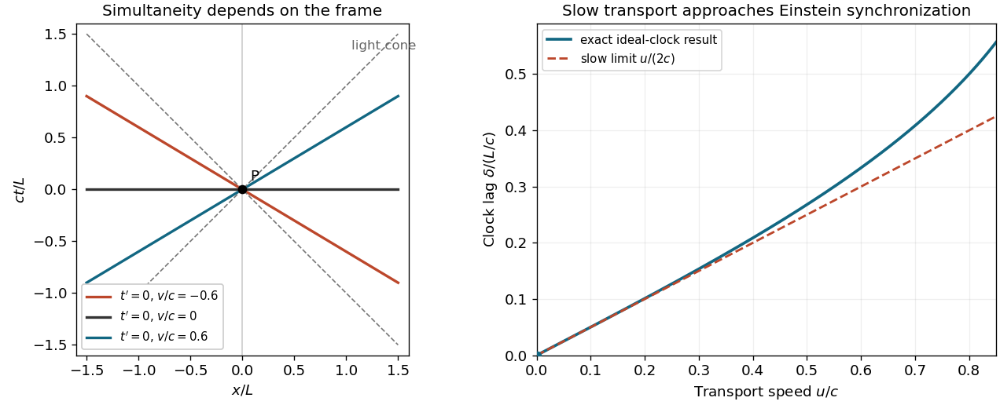

<h1 id="6/solution">Solution</h1>

↑ **Parent:** [6](../6.md)

**An observer-independent global [presentism](../../../presentism-philosophy-of-time.md) conflicts with the absence of a distinguished simultaneity relation in bare [special relativity](../../../special-relativity-split.md). It is not a formal contradiction to add a preferred [foliation](../../../foliation.md).** The issue is what the proposed present contains, and whether that extra structure is part of the physical theory or an additional metaphysical commitment. [Presentism](../../../presentism-philosophy-of-time.md) must be distinguished from the harmless indexical fact that an observer calls their own current event “now”.

Let two [spacetime events](../../../event-relativity.md) have coordinate differences $\Delta t=0$, $\Delta x=L\ne0$ in an [inertial frame](../../../inertial-frame.md). A relatively moving frame assigns

$$
\Delta t'=-\gamma vL/c^2.
$$

They are simultaneous in one frame and not in another. For a fixed event $P$, each inertial [four-velocity](../../../four-velocity.md) $u$ defines a different simultaneous [hyperplane](../../../hyperplane.md) through $P$ by $\eta(u,Q-P)=0$. No particular $u$ is selected by the [Minkowski metric](../../../minkowski-metric.md) alone. Thus an extended objective present cannot both be the equal-time slice of one ordinary inertial frame and be invariant under all [Lorentz transformations](../../../lorentz-transformation.md).

An equivocation can make the incompatibility seem stronger than it is. If one defines “real together” using one observer's [simultaneity](../../../simultaneity.md), then changes observers in the next inference, transitivity across the mixed relations has not been justified. It is the [failure of transitivity for mixed-frame simultaneity](../../../failure-of-transitivity-for-mixed-frame-simultaneity.md). The physics supplies the frame-indexed relations; it does not supply a single absolute co-existence relation formed by silently joining all of them. A sound argument against relativistic [presentism](../../../presentism-philosophy-of-time.md) challenges the physical basis of its preferred relation, rather than proving all events real by that equivocation.

**[Figure 1](#6/image-frame-dependent-simultaneity-and-the-vanishing-lag-of-ideal-slow-clock-transport). Frame-dependent simultaneity and the vanishing lag of ideal slow clock transport**. Left: equal-time lines for three inertial frames through one event. Right: the transported clock lag divided by distance over light speed tends to zero with transport speed.

There are several coherent responses, with different costs. A preferred [foliation](../../../foliation.md) can be appended to [Minkowski spacetime](../../../minkowski-spacetime.md), declaring one of its slices the objectively existing present. If it affects no physical process, it has no support from the relativistic laws and breaks the symmetry of the total ontology without changing observable predictions. If it affects matter, new laws must explain why ordinary tests display [Lorentz invariance](../../../lorentz-invariance.md). This is additional structure, not a logical impossibility. [Eternalism](../../../eternalism-philosophy-of-time.md), by contrast, treats the complete [spacetime](../../../spacetime.md) history as real and makes simultaneity relational, but the relativity of coordinate [time](../../../time-in-physics.md) by itself does not deductively establish that metaphysics.

A local present containing only $P$ is invariant once $P$ is given, yet it abandons a spatially extended world existing now. The [past light cone](../../../past-light-cone.md) is invariant too, but contains events of different ages and is not an instantaneous spatial present. An observer-relative present is meaningful, but relativizes the existence claim rather than defending a unique global present. The defensible conclusion is therefore an incompatibility among bare relativistic structure, an objective extended present, and full symmetry of existence claims; it is not an unconditional proof that every formulation of [presentism](../../../presentism-philosophy-of-time.md) is incoherent.

## ↑ Ancestors (10)

1. [6](../6.md)
2. [2019](../../2019-split.md)
3. [Past exam of the philosophy of space-time and philosophy of quantum mechanics paper of Parts A and B of the physics course of the University of Oxford](../../split.md)
4. [Philosophy of space-time and philosophy of quantum mechanics paper of Parts A and B of the physics course of the University of Oxford](../../../philosophy-of-space-time-and-philosophy-of-quantum-mechanics-paper-of-parts-a-and-b-of-the-physics-course-of-the-university-of-oxford.md)
5. [Physics course of the University of Oxford](../../../physics-course-of-the-university-of-oxford.md)
6. [Undergraduate course of the University of Oxford](../../../undergraduate-course-of-the-university-of-oxford.md)
7. [Course of the University of Oxford](../../../course-of-the-university-of-oxford.md)
8. [University of Oxford](../../../university-of-oxford-split.md)
9. [List of universities](../../../list-of-universities.md)
10. [Codex Wiki](../../../split.md)
