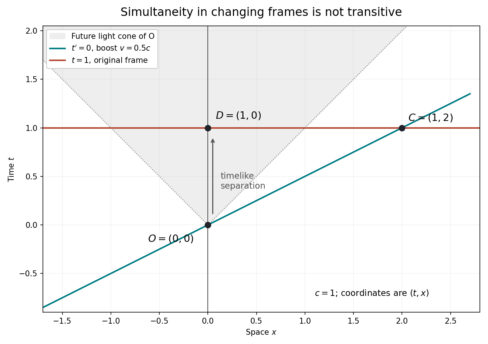

# 2022

↑ **Parent:** [Past exam of the philosophy of space-time course of the University of Oxford](../past-exam-of-the-philosophy-of-space-time-course-of-the-university-of-oxford.md)

Source paper: [Oxford FOI release, bundle pages 90–91](https://www.whatdotheyknow.com/request/oxford_physics_past_papers_2/response/2340696/attach/10/Physics%20Papers%202021.pdf?cookie_passthrough=1). The paper cover establishes 2022; the bundle filename uses 2021. This paper is shared by Physics Parts A and B.

**Table of contents**

- [1](#1)
  - [Solution](#1/solution)
- [2](#2)
  - [Solution](#2/solution)
- [3](#3)
  - [Solution](#3/solution)
- [4](#4)
  - [Solution](#4/solution)
- [5](#5)
  - [Solution](#5/solution)
- [6](#6)
  - [Solution](#6/solution)

## 1

↑ **Parent:** [2022](2022.md)

<h3 id="1/solution">Solution</h3>

↑ **Parent:** [1](#1)

An [inertial frame](../mathematical-physics.md#inertial-frame) is a nonrotating frame in which all force-free test bodies follow straight trajectories with constant [velocity](../classical-mechanics.md#velocity). The qualification “all” matters: a specially chosen coordinate system can make one accelerated trajectory look straight without making the frame inertial. In practice, approximately isolated test bodies and [gyroscopes](../momentum.md#gyroscope) help identify [inertial motion](../mathematical-physics.md#inertial-motion); identifying the relevant forces and calibrating instruments are part of testing the theory. The definition does not select a privileged state of uniform rest.

In its usual coordinate formulation, [Newtonian mechanics](../newtonian-mechanics.md) states $m\ddot{\mathbf x}=\mathbf F$ in an [inertial frame](../mathematical-physics.md#inertial-frame). A [Galilean transformation](../special-relativity.md#galilean-transformation), $t'=t+b$, $\mathbf x'=R\mathbf x+\mathbf Vt+\mathbf a$ with constant orthogonal $R$ and constant $\mathbf V$, maps the class of [inertial frames](../mathematical-physics.md#inertial-frame) to itself. It preserves zero [acceleration](../classical-mechanics.md#acceleration); a time-dependent translation generally does not. In the translating frame $\mathbf x'=\mathbf x-\mathbf a(t)$, the same physical law reads $m\ddot{\mathbf x}'=\mathbf F-m\ddot{\mathbf a}$. The extra [fictitious force](../mathematical-physics.md#fictitious-force) records the frame's [acceleration](../classical-mechanics.md#acceleration), rather than a new interaction.

It is possible to state [Newtonian mechanics](../newtonian-mechanics.md) without mentioning an [inertial frame](../mathematical-physics.md#inertial-frame) explicitly. On [Galilean spacetime](../newtonian-mechanics.md#galilean-spacetime), let $u$ be a trajectory tangent normalized by the absolute time covector, $t_a u^a=1$. Then

$$
m\nabla_u u=F
$$

uses an [affine connection](../vector-bundle.md#affine-connection) to define [acceleration](../classical-mechanics.md#acceleration). The free-particle equation is $\nabla_u u=0$. This formulation removes a chosen coordinate frame but retains the geometric distinction between [inertial motion](../mathematical-physics.md#inertial-motion) and accelerated motion. Omitting both the [inertial frame](../mathematical-physics.md#inertial-frame) language and all equivalent inertial structure would leave the law unable to specify which trajectories count as unforced.

The same distinction applies to [special relativity](../special-relativity.md). Einstein's original presentation uses a class of [inertial frames](../mathematical-physics.md#inertial-frame) and calibrated rods, clocks and [light](../optics.md#light) signals.[sections 1–3: synchronization, postulates and coordinate transformation](../physics-bibliography.md#on-the-electrodynamics-of-moving-bodies-by-albert-einstein) A geometric presentation instead uses [Minkowski spacetime](../special-relativity.md#minkowski-spacetime), its [Lorentzian metric](../general-relativity.md#lorentzian-metric) and its [Levi-Civita connection](../general-relativity.md#levi-civita-connection). A free massive particle obeys $\nabla_u u=0$, now with [proper time](../special-relativity.md#proper-time) parametrization and $g(u,u)=-c^2$. There is no preferred inertial rest frame, but there is a distinguished family of inertial trajectories and a physical [Minkowski interval](../special-relativity.md#minkowski-interval).

Accelerating coordinates are allowed in [special relativity](../special-relativity.md). They produce nonzero connection coefficients even though the [Riemann curvature tensor](../riemann-curvature-tensor.md) remains zero. [General relativity](../general-relativity.md) is needed when spacetime curvature and dynamical gravitation matter, not merely because the chosen observer accelerates. Thus neither theory requires a particular [inertial frame](../mathematical-physics.md#inertial-frame) in its coordinate-free statement; each still needs the structure that determines [inertial motion](../mathematical-physics.md#inertial-motion).

## 2

↑ **Parent:** [2022](2022.md)

<h3 id="2/solution">Solution</h3>

↑ **Parent:** [2](#2)

The crucial distinction is between an observer-independent binary relation of absolute simultaneity and a relation defined relative to an [inertial frame](../mathematical-physics.md#inertial-frame). The [relativity of simultaneity](../special-relativity.md#relativity-of-simultaneity) removes the former from the usual structure of [special relativity](../special-relativity.md); it does not make the latter meaningless or subjective.

For two [spacetime events](../special-relativity.md#event-relativity) separated by $(\Delta t,\Delta x)$, a [Lorentz boost](../special-relativity.md#lorentz-boost) of [velocity](../classical-mechanics.md#velocity) $v$ gives

$$
\Delta t'=\gamma\left(\Delta t-\frac{v\Delta x}{c^2}\right).
$$

If $\Delta t=0$ and $\Delta x\ne0$, then $\Delta t'\ne0$ for a nonzero boost along their separation. More generally, [spacelike separated](../special-relativity.md#spacelike-separation) events can be simultaneous in some [inertial frame](../mathematical-physics.md#inertial-frame), and their time order can reverse between [inertial frames](../mathematical-physics.md#inertial-frame). Distinct [timelike separated](../special-relativity.md#timelike-separation) or [null separated](../special-relativity.md#null-separation) events cannot be simultaneous in any [inertial frame](../mathematical-physics.md#inertial-frame); their causal order is preserved by time-orientation-preserving [Lorentz transformations](../special-relativity.md#lorentz-transformation). These are precise geometric facts, independent of anyone's beliefs.

In [Minkowski simultaneity relative to an inertial observer](../special-relativity.md#minkowski-simultaneity-relative-to-an-inertial-observer), the observer is represented by a constant future-directed [four-velocity](../special-relativity.md#four-velocity) $u$, normalized by $\eta(u,u)=-c^2$ in [metric signature](../topological-manifold.md#metric-signature) $(-,+,+,+)$. Then

$$
\Delta t_u=-\frac{\eta(u,Q-P)}{c^2},\qquad P\sim_u Q\ \Longleftrightarrow\ \eta(u,Q-P)=0.
$$

For a fixed $u$, this is a perfectly well-defined [equivalence relation](../set-theory.md#equivalence-relation). It can be specified without coordinates. What the [Minkowski metric](../special-relativity.md#minkowski-metric) does not supply is a uniquely preferred $u$ and hence a uniquely preferred simultaneity [foliation](../geometry-and-topology.md#foliation). This is the strongest defensible interpretation of the claim by [Tim Maudlin](../README.md#tim-maudlin): there is no additional fundamental, frame-independent simultaneity relation in the bare theory.

Calling it merely “relative to an observer” can mislead in two ways. First, distant simultaneity does not depend on when an image is received: travel time of the [light](../optics.md#light) signal must be accounted for. Second, two observers at the same [spacetime event](../special-relativity.md#event-relativity) but with different [four-velocities](../special-relativity.md#four-velocity) assign different simultaneity [hyperplanes](../vector-space.md#hyperplane); the dependence is on state of motion, rather than consciousness. [Einstein synchronisation](../special-relativity.md#einstein-synchronisation) operationalizes the standard frame assignment by setting a reflected pulse's remote reading to the midpoint of its sending and returning readings.[section 1: separated clocks and the reflected-light prescription](../physics-bibliography.md#on-the-electrodynamics-of-moving-bodies-by-albert-einstein)

A material system can pick out a useful rest frame, for example a gas in thermal equilibrium. That adds physical information beyond the [Minkowski metric](../special-relativity.md#minkowski-metric); it does not provide a universal absolute present. Accordingly, Maudlin's denial is justified if it denies a primitive observer-independent relation, but is too strong if read as denying every objective relation $P\sim_u Q$. The indexed relation and its measurable consequences remain part of the physics.

## 3

↑ **Parent:** [2022](2022.md)

<h3 id="3/solution">Solution</h3>

↑ **Parent:** [3](#3)

There are two distinct explanatory questions. One asks why a proposed system of equations has a particular [dynamical symmetry](../physics.md#dynamical-symmetry). The other asks why the common spacetime geometry is the right geometry for the behavior of physical rods, clocks and fields. A geometric account and a dynamical account give different directions of explanation, and their merits cannot be decided by a change of notation alone.

For the geometric account, [Minkowski spacetime](../special-relativity.md#minkowski-spacetime) has a fixed [Lorentzian metric](../general-relativity.md#lorentzian-metric); its [spacetime isometries](../riemannian-geometry.md#spacetime-isometry) form the [Poincaré group](../special-relativity.md#poincare-group). If the matter equations use that [metric tensor](../general-relativity.md#metric-tensor) and no additional symmetry-breaking [background structure](../mathematical-physics.md#background-structure), with couplings and boundary assumptions appropriate to the transformation, these [spacetime isometries](../riemannian-geometry.md#spacetime-isometry) take solutions into solutions. For example, the [Klein-Gordon equation](../wave-equation.md#klein-gordon-equation)

$$
\left(\eta^{\mu\nu}\partial_\mu\partial_\nu-\frac{m^2c^2}{\hbar^2}\right)\phi=0
$$

in [metric signature](../topological-manifold.md#metric-signature) $(-,+,+,+)$ is invariant under the [Poincaré group](../special-relativity.md#poincare-group). This provides one common reason for the same transformation rules appearing in many laws. An individual solution, such as a particular [plane wave](../wave-function.md#plane-wave), need not possess every symmetry of the equation.

Geometry alone is insufficient unless the assumed coupling to geometry is included. In the [covariant equation with a preferred timelike vector](../general-relativity.md#covariant-equation-with-a-preferred-timelike-vector),

$$
(\eta^{\mu\nu}-\alpha n^\mu n^\nu)\partial_\mu\partial_\nu\phi=0,
$$

the fixed timelike $n$ selects a preferred rest frame. All the quantities can be transformed consistently under a [coordinate transformation](../differential-geometry.md#smooth-transition-map), but boosts that change $n$ are not symmetries with the physical background fixed. Thus [general covariance](../general-relativity.md#general-covariance), tensor notation and the mere presence of the [Minkowski metric](../special-relativity.md#minkowski-metric) do not by themselves establish [Einstein's principle of relativity](../special-relativity.md#einstein-s-principle-of-relativity).

A dynamical account instead starts with the common invariance of the actual interactions and asks why their composite rods and clocks measure a common interval. If their equations and suitable equilibrium solutions transform consistently under [Lorentz transformations](../special-relativity.md#lorentz-transformation), their moving configurations can exhibit [length contraction](../special-relativity.md#length-contraction) and their periodic processes [time dilation](../special-relativity.md#time-dilation). This is the explanatory strategy defended by [Harvey R. Brown](../README.md#harvey-r-brown) and [Oliver Pooley](../README.md#oliver-pooley), who deny that merely redescribing these effects geometrically supplies their microscopic explanation.[sections 3–5: constructive explanation, rods and clocks, and the direction of explanation](../physics-bibliography.md#minkowski-space-time-a-glorious-non-entity-by-harvey-r-brown-and-oliver-pooley) Such an account must still explain why independent interactions have the same relevant symmetry and why a particular clock is a good clock; it cannot simply infer those facts from the word “dynamics”.

The positions therefore need not disagree about experimental predictions. The geometric presentation makes a shared constraint explicit and permits economical deductions. The constructive presentation investigates why material systems realize that constraint. Defining geometry from universal dynamical behavior is a substantive proposal; deriving behavior from geometry also requires substantive matter-coupling assumptions. Neither direction is made compulsory by the formal equivalence of the descriptions.

## 4

↑ **Parent:** [2022](2022.md)

<h3 id="4/solution">Solution</h3>

↑ **Parent:** [4](#4)

The [relativity of simultaneity](../special-relativity.md#relativity-of-simultaneity) creates a serious difficulty for an observer-independent global present, but a conclusion about what exists requires an additional metaphysical premise. [Eternalism](../physics.md#eternalism-philosophy-of-time) regards past, present and future events as equally real. [Presentism](../physics.md#presentism-philosophy-of-time) restricts existence to the present. These are ontological claims; the coordinate dependence of distant simultaneity is a physical claim.

A useful argument can be made mathematically explicit. In units $c=1$, consider [spacetime events](../special-relativity.md#event-relativity) $O=(0,0)$, $C=(1,2)$ and $D=(1,0)$ in coordinates $(t,x)$. The [Lorentz boost](../special-relativity.md#lorentz-boost) of [velocity](../classical-mechanics.md#velocity) $v=1/2$ makes $O,C$ simultaneous, since $t'_C=\gamma(1-\tfrac12\cdot2)=0$. The original [inertial frame](../mathematical-physics.md#inertial-frame) makes $C,D$ simultaneous. Yet $D$ is in the [timelike](../special-relativity.md#timelike-separation) future of $O$. Suppose one assumes that simultaneity in every [inertial frame](../mathematical-physics.md#inertial-frame) equally warrants co-reality, and that this co-reality is transitive. From the reality of $O$ one then obtains the reality of the future event $D$. Applying the construction repeatedly puts pressure on a presentist ontology.

**[Figure 1](#4/image-two-different-inertial-simultaneity-slices-connect-o-to-its-timelike-future-d-through-a-distant-event-c-no-single-inertial-frame-makes-o-and-d-simultaneous). Two different inertial simultaneity slices connect O to its timelike future D through a distant event C; no single inertial frame makes O and D simultaneous**.

The extra premise does real work. There is a [failure of transitivity for mixed-frame simultaneity](../special-relativity.md#failure-of-transitivity-for-mixed-frame-simultaneity): $O$ is simultaneous with $C$ in one [inertial frame](../mathematical-physics.md#inertial-frame), and $C$ with $D$ in another, but $O,D$ are not simultaneous in any [inertial frame](../mathematical-physics.md#inertial-frame). The physical relation therefore cannot itself be identified with a transitive relation of co-reality. [Special relativity](../special-relativity.md) supplies the geometry in this argument, not the ontological bridge. Writing an entire history as a four-dimensional mathematical solution also does not, by itself, prove that every represented event exists in the same sense.

A presentist could postulate an additional preferred [foliation](../geometry-and-topology.md#foliation). That recovers an absolute present but adds [background structure](../mathematical-physics.md#background-structure) absent from ordinary [Minkowski spacetime](../special-relativity.md#minkowski-spacetime), and must explain its physical role or its empirical unobservability. Alternatively, one might give a local account of becoming along a [world line](../special-relativity.md#world-line), rather than a single simultaneous becoming throughout the universe. The latter does not automatically vindicate global [presentism](../physics.md#presentism-philosophy-of-time), but shows why lack of a universal present is not identical to a denial of all temporal passage.

[General relativity](../general-relativity.md) further weakens any universal identification of time with a single inertial [foliation](../geometry-and-topology.md#foliation). Some cosmological solutions have a useful matter-selected time slicing; this is a property of those solutions and matter distributions. It is not an absolute simultaneity structure in every relativistic spacetime. The defensible conclusion is that relativity gives strong reasons against a fundamental observer-independent global present in its minimal structure. It does not entail [eternalism](../physics.md#eternalism-philosophy-of-time) without further premises about existence and the interpretation of that structure.

## 5

↑ **Parent:** [2022](2022.md)

<h3 id="5/solution">Solution</h3>

↑ **Parent:** [5](#5)

The distinction illuminates both a route to the [Lorentz transformation](../special-relativity.md#lorentz-transformation) and the explanatory scope of [special relativity](../special-relativity.md). In a [constructive theory](../physics.md#constructive-theory), one models constituent systems and their interactions to recover observable behavior. A [principle theory](../physics.md#principle-theory) instead imposes general empirical constraints on whatever microscopic models may be admissible. [Albert Einstein](../physicist.md#albert-einstein) explicitly contrasted these strategies in 1919, using molecular [kinetic theory](../kinetic-theory.md), [thermodynamics](../thermodynamics.md) and relativity as examples.[discussion of constructive theories, principle-theories and the classification of relativity](../physics-bibliography.md#what-is-the-theory-of-relativity-by-albert-einstein)

The [postulates of special relativity](../special-relativity.md#postulates-of-special-relativity) constrain coordinates calibrated by rods, clocks and [Einstein synchronisation](../special-relativity.md#einstein-synchronisation). For a boost along $x$, spacetime homogeneity makes the transformation affine, while the world line $x=vt$ of the moving origin gives $x'=A(v)(x-vt)$ after choosing coincident origins. Preservation of the two [light](../optics.md#light) rays $x=\pm ct$ then requires

$$
t'=A(v)\left(t-\frac{vx}{c^2}\right).
$$

Reciprocity together with spatial [isotropy](../continuum-mechanics.md#isotropy) gives $A(-v)=A(v)$ and

$$
A(v)^2(1-v^2/c^2)=1.
$$

Continuity and the usual orientation convention select $A(v)=\gamma>0$. Thus a pair of empirical principles, supplemented by homogeneity, [isotropy](../continuum-mechanics.md#isotropy) and coordinate conventions, yields the [Lorentz transformation](../special-relativity.md#lorentz-transformation) without a microscopic calculation of a particular clock. [Einstein's principle of relativity](../special-relativity.md#einstein-s-principle-of-relativity) alone is insufficient: the [Galilean transformation](../special-relativity.md#galilean-transformation) also realizes a relativity principle, with no finite invariant [speed](../classical-mechanics.md#speed).[sections 2–3: the two principles and the transformation of coordinates](../physics-bibliography.md#on-the-electrodynamics-of-moving-bodies-by-albert-einstein)

The distinction also tells us what has not been derived. A [principle theory](../physics.md#principle-theory) constrains all acceptable microscopic laws and the measurements they permit. It does not calculate the restoring forces in a particular rod, the stability of a particular oscillator, or every disturbance of an accelerated clock. Those are questions for detailed dynamics. Conversely, a [constructive theory](../physics.md#constructive-theory) that successfully treats one electromagnetic clock has not yet established the universal behavior of clocks using other interactions.

The content of [special relativity](../special-relativity.md) consequently includes more than a coordinate formula: it identifies the common causal and metrical structure and constrains the possible dynamics of physical systems. Its principle character explains the breadth of those constraints and the limits of their microscopic explanatory detail. A constructive realization can complement them. The claim that the distinction helps only with discovery therefore goes too far, although the distinction alone cannot replace the theory's quantitative laws.

## 6

↑ **Parent:** [2022](2022.md)

<h3 id="6/solution">Solution</h3>

↑ **Parent:** [6](#6)

[General relativity](../general-relativity.md) is not required for the ideal [twin paradox](../special-relativity.md#twin-paradox) in [Minkowski spacetime](../special-relativity.md#minkowski-spacetime). The relevant observable is the difference in [proper times](../special-relativity.md#proper-time) recorded by clocks that meet at departure and reunion. For a [world line](../special-relativity.md#world-line) $x(t)$ in one [inertial frame](../mathematical-physics.md#inertial-frame), the [clock hypothesis](../special-relativity.md#clock-hypothesis) gives

$$
\tau=\int_0^T\sqrt{1-\frac{\dot x(t)^2}{c^2}}\,dt.
$$

The home clock with $x=0$ records $T$. A traveler coasting outward at $v$ for $T/2$ and inward at $-v$ for $T/2$ records $T/\gamma$, in the ideal short-turnaround limit. For $T=10$ years and $v=0.6c$, these readings are ten and eight years. The complete paths, rather than conflicting applications of reciprocal [time dilation](../special-relativity.md#time-dilation) to one pair of [inertial frames](../mathematical-physics.md#inertial-frame), determine the invariant difference.

An exactly instantaneous reversal is an idealization, not an essential premise. Replace it by a smooth timelike turnaround. The [proper time](../special-relativity.md#proper-time) accumulated in a reversal interval of home duration $\delta t$ lies between zero and $\delta t$, so its contribution vanishes as the interval shrinks. The finite clock difference persists. Repeatedly lengthening the coasting legs while keeping the same reversal maneuver also changes the clock difference; the difference is not a universal function only of the peak [proper acceleration](../special-relativity.md#proper-acceleration).

The usual apparent symmetry fails because no single traveler [inertial frame](../mathematical-physics.md#inertial-frame) covers both legs. In the instantaneous rest frame at a traveler event $(t,x(t))$, the home event assigned as simultaneous has time

$$
t_H=t-\frac{v(t)x(t)}{c^2}.
$$

Hence a finite turnaround changes the home simultaneity assignment continuously. In the sharp-turnaround limit at $x=vT/2$, changing $v$ to $-v$ changes that assigned home time by $v^2T/c^2$. This is a change in a distant [relativity of simultaneity](../special-relativity.md#relativity-of-simultaneity) assignment, not a sudden physical jump in the home clock's reading. The full [twin paradox simultaneity change](../special-relativity.md#twin-paradox-simultaneity-change) reconciles the two inertial coasting descriptions.

An accelerated-coordinate calculation is also available within [special relativity](../special-relativity.md). Nonzero connection coefficients in that chart do not establish nonzero [Riemann curvature tensor](../riemann-curvature-tensor.md). Thus neither using accelerated coordinates nor making the traveler accelerate requires the [Einstein field equations](../einstein-field-equations.md). The [clock hypothesis](../special-relativity.md#clock-hypothesis) is a physical assumption about a sufficiently ideal clock, not a guarantee that every real apparatus survives arbitrary acceleration without disturbances. Experiments such as the [muon storage-ring time-dilation experiments](../special-relativity.md#muon-storage-ring-time-dilation-experiment) test clock behavior in specified regimes.

Real flights around [Earth](../planetary-science.md#earth) also compare different [gravitational potentials](../newton-s-law-of-universal-gravitation.md#newtonian-potential-of-a-point-mass) and require gravitational corrections, as in the [twin paradox clock experiments](../special-relativity.md#twin-paradox-clock-experiments). Those refinements involve [general relativity](../general-relativity.md). They do not make the flat-spacetime reunion calculation incomplete on its stated assumptions. Even two mirrored, accelerating travelers can record equal [proper times](../special-relativity.md#proper-time); the decisive quantity is the [proper time](../special-relativity.md#proper-time) of each entire path between the common events.

## ↑ Ancestors (8)

1. [Past exam of the philosophy of space-time course of the University of Oxford](../past-exam-of-the-philosophy-of-space-time-course-of-the-university-of-oxford.md)
2. [Philosophy of space-time course of the University of Oxford](../university-of-oxford.md#philosophy-of-space-time-course-of-the-university-of-oxford)
3. [Physics course of the University of Oxford](../university-of-oxford.md#physics-course-of-the-university-of-oxford)
4. [Undergraduate course of the University of Oxford](../university-of-oxford.md#undergraduate-course-of-the-university-of-oxford)
5. [Course of the University of Oxford](../university-of-oxford.md#course-of-the-university-of-oxford)
6. [University of Oxford](../university-of-oxford.md)
7. [List of universities](../README.md#list-of-universities)
8. [Codex Wiki](../README.md)
