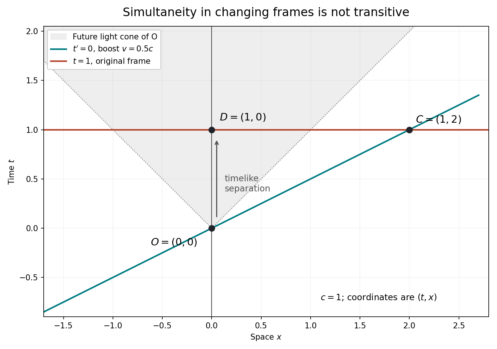

<h1 id="4/solution">Solution</h1>

↑ **Parent:** [4](../4.md)

The [relativity of simultaneity](../../../relativity-of-simultaneity.md) creates a serious difficulty for an observer-independent global present, but a conclusion about what exists requires an additional metaphysical premise. [Eternalism](../../../eternalism-philosophy-of-time.md) regards past, present and future events as equally real. [Presentism](../../../presentism-philosophy-of-time.md) restricts existence to the present. These are ontological claims; the coordinate dependence of distant simultaneity is a physical claim.

A useful argument can be made mathematically explicit. In units $c=1$, consider [spacetime events](../../../event-relativity.md) $O=(0,0)$, $C=(1,2)$ and $D=(1,0)$ in coordinates $(t,x)$. The [Lorentz boost](../../../lorentz-boost.md) of [velocity](../../../velocity.md) $v=1/2$ makes $O,C$ simultaneous, since $t'_C=\gamma(1-\tfrac12\cdot2)=0$. The original [inertial frame](../../../inertial-frame.md) makes $C,D$ simultaneous. Yet $D$ is in the [timelike](../../../timelike-separation.md) future of $O$. Suppose one assumes that simultaneity in every [inertial frame](../../../inertial-frame.md) equally warrants co-reality, and that this co-reality is transitive. From the reality of $O$ one then obtains the reality of the future event $D$. Applying the construction repeatedly puts pressure on a presentist ontology.

**[Figure 1](#4/image-two-different-inertial-simultaneity-slices-connect-o-to-its-timelike-future-d-through-a-distant-event-c-no-single-inertial-frame-makes-o-and-d-simultaneous). Two different inertial simultaneity slices connect O to its timelike future D through a distant event C; no single inertial frame makes O and D simultaneous**.

The extra premise does real work. There is a [failure of transitivity for mixed-frame simultaneity](../../../failure-of-transitivity-for-mixed-frame-simultaneity.md): $O$ is simultaneous with $C$ in one [inertial frame](../../../inertial-frame.md), and $C$ with $D$ in another, but $O,D$ are not simultaneous in any [inertial frame](../../../inertial-frame.md). The physical relation therefore cannot itself be identified with a transitive relation of co-reality. [Special relativity](../../../special-relativity-split.md) supplies the geometry in this argument, not the ontological bridge. Writing an entire history as a four-dimensional mathematical solution also does not, by itself, prove that every represented event exists in the same sense.

A presentist could postulate an additional preferred [foliation](../../../foliation.md). That recovers an absolute present but adds [background structure](../../../background-structure.md) absent from ordinary [Minkowski spacetime](../../../minkowski-spacetime.md), and must explain its physical role or its empirical unobservability. Alternatively, one might give a local account of becoming along a [world line](../../../world-line.md), rather than a single simultaneous becoming throughout the universe. The latter does not automatically vindicate global [presentism](../../../presentism-philosophy-of-time.md), but shows why lack of a universal present is not identical to a denial of all temporal passage.

[General relativity](../../../general-relativity-split.md) further weakens any universal identification of time with a single inertial [foliation](../../../foliation.md). Some cosmological solutions have a useful matter-selected time slicing; this is a property of those solutions and matter distributions. It is not an absolute simultaneity structure in every relativistic spacetime. The defensible conclusion is that relativity gives strong reasons against a fundamental observer-independent global present in its minimal structure. It does not entail [eternalism](../../../eternalism-philosophy-of-time.md) without further premises about existence and the interpretation of that structure.

## ↑ Ancestors (10)

1. [4](../4.md)
2. [2022](../../2022-split.md)
3. [Past exam of the philosophy of space-time course of the University of Oxford](../../split.md)
4. [Philosophy of space-time course of the University of Oxford](../../../philosophy-of-space-time-course-of-the-university-of-oxford.md)
5. [Physics course of the University of Oxford](../../../physics-course-of-the-university-of-oxford.md)
6. [Undergraduate course of the University of Oxford](../../../undergraduate-course-of-the-university-of-oxford.md)
7. [Course of the University of Oxford](../../../course-of-the-university-of-oxford.md)
8. [University of Oxford](../../../university-of-oxford-split.md)
9. [List of universities](../../../list-of-universities.md)
10. [Codex Wiki](../../../split.md)
