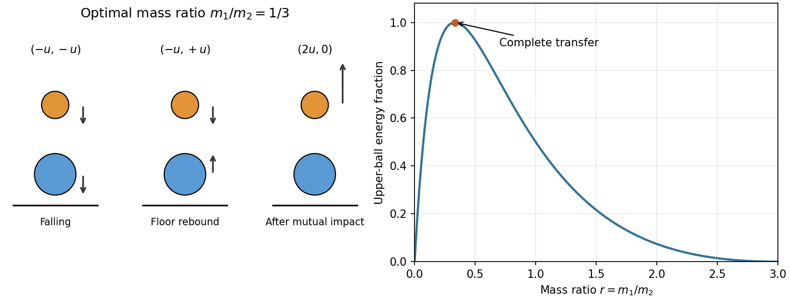

# 2013 resit

↑ **Parent:** [Past exam of the physics 1 paper of the University of Oxford](../past-exam-of-the-physics-1-paper-of-the-university-of-oxford.md)

Source paper: [https://www.whatdotheyknow.com/request/physics_preliminary_examinations/response/1162943/attach/3/Twain.7z?cookie_passthrough=1](https://www.whatdotheyknow.com/request/physics_preliminary_examinations/response/1162943/attach/3/Twain.7z?cookie_passthrough=1)

Solutions for the sitting of 9 September 2013, including all four alternatives in Section B. Lettered subsections also separate unlettered requests in the source.

**Table of contents**

- [1](#1)
  - [Solution](#1/solution)
- [2](#2)
  - [Solution](#2/solution)
- [3](#3)
  - [Solution](#3/solution)
- [4](#4)
  - [Solution](#4/solution)
- [5](#5)
  - [Solution](#5/solution)
- [6](#6)
  - [a](#6/a)
    - [Solution](#6/a/solution)
  - [b](#6/b)
    - [Solution](#6/b/solution)
- [7](#7)
  - [Solution](#7/solution)
- [8](#8)
  - [a](#8/a)
    - [Solution](#8/a/solution)
  - [b](#8/b)
    - [Solution](#8/b/solution)
  - [c](#8/c)
    - [Solution](#8/c/solution)
- [9](#9)
  - [a](#9/a)
    - [Solution](#9/a/solution)
  - [b](#9/b)
    - [Solution](#9/b/solution)
  - [c](#9/c)
    - [Solution](#9/c/solution)
- [10](#10)
  - [i](#10/i)
    - [Solution](#10/i/solution)
  - [a](#10/a)
    - [Solution](#10/a/solution)
  - [b](#10/b)
    - [Solution](#10/b/solution)
  - [ii](#10/ii)
    - [Solution](#10/ii/solution)
- [11](#11)
  - [a](#11/a)
    - [Solution](#11/a/solution)
  - [b](#11/b)
    - [Solution](#11/b/solution)
  - [c](#11/c)
    - [Solution](#11/c/solution)

## 1

↑ **Parent:** [2013 resit](2013-resit.md)

<h3 id="1/solution">Solution</h3>

↑ **Parent:** [1](#1)

Take the upward [velocity](../classical-mechanics.md#velocity) as positive during ascent. [Newton's second law](../force.md#newton-s-second-law) with [linear drag](../fluid-mechanics.md#linear-drag) gives

$$
\dot v+kv=-g,\qquad v(0)=v_0.
$$

Multiplication by the [integrating factor](../linear-ordinary-differential-equation.md#integrating-factor) $e^{kt}$ and integration give

$$
v(t)=\left(v_0+\frac gk\right)e^{-kt}-\frac gk.
$$

The maximum height occurs at the first zero of this [velocity](../classical-mechanics.md#velocity), hence

$$
\boxed{t_{\rm top}=\frac1k\log\left(1+\frac{kv_0}{g}\right).}
$$

Here $k$ has units of inverse [time](../classical-mechanics.md#time-in-physics). The limit $k\to0$ gives $v_0/g$, and positive [drag](../fluid-mechanics.md#drag-physics) shortens the ascent relative to motion in a vacuum. The expression applies only up to the turning point; the [drag force](../fluid-mechanics.md#drag-physics) opposes the subsequent downward motion.

## 2

↑ **Parent:** [2013 resit](2013-resit.md)

<h3 id="2/solution">Solution</h3>

↑ **Parent:** [2](#2)

Let $\dot M=500\,\mathrm{kg\,s^{-1}}$ and $V=10\,\mathrm{m\,s^{-1}}$. Incoming material has zero horizontal [momentum](../momentum.md), while incorporation requires horizontal [momentum](../momentum.md) $V\,dM$. Thus the engine supplies [force](../force.md) $F=V\dot M$, and its [power](../energy.md#power) is

$$
\boxed{F=5000\,\mathrm N,\qquad P=FV=\dot M V^2=50\,\mathrm{kW}.}
$$

No duration or loading distance is given, so a single total [work](../energy.md#work) cannot be assigned. Over an interval $t$ in seconds,

$$
\boxed{W=50{,}000t\,\mathrm J,\qquad \Delta K_{\rm horizontal}=\tfrac12\dot M V^2t=25{,}000t\,\mathrm J.}
$$

The remaining $25{,}000t\,\mathrm J$ becomes internal [energy](../energy.md) in the [inelastic collision](../classical-mechanics.md#inelastic-collision) that brings the falling material to the wagon's horizontal [velocity](../classical-mechanics.md#velocity). Vertical falling [kinetic energy](../energy.md#kinetic-energy), if any, is a separate contribution to dissipation; it does not alter this horizontal [work](../energy.md#work) balance. The source alternates between stone and coal; the calculation depends only on the given loading rate.

## 3

↑ **Parent:** [2013 resit](2013-resit.md)

<h3 id="3/solution">Solution</h3>

↑ **Parent:** [3](#3)

Use the angle $\theta$ from the vertical as the [generalized coordinate](../lagrangian-mechanics.md#generalized-coordinate). For a uniform ladder, its [centre of mass](../classical-mechanics.md#center-of-mass) is $(l\sin\theta,l\cos\theta)$, so $v_G^2=l^2\dot\theta^2$. Its central [moment of inertia](../rigid-body-dynamics.md#moment-of-inertia) is $I_G=m(2l)^2/12=ml^2/3$. With ideal contact constraints that do no [work](../energy.md#work), the [Lagrangian](../calculus-of-variations.md#lagrangian), [conjugate momentum](../hamiltonian-mechanics.md#canonical-momentum), and [Euler-Lagrange equation](../analysis.md#euler-lagrange-equation) are

$$
T=\tfrac12ml^2\dot\theta^2+\tfrac12I_G\dot\theta^2=\tfrac23ml^2\dot\theta^2,\quad U=mgl\cos\theta,
$$

$$
\boxed{L=\tfrac23ml^2\dot\theta^2-mgl\cos\theta,\qquad p_\theta=\frac{\partial L}{\partial\dot\theta}=\tfrac43ml^2\dot\theta,}
$$

$$
\boxed{\ddot\theta=\frac{3g}{4l}\sin\theta.}
$$

Release from rest at $\theta_0$ also gives $\dot\theta^2=3g(\cos\theta_0-\cos\theta)/(2l)$ by [conservation of energy](../mathematical-physics.md#conservation-of-energy). These results hold while both contacts persist. The ideal wall reaction is normal to the wall; an unspecified tangential wall friction would require an additional generalized [force](../force.md) and would prevent determination from the supplied data alone.

## 4

↑ **Parent:** [2013 resit](2013-resit.md)

<h3 id="4/solution">Solution</h3>

↑ **Parent:** [4](#4)

The [Lorentz factor](../special-relativity.md#lorentz-factor) is $\gamma=E/(m_\mu c^2)=20000/106=188.6792$ and $\beta=\sqrt{1-\gamma^{-2}}$. Traversal of the height $H$ takes [proper time](../special-relativity.md#proper-time) $H/(\beta\gamma c)$. Using the [exponential decay](../analysis.md#exponential-decay) law with the given [muon lifetime](../standard-model.md#muon-lifetime),

$$
\boxed{P=\exp\left[-\frac{H}{c\tau_0\sqrt{\gamma^2-1}}\right]\simeq0.8180.}
$$

The laboratory flight lasts about $83.39\,\mu\mathrm s$, while the elapsed [proper time](../special-relativity.md#proper-time) is about $0.4420\,\mu\mathrm s$. This is the probability of surviving decay to the surface, with atmospheric [energy](../energy.md) loss and detector efficiency neglected.

## 5

↑ **Parent:** [2013 resit](2013-resit.md)

<h3 id="5/solution">Solution</h3>

↑ **Parent:** [5](#5)

Let $\mathbf a,\mathbf b$ be the outgoing [velocities](../classical-mechanics.md#velocity). In the nonrelativistic [elastic collision](../classical-mechanics.md#elastic-collision), equal [masses](../classical-mechanics.md#mass) give

$$
\mathbf v=\mathbf a+\mathbf b,\qquad v^2=a^2+b^2
$$

by [conservation of momentum](../momentum.md#momentum-conservation) and [conservation of energy](../mathematical-physics.md#conservation-of-energy). Squaring the first relation and comparing with the second yields

$$
\boxed{\mathbf a\cdot\mathbf b=0.}
$$

If both particles move, their paths are perpendicular. If either [velocity](../classical-mechanics.md#velocity) vanishes, its direction is undefined and the other particle carries all the incident [momentum](../momentum.md) and [kinetic energy](../energy.md#kinetic-energy). This conclusion depends on the stated $v\ll c$ approximation.

## 6

↑ **Parent:** [2013 resit](2013-resit.md)

<h3 id="6/a">a</h3>

↑ **Parent:** [6](#6)

<h4 id="6/a/solution">Solution</h4>

↑ **Parent:** [A](#6/a)

The external [work](../energy.md#work) equals the change in [relativistic kinetic energy](../energy.md#relativistic-kinetic-energy), $W=m_ec^2(\gamma_f-\gamma_i)$. With $m_ec^2=511\,\mathrm{keV}$,

$$
\boxed{W_a=511\left(\frac1{\sqrt{1-0.11^2}}-\frac1{\sqrt{1-0.10^2}}\right)\mathrm{keV}\simeq0.5456\,\mathrm{keV}\simeq8.742\times10^{-17}\,\mathrm J.}
$$

The [rest energy](../special-relativity.md#rest-energy) cancels between endpoints. At these [speeds](../classical-mechanics.md#speed), the nonrelativistic estimate $\tfrac12m_e c^2(0.11^2-0.10^2)=0.53655\,\mathrm{keV}$ is close but slightly smaller.

<h3 id="6/b">b</h3>

↑ **Parent:** [6](#6)

<h4 id="6/b/solution">Solution</h4>

↑ **Parent:** [B](#6/b)

Applying the same [work-energy theorem](../energy.md#work-energy-theorem) at the higher pair of [speeds](../classical-mechanics.md#speed) gives

$$
\boxed{W_b=511\left(\frac1{\sqrt{1-0.99^2}}-\frac1{\sqrt{1-0.98^2}}\right)\mathrm{keV}\simeq1055\,\mathrm{keV}\simeq1.689\times10^{-13}\,\mathrm J.}
$$

The identical increment $0.01c$ now needs about two thousand times as much [work](../energy.md#work). The growth follows from the rapidly increasing [Lorentz factor](../special-relativity.md#lorentz-factor) near the [speed of light](../special-relativity.md#speed-of-light).

## 7

↑ **Parent:** [2013 resit](2013-resit.md)

<h3 id="7/solution">Solution</h3>

↑ **Parent:** [7](#7)

Treat the carriage as translating along the circular track, neglecting wheel [rotational kinetic energy](../energy.md#rotational-kinetic-energy) and its finite size. At the top, gravity and the inward normal [force](../force.md) supply the [centripetal acceleration](../classical-mechanics.md#centripetal-acceleration):

$$
mg+N=\frac{mv_{\rm top}^2}{r}.
$$

For unilateral contact, $N\ge0$, so the limiting [speed](../classical-mechanics.md#speed) is $v_{\rm top}^2=gr$. [Conservation of energy](../mathematical-physics.md#conservation-of-energy) from rest at height $h$ then gives

$$
mgh=2mgr+\tfrac12mgr,\qquad \boxed{h_{\min}=\tfrac52r.}
$$

This top contact condition is the most restrictive: at angle $\phi$ measured from the bottom, $N/(mg)=2h/r-2+3\cos\phi$, whose minimum occurs at the top. A mechanically captive carriage able to sustain an outward rail reaction has a different constraint; the result here uses the usual requirement of positive normal contact.

## 8

↑ **Parent:** [2013 resit](2013-resit.md)

<h3 id="8/a">a</h3>

↑ **Parent:** [8](#8)

<h4 id="8/a/solution">Solution</h4>

↑ **Parent:** [A](#8/a)

Choose parallel axes along $z$, one through the [centre of mass](../classical-mechanics.md#center-of-mass) and one displaced transversely by $\mathbf a$. Write the perpendicular position as $\mathbf r_\perp=\mathbf r'_{\perp}+\mathbf a$. Direct expansion of the [moment of inertia](../rigid-body-dynamics.md#moment-of-inertia) gives

$$
I=\int|\mathbf r'_\perp+\mathbf a|^2\,dm=I_G+2\mathbf a\cdot\int\mathbf r'_\perp\,dm+ma^2.
$$

The integral in the cross term is zero by the definition of the [centre of mass](../classical-mechanics.md#center-of-mass). Therefore the [parallel axis theorem](../rigid-body-dynamics.md#parallel-axis-theorem) is

$$
\boxed{I=I_G+ma^2.}
$$

The axes must be parallel and the reference axis must pass through the [centre of mass](../classical-mechanics.md#center-of-mass); the formula is not generally valid between arbitrary parallel axes using either axis as the reference.

<h3 id="8/b">b</h3>

↑ **Parent:** [8](#8)

<h4 id="8/b/solution">Solution</h4>

↑ **Parent:** [B](#8/b)

Let $\theta=0$ place the [centre of mass](../classical-mechanics.md#center-of-mass) vertically below a horizontal pivot axis. The restoring [torque](../momentum.md#torque) and [rotational kinetic energy](../energy.md#rotational-kinetic-energy) are $-mgh\sin\theta$ and $I\dot\theta^2/2$, so

$$
I\ddot\theta+mgh\sin\theta=0.
$$

For small angles, $\sin\theta=\theta+O(\theta^3)$, and the equation reduces to [simple harmonic motion](../classical-mechanics.md#simple-harmonic-motion). Thus the [physical pendulum](../mathematical-physics.md#physical-pendulum) has

$$
\boxed{\omega_0=\sqrt{\frac{mgh}{I}},\qquad T=2\pi\sqrt{\frac{I}{mgh}}.}
$$

This assumes negligible friction and a horizontal axis, with $h>0$. For a tilted axis the projected gravitational restoring [torque](../momentum.md#torque) changes; an axis through the [centre of mass](../classical-mechanics.md#center-of-mass) has no gravitational restoring [torque](../momentum.md#torque).

<h3 id="8/c">c</h3>

↑ **Parent:** [8](#8)

<h4 id="8/c/solution">Solution</h4>

↑ **Parent:** [C](#8/c)

For the shorter uniform rod, the [parallel axis theorem](../rigid-body-dynamics.md#parallel-axis-theorem) gives $I=m(a^2/12+x^2)$. Its equivalent [simple pendulum](../simple-pendulum.md) length is $I/(mx)=x+a^2/(12x)$. The rod of length $2a$ pivoted at an end has equivalent length $2(2a)/3=4a/3$. Matching the [periods](../mathematics.md#period-of-a-function) therefore requires

$$
x+\frac{a^2}{12x}=\frac{4a}{3},\qquad 12x^2-16ax+a^2=0,
$$

$$
x=\frac{a}{6}(4\pm\sqrt{13}).
$$

A pivot on the shorter rod requires $0<x\le a/2$, leaving

$$
\boxed{x=\frac{4-\sqrt{13}}6a\simeq0.0657415a.}
$$

Either side of the rod's [centre of mass](../classical-mechanics.md#center-of-mass) gives this distance. The other algebraic root is beyond the rod and would require a support extension of negligible [mass](../classical-mechanics.md#mass).

## 9

↑ **Parent:** [2013 resit](2013-resit.md)

<h3 id="9/a">a</h3>

↑ **Parent:** [9](#9)

<h4 id="9/a/solution">Solution</h4>

↑ **Parent:** [A](#9/a)

For a frame moving at [velocity](../classical-mechanics.md#velocity) $V\hat{\mathbf x}$, put $\Gamma=(1-V^2/c^2)^{-1/2}$. The [Lorentz transformation](../special-relativity.md#lorentz-transformation) of the [energy-momentum four-vector](../special-relativity.md#four-momentum) is

$$
\boxed{E'=\Gamma(E-Vp_x),\quad p'_x=\Gamma(p_x-VE/c^2),\quad p'_y=p_y,\quad p'_z=p_z.}
$$

Expansion gives

$$
E'^2-c^2p_x'^2=\Gamma^2\left(1-\frac{V^2}{c^2}\right)(E^2-c^2p_x^2)=E^2-c^2p_x^2.
$$

The transverse components are unchanged, hence $\boxed{E'^2-c^2|\mathbf p'|^2=E^2-c^2|\mathbf p|^2}$. For a particle of [rest mass](../special-relativity.md#invariant-mass) $m$ this invariant is $m^2c^4$; the same algebra also applies to the total [four-momentum](../special-relativity.md#four-momentum) of a system.

<h3 id="9/b">b</h3>

↑ **Parent:** [9](#9)

<h4 id="9/b/solution">Solution</h4>

↑ **Parent:** [B](#9/b)

Let $p$ be the incident [momentum](../momentum.md) and $q_1,q_2$ the outgoing magnitudes in the [laboratory frame](../mathematical-physics.md#laboratory-frame). Transverse [conservation of momentum](../momentum.md#momentum-conservation) gives $(q_1-q_2)\sin\theta=0$. For the nondegenerate symmetric scattering, $q_1=q_2=q$, and the two outgoing [energies](../energy.md) are equal, $\epsilon=(E+E_0)/2$. Then

$$
p=2q\cos\theta,\quad p^2c^2=E^2-E_0^2,\quad q^2c^2=\frac{(E+E_0)^2}{4}-E_0^2.
$$

Combining these [mass shell](../special-relativity.md#mass-shell) relations yields

$$
\boxed{\cos^2\theta=\frac{E+E_0}{E+3E_0},\qquad \tan^2\theta=\frac{2E_0}{E+E_0}.}
$$

Here $E$ includes the incident electron's [rest energy](../special-relativity.md#rest-energy). As $E\downarrow E_0$ the limiting angle is $45^\circ$, consistent with the nonrelativistic equal-mass [elastic collision](../classical-mechanics.md#elastic-collision); at large $E/E_0$ the outgoing tracks become forward directed.

<h3 id="9/c">c</h3>

↑ **Parent:** [9](#9)

<h4 id="9/c/solution">Solution</h4>

↑ **Parent:** [C](#9/c)

For $\theta=30^\circ$, the result in [b](#9/b) gives $1/3=2E_0/(E+E_0)$, hence $E=5E_0$. Acceleration from rest supplies only the change in [kinetic energy](../energy.md#kinetic-energy):

$$
e|\Delta V|=E-E_0=4E_0,\qquad \boxed{|\Delta V|=\frac{4m_ec^2}{e}\simeq2.044\,\mathrm{MV}.}
$$

The accelerating [electric potential difference](../electric-field.md#electric-potential-difference) is a magnitude; its sign depends on which electrode is taken as the reference, since the electron has negative [electric charge](../electric-charge.md).

## 10

↑ **Parent:** [2013 resit](2013-resit.md)

<h3 id="10/i">i</h3>

↑ **Parent:** [10](#10)

<h4 id="10/i/solution">Solution</h4>

↑ **Parent:** [I](#10/i)

About a chosen origin $O$, a particle has [angular momentum](../momentum.md#angular-momentum) $\mathbf L=\mathbf r\times\mathbf p$. A body has $\mathbf L=\sum_i\mathbf r_i\times\mathbf p_i$, or the corresponding integral for a continuous [mass](../classical-mechanics.md#mass) distribution. For a fixed origin in an [inertial frame](../mathematical-physics.md#inertial-frame),

$$
\boxed{\frac{d\mathbf L}{dt}=\boldsymbol\tau_{\rm external};\qquad\boldsymbol\tau_{\rm external}=0\ \Longrightarrow\ \mathbf L=\text{constant}.}
$$

Internal central pair [forces](../force.md) cancel in the total [torque](../momentum.md#torque). About a fixed origin, a [central force](../mathematical-physics.md#central-force) conserves a particle's [angular momentum](../momentum.md#angular-momentum); zero net [force](../force.md) alone is insufficient if an external couple remains.

<h3 id="10/a">a</h3>

↑ **Parent:** [10](#10)

<h4 id="10/a/solution">Solution</h4>

↑ **Parent:** [A](#10/a)

Put $\mu=GM$. At the turning point of a radial launch the [speed](../classical-mechanics.md#speed) vanishes, so [conservation of energy](../mathematical-physics.md#conservation-of-energy) gives

$$
\frac12v_0^2-\frac\mu R=-\frac\mu{r_0},\qquad
\boxed{r_0=\left(\frac1R-\frac{v_0^2}{2GM}\right)^{-1}=\frac{R}{1-v_0^2/v_{\rm esc}^2},\quad v_{\rm esc}=\sqrt{\frac{2GM}{R}}.}
$$

This result is exact within the exterior Newtonian [gravitational potential](../newton-s-law-of-universal-gravitation.md#newtonian-potential-of-a-point-mass). The condition $r_0\gg R$ means $v_0$ is just below the [escape velocity](../energy.md#escape-velocity): $1-v_0^2/v_{\rm esc}^2\ll1$. Replacing gravity by a constant would be inappropriate in this regime.

<h3 id="10/b">b</h3>

↑ **Parent:** [10](#10)

<h4 id="10/b/solution">Solution</h4>

↑ **Parent:** [B](#10/b)

For a tangential launch, conserved specific [angular momentum](../momentum.md#angular-momentum) is $j=Rv$. At the outer turning point the radial [velocity](../classical-mechanics.md#velocity) vanishes but the tangential [speed](../classical-mechanics.md#speed) is $j/r_0$. Thus

$$
\frac12v^2-\frac\mu R=\frac{R^2v^2}{2r_0^2}-\frac\mu{r_0}.
$$

Using [a](#10/a) eliminates the [gravitational potential](../newton-s-law-of-universal-gravitation.md#newtonian-potential-of-a-point-mass) difference and gives

$$
\boxed{v=\frac{v_0}{\sqrt{1-R^2/r_0^2}}=v_0\left[1+\frac{R^2}{2r_0^2}+O\left(\frac{R^4}{r_0^4}\right)\right].}
$$

The expression printed in the source is the leading correction for $r_0\gg R$, rather than an exact identity. Equivalently, $v^2=2\mu r_0/[R(r_0+R)]$, so the launch [speed](../classical-mechanics.md#speed) exceeds the circular value and the surface is the [periapsis](../celestial-mechanics.md#periapsis) of the nonintersecting ideal orbit.

<h3 id="10/ii">ii</h3>

↑ **Parent:** [10](#10)

<h4 id="10/ii/solution">Solution</h4>

↑ **Parent:** [Ii](#10/ii)

At a fixed launch radius the escape threshold is zero total [mechanical energy](../energy.md#mechanical-energy). It depends on the initial [speed](../classical-mechanics.md#speed) alone:

$$
\boxed{v_{\rm esc}=\sqrt{2GM/R}\quad\text{independent of outward launch direction in the nonrotating model}.}
$$

A direction aimed into the planet can of course cause impact before escape. If the planet rotates, the ground-relative launch [velocity](../classical-mechanics.md#velocity) must be added to $\boldsymbol\Omega\times\mathbf R$ to obtain the inertial [velocity](../classical-mechanics.md#velocity). The condition becomes $|\mathbf u+\boldsymbol\Omega\times\mathbf R|^2\ge2GM/R$: prograde launch needs less ground-relative [speed](../classical-mechanics.md#speed) than retrograde launch. For a spherical planet the threshold expressed as inertial [speed](../classical-mechanics.md#speed) at the same radius remains independent of direction.

## 11

↑ **Parent:** [2013 resit](2013-resit.md)

<h3 id="11/a">a</h3>

↑ **Parent:** [11](#11)

<h4 id="11/a/solution">Solution</h4>

↑ **Parent:** [A](#11/a)

Let $H$ be the common drop height in the small-gap, small-ball approximation and put $u=\sqrt{2gH}$. Use upward positive [velocity](../classical-mechanics.md#velocity). Just before ground impact both balls have [velocity](../classical-mechanics.md#velocity) $-u$. The massive fixed ground reverses the lower ball's [velocity](../classical-mechanics.md#velocity) elastically, so immediately before the ball-ball encounter

$$
u_1=-u,\qquad u_2=+u.
$$

One-dimensional [conservation of momentum](../momentum.md#momentum-conservation) and reversal of relative [velocity](../classical-mechanics.md#velocity) in an [elastic collision](../classical-mechanics.md#elastic-collision) give

$$
\boxed{v_1=\frac{3m_2-m_1}{m_1+m_2}u,\qquad v_2=\frac{m_2-3m_1}{m_1+m_2}u.}
$$

The sequence is shown for the optimal ratio in [b](#11/b). At that ratio the lower ball stops and the upper ball departs upward, so no immediate third encounter needs to be included. Finite gaps introduce unequal contact times and gravitational corrections; no gap or ball radii are supplied to calculate those corrections.

**[Figure 1](#11/a/image-separated-elastic-impacts-and-the-energy-transfer-to-the-upper-ball). Separated elastic impacts and the energy transfer to the upper ball**. The arrows show the velocities immediately before ground impact, after the lower ball rebounds, and after the mutual collision for the optimal mass ratio. The neighbouring curve gives the upper ball's fraction of the total initial kinetic energy.

<h3 id="11/b">b</h3>

↑ **Parent:** [11](#11)

<h4 id="11/b/solution">Solution</h4>

↑ **Parent:** [B](#11/b)

Write $r=m_1/m_2>0$. The upper ball's fraction of the available [kinetic energy](../energy.md#kinetic-energy) after the separated [elastic collisions](../classical-mechanics.md#elastic-collision) is

$$
f(r)=\frac{\tfrac12m_1v_1^2}{\tfrac12(m_1+m_2)u^2}=\frac{r(3-r)^2}{(1+r)^3},\qquad
1-f(r)=\frac{(1-3r)^2}{(1+r)^3}\ge0.
$$

Thus the maximal possible fraction is unity, attained at

$$
\boxed{\frac{m_1}{m_2}=\frac13,\qquad f_{\max}=1,\qquad v_1=2u,\quad v_2=0.}
$$

The identity proves the global bound without selecting a spurious stationary point. At the optimum the upper ball receives all the initial translational [kinetic energy](../energy.md#kinetic-energy). Its subsequent rise is $4H$ above the mutual-collision level. For arbitrary large mass ratios further ground encounters may occur; the unity bound is already attained in the stated two-impact sequence.

<h3 id="11/c">c</h3>

↑ **Parent:** [11](#11)

<h4 id="11/c/solution">Solution</h4>

↑ **Parent:** [C](#11/c)

As $m_1/m_2\to0$, [a](#11/a) gives $v_1\to3u$. The upper ball then rises through height $v_1^2/(2g)$ above the near-ground mutual encounter:

$$
\boxed{H_{\rm rebound}\longrightarrow\frac{9u^2}{2g}=9H.}
$$

The rise above its original release level is therefore $8H$ in this idealization. Although its [speed](../classical-mechanics.md#speed) triples, the light ball's fraction of the total [energy](../energy.md) tends to zero, $f(r)\sim9r$. This distinguishes maximum rebound height from the maximum energy-transfer fraction in [b](#11/b). With finite radii, $9H$ is the leading approximation in drop height relative to the collision height.

## ↑ Ancestors (9)

1. [Past exam of the physics 1 paper of the University of Oxford](../past-exam-of-the-physics-1-paper-of-the-university-of-oxford.md)
2. [Physics 1 paper of the University of Oxford](../university-of-oxford.md#physics-1-paper-of-the-university-of-oxford)
3. [Year 1 of the physics course of the University of Oxford](../university-of-oxford.md#year-1-of-the-physics-course-of-the-university-of-oxford)
4. [Physics course of the University of Oxford](../university-of-oxford.md#physics-course-of-the-university-of-oxford)
5. [Undergraduate course of the University of Oxford](../university-of-oxford.md#undergraduate-course-of-the-university-of-oxford)
6. [Course of the University of Oxford](../university-of-oxford.md#course-of-the-university-of-oxford)
7. [University of Oxford](../university-of-oxford.md)
8. [List of universities](../README.md#list-of-universities)
9. [Codex Wiki](../README.md)
