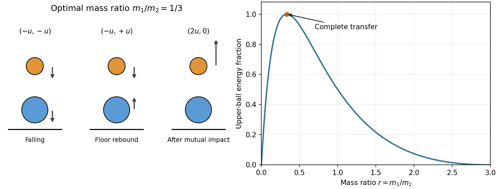

<h1 id="11/a/solution">Solution</h1>

↑ **Parent:** [A](../a.md)

Let $H$ be the common drop height in the small-gap, small-ball approximation and put $u=\sqrt{2gH}$. Use upward positive [velocity](../../../../velocity.md). Just before ground impact both balls have [velocity](../../../../velocity.md) $-u$. The massive fixed ground reverses the lower ball's [velocity](../../../../velocity.md) elastically, so immediately before the ball-ball encounter

$$
u_1=-u,\qquad u_2=+u.
$$

One-dimensional [conservation of momentum](../../../../momentum-conservation.md) and reversal of relative [velocity](../../../../velocity.md) in an [elastic collision](../../../../elastic-collision.md) give

$$
\boxed{v_1=\frac{3m_2-m_1}{m_1+m_2}u,\qquad v_2=\frac{m_2-3m_1}{m_1+m_2}u.}
$$

The sequence is shown for the optimal ratio in [b](../b.md). At that ratio the lower ball stops and the upper ball departs upward, so no immediate third encounter needs to be included. Finite gaps introduce unequal contact times and gravitational corrections; no gap or ball radii are supplied to calculate those corrections.

**[Figure 1](#11/a/image-separated-elastic-impacts-and-the-energy-transfer-to-the-upper-ball). Separated elastic impacts and the energy transfer to the upper ball**. The arrows show the velocities immediately before ground impact, after the lower ball rebounds, and after the mutual collision for the optimal mass ratio. The neighbouring curve gives the upper ball's fraction of the total initial kinetic energy.

## ↑ Ancestors (12)

1. [A](../a.md)
2. [11](../../11.md)
3. [2013 resit](../../../2013-resit-split.md)
4. [Past exam of the physics 1 paper of the University of Oxford](../../../split.md)
5. [Physics 1 paper of the University of Oxford](../../../../physics-1-paper-of-the-university-of-oxford.md)
6. [Year 1 of the physics course of the University of Oxford](../../../../year-1-of-the-physics-course-of-the-university-of-oxford.md)
7. [Physics course of the University of Oxford](../../../../physics-course-of-the-university-of-oxford.md)
8. [Undergraduate course of the University of Oxford](../../../../undergraduate-course-of-the-university-of-oxford.md)
9. [Course of the University of Oxford](../../../../course-of-the-university-of-oxford.md)
10. [University of Oxford](../../../../university-of-oxford-split.md)
11. [List of universities](../../../../list-of-universities.md)
12. [Codex Wiki](../../../../split.md)
