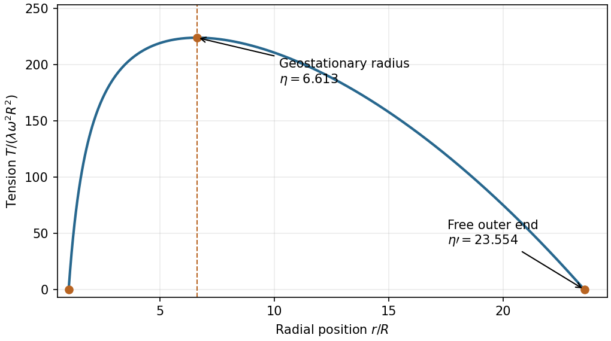
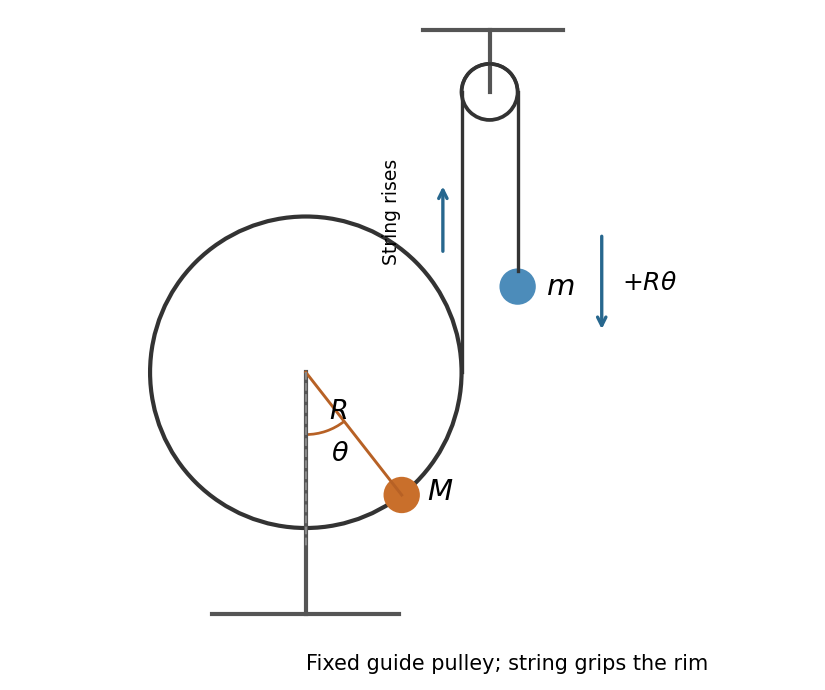

# 2013

↑ **Parent:** [Past exam of the physics 1 paper of the University of Oxford](../past-exam-of-the-physics-1-paper-of-the-university-of-oxford.md)

Source paper: [https://www.whatdotheyknow.com/request/physics_preliminary_examinations/response/1162943/attach/3/Twain.7z?cookie_passthrough=1](https://www.whatdotheyknow.com/request/physics_preliminary_examinations/response/1162943/attach/3/Twain.7z?cookie_passthrough=1)

Solutions for the ordinary sitting of 3 June 2013, including all four alternatives in Section B. The cover prints the placeholder XXXX; no numerical formal code is inferred from the resit.

**Table of contents**

- [1](#1)
  - [Solution](#1/solution)
- [2](#2)
  - [a](#2/a)
    - [Solution](#2/a/solution)
  - [b](#2/b)
    - [Solution](#2/b/solution)
- [3](#3)
  - [a](#3/a)
    - [Solution](#3/a/solution)
  - [b](#3/b)
    - [i](#3/b/i)
      - [Solution](#3/b/i/solution)
    - [ii](#3/b/ii)
      - [Solution](#3/b/ii/solution)
- [4](#4)
  - [Solution](#4/solution)
- [5](#5)
  - [Solution](#5/solution)
- [6](#6)
  - [Solution](#6/solution)
- [7](#7)
  - [Solution](#7/solution)
- [8](#8)
  - [a](#8/a)
    - [Solution](#8/a/solution)
  - [b](#8/b)
    - [Solution](#8/b/solution)
  - [c](#8/c)
    - [Solution](#8/c/solution)
  - [d](#8/d)
    - [Solution](#8/d/solution)
- [9](#9)
  - [a](#9/a)
    - [Solution](#9/a/solution)
  - [b](#9/b)
    - [Solution](#9/b/solution)
  - [c](#9/c)
    - [Solution](#9/c/solution)
  - [d](#9/d)
    - [Solution](#9/d/solution)
  - [e](#9/e)
    - [Solution](#9/e/solution)
- [10](#10)
  - [a](#10/a)
    - [Solution](#10/a/solution)
  - [b](#10/b)
    - [Solution](#10/b/solution)
  - [c](#10/c)
    - [i](#10/c/i)
      - [Solution](#10/c/i/solution)
    - [ii](#10/c/ii)
      - [Solution](#10/c/ii/solution)
  - [d](#10/d)
    - [Solution](#10/d/solution)
  - [e](#10/e)
    - [Solution](#10/e/solution)
- [11](#11)
  - [a](#11/a)
    - [Solution](#11/a/solution)
  - [b](#11/b)
    - [Solution](#11/b/solution)
  - [c](#11/c)
    - [Solution](#11/c/solution)
  - [d](#11/d)
    - [Solution](#11/d/solution)
  - [e](#11/e)
    - [Solution](#11/e/solution)
  - [f](#11/f)
    - [Solution](#11/f/solution)

## 1

↑ **Parent:** [2013](2013.md)

<h3 id="1/solution">Solution</h3>

↑ **Parent:** [1](#1)

The [parallel axis theorem](../rigid-body-dynamics.md#parallel-axis-theorem) states $I=I_G+Md^2$ for parallel axes separated by $d$, with the reference axis through the [centre of mass](../classical-mechanics.md#center-of-mass). The [perpendicular axis theorem](../rigid-body-dynamics.md#perpendicular-axis-theorem) states $I_z=I_x+I_y$ for a planar lamina in the $xy$ plane, about mutually perpendicular axes through one point. It does not apply directly to a three-dimensional solid.

For the [transverse moment of inertia of a uniform solid cylinder](../rigid-body-dynamics.md#transverse-moment-of-inertia-of-a-uniform-solid-cylinder), divide the cylinder into thin disks at axial positions $z\in[-h/2,h/2]$. Symmetry and the [perpendicular axis theorem](../rigid-body-dynamics.md#perpendicular-axis-theorem) give the diametral [moment of inertia](../rigid-body-dynamics.md#moment-of-inertia) $r^2\,dM/4$ of each disk; the [parallel axis theorem](../rigid-body-dynamics.md#parallel-axis-theorem) adds $z^2\,dM$. Hence

$$
I_\perp=\frac Mh\int_{-h/2}^{h/2}\left(\frac{r^2}{4}+z^2\right)dz,\qquad
\boxed{I_\perp=\frac M{12}(3r^2+h^2).}
$$

The thin-disk limit is $Mr^2/4$, while the slender-rod limit is $Mh^2/12$.

## 2

↑ **Parent:** [2013](2013.md)

<h3 id="2/a">a</h3>

↑ **Parent:** [2](#2)

<h4 id="2/a/solution">Solution</h4>

↑ **Parent:** [A](#2/a)

A [cyclic coordinate](../lagrangian-mechanics.md#cyclic-coordinate) $q_j$ is absent explicitly from the [Lagrangian](../calculus-of-variations.md#lagrangian): $\partial L/\partial q_j=0$, even though $\dot q_j$ may occur. The [Euler-Lagrange equation](../analysis.md#euler-lagrange-equation) then gives

$$
\boxed{\frac{d}{dt}\left(\frac{\partial L}{\partial\dot q_j}\right)=0,\qquad p_j=\frac{\partial L}{\partial\dot q_j}=\text{constant}.}
$$

Thus a continuous coordinate-translation symmetry gives a conserved [conjugate momentum](../hamiltonian-mechanics.md#canonical-momentum). The conserved quantity need not be ordinary linear [momentum](../momentum.md): an absent azimuthal angle can give conserved [angular momentum](../momentum.md#angular-momentum). The derivative is taken holding the other coordinates and [velocities](../classical-mechanics.md#velocity) fixed.

<h3 id="2/b">b</h3>

↑ **Parent:** [2](#2)

<h4 id="2/b/solution">Solution</h4>

↑ **Parent:** [B](#2/b)

Define the [energy function](../energy.md#energy-function) $\mathcal E=\sum_i\dot q_i p_i-L$. Along solutions of the [Euler-Lagrange equations](../analysis.md#euler-lagrange-equation),

$$
\frac{d\mathcal E}{dt}=\sum_i\left[\ddot q_i p_i+\dot q_i\dot p_i-\frac{\partial L}{\partial q_i}\dot q_i-\frac{\partial L}{\partial\dot q_i}\ddot q_i\right]-\frac{\partial L}{\partial t}=-\frac{\partial L}{\partial t}.
$$

Consequently

$$
\boxed{\partial L/\partial t=0\quad\Longrightarrow\quad\mathcal E=\text{constant}.}
$$

For an ordinary isolated [mechanical system](../classical-mechanics.md#mechanical-system) with $L=T-U$, a time-independent quadratic [kinetic energy](../energy.md#kinetic-energy) and a velocity-independent [potential energy](../energy.md#potential-energy), $\sum_i\dot q_i p_i=2T$, so $\mathcal E=T+U$. For a more general [Lagrangian](../calculus-of-variations.md#lagrangian), the conserved quantity is the displayed [energy function](../energy.md#energy-function); identifying it with $T+U$ requires these assumptions.

## 3

↑ **Parent:** [2013](2013.md)

<h3 id="3/a">a</h3>

↑ **Parent:** [3](#3)

<h4 id="3/a/solution">Solution</h4>

↑ **Parent:** [A](#3/a)

For the [relativistic head-on elastic collision with a stationary target](../classical-mechanics.md#relativistic-head-on-elastic-collision-with-a-stationary-target), use $c=1$ as stipulated, so [masses](../classical-mechanics.md#mass) are measured in [energy](../energy.md) units. The incoming [momentum](../momentum.md) is $p=\sqrt{E^2-M^2}$ and the invariant squared total [four-momentum](../special-relativity.md#four-momentum) is

$$
s=(E+m)^2-p^2=M^2+m^2+2mE.
$$

The [centre-of-mass frame](../special-relativity.md#center-of-momentum-frame) moves at $\beta_*=p/(E+m)$, with $\gamma_*=(E+m)/\sqrt s$. In this frame the incident particle has

$$
E_M^*=\frac{M^2+mE}{\sqrt s},\qquad p_M^*=\gamma_*(p-\beta_*E)=\frac{mp}{\sqrt s}.
$$

A nontrivial head-on [elastic collision](../classical-mechanics.md#elastic-collision) reverses $p_M^*$ and preserves $E_M^*$. Boosting back to the [laboratory frame](../mathematical-physics.md#laboratory-frame) gives

$$
E'=\gamma_*(E_M^*-\beta_*p_M^*)=\frac{(E+m)(M^2+mE)-m(E^2-M^2)}s,
$$

$$
\boxed{E'=\frac{2mM^2+E(m^2+M^2)}{2Em+m^2+M^2}.}
$$

The no-interaction forward branch instead leaves $E'=E$; the requested formula describes the actual one-dimensional encounter and recoil.

<h3 id="3/b">b</h3>

↑ **Parent:** [3](#3)

<h4 id="3/b/i">i</h4>

↑ **Parent:** [B](#3/b)

<h5 id="3/b/i/solution">Solution</h5>

↑ **Parent:** [I](#3/b/i)

With $M\gg m$ and $Em\gg M^2$, one also has $E\gg M^2/m\gg M$. The denominator in [a](#3/a) is then dominated by $2Em$, and the numerator by $EM^2$:

$$
\boxed{E'\sim\frac{M^2}{2m}.}
$$

This residual total [energy](../energy.md) is still much larger than the incident particle's [rest energy](../special-relativity.md#rest-energy) $M$, but is a small fraction of its incident [energy](../energy.md) $E$. The target acquires most of the available [energy](../energy.md) in this high-energy, heavy-projectile limit.

<h4 id="3/b/ii">ii</h4>

↑ **Parent:** [B](#3/b)

<h5 id="3/b/ii/solution">Solution</h5>

↑ **Parent:** [Ii](#3/b/ii)

For $m\gg M$, retain the ratio $E/m$ until a further limit is specified. Since $E\ge M$, the leading expression from [a](#3/a) is

$$
\boxed{E'\simeq\frac{Em}{m+2E}=\frac{E}{1+2E/m}.}
$$

For an infinitely heavy target at fixed incident [energy](../energy.md), $E/m\to0$ and $\boxed{E'\to E}$: the projectile reverses with negligible target recoil [energy](../energy.md). If the incident particle is ultrarelativistic even relative to the target, $E\gg m\gg M$, the same leading expression instead gives $E'\sim m/2$. The mass hierarchy alone does not justify replacing $E/m$ by zero.

## 4

↑ **Parent:** [2013](2013.md)

<h3 id="4/solution">Solution</h3>

↑ **Parent:** [4](#4)

For [maximum projectile range from an elevated launch](../classical-mechanics.md#maximum-projectile-range-from-an-elevated-launch), let $X$ be horizontal [projectile range](../classical-mechanics.md#projectile-range) from the tower and $\alpha$ the launch angle above horizontal. The [projectile motion](../classical-mechanics.md#projectile-motion) trajectory is

$$
y=h+X\tan\alpha-\frac{gX^2}{2u^2}(1+\tan^2\alpha).
$$

Put $z=\tan\alpha$. For a fixed $X$, its largest possible $y$ occurs at $z=u^2/(gX)$; the envelope is $y_{\max}=h+u^2/(2g)-gX^2/(2u^2)$. The furthest attainable ground point satisfies $y_{\max}=0$, so

$$
\boxed{X_{\max}=\frac ug\sqrt{u^2+2gh},\qquad \tan\alpha_{\rm opt}=\frac{u}{\sqrt{u^2+2gh}}.}
$$

The optimum angle is less than $45^\circ$ for $h>0$ and approaches $45^\circ$ as $h\to0$. The result is the maximum horizontal distance, using uniform gravity and no [drag](../fluid-mechanics.md#drag-physics).

## 5

↑ **Parent:** [2013](2013.md)

<h3 id="5/solution">Solution</h3>

↑ **Parent:** [5](#5)

If $S'$ moves at $+v$ relative to $S$, the [Lorentz transformations](../special-relativity.md#lorentz-transformation) are

$$
\boxed{x'=\gamma(x-vt),\quad t'=\gamma(t-vx/c^2),\quad \gamma=(1-v^2/c^2)^{-1/2}.}
$$

A rod at rest in $S$ has length $L$. To measure it in $S'$, select endpoint events simultaneous there: $\Delta t'=0$, so $\Delta t=vL/c^2$ and $\Delta x'=\gamma(L-v\Delta t)=L/\gamma$. This is [length contraction](../special-relativity.md#length-contraction).

Now let a clock at rest in $S'$ cross the two rod endpoints. These are different events, with $\Delta x=L$, $\Delta t=L/v$ and $\Delta x'=0$. Their transformed time interval is

$$
\Delta t'=\gamma\left(\frac Lv-\frac{vL}{c^2}\right)=\frac{L}{\gamma v}=\frac{L'}v.
$$

Thus

$$
\boxed{L'=L/\gamma,\qquad \Delta t=\gamma\Delta t'.}
$$

The moving clock measures the [proper time](../special-relativity.md#proper-time) $\Delta t'$. The rod's contracted length divided by its [speed](../classical-mechanics.md#speed) in that clock's frame gives exactly the same crossing [time](../classical-mechanics.md#time-in-physics); [time dilation](../special-relativity.md#time-dilation) and [length contraction](../special-relativity.md#length-contraction) are consistent consequences of the same transformation. Measuring a length and measuring a traversal interval require different simultaneity conditions.

## 6

↑ **Parent:** [2013](2013.md)

<h3 id="6/solution">Solution</h3>

↑ **Parent:** [6](#6)

Choose the positive axis from the approaching source towards the observer. The photon that reaches the observer is emitted forward, with source-frame [four-momentum](../special-relativity.md#four-momentum) $(E/c,E/c,0,0)$. Boosting to the observer frame gives $E_{\rm obs}=\gamma E(1+\beta)$, where $\beta=v/c$. Since photon [energy](../energy.md) is $h_{\rm P}\nu$,

$$
\boxed{\nu=\frac E{h_{\rm P}}\gamma(1+\beta)=\frac E{h_{\rm P}}\sqrt{\frac{1+v/c}{1-v/c}}.}
$$

This is the approaching-source [relativistic Doppler effect](../wave.md#relativistic-doppler-effect). A photon emitted in a general source-frame direction would instead have the factor $\gamma(1+\beta\cos\theta_*)$; forward emission is the geometry of the photon directed to the observer here.

## 7

↑ **Parent:** [2013](2013.md)

<h3 id="7/solution">Solution</h3>

↑ **Parent:** [7](#7)

The [alpha particle](../atomic-nucleus.md#alpha-particle) has [electric charge](../electric-charge.md) $2e$ and acquires [kinetic energy](../energy.md#kinetic-energy) $K=2e(20\,\mathrm{kV})=40\,\mathrm{keV}$. For [Coulomb head-on closest approach with target recoil](../classical-mechanics.md#coulomb-head-on-closest-approach-with-target-recoil), the initially stationary [beryllium](../chemical-substance.md#beryllium) nucleus is free to recoil. Approximating the nuclear [masses](../classical-mechanics.md#mass) by $4u$ and $9u$, the initial relative-motion [kinetic energy](../energy.md#kinetic-energy) is

$$
K_* = \frac{m_{\rm Be}}{m_\alpha+m_{\rm Be}}K=\frac9{13}(40\,\mathrm{keV})=27.6923\,\mathrm{keV}.
$$

At closest separation the relative radial [velocity](../classical-mechanics.md#velocity) vanishes, although the [centre of mass](../classical-mechanics.md#center-of-mass) continues moving. [Conservation of energy](../mathematical-physics.md#conservation-of-energy) for the relative motion gives

$$
\frac{(2e)(4e)}{4\pi\varepsilon_0r_{\min}}=K_*,\qquad
\boxed{r_{\min}=\frac{8e^2}{4\pi\varepsilon_0K_*}\simeq4.16\times10^{-13}\,\mathrm m.}
$$

Using $e^2/(4\pi\varepsilon_0)=1.43996\,\mathrm{MeV\,fm}$ gives $r_{\min}\simeq416\,\mathrm{fm}$. If the nucleus were externally held fixed, the relevant [energy](../energy.md) would be $K$, yielding $288\,\mathrm{fm}$ instead. Initially stationary is not the same as constrained stationary; the given proton and neutron counts supply the recoil correction. Nuclear sizes and strong interactions are negligible at this separation.

## 8

↑ **Parent:** [2013](2013.md)

<h3 id="8/a">a</h3>

↑ **Parent:** [8](#8)

<h4 id="8/a/solution">Solution</h4>

↑ **Parent:** [A](#8/a)

A [geostationary orbit](../celestial-mechanics.md#geostationary-orbit) has the same [angular velocity](../rigid-body-dynamics.md#angular-velocity) as the [Earth](../planetary-science.md#earth). Let $M_E=4\pi\rho R^3/3$ and $r_g=\eta R$. Balancing the required [centripetal acceleration](../classical-mechanics.md#centripetal-acceleration) with the exterior [gravitational field](../physics.md#gravitational-field) gives

$$
\omega^2r_g=\frac{GM_E}{r_g^2},\qquad
\boxed{\eta=\left(\frac{GM_E}{\omega^2R^3}\right)^{1/3}=\left(\frac{4\pi G\rho}{3\omega^2}\right)^{1/3}.}
$$

The [orbital plane](../celestial-mechanics.md#orbital-plane) must be equatorial and the motion prograde for the satellite to remain over one point. The uniform density assumption supplies $M_E$ in terms of the specified $\rho$ and $R$.

<h3 id="8/b">b</h3>

↑ **Parent:** [8](#8)

<h4 id="8/b/solution">Solution</h4>

↑ **Parent:** [B](#8/b)

Taking the [Earth](../planetary-science.md#earth)'s sidereal rotation period as $86164\,\mathrm s$, $\omega=2\pi/(86164\,\mathrm s)$, and $G=6.6743\times10^{-11}\,\mathrm{m^3\,kg^{-1}\,s^{-2}}$ gives

$$
\boxed{\eta\simeq6.61.}
$$

The [orbital radius](../dynamical-systems.md#orbital-radius) is therefore about $6.61R$, or an altitude of about $5.61R$. Replacing the sidereal day by $86400\,\mathrm s$ changes this estimate by less than $0.2\%$.

<h3 id="8/c">c</h3>

↑ **Parent:** [8](#8)

<h4 id="8/c/solution">Solution</h4>

↑ **Parent:** [C](#8/c)

For the [uniform unloaded space-elevator cable](../engineering.md#uniform-unloaded-space-elevator-cable), let the constant [linear mass density](../fluid-mechanics.md#linear-mass-density) be $\lambda$ and the outer endpoint be $b=\eta'R$. In the co-rotating frame the outward effective [force](../force.md) per unit length is $\lambda(\omega^2r-GM_E/r^2)$. The cable is just clear of the surface, with neither a ground load nor an endpoint counterweight, so both ends have zero applied [tension](../force.md#tension). The integrated effective [force](../force.md) must vanish:

$$
0=\lambda\int_R^b\left(\omega^2r-\frac{GM_E}{r^2}\right)dr=\lambda\left[\frac{\omega^2}{2}(b^2-R^2)+GM_E\left(\frac1b-\frac1R\right)\right].
$$

Using $GM_E=\omega^2\eta^3R^3$, this becomes

$$
0=(\eta'-1)\left[\frac{\eta'+1}{2}-\frac{\eta^3}{\eta'}\right].
$$

The root $\eta'=1$ is a zero-length cable. The physical nonzero cable has

$$
\boxed{\eta'=\frac{\sqrt{1+8\eta^3}-1}{2}\simeq23.6.}
$$

It extends well beyond the [geostationary orbit](../celestial-mechanics.md#geostationary-orbit) so its outer [centrifugal force](../mathematical-physics.md#centrifugal-force) balances the inner segment's weight. If a cable is anchored with a nonzero endpoint load or has a counterweight, that load changes the integrated balance; its length is not fixed by the zero-end-load formula.

<h3 id="8/d">d</h3>

↑ **Parent:** [8](#8)

<h4 id="8/d/solution">Solution</h4>

↑ **Parent:** [D](#8/d)

An element of the rotating cable satisfies

$$
\frac{dT}{dr}=\lambda\left(\frac{GM_E}{r^2}-\omega^2r\right).
$$

With $T(R)=0$, integration gives

$$
T(r)=\lambda\left[GM_E\left(\frac1R-\frac1r\right)-\frac{\omega^2}{2}(r^2-R^2)\right].
$$

It increases below $r_g$, decreases above $r_g$, and returns to zero at $b$. Hence

$$
\boxed{r_{T_{\max}}=r_g=\eta R,\qquad T_{\max}=\lambda\omega^2R^2\left(\eta^3-\frac32\eta^2+\frac12\right).}
$$

The [tension](../force.md#tension) is greatest at the [geostationary orbit](../celestial-mechanics.md#geostationary-orbit), where local effective gravity is zero. A zero local effective [force](../force.md) does not mean zero [tension](../force.md#tension): that section transmits the loads of the entire inner and outer cable portions.

**[Figure 1](#8/d/image-tension-in-the-uniform-unloaded-space-elevator-cable). Tension in the uniform unloaded space-elevator cable**. The tension vanishes at both ends and peaks at the geostationary radius. The outer endpoint follows from the integrated rotating-frame force balance, using the specified uniform Earth density.

## 9

↑ **Parent:** [2013](2013.md)

<h3 id="9/a">a</h3>

↑ **Parent:** [9](#9)

<h4 id="9/a/solution">Solution</h4>

↑ **Parent:** [A](#9/a)

Let $\theta$ measure the rim [point mass](../classical-mechanics.md#point-mass)'s displacement from vertically below the fixed axis. The disk has [moment of inertia](../rigid-body-dynamics.md#moment-of-inertia) $I_D=\tfrac12(2M)R^2=MR^2$, and the rim [mass](../classical-mechanics.md#mass) contributes another $MR^2$. Its varying [gravitational potential energy](../energy.md#gravitational-energy) is $-MgR\cos\theta$. Thus

$$
\boxed{L=MR^2\dot\theta^2+MgR\cos\theta.}
$$

The disk's [centre of mass](../classical-mechanics.md#center-of-mass) remains fixed, so its own gravitational contribution is a constant and has been omitted. The total fixed-axis [moment of inertia](../rigid-body-dynamics.md#moment-of-inertia) is $2MR^2$.

<h3 id="9/b">b</h3>

↑ **Parent:** [9](#9)

<h4 id="9/b/solution">Solution</h4>

↑ **Parent:** [B](#9/b)

The [Euler-Lagrange equation](../analysis.md#euler-lagrange-equation) from [a](#9/a) is $2MR^2\ddot\theta+MgR\sin\theta=0$. Linearizing about $\theta=0$ gives

$$
\boxed{\omega_{\rm fixed}=\sqrt{\frac{g}{2R}},\qquad f_{\rm fixed}=\frac1{2\pi}\sqrt{\frac{g}{2R}},\qquad T_{\rm fixed}=2\pi\sqrt{\frac{2R}{g}}.}
$$

Both [angular frequency](../lagrangian-mechanics.md#angular-frequency) and ordinary [frequency](../wave.md#frequency) are given to distinguish the two conventions. The stable position places the extra [mass](../classical-mechanics.md#mass) below the pivot.

<h3 id="9/c">c</h3>

↑ **Parent:** [9](#9)

<h4 id="9/c/solution">Solution</h4>

↑ **Parent:** [C](#9/c)

For the [rolling disk with a rim point mass](../rigid-body-dynamics.md#rolling-disk-with-a-rim-point-mass), impose [rolling without slipping](../rigid-body-dynamics.md#rolling-without-slipping) and take the clockwise angular displacement $\theta$ from the configuration with the extra [mass](../classical-mechanics.md#mass) at the bottom. The disk centre has $x_C=R\theta$ and $y_C=R$. The extra [mass](../classical-mechanics.md#mass) has

$$
x_M=R(\theta-\sin\theta),\qquad y_M=R(1-\cos\theta),\qquad v_M^2=2R^2(1-\cos\theta)\dot\theta^2.
$$

The disk's translational and [rotational kinetic energies](../energy.md#rotational-kinetic-energy) sum to $3MR^2\dot\theta^2/2$. Including the rim [mass](../classical-mechanics.md#mass) gives

$$
T=\frac12MR^2(5-2\cos\theta)\dot\theta^2,\qquad U=MgR(1-\cos\theta).
$$

The exact [Euler-Lagrange equation](../analysis.md#euler-lagrange-equation) is

$$
MR^2(5-2\cos\theta)\ddot\theta+MR^2\sin\theta\,\dot\theta^2+MgR\sin\theta=0.
$$

To first order, $3MR^2\ddot\theta+MgR\theta=0$. Therefore

$$
\boxed{\omega_{\rm roll}=\sqrt{\frac{g}{3R}},\qquad \frac{T_{\rm roll}}{T_{\rm fixed}}=\sqrt{\frac32}.}
$$

At the bottom the extra [mass](../classical-mechanics.md#mass) is instantaneously at the contact point and has no first-order [velocity](../classical-mechanics.md#velocity). The increased effective inertia comes from the moving disk. Static [friction](../newtonian-mechanics.md#friction) enforces the rolling constraint without doing [work](../energy.md#work) at the stationary contact.

<h3 id="9/d">d</h3>

↑ **Parent:** [9](#9)

<h4 id="9/d/solution">Solution</h4>

↑ **Parent:** [D](#9/d)

In the [rim-mass pulley coupled to a hanging mass](../lagrangian-mechanics.md#rim-mass-pulley-coupled-to-a-hanging-mass), the printed figure shows the smaller pulley fixed overhead, and the [mechanical string](../continuum-mechanics.md#mechanical-string) leaves the right-hand tangent of the larger pulley. Let $\theta$ increase counterclockwise from the downward vertical to the radius carrying $M$. Then the hanging [mass](../classical-mechanics.md#mass) $m$ moves downward by $R\theta$. The string is taken to grip the rim without slipping. Its [tension](../force.md#tension) must be solved dynamically, rather than set equal to $mg$ during motion.

The [kinetic energy](../energy.md#kinetic-energy) and [potential energy](../energy.md#potential-energy) are

$$
T=\frac12(M+m)R^2\dot\theta^2,\qquad U=-MgR\cos\theta-mgR\theta.
$$

The [Euler-Lagrange equation](../analysis.md#euler-lagrange-equation) and the condition for [equilibrium](../dynamical-systems.md#equilibrium-point-of-a-dynamical-system) are

$$
\boxed{(M+m)R\ddot\theta+Mg\sin\theta-mg=0,\qquad \sin\theta_e=\frac mM.}
$$

One can also eliminate the [tension](../force.md#tension) from $MR^2\ddot\theta=TR-MgR\sin\theta$ and $mR\ddot\theta=mg-T$. For $0<m<M$, the solution with $\cos\theta_e>0$ is stable; the other solution in a full turn is unstable.

**[Figure 2](#9/d/image-coordinates-and-string-motion-in-the-coupled-pulley-system). Coordinates and string motion in the coupled pulley system**. The original schematic records the printed figure's fixed upper pulley, right-hand tangent string, rim mass, and angle from downward vertical. Positive rotation raises the tangent string and lowers the hanging mass.

<h3 id="9/e">e</h3>

↑ **Parent:** [9](#9)

<h4 id="9/e/solution">Solution</h4>

↑ **Parent:** [E](#9/e)

Put $\theta=\theta_e+\delta$ at the stable [equilibrium](../dynamical-systems.md#equilibrium-point-of-a-dynamical-system). Since $M\sin\theta_e=m$, linearization of [d](#9/d) gives

$$
(M+m)R\ddot\delta+Mg\cos\theta_e\,\delta=0.
$$

Thus

$$
\boxed{\omega_0=\sqrt{\frac{Mg\cos\theta_e}{(M+m)R}}=\sqrt{\frac{g\sqrt{M^2-m^2}}{(M+m)R}},\qquad f_0=\frac{\omega_0}{2\pi}.}
$$

As $m\to0$, the result approaches $\sqrt{g/R}$, the [simple pendulum](../simple-pendulum.md) value. As $m\uparrow M$, the restoring curvature tends to zero and this small-amplitude [frequency](../wave.md#frequency) tends to zero; the endpoint itself is not a stable quadratic minimum.

## 10

↑ **Parent:** [2013](2013.md)

<h3 id="10/a">a</h3>

↑ **Parent:** [10](#10)

<h4 id="10/a/solution">Solution</h4>

↑ **Parent:** [A](#10/a)

For the approaching ship, $\beta_s=0.85$ and $\gamma_s=(1-0.85^2)^{-1/2}$. Its station-frame [length contraction](../special-relativity.md#length-contraction) gives $L_s=100/\gamma_s\,\mathrm m$. Adding the two station-frame clearances gives

$$
\boxed{L_b=100\sqrt{1-0.85^2}+4\simeq56.6783\,\mathrm m.}
$$

This is the berth's [proper length](../special-relativity.md#proper-length), since the berth is at rest in the station. It is a simultaneous station-frame allocation, not a ship-frame guarantee of a safe docking maneuver.

<h3 id="10/b">b</h3>

↑ **Parent:** [10](#10)

<h4 id="10/b/solution">Solution</h4>

↑ **Parent:** [B](#10/b)

The berth moves at $0.85c$ in the ship's initial [rest frame](../mathematical-physics.md#rest-frame), so it too is subject to [length contraction](../special-relativity.md#length-contraction):

$$
\boxed{L_b'=\frac{L_b}{\gamma_s}=100(1-0.85^2)+4\sqrt{1-0.85^2}\simeq29.8571\,\mathrm m.}
$$

The ship remains $100\,\mathrm m$ long in this frame. The two length comparisons use different simultaneous endpoint events; this is the same [relativity of simultaneity](../special-relativity.md#relativity-of-simultaneity) that resolves the [ladder paradox](../special-relativity.md#ladder-paradox). Physical docking also requires deceleration, whose later effects are outside these initial inertial measurements.

<h3 id="10/c">c</h3>

↑ **Parent:** [10](#10)

<h4 id="10/c/i">i</h4>

↑ **Parent:** [C](#10/c)

<h5 id="10/c/i/solution">Solution</h5>

↑ **Parent:** [I](#10/c/i)

Interpret the one-light-day separation $D$ as measured in the station frame at capsule launch, and retain the ship's initial inertial [rest frame](../mathematical-physics.md#rest-frame) until reception at the station. The phrase does not explicitly name a frame; an alternative is given below. The ship-frame simultaneous separation is $D'=D/\gamma_s$. The capsule moves at $0.9c$ towards a station approaching at $0.85c$, so their separation decreases at $1.75c$ in this frame. This is a separation rate, not either object's [speed](../classical-mechanics.md#speed). Hence the elapsed ship-frame coordinate [time](../classical-mechanics.md#time-in-physics) is

$$
\boxed{\Delta t_s=\frac{D}{\gamma_s(0.9+0.85)c}\simeq0.301018\,\mathrm{day}\simeq7.2244\,\mathrm h.}
$$

It is the interval assigned using synchronized clocks in the ship frame to the launch and remote arrival. A single onboard clock does not directly mark the remote arrival event; observing its arrival signal would add a light-travel delay. If the stated one-light-day separation were instead measured in the ship frame, the answer would be $\Delta t_s=(1/1.75)\,\mathrm{day}=0.571429\,\mathrm{day}$.

<h4 id="10/c/ii">ii</h4>

↑ **Parent:** [C](#10/c)

<h5 id="10/c/ii/solution">Solution</h5>

↑ **Parent:** [Ii](#10/c/ii)

Launch and arrival occur on the capsule's own worldline, so its clock measures the [proper time](../special-relativity.md#proper-time). In the ship frame its [Lorentz factor](../special-relativity.md#lorentz-factor) is $\gamma_{c/s}=(1-0.9^2)^{-1/2}$; therefore

$$
\boxed{\Delta\tau_c=\frac{\Delta t_s}{\gamma_{c/s}}=\Delta t_s\sqrt{1-0.9^2}\simeq0.131211\,\mathrm{day}\simeq3.1491\,\mathrm h.}
$$

This uses the station-frame distance convention stated in [i](#10/c/i). With a one-light-day distance in the ship frame instead, it becomes $\Delta\tau_c=\sqrt{0.19}/1.75\,\mathrm{day}\simeq0.249080\,\mathrm{day}$. The uncertainty is a distance-frame convention in the wording, not a missing figure or an unanswered mathematical part.

<h3 id="10/d">d</h3>

↑ **Parent:** [10](#10)

<h4 id="10/d/solution">Solution</h4>

↑ **Parent:** [D](#10/d)

The [velocity-addition formula](../special-relativity.md#velocity-addition-formula) combines the ship's station-frame [velocity](../classical-mechanics.md#velocity) and the capsule's ship-frame [velocity](../classical-mechanics.md#velocity):

$$
\boxed{\frac{v_c}{c}=\frac{0.85+0.9}{1+0.85(0.9)}=\frac{350}{353}\simeq0.9915014.}
$$

For the distance convention in [i](#10/c/i), station-frame arrival takes $D/v_c=(353/350)\,\mathrm{day}=1.008571\,\mathrm{day}$. Transforming its two endpoint events back to the ship frame gives $\gamma_s[D/v_c-0.85D/c]$, agreeing with [i](#10/c/i). The capsule remains below the [speed of light](../special-relativity.md#speed-of-light) in either frame.

<h3 id="10/e">e</h3>

↑ **Parent:** [10](#10)

<h4 id="10/e/solution">Solution</h4>

↑ **Parent:** [E](#10/e)

The capsule continues inertially at $v_c/c=350/353$ while the ship reduces its station-frame [speed](../classical-mechanics.md#speed) to $0.7c$. Transform the ship's new [velocity](../classical-mechanics.md#velocity) into the capsule frame:

$$
\boxed{\frac{v_{s/c}}c=\frac{0.7-350/353}{1-0.7(350/353)}=-\frac{343}{360}\simeq-0.952778.}
$$

Thus its [speed](../classical-mechanics.md#speed) is $0.952778c$, and the negative sign means it recedes behind the capsule along the chosen axis. The same transformation compares the subsequent local inertial [velocities](../classical-mechanics.md#velocity); the details of the intervening deceleration are not needed.

## 11

↑ **Parent:** [2013](2013.md)

<h3 id="11/a">a</h3>

↑ **Parent:** [11](#11)

<h4 id="11/a/solution">Solution</h4>

↑ **Parent:** [A](#11/a)

Let $\mu=GM_*$ and use plane polar coordinates in the orbital plane. The Newtonian [gravitational potential energy](../energy.md#gravitational-energy) is $U=-\mu M_p/r$, so

$$
\boxed{L=\frac{M_p}{2}(\dot r^2+r^2\dot\phi^2)+\frac{GM_*M_p}{r}.}
$$

A [central force](../mathematical-physics.md#central-force) keeps the orbit in a plane. The star is treated as stationary, appropriate when $M_p\ll M_*$; otherwise the two-body reduction uses the [reduced mass](../classical-mechanics.md#reduced-mass) and the relative separation.

<h3 id="11/b">b</h3>

↑ **Parent:** [11](#11)

<h4 id="11/b/solution">Solution</h4>

↑ **Parent:** [B](#11/b)

The [Lagrangian](../calculus-of-variations.md#lagrangian) has no explicit [time](../classical-mechanics.md#time-in-physics) dependence, so its [energy function](../energy.md#energy-function) is constant. With total [speed](../classical-mechanics.md#speed) $v^2=\dot r^2+r^2\dot\phi^2$, division by $M_p$ gives

$$
\epsilon=\frac12v^2-\frac\mu r=\text{constant}.
$$

Consequently, between the initial point $(r_i,v_i)$ and any other point,

$$
\boxed{v^2(r)=v_i^2+2GM_*\left(\frac1r-\frac1{r_i}\right).}
$$

This energy relation holds for nonradial motion too. Radially outward motion is the stipulated approximation for the subsequent probe calculation; [angular momentum](../momentum.md#angular-momentum) is then zero.

<h3 id="11/c">c</h3>

↑ **Parent:** [11](#11)

<h4 id="11/c/solution">Solution</h4>

↑ **Parent:** [C](#11/c)

Retain the source's idealized solar radial trajectory. Use $\mu_\odot\simeq1.32712\times10^{11}\,\mathrm{km^3\,s^{-2}}$, $r_i=1.5\times10^9\,\mathrm{km}$ and $v_i=22\,\mathrm{km\,s^{-1}}$. At $r=1.8\times10^{10}\,\mathrm{km}$,

$$
\boxed{v=\sqrt{22^2+2(1.32712\times10^{11})\left(\frac1{1.8\times10^{10}}-\frac1{1.5\times10^9}\right)}\simeq17.94\,\mathrm{km\,s^{-1}}.}
$$

The [speed](../classical-mechanics.md#speed) has decreased because the probe gains [gravitational potential energy](../energy.md#gravitational-energy) while moving away from the [Sun](../stellar-astrophysics.md#sun). This is the supplied simplified model, rather than a reconstruction of [Voyager 1](../engineering.md#voyager-1)'s actual three-dimensional trajectory or planetary encounters.

<h3 id="11/d">d</h3>

↑ **Parent:** [11](#11)

<h4 id="11/d/solution">Solution</h4>

↑ **Parent:** [D](#11/d)

Setting $1/r\to0$ in [b](#11/b) gives the asymptotic [speed](../classical-mechanics.md#speed)

$$
\boxed{v_\infty=\sqrt{22^2-\frac{2(1.32712\times10^{11})}{1.5\times10^9}}\simeq17.52\,\mathrm{km\,s^{-1}}.}
$$

The radicand is positive, so the ideal probe has positive total [mechanical energy](../energy.md#mechanical-energy) and escapes the [Sun](../stellar-astrophysics.md#sun). The later dust-cloud model takes this limiting [speed](../classical-mechanics.md#speed) as its initial [speed](../classical-mechanics.md#speed).

<h3 id="11/e">e</h3>

↑ **Parent:** [11](#11)

<h4 id="11/e/solution">Solution</h4>

↑ **Parent:** [E](#11/e)

For [constant-area capture of stationary dust](../classical-mechanics.md#constant-area-capture-of-stationary-dust), let $x=0$ at cloud entry, $M(0)=M_p$, $v(0)=v_\infty$, and define $k=\rho A$ with fixed collecting area $A$. Every swept volume $A\,dx$ adds stationary [mass](../classical-mechanics.md#mass), so

$$
\frac{dM}{dt}=kv,\qquad M=M_p+kx.
$$

There is no external longitudinal [force](../force.md), and the incoming dust has zero [momentum](../momentum.md) in the cloud frame. The [variable-mass system](../classical-mechanics.md#variable-mass-system) therefore satisfies $d(Mv)/dt=0$, rather than $M\dot v=0$. Using $Mv=M_pv_\infty$ gives

$$
M\dot M=kM_pv_\infty,\qquad M^2=M_p^2+2kM_pv_\infty t.
$$

Hence

$$
\boxed{M(t)=M_p\sqrt{1+\frac{2\rho Av_\infty t}{M_p}},\qquad v(t)=\frac{v_\infty}{\sqrt{1+2\rho Av_\infty t/M_p}},}
$$

$$
\boxed{x(t)=\frac{M_p}{\rho A}\left[\sqrt{1+\frac{2\rho Av_\infty t}{M_p}}-1\right].}
$$

The [kinetic energy](../energy.md#kinetic-energy) decreases during sticking: $dK/dt=-\tfrac12\dot M v^2$. The lost [energy](../energy.md) becomes internal [energy](../energy.md). Radiation, gravity, sputtering and changes in area are excluded by the ideal complete-collection model. The zero-density limit recovers $M=M_p$, $v=v_\infty$ and $x=v_\infty t$.

<h3 id="11/f">f</h3>

↑ **Parent:** [11](#11)

<h4 id="11/f/solution">Solution</h4>

↑ **Parent:** [F](#11/f)

Use a year of $365.25$ days, so $t=9.46728\times10^8\,\mathrm s$, and $k=\rho A=10^{-11}\,\mathrm{kg\,m^{-1}}$. With $M_p=722\,\mathrm{kg}$ and $v_\infty\simeq1.752\times10^4\,\mathrm{m\,s^{-1}}$, [e](#11/e) gives

$$
\boxed{M_f\simeq872\,\mathrm{kg},\qquad v_f\simeq14.5\,\mathrm{km\,s^{-1}}.}
$$

The corresponding cloud thickness is $x_f=(M_f-M_p)/k\simeq1.50\times10^{13}\,\mathrm m$. Checking $M_fv_f=M_pv_\infty$ verifies [conservation of momentum](../momentum.md#momentum-conservation); using the initial [speed](../classical-mechanics.md#speed) for all thirty years would overestimate the collected [mass](../classical-mechanics.md#mass).

## ↑ Ancestors (9)

1. [Past exam of the physics 1 paper of the University of Oxford](../past-exam-of-the-physics-1-paper-of-the-university-of-oxford.md)
2. [Physics 1 paper of the University of Oxford](../university-of-oxford.md#physics-1-paper-of-the-university-of-oxford)
3. [Year 1 of the physics course of the University of Oxford](../university-of-oxford.md#year-1-of-the-physics-course-of-the-university-of-oxford)
4. [Physics course of the University of Oxford](../university-of-oxford.md#physics-course-of-the-university-of-oxford)
5. [Undergraduate course of the University of Oxford](../university-of-oxford.md#undergraduate-course-of-the-university-of-oxford)
6. [Course of the University of Oxford](../university-of-oxford.md#course-of-the-university-of-oxford)
7. [University of Oxford](../university-of-oxford.md)
8. [List of universities](../README.md#list-of-universities)
9. [Codex Wiki](../README.md)
