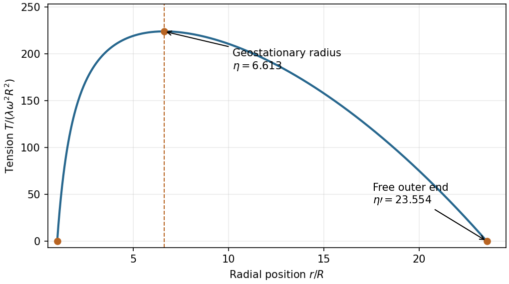

<h1 id="8/d/solution">Solution</h1>

↑ **Parent:** [D](../d.md)

An element of the rotating cable satisfies

$$
\frac{dT}{dr}=\lambda\left(\frac{GM_E}{r^2}-\omega^2r\right).
$$

With $T(R)=0$, integration gives

$$
T(r)=\lambda\left[GM_E\left(\frac1R-\frac1r\right)-\frac{\omega^2}{2}(r^2-R^2)\right].
$$

It increases below $r_g$, decreases above $r_g$, and returns to zero at $b$. Hence

$$
\boxed{r_{T_{\max}}=r_g=\eta R,\qquad T_{\max}=\lambda\omega^2R^2\left(\eta^3-\frac32\eta^2+\frac12\right).}
$$

The [tension](../../../../tension.md) is greatest at the [geostationary orbit](../../../../geostationary-orbit.md), where local effective gravity is zero. A zero local effective [force](../../../../force-split.md) does not mean zero [tension](../../../../tension.md): that section transmits the loads of the entire inner and outer cable portions.

**[Figure 1](#8/d/image-tension-in-the-uniform-unloaded-space-elevator-cable). Tension in the uniform unloaded space-elevator cable**. The tension vanishes at both ends and peaks at the geostationary radius. The outer endpoint follows from the integrated rotating-frame force balance, using the specified uniform Earth density.

## ↑ Ancestors (12)

1. [D](../d.md)
2. [8](../../8.md)
3. [2013](../../../2013-split.md)
4. [Past exam of the physics 1 paper of the University of Oxford](../../../split.md)
5. [Physics 1 paper of the University of Oxford](../../../../physics-1-paper-of-the-university-of-oxford.md)
6. [Year 1 of the physics course of the University of Oxford](../../../../year-1-of-the-physics-course-of-the-university-of-oxford.md)
7. [Physics course of the University of Oxford](../../../../physics-course-of-the-university-of-oxford.md)
8. [Undergraduate course of the University of Oxford](../../../../undergraduate-course-of-the-university-of-oxford.md)
9. [Course of the University of Oxford](../../../../course-of-the-university-of-oxford.md)
10. [University of Oxford](../../../../university-of-oxford-split.md)
11. [List of universities](../../../../list-of-universities.md)
12. [Codex Wiki](../../../../split.md)
