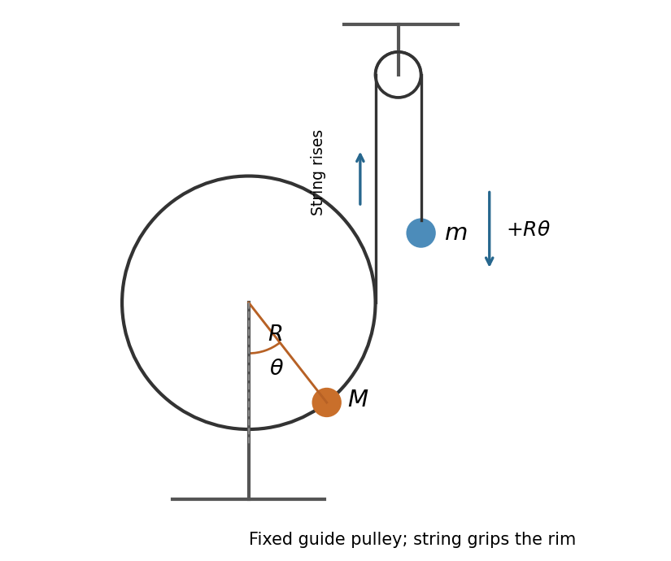

<h1 id="9/d/solution">Solution</h1>

↑ **Parent:** [D](../d.md)

In the [rim-mass pulley coupled to a hanging mass](../../../../rim-mass-pulley-coupled-to-a-hanging-mass.md), the printed figure shows the smaller pulley fixed overhead, and the [mechanical string](../../../../mechanical-string.md) leaves the right-hand tangent of the larger pulley. Let $\theta$ increase counterclockwise from the downward vertical to the radius carrying $M$. Then the hanging [mass](../../../../mass.md) $m$ moves downward by $R\theta$. The string is taken to grip the rim without slipping. Its [tension](../../../../tension.md) must be solved dynamically, rather than set equal to $mg$ during motion.

The [kinetic energy](../../../../kinetic-energy.md) and [potential energy](../../../../potential-energy.md) are

$$
T=\frac12(M+m)R^2\dot\theta^2,\qquad U=-MgR\cos\theta-mgR\theta.
$$

The [Euler-Lagrange equation](../../../../euler-lagrange-equation.md) and the condition for [equilibrium](../../../../equilibrium-point-of-a-dynamical-system.md) are

$$
\boxed{(M+m)R\ddot\theta+Mg\sin\theta-mg=0,\qquad \sin\theta_e=\frac mM.}
$$

One can also eliminate the [tension](../../../../tension.md) from $MR^2\ddot\theta=TR-MgR\sin\theta$ and $mR\ddot\theta=mg-T$. For $0<m<M$, the solution with $\cos\theta_e>0$ is stable; the other solution in a full turn is unstable.

**[Figure 2](#9/d/image-coordinates-and-string-motion-in-the-coupled-pulley-system). Coordinates and string motion in the coupled pulley system**. The original schematic records the printed figure's fixed upper pulley, right-hand tangent string, rim mass, and angle from downward vertical. Positive rotation raises the tangent string and lowers the hanging mass.

## ↑ Ancestors (12)

1. [D](../d.md)
2. [9](../../9.md)
3. [2013](../../../2013-split.md)
4. [Past exam of the physics 1 paper of the University of Oxford](../../../split.md)
5. [Physics 1 paper of the University of Oxford](../../../../physics-1-paper-of-the-university-of-oxford.md)
6. [Year 1 of the physics course of the University of Oxford](../../../../year-1-of-the-physics-course-of-the-university-of-oxford.md)
7. [Physics course of the University of Oxford](../../../../physics-course-of-the-university-of-oxford.md)
8. [Undergraduate course of the University of Oxford](../../../../undergraduate-course-of-the-university-of-oxford.md)
9. [Course of the University of Oxford](../../../../course-of-the-university-of-oxford.md)
10. [University of Oxford](../../../../university-of-oxford-split.md)
11. [List of universities](../../../../list-of-universities.md)
12. [Codex Wiki](../../../../split.md)
