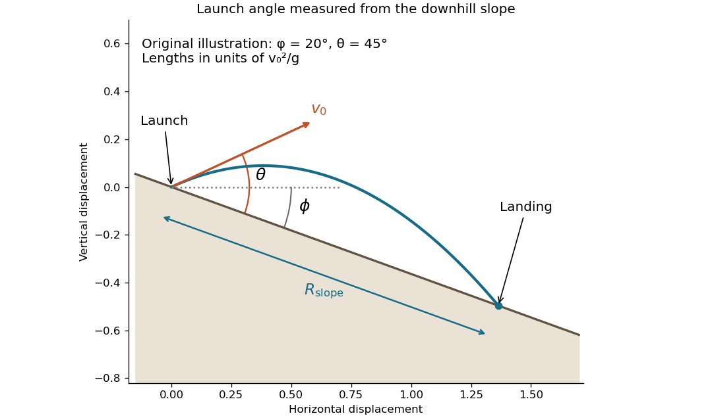
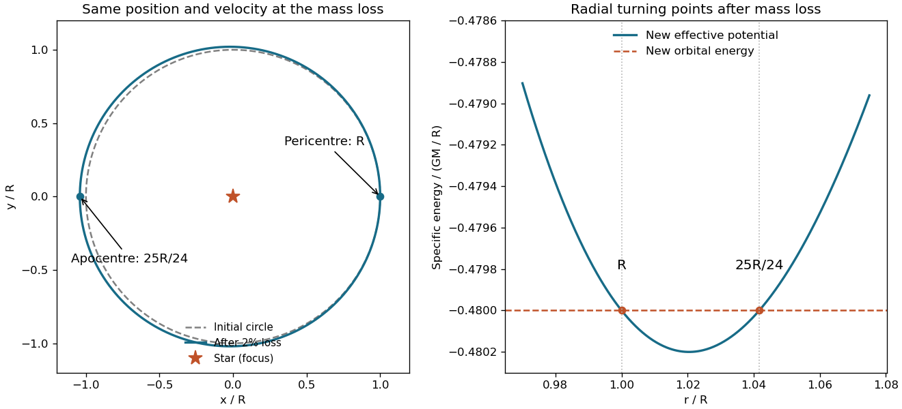

# 2014 resit

↑ **Parent:** [Past exam of the physics 1 paper of the University of Oxford](../past-exam-of-the-physics-1-paper-of-the-university-of-oxford.md)

Source paper: [https://www.whatdotheyknow.com/request/physics_preliminary_examinations/response/1162943/attach/3/Twain.7z?cookie_passthrough=1](https://www.whatdotheyknow.com/request/physics_preliminary_examinations/response/1162943/attach/3/Twain.7z?cookie_passthrough=1)

The cover dates this paper to 8 September 2014. The held PDF and transcription have legacy filenames ending in `2014`, but this is the resit. All questions in both sections are covered. Unlettered marked blocks use editorial lettered scopes; the two separately marked blocks within 8(a) use editorial Roman scopes.

**Table of contents**

- [1](#1)
  - [Solution](#1/solution)
  - [a](#1/a)
    - [Solution](#1/a/solution)
  - [b](#1/b)
    - [Solution](#1/b/solution)
- [2](#2)
  - [Solution](#2/solution)
- [3](#3)
  - [a](#3/a)
    - [Solution](#3/a/solution)
  - [b](#3/b)
    - [Solution](#3/b/solution)
- [4](#4)
  - [Solution](#4/solution)
- [5](#5)
  - [Solution](#5/solution)
- [6](#6)
  - [Solution](#6/solution)
- [7](#7)
  - [Solution](#7/solution)
- [8](#8)
  - [a](#8/a)
    - [i](#8/a/i)
      - [Solution](#8/a/i/solution)
    - [ii](#8/a/ii)
      - [Solution](#8/a/ii/solution)
  - [b](#8/b)
    - [Solution](#8/b/solution)
- [9](#9)
  - [a](#9/a)
    - [Solution](#9/a/solution)
  - [b](#9/b)
    - [Solution](#9/b/solution)
- [10](#10)
  - [a](#10/a)
    - [Solution](#10/a/solution)
  - [b](#10/b)
    - [Solution](#10/b/solution)
  - [c](#10/c)
    - [Solution](#10/c/solution)
- [11](#11)
  - [a](#11/a)
    - [Solution](#11/a/solution)
  - [b](#11/b)
    - [Solution](#11/b/solution)

## 1

↑ **Parent:** [2014 resit](2014-resit.md)

<h3 id="1/solution">Solution</h3>

↑ **Parent:** [1](#1)

The [parallel axis theorem](../rigid-body-dynamics.md#parallel-axis-theorem) relates the [moment of inertia](../rigid-body-dynamics.md#moment-of-inertia) about an axis through the [centre of mass](../classical-mechanics.md#center-of-mass) to that about a parallel axis displaced by perpendicular distance $d$:

$$
\boxed{I=I_G+Md^2.}
$$

The reference axis must pass through the [centre of mass](../classical-mechanics.md#center-of-mass). To see why, write the displacement from it as $\mathbf r=\mathbf R+\mathbf d$ in the plane perpendicular to the axes. Expanding $\int|\mathbf R+\mathbf d|^2\,dm$ gives $I_G+Md^2$ because $\int\mathbf R\,dm=0$.

For a thin planar [mass distribution](../classical-mechanics.md#mass-distribution), let $x,y$ be perpendicular axes in its plane and $z$ the normal axis through **their same intersection**. The [perpendicular axis theorem](../rigid-body-dynamics.md#perpendicular-axis-theorem) states

$$
\boxed{I_z=I_x+I_y.}
$$

Indeed, $I_z=\int(x^2+y^2)\,dm$, while $I_x=\int y^2\,dm$ and $I_y=\int x^2\,dm$. Their common intersection need not be the [centre of mass](../classical-mechanics.md#center-of-mass), but an arbitrary three-dimensional body does not satisfy the planar equality.

<h3 id="1/a">a</h3>

↑ **Parent:** [1](#1)

<h4 id="1/a/solution">Solution</h4>

↑ **Parent:** [A](#1/a)

Take the square to have uniform [surface mass density](../fluid-mechanics.md#projected-surface-mass-density) $\sigma=M/a^2$, and put its centre at $x=y=0$. For an in-plane axis through the centre parallel to a side, direct [integration](../integral.md) gives

$$
I_x=\frac M{a^2}\int_{-a/2}^{a/2}\int_{-a/2}^{a/2}y^2\,dx\,dy=\frac{Ma^2}{12}.
$$

The same holds for $I_y$, and the mixed [integral](../integral.md) $\int xy\,dm$ vanishes by reflection symmetry. The squared perpendicular distance to an axis making angle $\psi$ with the $x$ axis is $(-x\sin\psi+y\cos\psi)^2$. Its [integral](../integral.md) therefore gives

$$
I_\psi=\frac{Ma^2}{12}(\sin^2\psi+\cos^2\psi)=\frac{Ma^2}{12}.
$$

Thus a diagonal through opposite corners and its perpendicular **through the centre** have

$$
\boxed{I_{\rm diagonal}=I_{\rm central\ perpendicular}=\frac{Ma^2}{12}.}
$$

This is the [in-plane inertia isotropy of a square plate](../rigid-body-dynamics.md#in-plane-inertia-isotropy-of-a-square-plate).

**Axis-location qualification:** perpendicularity fixes a direction, not a line's position. If the second axis is instead shifted by distance $d$ from the centre, the [parallel axis theorem](../rigid-body-dynamics.md#parallel-axis-theorem) gives $I_2=Ma^2/12+Md^2$. A perpendicular through a corner on that diagonal has $d=a/\sqrt2$ and hence $I_2=7Ma^2/12$, a concrete different value satisfying the stated directional description. If “through the corners” means an edge rather than a diagonal, that edge has $I=Ma^2/3$; two adjacent edges both have that value. The general displaced-axis formula and these choices make the location convention explicit rather than silently assigning a unique value to an unspecified second axis.

<h3 id="1/b">b</h3>

↑ **Parent:** [1](#1)

<h4 id="1/b/solution">Solution</h4>

↑ **Parent:** [B](#1/b)

Use two central perpendicular axes in the plate. The [perpendicular axis theorem](../rigid-body-dynamics.md#perpendicular-axis-theorem) and the preceding [moments of inertia](../rigid-body-dynamics.md#moment-of-inertia) give

$$
\boxed{I_{z,G}=\frac{Ma^2}{12}+\frac{Ma^2}{12}=\frac{Ma^2}{6}.}
$$

Alternatively, axes along adjacent edges have [moments of inertia](../rigid-body-dynamics.md#moment-of-inertia) $Ma^2/3$ each. The normal axis through their shared corner therefore has $2Ma^2/3$. It lies a distance $a/\sqrt2$ from the parallel normal axis through the centre, so the [parallel axis theorem](../rigid-body-dynamics.md#parallel-axis-theorem) yields $I_{z,G}=2Ma^2/3-M(a^2/2)=Ma^2/6$. This normal central result is independent of the in-plane axis-location ambiguity.

## 2

↑ **Parent:** [2014 resit](2014-resit.md)

<h3 id="2/solution">Solution</h3>

↑ **Parent:** [2](#2)

For the attractive [central force](../mathematical-physics.md#central-force) $\mathbf F=-k\mathbf r$, with $k>0$, the [potential energy](../energy.md#potential-energy) is $U(r)=kr^2/2$ up to an additive constant. Conservation of [angular momentum](../momentum.md#angular-momentum) confines the motion to a plane; writing its magnitude as $J=mr^2\dot\varphi$, the [kinetic energy](../energy.md#kinetic-energy) is

$$
T=\frac12m\dot r^2+\frac12mr^2\dot\varphi^2=\frac12m\dot r^2+\frac{J^2}{2mr^2}.
$$

At fixed $J$, the radial [energy](../energy.md) equation becomes $E=m\dot r^2/2+U_{\rm eff}(r)$, where

$$
\boxed{U_{\rm eff}(r)=\frac{J^2}{2mr^2}+\frac12kr^2.}
$$

The [effective potential](../mathematical-physics.md#effective-potential) combines the true [potential energy](../energy.md#potential-energy) with the angular-motion contribution. Its negative derivative gives the radial equation $m\ddot r=-U_{\rm eff}'=J^2/(mr^3)-kr$; the first term is the centrifugal contribution arising from elimination of the angular coordinate.

A [circular orbit](../classical-mechanics.md#circular-orbit) is a fixed radial position at a stationary point:

$$
\boxed{r_0=\left(\frac{J^2}{mk}\right)^{1/4},\qquad
\Omega=\frac J{mr_0^2}=\sqrt{\frac km}.}
$$

For $J\ne0$, $U_{\rm eff}''(r_0)=4k>0$, so this is a stable minimum. Small radial disturbances have [angular frequency](../lagrangian-mechanics.md#angular-frequency) $2\sqrt{k/m}$. For $J=0$, there is no nonzero-radius [circular orbit](../classical-mechanics.md#circular-orbit).

## 3

↑ **Parent:** [2014 resit](2014-resit.md)

<h3 id="3/a">a</h3>

↑ **Parent:** [3](#3)

<h4 id="3/a/solution">Solution</h4>

↑ **Parent:** [A](#3/a)

In the [centre-of-mass frame](../special-relativity.md#center-of-momentum-frame), the two equal incoming [rest masses](../special-relativity.md#invariant-mass) have opposite [momenta](../momentum.md) and total [energy](../energy.md) $2E$. The squared total [four-momentum](../special-relativity.md#four-momentum) fixes the composite [invariant mass](../special-relativity.md#invariant-mass) $\mathcal M$:

$$
\mathcal M^2c^4=E_{\rm tot}^2-c^2|\mathbf P_{\rm tot}|^2=4E^2,
\qquad \boxed{\mathcal M=\frac{2E}{c^2}.}
$$

A change of [inertial frame](../mathematical-physics.md#inertial-frame), including going to either particle's rest frame, cannot change this [invariant mass](../special-relativity.md#invariant-mass). It includes the internal [kinetic energy](../energy.md#kinetic-energy) and is generally larger than $2M_1$.

There is a terminology convention worth making explicit. The older “relativistic mass” means frame-dependent total [energy](../energy.md) divided by $c^2$. To stop particle 1 requires a boost with [Lorentz factor](../special-relativity.md#lorentz-factor) $\gamma=E/(M_1c^2)$, so the system has total [energy](../energy.md) $2\gamma E=2E^2/(M_1c^2)$ in that frame. Under that alternative convention, its relativistic mass would be $2E^2/(M_1c^4)$. This is not its [invariant mass](../special-relativity.md#invariant-mass); both quantities coincide only when $E=M_1c^2$ and the incoming particles already have zero relative motion.

<h3 id="3/b">b</h3>

↑ **Parent:** [3](#3)

<h4 id="3/b/solution">Solution</h4>

↑ **Parent:** [B](#3/b)

[Four-momentum conservation](../special-relativity.md#four-momentum-conservation) fixes the outgoing system's [invariant mass](../special-relativity.md#invariant-mass) to the same $2E/c^2$. In the rest frame of particle 3, let particle 4 have [energy](../energy.md) $E_4'$ and [momentum](../momentum.md) $\mathbf p_4'$. Each outgoing particle has [rest mass](../special-relativity.md#invariant-mass) $M_2$, so

$$
4E^2=(M_2c^2+E_4')^2-c^2|\mathbf p_4'|^2
=2M_2^2c^4+2M_2c^2E_4'.
$$

Consequently

$$
\boxed{E_4'=\frac{2E^2}{M_2c^2}-M_2c^2.}
$$

Here $E_4'$ is the total [energy](../energy.md), including rest energy. At the production threshold $E=M_2c^2$, it reduces to $M_2c^2$, as it should. Production is kinematically possible only for $E\ge M_2c^2$. The initial [rest mass](../special-relativity.md#invariant-mass) $M_1$ drops out because the conserved total [centre-of-mass energy](../special-relativity.md#center-of-mass-energy), rather than the identity of the incoming particles, determines this outgoing relative motion.

## 4

↑ **Parent:** [2014 resit](2014-resit.md)

<h3 id="4/solution">Solution</h3>

↑ **Parent:** [4](#4)

Let the source's proper emission period be $T_0$, and let it approach a stationary observer directly with speed $v=\beta c>0$. In the observer's [inertial frame](../mathematical-physics.md#inertial-frame), consecutive emissions are separated by $\gamma T_0$ through [time dilation](../special-relativity.md#time-dilation). The second crest starts $v\gamma T_0$ nearer the observer, reducing the arrival interval to

$$
T_{\rm obs}=\gamma T_0(1-\beta).
$$

Since light travels at $c$ in each [inertial frame](../mathematical-physics.md#inertial-frame), the longitudinal [relativistic Doppler effect](../wave.md#relativistic-doppler-effect) is

$$
\boxed{\frac{\nu_{\rm obs}}{\nu_0}=\sqrt{\frac{1+\beta}{1-\beta}},\qquad
\frac{\lambda_{\rm obs}}{\lambda_0}=\sqrt{\frac{1-\beta}{1+\beta}}.}
$$

Recession reverses the sign of $\beta$. More generally, if $\Theta$ is the angle between the source velocity and the photon propagation direction in the observer's frame, a [Lorentz transformation](../special-relativity.md#lorentz-transformation) of the photon [four-momentum](../special-relativity.md#four-momentum) gives $\nu_0=\gamma\nu_{\rm obs}(1-\beta\cos\Theta)$.

The [common Doppler scaling of spectral-line separations](../wave.md#common-doppler-scaling-of-spectral-line-separations) follows because every line receives the same wavelength factor $D$. The supplied wavelengths have rest separation $50\,\mathrm{nm}$; the measured separation gives $D=51/50=1.02$. Defining $\beta_{\rm rec}>0$ for recession, inversion gives

$$
\boxed{\beta_{\rm rec}=\frac{D^2-1}{D^2+1}=\frac{101}{5101}=0.0198000,\qquad
v_{\rm rec}=5.93590\times10^6\,\mathrm{m\,s^{-1}}.}
$$

**Source contradiction:** a strictly approaching source has $D<1$ and must reduce the wavelength separation below $50\,\mathrm{nm}$, so no positive approach speed satisfies the stated $51\,\mathrm{nm}$. For example, approach at $0.02c$ gives a separation of $49.0098\,\mathrm{nm}$. The speed inferred from the numerical data is therefore about $0.0198c$ **receding**; retaining the word “approaching” would require a negative signed approach velocity. The two observed wavelengths consistent with the given separation are $357$ and $408\,\mathrm{nm}$.

## 5

↑ **Parent:** [2014 resit](2014-resit.md)

<h3 id="5/solution">Solution</h3>

↑ **Parent:** [5](#5)

Measure the vertical displacement $x$ downward from the spring's unstretched position. The [kinetic energy](../energy.md#kinetic-energy) is $m\dot x^2/2$, while the spring and gravitational [potential energies](../energy.md#potential-energy) are $kx^2/2$ and $-mgx$. Thus the [Lagrangian](../calculus-of-variations.md#lagrangian) is

$$
\boxed{\mathcal L=\frac12m\dot x^2-\frac12kx^2+mgx.}
$$

Applying the [Euler-Lagrange equation](../analysis.md#euler-lagrange-equation), $d(\partial\mathcal L/\partial\dot x)/dt-\partial\mathcal L/\partial x=0$, gives

$$
\boxed{m\ddot x+kx=mg.}
$$

Gravity shifts the equilibrium to $x_*=mg/k$. For displacement $\xi=x-x_*$ from that equilibrium, the [equation of motion](../classical-mechanics.md#equation-of-motion) becomes $\ddot\xi+(k/m)\xi=0$, giving [simple harmonic motion](../classical-mechanics.md#simple-harmonic-motion) with [angular frequency](../lagrangian-mechanics.md#angular-frequency) $\omega=\sqrt{k/m}$. Choosing an upward coordinate instead reverses the gravitational term, but leaves the equilibrium-relative [angular frequency](../lagrangian-mechanics.md#angular-frequency) unchanged.

## 6

↑ **Parent:** [2014 resit](2014-resit.md)

<h3 id="6/solution">Solution</h3>

↑ **Parent:** [6](#6)

Let the initial [velocity](../classical-mechanics.md#velocity) be $\mathbf v$ and the two final [velocities](../classical-mechanics.md#velocity) be $\mathbf u,\mathbf w$. In the stated nonrelativistic [elastic collision](../classical-mechanics.md#elastic-collision), [conservation of momentum](../momentum.md#momentum-conservation) and [conservation of energy](../mathematical-physics.md#conservation-of-energy) give

$$
\mathbf v=\mathbf u+\mathbf w,\qquad
v^2=u^2+w^2.
$$

Squaring the first equation and comparing it with the second yields

$$
v^2=u^2+w^2+2\mathbf u\cdot\mathbf w,
\qquad \boxed{\mathbf u\cdot\mathbf w=0.}
$$

If both final [velocities](../classical-mechanics.md#velocity) are nonzero, their directions are perpendicular. If one is zero, the moving particle retains the initial [velocity](../classical-mechanics.md#velocity) and a scattering angle for the stationary particle is undefined. This includes the zero-deflection and head-on exchange limits rather than incorrectly assigning a direction to a zero vector. Equal [masses](../classical-mechanics.md#mass) and a stationary initial target are essential to the dot-product cancellation.

## 7

↑ **Parent:** [2014 resit](2014-resit.md)

<h3 id="7/solution">Solution</h3>

↑ **Parent:** [7](#7)

Use coordinates $s$ down the [inclined plane](../classical-mechanics.md#inclined-plane) and $n$ along its upward normal, with the launch point as origin. Gravity has components $g\sin\phi$ and $-g\cos\phi$. For launch angle $\theta$ above the downhill direction,

$$
s(t)=v_0\cos\theta\,t+\frac12g\sin\phi\,t^2,
\qquad n(t)=v_0\sin\theta\,t-\frac12g\cos\phi\,t^2.
$$

The nonzero root of $n(t)=0$ is $t_f=2v_0\sin\theta/(g\cos\phi)$. Substituting into $s(t)$ and combining the two trigonometric terms gives the distance along the slope:

$$
\boxed{R_{\rm slope}=\frac{2v_0^2\sin\theta\cos(\theta-\phi)}{g\cos^2\phi}.}
$$

This assumes $0\le\phi<\pi/2$, $\sin\theta>0$, and a downhill landing with $\cos(\theta-\phi)>0$, as well as the neglected [air resistance](../fluid-mechanics.md#air-resistance). It reduces to the horizontal [projectile range](../classical-mechanics.md#projectile-range) $v_0^2\sin(2\theta)/g$ at $\phi=0$. The angle relative to the horizontal is $\theta-\phi$, which explains the shifted cosine. The original diagram uses stipulated illustrative angles; no examination figure is being reconstructed.

**[Figure 1](#7/image-original-projectile-motion-geometry-with-the-launch-angle-measured-above-a-downhill-inclined-plane). Original projectile motion geometry with the launch angle measured above a downhill inclined plane**.

## 8

↑ **Parent:** [2014 resit](2014-resit.md)

<h3 id="8/a">a</h3>

↑ **Parent:** [8](#8)

<h4 id="8/a/i">i</h4>

↑ **Parent:** [A](#8/a)

<h5 id="8/a/i/solution">Solution</h5>

↑ **Parent:** [I](#8/a/i)

Take $\theta$ from the downward vertical. Under the conventional light-rod idealization, only the endpoint [point mass](../classical-mechanics.md#point-mass) contributes appreciably. Its speed is $l\dot\theta$, and its gravitational [potential energy](../energy.md#potential-energy) is $-mgl\cos\theta$. Therefore

$$
\boxed{\mathcal L=\frac12ml^2\dot\theta^2+mgl\cos\theta.}
$$

An additive constant in the [potential energy](../energy.md#potential-energy) has no effect on the [Euler-Lagrange equation](../analysis.md#euler-lagrange-equation).

**Rod-mass qualification:** “thin” and “uniform” do not imply negligible [mass](../classical-mechanics.md#mass). If the uniform rod has a finite unspecified [mass](../classical-mechanics.md#mass) $M_r$, its pivot [moment of inertia](../rigid-body-dynamics.md#moment-of-inertia) is $M_rl^2/3$ and its [centre of mass](../classical-mechanics.md#center-of-mass) lies $l/2$ from the pivot. For a [pendulum with a uniform rod and an endpoint mass](../mathematical-physics.md#pendulum-with-a-uniform-rod-and-an-endpoint-mass), the general answer is

$$
\mathcal L=\frac12I\dot\theta^2+A\cos\theta,\qquad
I=l^2\left(m+\frac{M_r}{3}\right),\qquad
A=gl\left(m+\frac{M_r}{2}\right).
$$

This formula covers either convention without inventing a rod [mass](../classical-mechanics.md#mass). A result involving only the specified $m,l,g$ uses $M_r=0$ unless an additional relation for $M_r$ is stated.

<h4 id="8/a/ii">ii</h4>

↑ **Parent:** [A](#8/a)

<h5 id="8/a/ii/solution">Solution</h5>

↑ **Parent:** [Ii](#8/a/ii)

For the general [Lagrangian](../calculus-of-variations.md#lagrangian) just obtained, the [Euler-Lagrange equation](../analysis.md#euler-lagrange-equation) gives

$$
I\ddot\theta+A\sin\theta=0.
$$

Using the [small-angle approximation](../geometry-and-topology.md#small-angle-approximation) $\sin\theta\simeq\theta$, this is [simple harmonic motion](../classical-mechanics.md#simple-harmonic-motion) with $\omega_0^2=A/I$. Thus

$$
\boxed{T=2\pi\sqrt{\frac{l(m+M_r/3)}{g(m+M_r/2)}}\quad\longrightarrow\quad
T=2\pi\sqrt{\frac lg}\ \text{for a negligible-mass rod}.}
$$

The endpoint [mass](../classical-mechanics.md#mass) cancels in the light-rod limit. A concrete comparison shows why the finite rod cannot silently be included: the same specified endpoint $m$ with $M_r=m$ gives $T=2\pi\sqrt{8l/(9g)}$, distinct from the negligible-rod result. This is a [physical pendulum](../mathematical-physics.md#physical-pendulum) when the rod contributes, and a [simple pendulum](../simple-pendulum.md) in the light-rod limit. Both expressions require small oscillation amplitude; the full sine equation remains nonlinear.

<h3 id="8/b">b</h3>

↑ **Parent:** [8](#8)

<h4 id="8/b/solution">Solution</h4>

↑ **Parent:** [B](#8/b)

Allowing azimuthal motion makes the endpoint speed satisfy $v^2=l^2(\dot\theta^2+\sin^2\theta\,\dot\varphi^2)$. The light-rod [spherical pendulum](../simple-pendulum.md#spherical-pendulum) therefore has

$$
\boxed{\mathcal L=\frac12ml^2\left(\dot\theta^2+\sin^2\theta\,\dot\varphi^2\right)+mgl\cos\theta.}
$$

The azimuth $\varphi$ is a [cyclic coordinate](../lagrangian-mechanics.md#cyclic-coordinate), since the [Lagrangian](../calculus-of-variations.md#lagrangian) is independent of it. Its conjugate [canonical momentum](../hamiltonian-mechanics.md#canonical-momentum) is the conserved vertical [angular momentum](../momentum.md#angular-momentum):

$$
\boxed{p_\varphi=ml^2\sin^2\theta\,\dot\varphi=J_z=\text{constant}.}
$$

For a finite uniform rod, replace $ml^2$ by $I$ and $mgl$ by $A$ from [i](#8/a/i). The same azimuthal symmetry then gives $p_\varphi=I\sin^2\theta\,\dot\varphi$.

The [Hamiltonian](../hamiltonian-mechanics.md#hamiltonian) is the [Legendre transform](../convex-optimization.md#convex-conjugate) of this [Lagrangian](../calculus-of-variations.md#lagrangian). With $p_\theta=I\dot\theta$,

$$
H=\frac{p_\theta^2}{2I}+\frac{p_\varphi^2}{2I\sin^2\theta}-A\cos\theta
=\frac I2\left(\dot\theta^2+\sin^2\theta\,\dot\varphi^2\right)-A\cos\theta.
$$

There is no explicit time dependence, so $dH/dt=\partial H/\partial t=0$. Here $H$ also equals the total mechanical [energy](../energy.md): the constraint is stationary, the [kinetic energy](../energy.md#kinetic-energy) is quadratic in generalized velocities, and gravity is conservative. The apparent singularity of the momentum expression at $\sin\theta=0$ is a spherical-coordinate singularity; trajectories reaching a pole must be described consistently, and nonzero $J_z$ prevents reaching it at finite [energy](../energy.md).

## 9

↑ **Parent:** [2014 resit](2014-resit.md)

<h3 id="9/a">a</h3>

↑ **Parent:** [9](#9)

<h4 id="9/a/solution">Solution</h4>

↑ **Parent:** [A](#9/a)

Let $P=m_pc^2$ denote the proton rest energy and $W=220\,\mathrm{GeV}$ the desired particle's rest energy. For an antiproton of total [energy](../energy.md) $E_{\bar p}$ striking a stationary proton, the incoming squared [centre-of-mass energy](../special-relativity.md#center-of-mass-energy) is

$$
s=(E_{\bar p}+P)^2-c^2p_{\bar p}^2=2P^2+2PE_{\bar p}.
$$

For production of the stated single particle, [four-momentum conservation](../special-relativity.md#four-momentum-conservation) requires $s=W^2$. Thus

$$
\boxed{E_{\bar p}^{\rm fixed}=\frac{W^2-2P^2}{2P}\simeq25.7912\,\mathrm{TeV}.}
$$

The numerical value uses $P=0.938272\,\mathrm{GeV}$. It is a **total** incident [energy](../energy.md); the corresponding [kinetic energy](../energy.md#kinetic-energy) is $E_{\bar p}^{\rm fixed}-P\simeq25.7902\,\mathrm{TeV}$. Much of the laboratory [energy](../energy.md) supplies motion of the outgoing system rather than its [invariant mass](../special-relativity.md#invariant-mass).

For equal and opposite beam [momenta](../momentum.md), the laboratory is the [centre-of-mass frame](../special-relativity.md#center-of-momentum-frame). Each beam has the same total [energy](../energy.md) and their sum is $W$, giving

$$
\boxed{E_{\bar p}^{\rm collider}=\frac W2=110\,\mathrm{GeV},\qquad
K_{\bar p}^{\rm collider}=110-P\simeq109.062\,\mathrm{GeV}.}
$$

These are the [fixed-target production threshold](../special-relativity.md#fixed-target-production-threshold) and collider kinematic comparison for the specified final state. Extra final particles or restrictions from conserved quantum numbers would require a separately specified reaction.

<h3 id="9/b">b</h3>

↑ **Parent:** [9](#9)

<h4 id="9/b/solution">Solution</h4>

↑ **Parent:** [B](#9/b)

In the parent's rest frame, the identical daughters have equal and opposite [momenta](../momentum.md), and each has total [energy](../energy.md) $110\,\mathrm{GeV}$. With daughter rest energy $Q=90\,\mathrm{GeV}$, each speed in this frame is

$$
\beta_*c=c\sqrt{1-\frac{Q^2}{110^2}},\qquad \beta_*=0.5749596.
$$

Transform to the rest frame of one daughter using the collinear [relativistic velocity addition](../special-relativity.md#velocity-addition-formula) law. The other daughter then has speed

$$
\boxed{\frac wc=\frac{2\beta_*}{1+\beta_*^2}=\frac{44\sqrt{10}}{161}=0.864225.}
$$

An independent [invariant mass](../special-relativity.md#invariant-mass) check is useful. In the rest frame of one daughter the other's total [energy](../energy.md) satisfies $W^2=2Q^2+2QE'$, so $E'=178.8889\,\mathrm{GeV}$ and the relative [Lorentz factor](../special-relativity.md#lorentz-factor) is $\gamma_{\rm rel}=E'/Q=161/81$. Hence $w/c=\sqrt{1-\gamma_{\rm rel}^{-2}}$, the same result.

The answer is unchanged if the parent is produced by a fixed-target collision. Its laboratory [velocity](../classical-mechanics.md#velocity) then differs, but its rest [mass](../classical-mechanics.md#mass) and two-body decay kinematics do not. The scalar product of the daughters' [four-momenta](../special-relativity.md#four-momentum), equivalently their relative [Lorentz factor](../special-relativity.md#lorentz-factor), depends only on $W$ and $Q$. A common boost cannot change the speed of one measured in the rest frame of the other.[Invariant relative Lorentz factor and associated relative speed](../special-relativity.md#relative-speed-from-four-velocity-contraction)

## 10

↑ **Parent:** [2014 resit](2014-resit.md)

<h3 id="10/a">a</h3>

↑ **Parent:** [10](#10)

<h4 id="10/a/solution">Solution</h4>

↑ **Parent:** [A](#10/a)

[Conservation of angular momentum](../momentum.md#conservation-of-angular-momentum) means that the total [angular momentum](../momentum.md#angular-momentum) of a system about a chosen fixed origin in an [inertial frame](../mathematical-physics.md#inertial-frame) stays constant. Its dynamical condition is

$$
\boxed{\frac{d\mathbf J}{dt}=\boldsymbol\tau_{\rm ext}=0.}
$$

Internal torques cancel for the complete isolated mechanical system. If only the component of external [torque](../momentum.md#torque) about an axis vanishes, only that [angular momentum](../momentum.md#angular-momentum) component is necessarily conserved. The skater's upright spin uses this axial statement: vertical weight and support provide negligible vertical-axis torque, and frictional torque is neglected. The skater need not conserve [rotational kinetic energy](../energy.md#rotational-kinetic-energy) while changing the internal configuration.

<h3 id="10/b">b</h3>

↑ **Parent:** [10](#10)

<h4 id="10/b/solution">Solution</h4>

↑ **Parent:** [B](#10/b)

The uniform cylindrical torso contributes $I_c=Mr^2/2=50(0.20)^2/2=1.00\,\mathrm{kg\,m^2}$. Adding both arm [point masses](../classical-mechanics.md#point-mass) about the same vertical axis gives

$$
I_i=1+2(7)(0.70)^2=7.86\,\mathrm{kg\,m^2},\qquad
I_f=1+2(7)(0.30)^2=2.26\,\mathrm{kg\,m^2}.
$$

With initial [angular frequency](../lagrangian-mechanics.md#angular-frequency) $\omega_i=2\pi\,\mathrm{rad\,s^{-1}}$, [conservation of angular momentum](../momentum.md#conservation-of-angular-momentum) gives $I_i\omega_i=I_f\omega_f$. Therefore

$$
\boxed{\omega_f=2\pi\frac{7.86}{2.26}=21.8521\,\mathrm{rad\,s^{-1}}.}
$$

This corresponds to $3.47788$ rotations per second; it is important not to confuse that [frequency](../wave.md#frequency) with the requested [angular frequency](../lagrangian-mechanics.md#angular-frequency).

<h3 id="10/c">c</h3>

↑ **Parent:** [10](#10)

<h4 id="10/c/solution">Solution</h4>

↑ **Parent:** [C](#10/c)

Using [rotational kinetic energy](../energy.md#rotational-kinetic-energy) $K=I\omega^2/2$ at the two steady endpoint configurations,

$$
\boxed{K_i=155.150\,\mathrm J,\qquad K_f=539.593\,\mathrm J,\qquad
\Delta K=384.443\,\mathrm J.}
$$

At fixed [angular momentum](../momentum.md#angular-momentum) $J$, $K=J^2/(2I)$ increases when the [moment of inertia](../rigid-body-dynamics.md#moment-of-inertia) decreases. The skater supplies [work](../energy.md#work) by pulling the arms inward; chemical energy in the muscles is converted into additional [rotational kinetic energy](../energy.md#rotational-kinetic-energy), with possible extra dissipation in a real skater. This does not require an external axial [torque](../momentum.md#torque).

For the ideal rotating [point masses](../classical-mechanics.md#point-mass), an inward radial [force](../force.md) supplies the required centripetal acceleration. During contraction both that inward [force](../force.md) and the radial displacement point inward, so their scalar product gives positive [work](../energy.md#work). At the initial and final steady configurations radial motion has ceased; any transient radial [kinetic energy](../energy.md#kinetic-energy) must also be included in a full intermediate-time balance. The quoted difference compares the rotational endpoint energies only.

## 11

↑ **Parent:** [2014 resit](2014-resit.md)

<h3 id="11/a">a</h3>

↑ **Parent:** [11](#11)

<h4 id="11/a/solution">Solution</h4>

↑ **Parent:** [A](#11/a)

The first term, $m\dot r^2/2$, is radial [kinetic energy](../energy.md#kinetic-energy). The second, $L^2/(2mr^2)$, is tangential [kinetic energy](../energy.md#kinetic-energy), since conservation of [angular momentum](../momentum.md#angular-momentum) gives $L=mr^2\dot\varphi$. The final term, $-GMm/r$, is the gravitational [potential energy](../energy.md#potential-energy), with zero at infinite separation. Thus

$$
E=\frac12m\dot r^2+U_{\rm eff}(r),\qquad
\boxed{U_{\rm eff}(r)=\frac{L^2}{2mr^2}-\frac{GMm}{r}.}
$$

The second and third terms together form the radial [effective potential](../mathematical-physics.md#effective-potential) for a [Kepler orbit](../celestial-mechanics.md#kepler-orbit). At an apsis the radial [velocity](../classical-mechanics.md#velocity) vanishes, so $E=U_{\rm eff}$; for a bound noncircular orbit the two accessible roots give the nearest and furthest radii.

<h3 id="11/b">b</h3>

↑ **Parent:** [11](#11)

<h4 id="11/b/solution">Solution</h4>

↑ **Parent:** [B](#11/b)

Write the lost [mass](../classical-mechanics.md#mass) fraction as $f$, with $f=0.02$, and let $\mu=GM$. Initially the [circular orbit](../classical-mechanics.md#circular-orbit) has $v_0^2=\mu/R$, zero radial [velocity](../classical-mechanics.md#velocity), and specific [angular momentum](../momentum.md#angular-momentum) $h^2=R^2v_0^2=\mu R$. The stipulated rapid symmetric loss leaves the satellite's instantaneous position and [velocity](../classical-mechanics.md#velocity) unchanged, but reduces the gravitational parameter to $\mu'=(1-f)\mu$. There is no impulsive kick from contact with ejecta in this model.

The new specific orbital [energy](../energy.md) is

$$
\varepsilon'=\frac{v_0^2}{2}-\frac{\mu'}R
=\frac\mu R\left(f-\frac12\right),
$$

and $h$ remains unchanged because the post-loss [force](../force.md) is still central. At a radial turning point,

$$
\varepsilon'=\frac{h^2}{2r^2}-\frac{\mu'}r.
$$

Inserting the known constants and factoring yields

$$
(1-2f)r^2-2(1-f)Rr+R^2
=(r-R)\bigl[(1-2f)r-R\bigr]=0.
$$

For $0<f<1/2$ the two radii are $R$ and $R/(1-2f)$. The initial radius is the [pericentre](../celestial-mechanics.md#periapsis): immediately after the loss, $\ddot r=h^2/R^3-\mu'/R^2=f\mu/R^2>0$, so the satellite begins moving outward. Therefore

$$
\boxed{r_{\min}=R,\qquad r_{\max}=\frac R{0.96}=\frac{25}{24}R.}
$$

Equivalently, the new [semi-major axis](../celestial-mechanics.md#semi-major-axis) is $49R/48$ and the [orbital eccentricity](../celestial-mechanics.md#orbital-eccentricity) is $1/49$. These values also satisfy $r_{\min}=a(1-e)$ and $r_{\max}=a(1+e)$. For loss of half the original [mass](../classical-mechanics.md#mass) the ideal trajectory becomes parabolic, and larger loss makes it unbound. Slow adiabatic loss would give a different, nearly circular expansion; it is not the instantaneous limit stipulated here.

**[Figure 2](#11/b/image-original-effective-potential-comparison-and-turning-radii-after-an-instantaneous-two-percent-central-mass-loss). Original effective potential comparison and turning radii after an instantaneous two-percent central mass loss**.

The figure retains the same [angular momentum](../momentum.md#angular-momentum) before and after the change. Once the expelled material is far away, a spherically symmetric outer shell exerts no interior gravitational [force](../force.md) by the [shell theorem](../mathematical-physics.md#spherical-shell-theorem); direct ejecta interaction and the shell's finite transit time are neglected as in the source idealization.

## ↑ Ancestors (9)

1. [Past exam of the physics 1 paper of the University of Oxford](../past-exam-of-the-physics-1-paper-of-the-university-of-oxford.md)
2. [Physics 1 paper of the University of Oxford](../university-of-oxford.md#physics-1-paper-of-the-university-of-oxford)
3. [Year 1 of the physics course of the University of Oxford](../university-of-oxford.md#year-1-of-the-physics-course-of-the-university-of-oxford)
4. [Physics course of the University of Oxford](../university-of-oxford.md#physics-course-of-the-university-of-oxford)
5. [Undergraduate course of the University of Oxford](../university-of-oxford.md#undergraduate-course-of-the-university-of-oxford)
6. [Course of the University of Oxford](../university-of-oxford.md#course-of-the-university-of-oxford)
7. [University of Oxford](../university-of-oxford.md)
8. [List of universities](../README.md#list-of-universities)
9. [Codex Wiki](../README.md)
