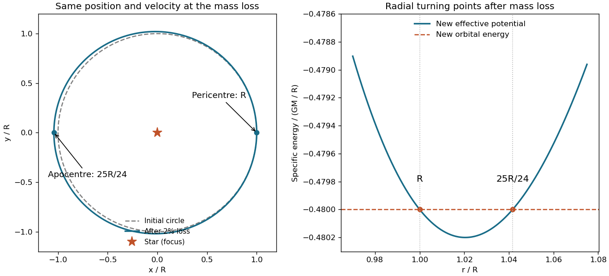

<h1 id="11/b/solution">Solution</h1>

↑ **Parent:** [B](../b.md)

Write the lost [mass](../../../../mass.md) fraction as $f$, with $f=0.02$, and let $\mu=GM$. Initially the [circular orbit](../../../../circular-orbit.md) has $v_0^2=\mu/R$, zero radial [velocity](../../../../velocity.md), and specific [angular momentum](../../../../angular-momentum.md) $h^2=R^2v_0^2=\mu R$. The stipulated rapid symmetric loss leaves the satellite's instantaneous position and [velocity](../../../../velocity.md) unchanged, but reduces the gravitational parameter to $\mu'=(1-f)\mu$. There is no impulsive kick from contact with ejecta in this model.

The new specific orbital [energy](../../../../energy-split.md) is

$$
\varepsilon'=\frac{v_0^2}{2}-\frac{\mu'}R
=\frac\mu R\left(f-\frac12\right),
$$

and $h$ remains unchanged because the post-loss [force](../../../../force-split.md) is still central. At a radial turning point,

$$
\varepsilon'=\frac{h^2}{2r^2}-\frac{\mu'}r.
$$

Inserting the known constants and factoring yields

$$
(1-2f)r^2-2(1-f)Rr+R^2
=(r-R)\bigl[(1-2f)r-R\bigr]=0.
$$

For $0<f<1/2$ the two radii are $R$ and $R/(1-2f)$. The initial radius is the [pericentre](../../../../periapsis.md): immediately after the loss, $\ddot r=h^2/R^3-\mu'/R^2=f\mu/R^2>0$, so the satellite begins moving outward. Therefore

$$
\boxed{r_{\min}=R,\qquad r_{\max}=\frac R{0.96}=\frac{25}{24}R.}
$$

Equivalently, the new [semi-major axis](../../../../semi-major-axis.md) is $49R/48$ and the [orbital eccentricity](../../../../orbital-eccentricity.md) is $1/49$. These values also satisfy $r_{\min}=a(1-e)$ and $r_{\max}=a(1+e)$. For loss of half the original [mass](../../../../mass.md) the ideal trajectory becomes parabolic, and larger loss makes it unbound. Slow adiabatic loss would give a different, nearly circular expansion; it is not the instantaneous limit stipulated here.

**[Figure 2](#11/b/image-original-effective-potential-comparison-and-turning-radii-after-an-instantaneous-two-percent-central-mass-loss). Original effective potential comparison and turning radii after an instantaneous two-percent central mass loss**.

The figure retains the same [angular momentum](../../../../angular-momentum.md) before and after the change. Once the expelled material is far away, a spherically symmetric outer shell exerts no interior gravitational [force](../../../../force-split.md) by the [shell theorem](../../../../spherical-shell-theorem.md); direct ejecta interaction and the shell's finite transit time are neglected as in the source idealization.

## ↑ Ancestors (12)

1. [B](../b.md)
2. [11](../../11.md)
3. [2014 resit](../../../2014-resit-split.md)
4. [Past exam of the physics 1 paper of the University of Oxford](../../../split.md)
5. [Physics 1 paper of the University of Oxford](../../../../physics-1-paper-of-the-university-of-oxford.md)
6. [Year 1 of the physics course of the University of Oxford](../../../../year-1-of-the-physics-course-of-the-university-of-oxford.md)
7. [Physics course of the University of Oxford](../../../../physics-course-of-the-university-of-oxford.md)
8. [Undergraduate course of the University of Oxford](../../../../undergraduate-course-of-the-university-of-oxford.md)
9. [Course of the University of Oxford](../../../../course-of-the-university-of-oxford.md)
10. [University of Oxford](../../../../university-of-oxford-split.md)
11. [List of universities](../../../../list-of-universities.md)
12. [Codex Wiki](../../../../split.md)
