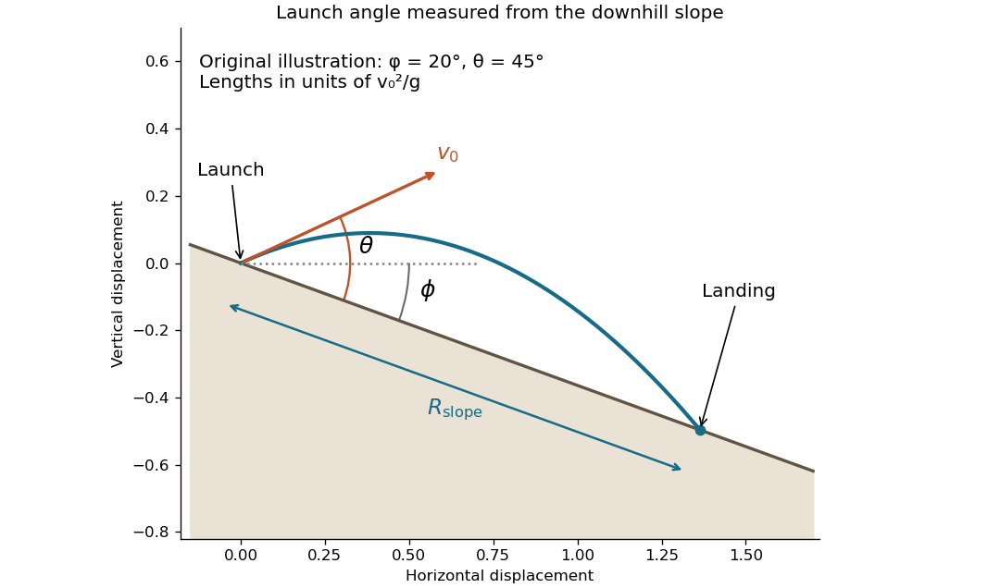

<h1 id="7/solution">Solution</h1>

↑ **Parent:** [7](../7.md)

Use coordinates $s$ down the [inclined plane](../../../inclined-plane.md) and $n$ along its upward normal, with the launch point as origin. Gravity has components $g\sin\phi$ and $-g\cos\phi$. For launch angle $\theta$ above the downhill direction,

$$
s(t)=v_0\cos\theta\,t+\frac12g\sin\phi\,t^2,
\qquad n(t)=v_0\sin\theta\,t-\frac12g\cos\phi\,t^2.
$$

The nonzero root of $n(t)=0$ is $t_f=2v_0\sin\theta/(g\cos\phi)$. Substituting into $s(t)$ and combining the two trigonometric terms gives the distance along the slope:

$$
\boxed{R_{\rm slope}=\frac{2v_0^2\sin\theta\cos(\theta-\phi)}{g\cos^2\phi}.}
$$

This assumes $0\le\phi<\pi/2$, $\sin\theta>0$, and a downhill landing with $\cos(\theta-\phi)>0$, as well as the neglected [air resistance](../../../air-resistance.md). It reduces to the horizontal [projectile range](../../../projectile-range.md) $v_0^2\sin(2\theta)/g$ at $\phi=0$. The angle relative to the horizontal is $\theta-\phi$, which explains the shifted cosine. The original diagram uses stipulated illustrative angles; no examination figure is being reconstructed.

**[Figure 1](#7/image-original-projectile-motion-geometry-with-the-launch-angle-measured-above-a-downhill-inclined-plane). Original projectile motion geometry with the launch angle measured above a downhill inclined plane**.

## ↑ Ancestors (11)

1. [7](../7.md)
2. [2014 resit](../../2014-resit-split.md)
3. [Past exam of the physics 1 paper of the University of Oxford](../../split.md)
4. [Physics 1 paper of the University of Oxford](../../../physics-1-paper-of-the-university-of-oxford.md)
5. [Year 1 of the physics course of the University of Oxford](../../../year-1-of-the-physics-course-of-the-university-of-oxford.md)
6. [Physics course of the University of Oxford](../../../physics-course-of-the-university-of-oxford.md)
7. [Undergraduate course of the University of Oxford](../../../undergraduate-course-of-the-university-of-oxford.md)
8. [Course of the University of Oxford](../../../course-of-the-university-of-oxford.md)
9. [University of Oxford](../../../university-of-oxford-split.md)
10. [List of universities](../../../list-of-universities.md)
11. [Codex Wiki](../../../split.md)
