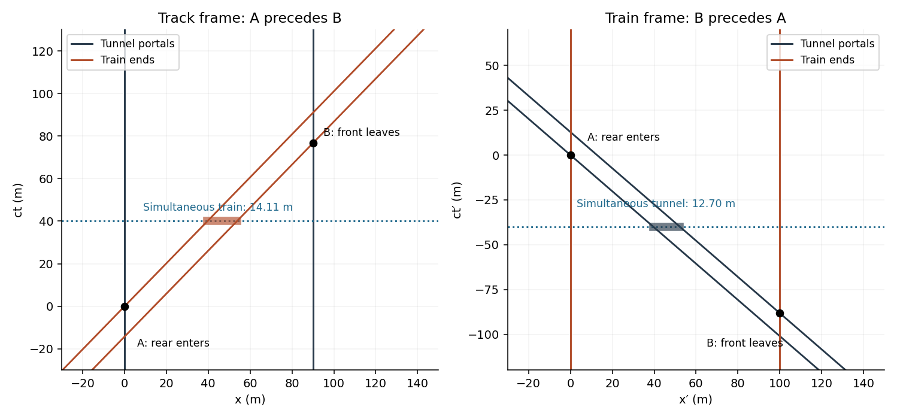
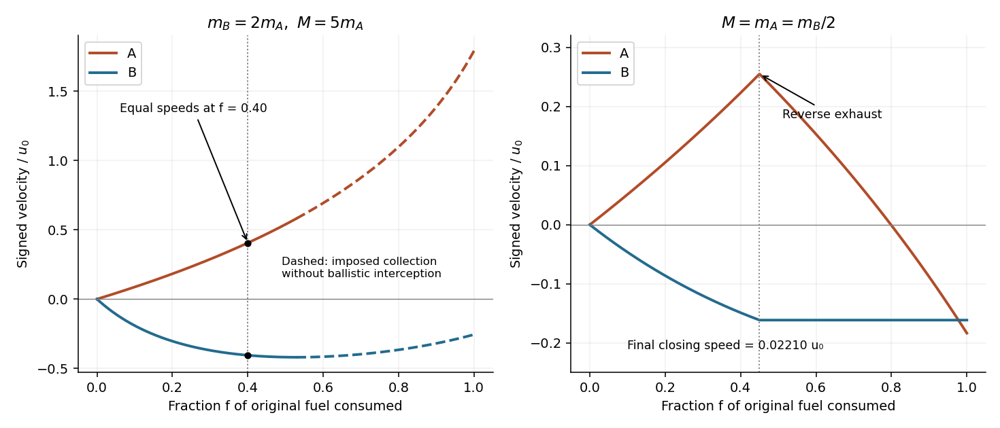
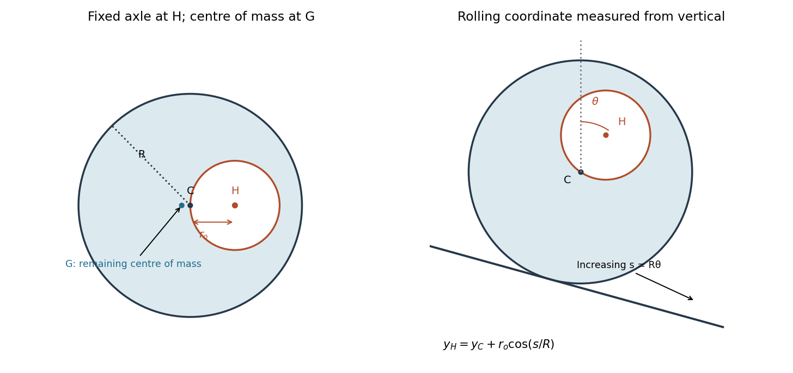
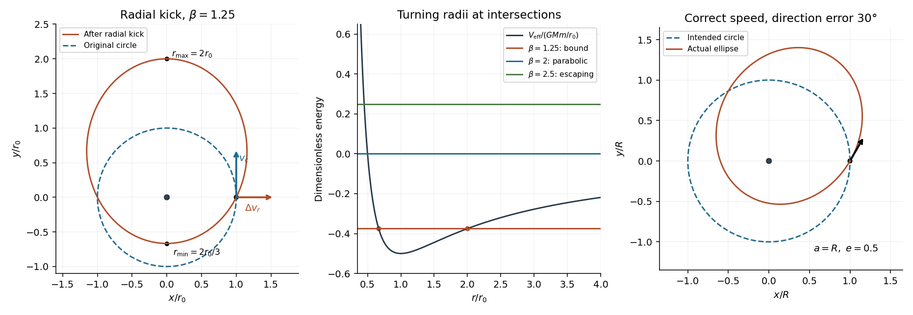

# 2014

↑ **Parent:** [Past exam of the physics 1 paper of the University of Oxford](../past-exam-of-the-physics-1-paper-of-the-university-of-oxford.md)

Source paper: [https://www.whatdotheyknow.com/request/physics_preliminary_examinations/response/1162943/attach/3/Twain.7z?cookie_passthrough=1](https://www.whatdotheyknow.com/request/physics_preliminary_examinations/response/1162943/attach/3/Twain.7z?cookie_passthrough=1)

This is the ordinary sitting of 9 June 2014, whose source is retained in the archive's legacy unspecified-stage directory. All eleven questions are solved, including all four alternatives in Section B. The tutorial clarification printed with Question 9 is accounted for in [c](#9/c).

**Table of contents**

- [1](#1)
  - [a](#1/a)
    - [Solution](#1/a/solution)
  - [b](#1/b)
    - [Solution](#1/b/solution)
- [2](#2)
  - [a](#2/a)
    - [Solution](#2/a/solution)
  - [b](#2/b)
    - [Solution](#2/b/solution)
- [3](#3)
  - [Solution](#3/solution)
- [4](#4)
  - [a](#4/a)
    - [Solution](#4/a/solution)
  - [b](#4/b)
    - [Solution](#4/b/solution)
  - [c](#4/c)
    - [Solution](#4/c/solution)
- [5](#5)
  - [a](#5/a)
    - [Solution](#5/a/solution)
  - [b](#5/b)
    - [Solution](#5/b/solution)
- [6](#6)
  - [Solution](#6/solution)
- [7](#7)
  - [Solution](#7/solution)
- [8](#8)
  - [a](#8/a)
    - [Solution](#8/a/solution)
  - [b](#8/b)
    - [Solution](#8/b/solution)
  - [c](#8/c)
    - [Solution](#8/c/solution)
  - [d](#8/d)
    - [Solution](#8/d/solution)
- [9](#9)
  - [a](#9/a)
    - [Solution](#9/a/solution)
  - [b](#9/b)
    - [Solution](#9/b/solution)
  - [c](#9/c)
    - [Solution](#9/c/solution)
- [10](#10)
  - [a](#10/a)
    - [Solution](#10/a/solution)
  - [b](#10/b)
    - [Solution](#10/b/solution)
  - [c](#10/c)
    - [Solution](#10/c/solution)
- [11](#11)
  - [a](#11/a)
    - [Solution](#11/a/solution)
  - [b](#11/b)
    - [Solution](#11/b/solution)
  - [c](#11/c)
    - [Solution](#11/c/solution)

## 1

↑ **Parent:** [2014](2014.md)

<h3 id="1/a">a</h3>

↑ **Parent:** [1](#1)

<h4 id="1/a/solution">Solution</h4>

↑ **Parent:** [A](#1/a)

Use nonrelativistic [mechanics](../physics.md#mechanics) and let $\mathbf V=(m_1\mathbf v_1+m_2\mathbf v_2)/(m_1+m_2)$ be the constant [centre-of-mass velocity](../classical-mechanics.md#center-of-mass-velocity). In the [centre-of-mass frame](../special-relativity.md#center-of-momentum-frame), [conservation of momentum](../momentum.md#momentum-conservation) gives $m_1\mathbf u_1+m_2\mathbf u_2=0$ before and after the [elastic collision](../classical-mechanics.md#elastic-collision). Thus $\mathbf u_2=-(m_1/m_2)\mathbf u_1$, and the [kinetic energy](../energy.md#kinetic-energy) is

$$
T_*=\frac12m_1u_1^2+\frac12m_2u_2^2=\frac12m_1\left(1+\frac{m_1}{m_2}\right)u_1^2.
$$

The decomposition $T_{\rm lab}=T_*+\tfrac12(m_1+m_2)V^2$ and constant [centre-of-mass velocity](../classical-mechanics.md#center-of-mass-velocity) show that the [elastic collision](../classical-mechanics.md#elastic-collision) preserves $T_*$, so the positive constant multiplying $u_1^2$ forces that [speed](../classical-mechanics.md#speed) to remain unchanged. The same [momentum](../momentum.md) relation fixes the second [speed](../classical-mechanics.md#speed):

$$
\boxed{|\mathbf u'_1|=|\mathbf u_1|,\qquad |\mathbf u'_2|=|\mathbf u_2|.}
$$

Only their directions can change; the two [velocities](../classical-mechanics.md#velocity) remain antiparallel in this frame. This derivation does not require a head-on [collision](../classical-mechanics.md#collision).

<h3 id="1/b">b</h3>

↑ **Parent:** [1](#1)

<h4 id="1/b/solution">Solution</h4>

↑ **Parent:** [B](#1/b)

For equal [masses](../classical-mechanics.md#mass), let the incoming [laboratory frame](../mathematical-physics.md#laboratory-frame) [velocity](../classical-mechanics.md#velocity) be $\mathbf v$ and the outgoing [velocities](../classical-mechanics.md#velocity) be $\mathbf a,\mathbf b$. [Conservation of momentum](../momentum.md#momentum-conservation) and [kinetic energy](../energy.md#kinetic-energy) give

$$
\mathbf v=\mathbf a+\mathbf b,\qquad v^2=a^2+b^2.
$$

Squaring the first equation and subtracting the second yields $2\mathbf a\cdot\mathbf b=0$. Hence

$$
\boxed{\mathbf a\cdot\mathbf b=0,\qquad \text{outgoing directions differ by }90^\circ.}
$$

The stated oblique [collision](../classical-mechanics.md#collision) ensures both outgoing [speeds](../classical-mechanics.md#speed) are nonzero. In the degenerate head-on case one particle can stop, and a direction cannot be assigned to its zero [velocity](../classical-mechanics.md#velocity).

## 2

↑ **Parent:** [2014](2014.md)

<h3 id="2/a">a</h3>

↑ **Parent:** [2](#2)

<h4 id="2/a/solution">Solution</h4>

↑ **Parent:** [A](#2/a)

Let $x$ be the signed distance from the [Earth](../planetary-science.md#earth)'s centre along the polar tunnel, with $x(0)=r_0$ and $\dot x(0)=0$. The [shell theorem](../mathematical-physics.md#spherical-shell-theorem) leaves only the enclosed [mass](../classical-mechanics.md#mass) $4\pi\rho|x|^3/3$ contributing to the [gravitational field](../physics.md#gravitational-field). Consequently

$$
\ddot x=-\frac{4\pi G\rho}{3}x=-\frac{g}{r_0}x,\qquad g=\frac{4\pi G\rho r_0}{3}.
$$

This is [simple harmonic motion](../classical-mechanics.md#simple-harmonic-motion) with $\omega=\sqrt{g/r_0}$ and $x=r_0\cos(\omega t)$. Crossing the centre takes a quarter-period; reaching the opposite surface takes a half-period:

$$
\boxed{t_{\rm cross}=\pi\sqrt{\frac{r_0}{g}}=\sqrt{\frac{3\pi}{4G\rho}}.}
$$

The body's [mass](../classical-mechanics.md#mass) cancels. The polar diameter lies on the rotation axis, so the tunnel motion has no additional [centrifugal force](../mathematical-physics.md#centrifugal-force) or [Coriolis force](../mathematical-physics.md#coriolis-force) from the [Earth](../planetary-science.md#earth)'s rotation. A realistic radial density profile would change the harmonic equation.

<h3 id="2/b">b</h3>

↑ **Parent:** [2](#2)

<h4 id="2/b/solution">Solution</h4>

↑ **Parent:** [B](#2/b)

A straight diameter at nonzero [angle](../geometry-and-topology.md#angle) $\chi$ to the rotation axis moves the body toward that axis during the inward half of its trip. With no external axial [torque](../momentum.md#torque), the total axial [angular momentum](../momentum.md#angular-momentum) of the [Earth](../planetary-science.md#earth) and body is conserved. The body's contribution to the [moment of inertia](../rigid-body-dynamics.md#moment-of-inertia) decreases toward the centre, so the [Earth](../planetary-science.md#earth) spins slightly faster; the reverse happens on the outward half, restoring the original rotation rate at the far surface.

For a body of [mass](../classical-mechanics.md#mass) $m$ constrained to follow a tunnel fixed in the [Earth](../planetary-science.md#earth), an illustrative angular-momentum balance is

$$
\boxed{\Omega(x)=\Omega_0\frac{I_E+mr_0^2\sin^2\chi}{I_E+mx^2\sin^2\chi}.}
$$

Here $I_E$ is the [Earth](../planetary-science.md#earth)'s axial [moment of inertia](../rigid-body-dynamics.md#moment-of-inertia), treated as constant, and $x$ is the signed distance along the diameter. A frictionless guide can still exert normal forces: these supply the transverse acceleration and exchange axial [angular momentum](../momentum.md#angular-momentum) with the rotating [Earth](../planetary-science.md#earth). Simply allowing an unconstrained body to fall would not keep it inside a narrow nonpolar straight tunnel. The effect vanishes for $\chi=0$ and is largest for an equatorial diameter.

## 3

↑ **Parent:** [2014](2014.md)

<h3 id="3/solution">Solution</h3>

↑ **Parent:** [3](#3)

Choose the smaller disc's initial sense as positive. For either uniform [disk](../topology.md#disk-mathematics), the axial [moment of inertia](../rigid-body-dynamics.md#moment-of-inertia) is $I=\tfrac12mr^2$, so $I_1=I_2/2$. The signed initial [angular velocities](../rigid-body-dynamics.md#angular-velocity) are $\Omega_1=2\omega_2$ and $\Omega_2=-\omega_2$, giving total axial [angular momentum](../momentum.md#angular-momentum) zero. The frictionless axle supplies no axial [torque](../momentum.md#torque), and the pins' negligible [mass](../classical-mechanics.md#mass) supplies no extra stored [kinetic energy](../energy.md#kinetic-energy). Thus

$$
I_1\Omega'_1+I_2\Omega'_2=0,\qquad
\frac12I_1(\Omega'_1)^2+\frac12I_2(\Omega'_2)^2=\frac12I_1(2\omega_2)^2+\frac12I_2\omega_2^2.
$$

These equations allow the original state or its simultaneous reversal. A nontrivial elastic pin impact selects reversal of the relative contact [velocity](../classical-mechanics.md#velocity), rather than continued interpenetration. Therefore

$$
\boxed{\Omega'_1=-2\omega_2=-\omega_1,\qquad \Omega'_2=+\omega_2.}
$$

The requested magnitudes are unchanged: $|\Omega'_1|=\omega_1$ and $|\Omega'_2|=\omega_2$. The intersecting pin paths make the impact possible; no additional lever arm is needed once axial [angular momentum](../momentum.md#angular-momentum) and [energy](../energy.md) conservation have been imposed.

## 4

↑ **Parent:** [2014](2014.md)

<h3 id="4/a">a</h3>

↑ **Parent:** [4](#4)

<h4 id="4/a/solution">Solution</h4>

↑ **Parent:** [A](#4/a)

[Generalized coordinates](../lagrangian-mechanics.md#generalized-coordinate) are variables $q_1,\ldots,q_n$ that specify the allowed instantaneous configuration of a [mechanical system](../classical-mechanics.md#mechanical-system). They need not be Cartesian positions: a rigid pendulum's [angle](../geometry-and-topology.md#angle) is a suitable single coordinate. With constraints solved, the particle positions are functions $\mathbf r_i(q_1,\ldots,q_n,t)$.

<h3 id="4/b">b</h3>

↑ **Parent:** [4](#4)

<h4 id="4/b/solution">Solution</h4>

↑ **Parent:** [B](#4/b)

The number of [degrees of freedom](../classical-mechanics.md#degree-of-freedom) is the number of independent coordinates needed to specify an allowed configuration locally. For $N$ unconstrained point particles in three dimensions it is $3N$; $k$ independent regular [holonomic constraints](../classical-mechanics.md#holonomic-constraint) reduce it to $3N-k$. Redundant constraints must not be counted twice, and nonholonomic velocity restrictions require separate care.

<h3 id="4/c">c</h3>

↑ **Parent:** [4](#4)

<h4 id="4/c/solution">Solution</h4>

↑ **Parent:** [C](#4/c)

A [holonomic constraint](../classical-mechanics.md#holonomic-constraint) can be written as an equation $f(q_1,\ldots,q_n,t)=0$ involving coordinates and possibly time, without an irreducible dependence on [velocities](../classical-mechanics.md#velocity). For example a particle confined to a fixed sphere obeys $x^2+y^2+z^2-a^2=0$. A general [rolling without slipping](../rigid-body-dynamics.md#rolling-without-slipping) constraint in three dimensions need not be integrable into such a coordinate equation.

## 5

↑ **Parent:** [2014](2014.md)

<h3 id="5/a">a</h3>

↑ **Parent:** [5](#5)

<h4 id="5/a/solution">Solution</h4>

↑ **Parent:** [A](#5/a)

Use the inverse [Lorentz transformation](../special-relativity.md#lorentz-transformation), with $\gamma_u=(1-u^2/c^2)^{-1/2}$:

$$
x=\gamma_u(x'+ut'),\qquad t=\gamma_u\left(t'+\frac{ux'}{c^2}\right).
$$

Taking differentials along the object's trajectory gives

$$
\boxed{w=\frac{dx}{dt}=\frac{v+u}{1+uv/c^2}.}
$$

This is the collinear [relativistic velocity addition](../special-relativity.md#velocity-addition-formula) law. It concerns the [velocity](../classical-mechanics.md#velocity) of one object measured in two frames. By contrast the rate of change of the distance between two objects in one [laboratory frame](../mathematical-physics.md#laboratory-frame) can be as large as

$$
\boxed{\frac{dD}{dt}=2c,}
$$

attained by oppositely directed light signals; for massive objects it is approached but not attained. This is not an object's [speed](../classical-mechanics.md#speed) in the other's rest frame and cannot transmit a signal faster than $c$.

<h3 id="5/b">b</h3>

↑ **Parent:** [5](#5)

<h4 id="5/b/solution">Solution</h4>

↑ **Parent:** [B](#5/b)

Take the light to travel along positive x, while the water moves with signed [velocity](../classical-mechanics.md#velocity) $-v$. In the water's rest frame its light [phase velocity](../dispersion-relation.md#phase-velocity) is $c/n$. The [relativistic velocity addition](../special-relativity.md#velocity-addition-formula) law from [a](#5/a) gives the laboratory [phase velocity](../dispersion-relation.md#phase-velocity)

$$
w=\frac{c/n-v}{1-v/(nc)},\qquad
n'=\frac cw=n\frac{1-v/(nc)}{1-nv/c}.
$$

Expanding to first order in $v/c$, with $nv/c\ll1$, yields

$$
\boxed{n'\simeq n\left(1+\frac{nv}{c}-\frac{v}{nc}\right).}
$$

Equivalently $w\simeq c/n-v(1-1/n^2)$: the counterflow reduces the forward light [speed](../classical-mechanics.md#speed). This is the nondispersive [Fresnel drag coefficient](../special-relativity.md#fresnel-drag-coefficient). The [refractive index](../electromagnetic-wave.md#refractive-index) is taken as constant over the relevant frequencies; [dispersion](../dispersion-relation.md#wave-dispersion) and its frequency-shift corrections are outside this approximation.

## 6

↑ **Parent:** [2014](2014.md)

<h3 id="6/solution">Solution</h3>

↑ **Parent:** [6](#6)

For $\beta=0.99$, the [Lorentz factor](../special-relativity.md#lorentz-factor) is $\gamma=1/\sqrt{1-\beta^2}=7.0888$. In the tracks' rest frame the train undergoes [length contraction](../special-relativity.md#length-contraction) to $100/\gamma=14.1067\,\mathrm m$, which fits in the $90\,\mathrm m$ tunnel. There is a time interval during which it is entirely inside. In the train's rest frame the tunnel instead has length $90/\gamma=12.6961\,\mathrm m$, so it never simultaneously contains the whole $100\,\mathrm m$ train:

$$
\boxed{\text{Entirely inside at one track-frame time: yes. At one train-frame time: no.}}
$$

These refer to different sets of simultaneous events, as required by [relativity of simultaneity](../special-relativity.md#relativity-of-simultaneity). Quantitatively let $A$ be the rear entering the near portal, with $(x_A,t_A)=(0,0)$, and $B$ the front reaching the far portal. In the track frame,

$$
x_B=90\,\mathrm m,\qquad ct_B=\frac{90-100/\gamma}{\beta}=76.6599\,\mathrm m.
$$

The train is wholly inside between these events. Transforming their time separation gives

$$
c(t'_B-t'_A)=\gamma(ct_B-\beta x_B)=-88.1858\,\mathrm m<0.
$$

Thus the front leaves before the rear enters in the train frame. The two events are [spacelike separated](../special-relativity.md#spacelike-separation), so their time order may reverse without a causal contradiction. No doors or forced acceleration need be added to the problem.

**[Figure 1](#6/image-portal-and-train-worldlines-in-the-two-inertial-frames). Portal and train worldlines in the two inertial frames**. Original [spacetime diagrams](../mathematical-physics.md#spacetime-diagram), with vertical coordinates ct and ct-prime in metres. Events A and B exchange time order; the horizontal shaded time slice shows the different simultaneous configurations.

## 7

↑ **Parent:** [2014](2014.md)

<h3 id="7/solution">Solution</h3>

↑ **Parent:** [7](#7)

Let $\theta$ measure the spoke's displacement from downward equilibrium. The total [moment of inertia](../rigid-body-dynamics.md#moment-of-inertia) about the axle is $I=MR_2^2+mR_1^2$: the rim is a thin [thin hoop](../rigid-body-dynamics.md#thin-hoop), and the attached body is a point [mass](../classical-mechanics.md#mass). The rim's weight has no axle [torque](../momentum.md#torque), while the attached [mass](../classical-mechanics.md#mass) gives restoring [torque](../momentum.md#torque) $-mgR_1\sin\theta$. Hence

$$
\boxed{(MR_2^2+mR_1^2)\ddot\theta+mgR_1\sin\theta=0,\quad \theta(0)=\theta_0,\quad\dot\theta(0)=0.}
$$

Equivalently [conservation of energy](../mathematical-physics.md#conservation-of-energy) gives $\tfrac12I\dot\theta^2=mgR_1(\cos\theta-\cos\theta_0)$. For small [angles](../geometry-and-topology.md#angle), $\sin\theta\simeq\theta$, so the motion is approximately $\theta=\theta_0\cos(\omega t)$ with $\omega^2=mgR_1/I$. The small-amplitude period is

$$
\boxed{T=2\pi\sqrt{\frac{MR_2^2+mR_1^2}{mgR_1}}.}
$$

At finite amplitude the nonlinear pendulum equation remains valid but this period approximation does not. The $M\to0$ limit recovers a simple pendulum of length $R_1$.

## 8

↑ **Parent:** [2014](2014.md)

<h3 id="8/a">a</h3>

↑ **Parent:** [8](#8)

<h4 id="8/a/solution">Solution</h4>

↑ **Parent:** [A](#8/a)

Choose positive x along the rocket's motion. If its instantaneous total [mass](../classical-mechanics.md#mass) is $\mu$ and it ejects a positive amount $d\eta=-d\mu$, the exhaust [velocity](../classical-mechanics.md#velocity) in the original [inertial frame](../mathematical-physics.md#inertial-frame) is $v-u_0$ to first order. [Conservation of momentum](../momentum.md#momentum-conservation) over that increment gives

$$
\mu v=(\mu-d\eta)(v+dv)+d\eta(v-u_0),\qquad \mu\,dv=u_0d\eta=-u_0d\mu.
$$

Integrating the [rocket equation](../momentum.md#rocket-equation) from $\mu=m+M$ to $\mu=m$ gives

$$
\boxed{v_f=u_0\ln\frac{m+M}{m}.}
$$

The constant exhaust [speed](../classical-mechanics.md#speed) is relative to the rocket, not the initial frame. [Kinetic energy](../energy.md#kinetic-energy) of rocket plus exhaust is not conserved because stored fuel [energy](../energy.md) is released. The calculation is Newtonian and requires resulting [speeds](../classical-mechanics.md#speed) small compared with the [speed of light](../special-relativity.md#speed-of-light).

<h3 id="8/b">b</h3>

↑ **Parent:** [8](#8)

<h4 id="8/b/solution">Solution</h4>

↑ **Parent:** [B](#8/b)

Let $q$ be the transferred fuel [mass](../classical-mechanics.md#mass). Before any engine reversal, rocket A has [mass](../classical-mechanics.md#mass) $a=m_A+M-q$ and [velocity](../classical-mechanics.md#velocity)

$$
v_A(q)=u_0\ln\frac{m_A+M}{m_A+M-q}.
$$

For [exhaust collection by a second rocket](../momentum.md#exhaust-collection-by-a-second-rocket), under the stipulated eventual capture of all exhaust, final [conservation of momentum](../momentum.md#momentum-conservation) for the complete initially stationary system gives $m_Av_{Af}+(m_B+M)v_{Bf}=0$. Thus

$$
\boxed{v_{Af}=u_0\ln\frac{m_A+M}{m_A},\quad v_{Bf}=-\frac{m_A}{m_B+M}v_{Af},\quad v_{\rm rel}=u_0\frac{m_A+m_B+M}{m_B+M}\ln\frac{m_A+M}{m_A}.}
$$

Capture is inelastic: no [kinetic energy](../energy.md#kinetic-energy) conservation for B is assumed. Finite exhaust flight time changes the intermediate sharing of [momentum](../momentum.md) but not this endpoint balance if the stated complete capture actually occurs.

The [ballistic exhaust interception condition](../momentum.md#ballistic-exhaust-interception-condition) is a physical restriction on that idealization. For purely ballistic exhaust to reach a receding collector to the rear, its laboratory [velocity](../classical-mechanics.md#velocity) must be more negative than B's while interception occurs. In the negligible-flight-time approximation this requires $v_A-u_0<v_B$. Very large fuel ratios need not meet that condition throughout a complete burn; the boxed endpoint formula is conditional on the prompt's complete-collection stipulation, not an unconditional prediction for every ballistic two-rocket geometry.

<h3 id="8/c">c</h3>

↑ **Parent:** [8](#8)

<h4 id="8/c/solution">Solution</h4>

↑ **Parent:** [C](#8/c)

Neglecting exhaust flight time, no [momentum](../momentum.md) is stored in transit and

$$
(m_A+M-q)v_A+(m_B+q)v_B=0.
$$

Since the velocities have opposite signs, equal nonzero [speeds](../classical-mechanics.md#speed) imply equality of the instantaneous [masses](../classical-mechanics.md#mass). For $m_B=2m_A$ and $M=5m_A$, this occurs at $6m_A-q=2m_A+q$, or $q=2m_A$. Therefore

$$
\boxed{v_s=u_0\ln\frac{6m_A}{4m_A}=u_0\ln\frac32.}
$$

The common-speed event occurs after $40\%$ of A's original fuel has been transferred, rather than when either rocket has its final [mass](../classical-mechanics.md#mass). At this event the rearward exhaust still overtakes B: $v_A-u_0=-0.5945u_0<v_B=-0.4055u_0$. Thus the interception restriction in [b](#8/b) does not invalidate this event even though extending complete ballistic capture over the much later burn would need separate checking.

<h3 id="8/d">d</h3>

↑ **Parent:** [8](#8)

<h4 id="8/d/solution">Solution</h4>

↑ **Parent:** [D](#8/d)

Put $m_A=M=m$ and $m_B=2m$. At reversal the transferred [mass](../classical-mechanics.md#mass) is $q_r=0.45m$, leaving A with $1.55m$ and, after capture of that exhaust, B with $2.45m$. The first burn gives

$$
v_{Ar}=u_0\ln\frac2{1.55}=u_0\ln\frac{40}{31},\qquad
v_{Br}=-\frac{1.55}{2.45}v_{Ar}=-\frac{31}{49}u_0\ln\frac{40}{31}.
$$

After reversal A emits its remaining exhaust away from B, so B receives no further fuel and eventually coasts at this [velocity](../classical-mechanics.md#velocity). Applying the [rocket equation](../momentum.md#rocket-equation) with reversed thrust to A gives

$$
v_{Af}=v_{Ar}-u_0\ln1.55=u_0\ln\frac{800}{961}\simeq-0.18336u_0,\qquad v_{Bf}\simeq-0.16126u_0.
$$

Both now move toward negative x, but A moves faster in that direction. The asymptotic closing [speed](../classical-mechanics.md#speed) is

$$
\boxed{v_{Bf}-v_{Af}\simeq0.0221u_0>0:\quad\text{A can catch B.}}
$$

This conclusion does not require a burn rate or an initial separation: after a finite burn, the positive eventual closing [speed](../classical-mechanics.md#speed) closes any finite remaining gap. Those additional inputs would be required to calculate the meeting time. Any pre-reversal exhaust still in transit affects the timing, not B's eventual [momentum](../momentum.md) after collecting that fixed amount.

**[Figure 2](#8/d/image-signed-velocities-during-exhaust-collection-and-thrust-reversal). Signed velocities during exhaust collection and thrust reversal**. Original Newtonian calculations versus the fraction of original fuel consumed. Left: the equal-speed event in the ideal negligible-flight-time collection model; the later dashed extension is conditional on collection and can violate ballistic interception. Right: reversing thrust at 45 percent produces a small positive eventual closing speed.

## 9

↑ **Parent:** [2014](2014.md)

<h3 id="9/a">a</h3>

↑ **Parent:** [9](#9)

<h4 id="9/a/solution">Solution</h4>

↑ **Parent:** [A](#9/a)

For the [eccentric circular-hole disk inertia](../rigid-body-dynamics.md#eccentric-circular-hole-disk-inertia), let $D=\pi\rho R^2$ be the [mass](../classical-mechanics.md#mass) of the complete disc before removing material, $h=\pi\rho r_o^2$ the missing [mass](../classical-mechanics.md#mass), and $W=D-h$ the wheel's remaining [mass](../classical-mechanics.md#mass). Denote the complete disc's centre by C and the axle/hole centre by H; $CH=r_o$. Assume the hole fits inside the disc, $0<r_o<R/2$. The [parallel axis theorem](../rigid-body-dynamics.md#parallel-axis-theorem) gives the full disc's [moment of inertia](../rigid-body-dynamics.md#moment-of-inertia) about H as $\tfrac12DR^2+Dr_o^2$. Subtract the absent little disc about its own centre H:

$$
\boxed{I_H=\frac12DR^2+Dr_o^2-\frac12hr_o^2=\frac{\pi\rho}{2}\left(R^4+2R^2r_o^2-r_o^4\right).}
$$

The axle is a support, not part of the rotating wheel's stated [mass](../classical-mechanics.md#mass). Its frictionless bearing does not alter this [moment of inertia](../rigid-body-dynamics.md#moment-of-inertia). For fixed-axis [angular velocity](../rigid-body-dynamics.md#angular-velocity) $\omega$,

$$
\boxed{T_H=\frac12I_H\omega^2=\frac{\pi\rho\omega^2}{4}\left(R^4+2R^2r_o^2-r_o^4\right).}
$$

The missing material must be subtracted with its actual displacement relative to the axis; treating the wheel as a concentric annulus would give the wrong result.

<h3 id="9/b">b</h3>

↑ **Parent:** [9](#9)

<h4 id="9/b/solution">Solution</h4>

↑ **Parent:** [B](#9/b)

For a freely rolling rigid body, decompose the [kinetic energy](../energy.md#kinetic-energy) into translation of its [centre of mass](../classical-mechanics.md#center-of-mass) G and rotation about G. The [centre of mass after removing material](../classical-mechanics.md#centre-of-mass-after-removing-material) lies on the side opposite H:

$$
\overrightarrow{CG}=-\frac hW\overrightarrow{CH},\qquad HG=r_o\left(1+\frac hW\right)=\frac{Dr_o}{W}.
$$

Another use of the [parallel axis theorem](../rigid-body-dynamics.md#parallel-axis-theorem) gives

$$
I_G=I_H-W(HG)^2=I_H-\frac{D^2r_o^2}{W}.
$$

Thus at the same [angular speed](../rigid-body-dynamics.md#angular-speed),

$$
\boxed{T_{\rm rot,G}=\frac12I_G\omega^2<T_H,\qquad T_H-T_{\rm rot,G}=\frac{D^2r_o^2\omega^2}{2W}>0.}
$$

This compares the rotational component, not the total rolling [kinetic energy](../energy.md#kinetic-energy). The total also contains $\tfrac12Wv_G^2$ and need not be smaller than $T_H$. Describing all rolling motion as instantaneous rotation about its contact point includes that translational contribution; it is not the rotational component intended by this comparison.

<h3 id="9/c">c</h3>

↑ **Parent:** [9](#9)

<h4 id="9/c/solution">Solution</h4>

↑ **Parent:** [C](#9/c)

The supplied PDF labels this equation _clarified from original for tutorial purposes_. Use the model of an [eccentric wheel with missing-mass kinetic energy neglected](../rigid-body-dynamics.md#eccentric-wheel-with-missing-mass-kinetic-energy-neglected): neglect the missing disc's contribution to [kinetic energy](../energy.md#kinetic-energy), while retaining its subtraction from gravitational [potential energy](../energy.md#potential-energy). Do not silently replace the gravitational [mass](../classical-mechanics.md#mass) $W$ by the full-disc [mass](../classical-mechanics.md#mass) $D$ as well.

Choose $\theta$ as the clockwise [angle](../geometry-and-topology.md#angle) of $\overrightarrow{CH}$ from the upward vertical, and set $s=R\theta$. The [rolling without slipping](../rigid-body-dynamics.md#rolling-without-slipping) constraint makes changes in $s$ equal changes in the distance C travels down the slope. Choose its additive origin so $s=0$ when the hole is vertically above C. Then, up to an irrelevant height constant,

$$
y_C=-s\sin\alpha+\mathrm{constant},\qquad y_H=y_C+r_o\cos(s/R).
$$

The approximate [kinetic energy](../energy.md#kinetic-energy) is that of the complete uniform disc rolling at $\dot s=R\dot\theta$:

$$
T\simeq\frac12D\dot s^2+\frac12\left(\frac12DR^2\right)\frac{\dot s^2}{R^2}=\frac34D\dot s^2.
$$

Subtracting the missing disc's gravitational [potential energy](../energy.md#potential-energy) gives

$$
U=Dgy_C-hgy_H=-Wgs\sin\alpha-hgr_o\cos(s/R)+\mathrm{constant}.
$$

Apply the [Euler-Lagrange equation](../analysis.md#euler-lagrange-equation) to $\mathcal L=T-U$:

$$
\frac32D\ddot s+\frac{hgr_o}{R}\sin(s/R)-Wg\sin\alpha=0.
$$

Therefore

$$
\boxed{K_1=\frac{2hgr_o}{3DR}=\frac{2gr_o^3}{3R^3},\qquad K_2=-\frac{2Wg\sin\alpha}{3D}=-\frac{2g}{3}\left(1-\frac{r_o^2}{R^2}\right)\sin\alpha,\qquad\gamma=\frac1R.}
$$

Here $K_1,K_2$ have dimensions of [acceleration](../classical-mechanics.md#acceleration) and $\gamma$ has dimensions of inverse [length](../physics.md#length). The initial conditions are $s(0)=\dot s(0)=0$ under the vertical-above interpretation. If an initial orientation is instead specified relative to the slope normal, the same coordinate convention produces a different initial $s$, not different constants. With $r_o\to0$ the equation becomes $\ddot s=(2/3)g\sin\alpha$, the familiar solid-disc result. Retaining the hole's exact [kinetic energy](../energy.md#kinetic-energy) would introduce coordinate-dependent inertia and extra $\dot s^2$ terms; the printed neglect is what permits the requested constant-coefficient form.

**[Figure 3](#9/c/image-the-axle-geometric-centre-and-centre-of-mass-of-the-perforated-wheel). The axle, geometric centre and centre of mass of the perforated wheel**. Original geometric constructions. Left: fixed-axis inertia subtracts a missing disc about H. Right: the rolling coordinate is the hole angle from the upward vertical; the centre travels downhill by R times the angle, while the missing mass contributes a cosine to potential energy.

## 10

↑ **Parent:** [2014](2014.md)

<h3 id="10/a">a</h3>

↑ **Parent:** [10](#10)

<h4 id="10/a/solution">Solution</h4>

↑ **Parent:** [A](#10/a)

The incident particle obeys the [energy–momentum relation](../special-relativity.md#energy-momentum-relation) $E^2=p^2c^2+m_1^2c^4$. The stationary target contributes [energy](../energy.md) $m_2c^2$ and zero [momentum](../momentum.md). A single product inherits the total [four-momentum](../special-relativity.md#four-momentum), so its [invariant mass](../special-relativity.md#invariant-mass) satisfies

$$
M^2c^4=(E+m_2c^2)^2-p^2c^2=m_1^2c^4+m_2^2c^4+2Em_2c^2.
$$

Hence

$$
\boxed{M=\sqrt{m_1^2+m_2^2+\frac{2m_2E}{c^2}}.}
$$

Here $E$ is the incident total [energy](../energy.md), including rest [energy](../energy.md). In a one-particle final state, exact production of a specified [mass](../classical-mechanics.md#mass) fixes the incident [energy](../energy.md); there is no adjustable final relative motion to absorb excess [energy](../energy.md). A resonance with a finite [decay width](../relativistic-quantum-field.md#decay-width) relaxes that ideal exact equality over its line shape.

<h3 id="10/b">b</h3>

↑ **Parent:** [10](#10)

<h4 id="10/b/solution">Solution</h4>

↑ **Parent:** [B](#10/b)

For fixed-target [electron](../physics.md#electron)-[Positron](../physics.md#positron) formation, set $m_1=m_2=m_e$ in [a](#10/a) and solve for the incident total [energy](../energy.md):

$$
\boxed{E_{e^+}=\frac{m_\rho^2c^4-2m_e^2c^4}{2m_ec^2}=\frac{(768\,\mathrm{MeV})^2}{2(0.511\,\mathrm{MeV})}-0.511\,\mathrm{MeV}\simeq5.7713\times10^5\,\mathrm{MeV}=577.1\,\mathrm{GeV}.}
$$

The incident [kinetic energy](../energy.md#kinetic-energy) is smaller by another $m_ec^2$, a negligible relative change here. Most of the fixed-target [energy](../energy.md) becomes motion of the final [rho meson](../physics.md#rho-meson) in the laboratory.

With equal and opposite incoming [momenta](../momentum.md), the [centre-of-momentum frame](../special-relativity.md#center-of-momentum-frame) is the laboratory. Each incoming particle has the same total [energy](../energy.md), and there is no final translational [kinetic energy](../energy.md#kinetic-energy) at formation:

$$
\boxed{E_{e^+}=E_{e^-}=\frac{m_\rho c^2}{2}=384\,\mathrm{MeV}.}
$$

This large contrast illustrates the invariant-energy advantage of colliding beams. The given $768\,\mathrm{MeV}/c^2$ resonance [mass](../classical-mechanics.md#mass) is used rather than replacing it with a modern tabulated value.

<h3 id="10/c">c</h3>

↑ **Parent:** [10](#10)

<h4 id="10/c/solution">Solution</h4>

↑ **Parent:** [C](#10/c)

Treat the atmospheric [proton](../physics.md#proton) as stationary in the [Earth](../planetary-science.md#earth) frame, the incident [antiproton](../relativistic-quantum-field.md#antiproton) as vertically downward, and neglect atmospheric [energy loss](../particle-detection.md#energy-loss), scattering and the [Earth](../planetary-science.md#earth)'s curvature initially. Take $m_pc^2=0.9383\,\mathrm{GeV}$. [Conservation of energy](../mathematical-physics.md#conservation-of-energy) and equal outgoing [energies](../energy.md) give

$$
E_\mu=\frac{35+0.9383}{2}\,\mathrm{GeV}=17.9692\,\mathrm{GeV},\qquad \gamma_\mu=\frac{E_\mu}{0.106\,\mathrm{GeV}}\simeq169.52.
$$

Equal [energies](../energy.md) imply equal [momentum](../momentum.md) magnitudes. Their transverse [momenta](../momentum.md) cancel, so the two [muons](../standard-model.md#muon) have equal downward components $p_z=p_{\bar p}/2$, where

$$
p_{\bar p}c=\sqrt{(35\,\mathrm{GeV})^2-(0.9383\,\mathrm{GeV})^2}\simeq34.9874\,\mathrm{GeV}.
$$

Each [muon](../standard-model.md#muon) therefore makes an [angle](../geometry-and-topology.md#angle) $\theta$ with the downward vertical satisfying

$$
\cos\theta=\frac{p_{\bar p}c/2}{\sqrt{E_\mu^2-m_\mu^2c^4}}\simeq0.9735.
$$

The paths are not both vertical: replacing their path lengths by $20\,\mathrm{km}$ would miss this two-body kinematic correction. Since $v_z=p_zc^2/E_\mu$, the proper flight time over vertical height $H$ is

$$
\Delta\tau_\mu=\frac{H}{\gamma_\mu v_z}=\frac{2Hm_\mu c^2}{c(p_{\bar p}c)}.
$$

For [equal-energy atmospheric muon-pair survival](../standard-model.md#equal-energy-atmospheric-muon-pair-survival), independent exponential [particle decays](../physics.md#particle-decay) with mean proper [muon lifetime](../standard-model.md#muon-lifetime) $\tau_0=2.2\,\mu\mathrm s$, both survive with [probability](../probability-theory.md#probability)

$$
\boxed{P_{\rm both}=\exp\left[-\frac{4Hm_\mu c^2}{c\tau_0(p_{\bar p}c)}\right]\simeq0.692.}
$$

Equivalently each travels about $20.55\,\mathrm{km}$, with proper flight time about $0.404\,\mu\mathrm s$, and survives with [probability](../probability-theory.md#probability) about $0.832$. The result is decay-only survival to an ideal surface, not a prediction including air interactions or detector efficiency. For a spherical [Earth](../planetary-science.md#earth) of radius $R_E$, the exact path length is $\ell=(R_E+H)\cos\theta-\sqrt{R_E^2-(R_E+H)^2\sin^2\theta}$; inserting $P_{\rm both}=\exp[-2\ell/(\gamma_\mu v_\mu\tau_0)]$ gives a small curvature correction.

## 11

↑ **Parent:** [2014](2014.md)

<h3 id="11/a">a</h3>

↑ **Parent:** [11](#11)

<h4 id="11/a/solution">Solution</h4>

↑ **Parent:** [A](#11/a)

Here $G$ is the [gravitational constant](../newton-s-law-of-universal-gravitation.md#gravitational-constant), $r$ is the separation of the orbiting object from the central body's centre, and $J$ is the magnitude of the object's conserved [orbital angular momentum](../quantum-mechanics.md#orbital-angular-momentum), not angular momentum per unit [mass](../classical-mechanics.md#mass). Approximate the much heavier central body as fixed, neglect other forces, and use the Newtonian gravitational [potential energy](../energy.md#potential-energy) $U=-GMm_0/r$, with zero at infinity.

A [central force](../mathematical-physics.md#central-force) confines the motion to a fixed [orbital plane](../celestial-mechanics.md#orbital-plane). In plane polar coordinates its [kinetic energy](../energy.md#kinetic-energy) is $T=\tfrac12m_0(\dot r^2+r^2\dot\phi^2)$. Conservation of [angular momentum](../momentum.md#angular-momentum) gives $J=m_0r^2\dot\phi$; eliminating $\dot\phi$ yields

$$
\boxed{E=\frac12m_0\dot r^2+V_{\rm eff}(r),\qquad V_{\rm eff}(r)=\frac{J^2}{2m_0r^2}-\frac{GMm_0}{r}.}
$$

The centrifugal term belongs to the radial [effective potential](../mathematical-physics.md#effective-potential); it is the eliminated transverse [kinetic energy](../energy.md#kinetic-energy), not an additional physical interaction. If recoil of the central body mattered, the relative-coordinate reduction would use the [reduced mass](../classical-mechanics.md#reduced-mass).

<h3 id="11/b">b</h3>

↑ **Parent:** [11](#11)

<h4 id="11/b/solution">Solution</h4>

↑ **Parent:** [B](#11/b)

Write $\mu=GM$ and let $v_c=\sqrt{\mu/r_0}$ be the original circular [orbital speed](../celestial-mechanics.md#orbital-speed). An impulse leaves the [orbital angular momentum](../quantum-mechanics.md#orbital-angular-momentum) unchanged if it is radial: its [angular impulse](../momentum.md#angular-impulse) $\mathbf r\times\Delta\mathbf p$ is zero. The tangential [velocity](../classical-mechanics.md#velocity) remains $v_c$, and an added radial component $w$ gives

$$
v_c^2+w^2=\beta v_c^2,\qquad \boxed{\Delta\mathbf v=\pm v_c\sqrt{\beta-1}\,\hat{\mathbf r}.}
$$

Thus [kinetic energy](../energy.md#kinetic-energy) increases even though [angular momentum](../momentum.md#angular-momentum) does not. For a [Radial kick from a circular Kepler orbit](../classical-mechanics.md#radial-kick-from-a-circular-kepler-orbit), the new specific [orbital energy](../celestial-mechanics.md#orbital-energy) and squared specific [angular momentum](../momentum.md#angular-momentum) are

$$
\varepsilon=\frac{\mu}{2r_0}(\beta-2),\qquad j^2=\mu r_0.
$$

The [orbital eccentricity](../celestial-mechanics.md#orbital-eccentricity) is $e=\sqrt{1+2\varepsilon j^2/\mu^2}=\sqrt{\beta-1}$, while the [semi-latus rectum](../euclidean-geometry.md#semilatus-rectum) is $p=j^2/\mu=r_0$. Hence

$$
\boxed{r_{\min}=\frac{r_0}{1+\sqrt{\beta-1}},\qquad r_{\max}=\frac{r_0}{1-\sqrt{\beta-1}}\quad(1<\beta<2).}
$$

For $\beta=2$ the trajectory is a [parabolic Kepler orbit](../celestial-mechanics.md#parabolic-trajectory) and has no finite furthest radius; its periapsis is $r_0/2$. For $\beta>2$ it is a [hyperbolic orbit](../celestial-mechanics.md#hyperbolic-orbit), with the same formula for $r_{\min}$ but unbounded radius:

$$
\boxed{r_{\max}=\infty\quad\text{for }\beta\geq2.}
$$

One must not use the negative denominator in the bound-orbit expression as a negative physical apocentre. On a departing unbound branch the conic's periapsis may already lie in the past; the future minimum from the kick event is then $r_0$. These are ideal conic orbits; a periapsis inside a real planet would cause impact before the ideal continuation.

**[Figure 4](#11/b/image-radial-impulse-orbital-turning-radii-and-a-launch-direction-error). Radial impulse, orbital turning radii and a launch-direction error**. Original dimensionless orbit calculations. Left: a radial kick changes energy while preserving tangential velocity and angular momentum. Middle: fixed-angular-momentum effective potential with bound, marginal and escaping energies. Right: a fixed-speed direction error gives an ellipse with the intended circular orbit's semimajor axis.

<h3 id="11/c">c</h3>

↑ **Parent:** [11](#11)

<h4 id="11/c/solution">Solution</h4>

↑ **Parent:** [C](#11/c)

For a [fixed-speed orbital launch-direction error](../celestial-mechanics.md#fixed-speed-orbital-launch-direction-error), the initial radius and [speed](../classical-mechanics.md#speed) are correct, so the specific [orbital energy](../celestial-mechanics.md#orbital-energy) is still $\varepsilon=-GM/(2R)$ and the new [semi-major axis](../celestial-mechanics.md#semi-major-axis) is still $a=R$. Resolve the launch [velocity](../classical-mechanics.md#velocity) into radial and tangential components, taking $\alpha$ as the in-plane deviation from the intended tangent:

$$
v_r=\sqrt{\frac{GM}{R}}\sin\alpha,\qquad v_\phi=\sqrt{\frac{GM}{R}}\cos\alpha,\qquad j=\sqrt{GMR}\cos\alpha.
$$

For a nondegenerate orbit $\cos\alpha\ne0$, the [orbital eccentricity](../celestial-mechanics.md#orbital-eccentricity) follows from $j^2=GMa(1-e^2)$:

$$
e=|\sin\alpha|,\qquad r_{\min}=R(1-|\sin\alpha|),\qquad r_{\max}=R(1+|\sin\alpha|).
$$

The intended circular orbit has radius $R$ everywhere, so the largest radial distance between the orbit curves occurs at either apsis:

$$
\boxed{\Delta r_{\max}=R|\sin\alpha|\simeq R|\alpha|\quad\text{for small }|\alpha|\text{ in radians}.}
$$

This is the geometric separation of the two orbit curves, not the distance between two satellites compared at equal elapsed times. The latter also depends on orbital phase. A purely radial launch is a degenerate zero-angular-momentum trajectory through the central body and requires separate treatment of the collision.

## ↑ Ancestors (9)

1. [Past exam of the physics 1 paper of the University of Oxford](../past-exam-of-the-physics-1-paper-of-the-university-of-oxford.md)
2. [Physics 1 paper of the University of Oxford](../university-of-oxford.md#physics-1-paper-of-the-university-of-oxford)
3. [Year 1 of the physics course of the University of Oxford](../university-of-oxford.md#year-1-of-the-physics-course-of-the-university-of-oxford)
4. [Physics course of the University of Oxford](../university-of-oxford.md#physics-course-of-the-university-of-oxford)
5. [Undergraduate course of the University of Oxford](../university-of-oxford.md#undergraduate-course-of-the-university-of-oxford)
6. [Course of the University of Oxford](../university-of-oxford.md#course-of-the-university-of-oxford)
7. [University of Oxford](../university-of-oxford.md)
8. [List of universities](../README.md#list-of-universities)
9. [Codex Wiki](../README.md)
