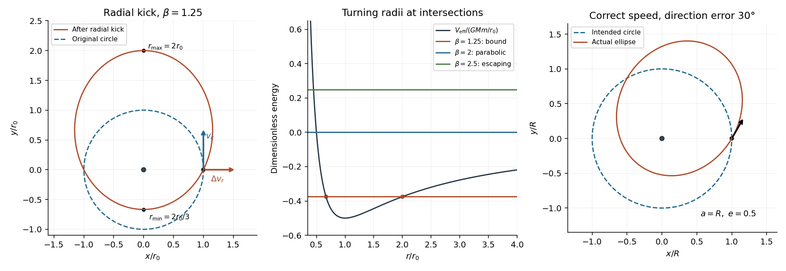

<h1 id="11/b/solution">Solution</h1>

↑ **Parent:** [B](../b.md)

Write $\mu=GM$ and let $v_c=\sqrt{\mu/r_0}$ be the original circular [orbital speed](../../../../orbital-speed.md). An impulse leaves the [orbital angular momentum](../../../../orbital-angular-momentum.md) unchanged if it is radial: its [angular impulse](../../../../angular-impulse.md) $\mathbf r\times\Delta\mathbf p$ is zero. The tangential [velocity](../../../../velocity.md) remains $v_c$, and an added radial component $w$ gives

$$
v_c^2+w^2=\beta v_c^2,\qquad \boxed{\Delta\mathbf v=\pm v_c\sqrt{\beta-1}\,\hat{\mathbf r}.}
$$

Thus [kinetic energy](../../../../kinetic-energy.md) increases even though [angular momentum](../../../../angular-momentum.md) does not. For a [Radial kick from a circular Kepler orbit](../../../../radial-kick-from-a-circular-kepler-orbit.md), the new specific [orbital energy](../../../../orbital-energy.md) and squared specific [angular momentum](../../../../angular-momentum.md) are

$$
\varepsilon=\frac{\mu}{2r_0}(\beta-2),\qquad j^2=\mu r_0.
$$

The [orbital eccentricity](../../../../orbital-eccentricity.md) is $e=\sqrt{1+2\varepsilon j^2/\mu^2}=\sqrt{\beta-1}$, while the [semi-latus rectum](../../../../semilatus-rectum.md) is $p=j^2/\mu=r_0$. Hence

$$
\boxed{r_{\min}=\frac{r_0}{1+\sqrt{\beta-1}},\qquad r_{\max}=\frac{r_0}{1-\sqrt{\beta-1}}\quad(1<\beta<2).}
$$

For $\beta=2$ the trajectory is a [parabolic Kepler orbit](../../../../parabolic-trajectory.md) and has no finite furthest radius; its periapsis is $r_0/2$. For $\beta>2$ it is a [hyperbolic orbit](../../../../hyperbolic-orbit.md), with the same formula for $r_{\min}$ but unbounded radius:

$$
\boxed{r_{\max}=\infty\quad\text{for }\beta\geq2.}
$$

One must not use the negative denominator in the bound-orbit expression as a negative physical apocentre. On a departing unbound branch the conic's periapsis may already lie in the past; the future minimum from the kick event is then $r_0$. These are ideal conic orbits; a periapsis inside a real planet would cause impact before the ideal continuation.

**[Figure 4](#11/b/image-radial-impulse-orbital-turning-radii-and-a-launch-direction-error). Radial impulse, orbital turning radii and a launch-direction error**. Original dimensionless orbit calculations. Left: a radial kick changes energy while preserving tangential velocity and angular momentum. Middle: fixed-angular-momentum effective potential with bound, marginal and escaping energies. Right: a fixed-speed direction error gives an ellipse with the intended circular orbit's semimajor axis.

## ↑ Ancestors (12)

1. [B](../b.md)
2. [11](../../11.md)
3. [2014](../../../2014-split.md)
4. [Past exam of the physics 1 paper of the University of Oxford](../../../split.md)
5. [Physics 1 paper of the University of Oxford](../../../../physics-1-paper-of-the-university-of-oxford.md)
6. [Year 1 of the physics course of the University of Oxford](../../../../year-1-of-the-physics-course-of-the-university-of-oxford.md)
7. [Physics course of the University of Oxford](../../../../physics-course-of-the-university-of-oxford.md)
8. [Undergraduate course of the University of Oxford](../../../../undergraduate-course-of-the-university-of-oxford.md)
9. [Course of the University of Oxford](../../../../course-of-the-university-of-oxford.md)
10. [University of Oxford](../../../../university-of-oxford-split.md)
11. [List of universities](../../../../list-of-universities.md)
12. [Codex Wiki](../../../../split.md)
