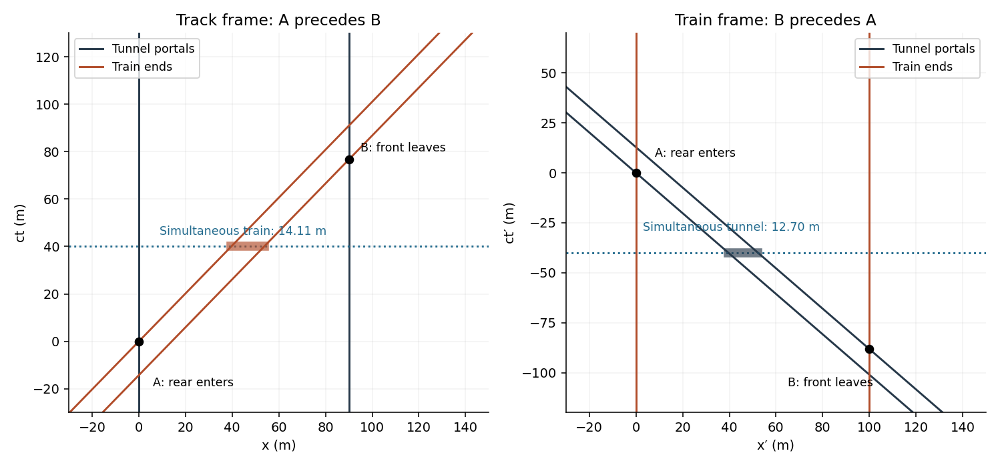

<h1 id="6/solution">Solution</h1>

↑ **Parent:** [6](../6.md)

For $\beta=0.99$, the [Lorentz factor](../../../lorentz-factor.md) is $\gamma=1/\sqrt{1-\beta^2}=7.0888$. In the tracks' rest frame the train undergoes [length contraction](../../../length-contraction.md) to $100/\gamma=14.1067\,\mathrm m$, which fits in the $90\,\mathrm m$ tunnel. There is a time interval during which it is entirely inside. In the train's rest frame the tunnel instead has length $90/\gamma=12.6961\,\mathrm m$, so it never simultaneously contains the whole $100\,\mathrm m$ train:

$$
\boxed{\text{Entirely inside at one track-frame time: yes. At one train-frame time: no.}}
$$

These refer to different sets of simultaneous events, as required by [relativity of simultaneity](../../../relativity-of-simultaneity.md). Quantitatively let $A$ be the rear entering the near portal, with $(x_A,t_A)=(0,0)$, and $B$ the front reaching the far portal. In the track frame,

$$
x_B=90\,\mathrm m,\qquad ct_B=\frac{90-100/\gamma}{\beta}=76.6599\,\mathrm m.
$$

The train is wholly inside between these events. Transforming their time separation gives

$$
c(t'_B-t'_A)=\gamma(ct_B-\beta x_B)=-88.1858\,\mathrm m<0.
$$

Thus the front leaves before the rear enters in the train frame. The two events are [spacelike separated](../../../spacelike-separation.md), so their time order may reverse without a causal contradiction. No doors or forced acceleration need be added to the problem.

**[Figure 1](#6/image-portal-and-train-worldlines-in-the-two-inertial-frames). Portal and train worldlines in the two inertial frames**. Original [spacetime diagrams](../../../spacetime-diagram.md), with vertical coordinates ct and ct-prime in metres. Events A and B exchange time order; the horizontal shaded time slice shows the different simultaneous configurations.

## ↑ Ancestors (11)

1. [6](../6.md)
2. [2014](../../2014-split.md)
3. [Past exam of the physics 1 paper of the University of Oxford](../../split.md)
4. [Physics 1 paper of the University of Oxford](../../../physics-1-paper-of-the-university-of-oxford.md)
5. [Year 1 of the physics course of the University of Oxford](../../../year-1-of-the-physics-course-of-the-university-of-oxford.md)
6. [Physics course of the University of Oxford](../../../physics-course-of-the-university-of-oxford.md)
7. [Undergraduate course of the University of Oxford](../../../undergraduate-course-of-the-university-of-oxford.md)
8. [Course of the University of Oxford](../../../course-of-the-university-of-oxford.md)
9. [University of Oxford](../../../university-of-oxford-split.md)
10. [List of universities](../../../list-of-universities.md)
11. [Codex Wiki](../../../split.md)
