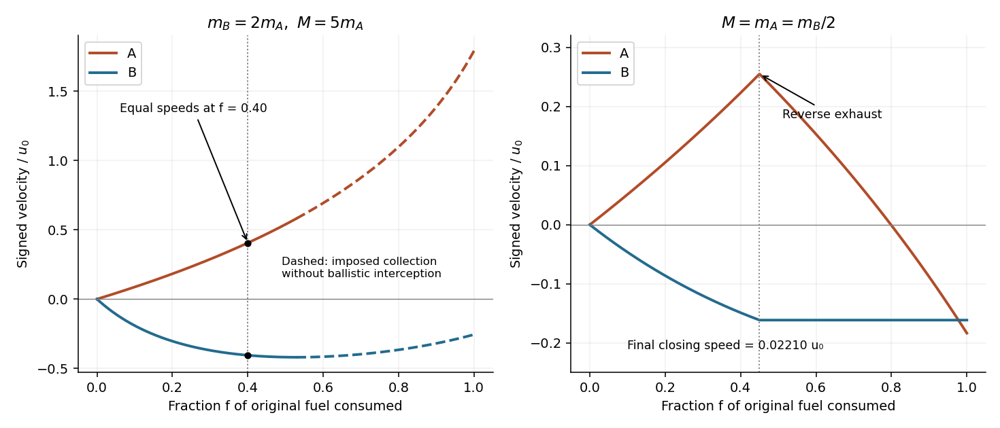

<h1 id="8/d/solution">Solution</h1>

↑ **Parent:** [D](../d.md)

Put $m_A=M=m$ and $m_B=2m$. At reversal the transferred [mass](../../../../mass.md) is $q_r=0.45m$, leaving A with $1.55m$ and, after capture of that exhaust, B with $2.45m$. The first burn gives

$$
v_{Ar}=u_0\ln\frac2{1.55}=u_0\ln\frac{40}{31},\qquad
v_{Br}=-\frac{1.55}{2.45}v_{Ar}=-\frac{31}{49}u_0\ln\frac{40}{31}.
$$

After reversal A emits its remaining exhaust away from B, so B receives no further fuel and eventually coasts at this [velocity](../../../../velocity.md). Applying the [rocket equation](../../../../rocket-equation.md) with reversed thrust to A gives

$$
v_{Af}=v_{Ar}-u_0\ln1.55=u_0\ln\frac{800}{961}\simeq-0.18336u_0,\qquad v_{Bf}\simeq-0.16126u_0.
$$

Both now move toward negative x, but A moves faster in that direction. The asymptotic closing [speed](../../../../speed.md) is

$$
\boxed{v_{Bf}-v_{Af}\simeq0.0221u_0>0:\quad\text{A can catch B.}}
$$

This conclusion does not require a burn rate or an initial separation: after a finite burn, the positive eventual closing [speed](../../../../speed.md) closes any finite remaining gap. Those additional inputs would be required to calculate the meeting time. Any pre-reversal exhaust still in transit affects the timing, not B's eventual [momentum](../../../../momentum-split.md) after collecting that fixed amount.

**[Figure 2](#8/d/image-signed-velocities-during-exhaust-collection-and-thrust-reversal). Signed velocities during exhaust collection and thrust reversal**. Original Newtonian calculations versus the fraction of original fuel consumed. Left: the equal-speed event in the ideal negligible-flight-time collection model; the later dashed extension is conditional on collection and can violate ballistic interception. Right: reversing thrust at 45 percent produces a small positive eventual closing speed.

## ↑ Ancestors (12)

1. [D](../d.md)
2. [8](../../8.md)
3. [2014](../../../2014-split.md)
4. [Past exam of the physics 1 paper of the University of Oxford](../../../split.md)
5. [Physics 1 paper of the University of Oxford](../../../../physics-1-paper-of-the-university-of-oxford.md)
6. [Year 1 of the physics course of the University of Oxford](../../../../year-1-of-the-physics-course-of-the-university-of-oxford.md)
7. [Physics course of the University of Oxford](../../../../physics-course-of-the-university-of-oxford.md)
8. [Undergraduate course of the University of Oxford](../../../../undergraduate-course-of-the-university-of-oxford.md)
9. [Course of the University of Oxford](../../../../course-of-the-university-of-oxford.md)
10. [University of Oxford](../../../../university-of-oxford-split.md)
11. [List of universities](../../../../list-of-universities.md)
12. [Codex Wiki](../../../../split.md)
