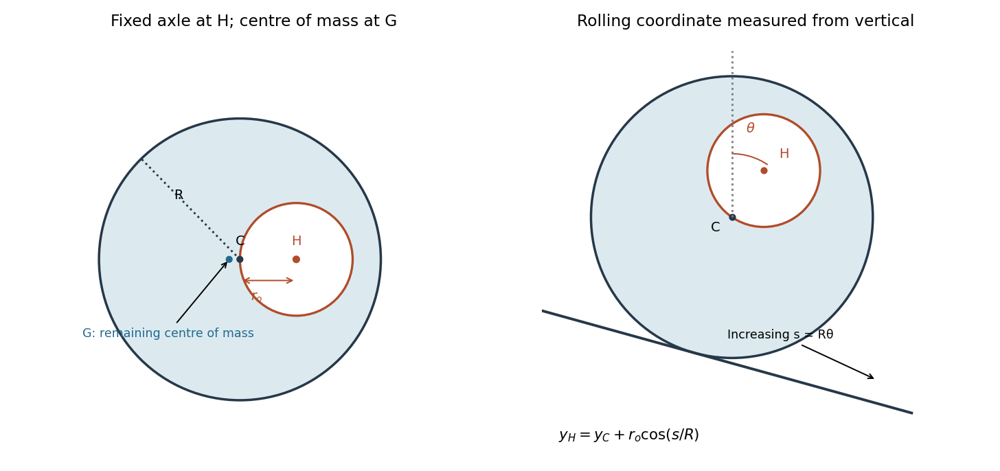

<h1 id="9/c/solution">Solution</h1>

↑ **Parent:** [C](../c.md)

The supplied PDF labels this equation _clarified from original for tutorial purposes_. Use the model of an [eccentric wheel with missing-mass kinetic energy neglected](../../../../eccentric-wheel-with-missing-mass-kinetic-energy-neglected.md): neglect the missing disc's contribution to [kinetic energy](../../../../kinetic-energy.md), while retaining its subtraction from gravitational [potential energy](../../../../potential-energy.md). Do not silently replace the gravitational [mass](../../../../mass.md) $W$ by the full-disc [mass](../../../../mass.md) $D$ as well.

Choose $\theta$ as the clockwise [angle](../../../../angle.md) of $\overrightarrow{CH}$ from the upward vertical, and set $s=R\theta$. The [rolling without slipping](../../../../rolling-without-slipping.md) constraint makes changes in $s$ equal changes in the distance C travels down the slope. Choose its additive origin so $s=0$ when the hole is vertically above C. Then, up to an irrelevant height constant,

$$
y_C=-s\sin\alpha+\mathrm{constant},\qquad y_H=y_C+r_o\cos(s/R).
$$

The approximate [kinetic energy](../../../../kinetic-energy.md) is that of the complete uniform disc rolling at $\dot s=R\dot\theta$:

$$
T\simeq\frac12D\dot s^2+\frac12\left(\frac12DR^2\right)\frac{\dot s^2}{R^2}=\frac34D\dot s^2.
$$

Subtracting the missing disc's gravitational [potential energy](../../../../potential-energy.md) gives

$$
U=Dgy_C-hgy_H=-Wgs\sin\alpha-hgr_o\cos(s/R)+\mathrm{constant}.
$$

Apply the [Euler-Lagrange equation](../../../../euler-lagrange-equation.md) to $\mathcal L=T-U$:

$$
\frac32D\ddot s+\frac{hgr_o}{R}\sin(s/R)-Wg\sin\alpha=0.
$$

Therefore

$$
\boxed{K_1=\frac{2hgr_o}{3DR}=\frac{2gr_o^3}{3R^3},\qquad K_2=-\frac{2Wg\sin\alpha}{3D}=-\frac{2g}{3}\left(1-\frac{r_o^2}{R^2}\right)\sin\alpha,\qquad\gamma=\frac1R.}
$$

Here $K_1,K_2$ have dimensions of [acceleration](../../../../acceleration.md) and $\gamma$ has dimensions of inverse [length](../../../../length.md). The initial conditions are $s(0)=\dot s(0)=0$ under the vertical-above interpretation. If an initial orientation is instead specified relative to the slope normal, the same coordinate convention produces a different initial $s$, not different constants. With $r_o\to0$ the equation becomes $\ddot s=(2/3)g\sin\alpha$, the familiar solid-disc result. Retaining the hole's exact [kinetic energy](../../../../kinetic-energy.md) would introduce coordinate-dependent inertia and extra $\dot s^2$ terms; the printed neglect is what permits the requested constant-coefficient form.

**[Figure 3](#9/c/image-the-axle-geometric-centre-and-centre-of-mass-of-the-perforated-wheel). The axle, geometric centre and centre of mass of the perforated wheel**. Original geometric constructions. Left: fixed-axis inertia subtracts a missing disc about H. Right: the rolling coordinate is the hole angle from the upward vertical; the centre travels downhill by R times the angle, while the missing mass contributes a cosine to potential energy.

## ↑ Ancestors (12)

1. [C](../c.md)
2. [9](../../9.md)
3. [2014](../../../2014-split.md)
4. [Past exam of the physics 1 paper of the University of Oxford](../../../split.md)
5. [Physics 1 paper of the University of Oxford](../../../../physics-1-paper-of-the-university-of-oxford.md)
6. [Year 1 of the physics course of the University of Oxford](../../../../year-1-of-the-physics-course-of-the-university-of-oxford.md)
7. [Physics course of the University of Oxford](../../../../physics-course-of-the-university-of-oxford.md)
8. [Undergraduate course of the University of Oxford](../../../../undergraduate-course-of-the-university-of-oxford.md)
9. [Course of the University of Oxford](../../../../course-of-the-university-of-oxford.md)
10. [University of Oxford](../../../../university-of-oxford-split.md)
11. [List of universities](../../../../list-of-universities.md)
12. [Codex Wiki](../../../../split.md)
