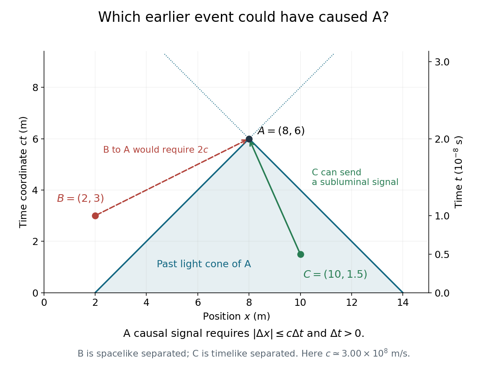
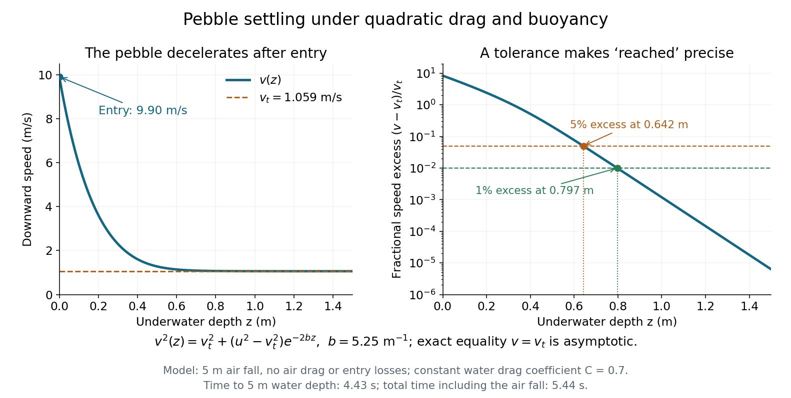
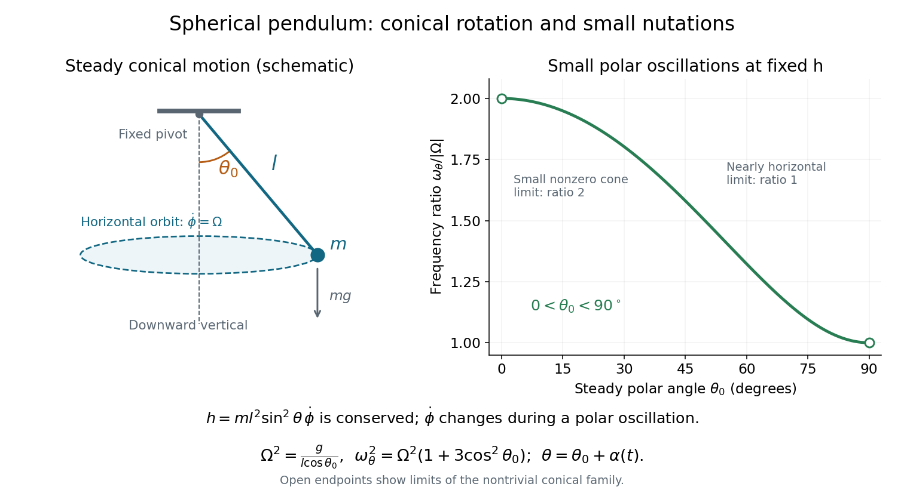

# 2015 resit

↑ **Parent:** [Past exam of the physics 1 paper of the University of Oxford](../past-exam-of-the-physics-1-paper-of-the-university-of-oxford.md)

Source paper: [https://www.whatdotheyknow.com/request/physics_preliminary_examinations/response/1162943/attach/3/Twain.7z?cookie_passthrough=1](https://www.whatdotheyknow.com/request/physics_preliminary_examinations/response/1162943/attach/3/Twain.7z?cookie_passthrough=1)

Other held scans reproduce this examination. The cleaner copy with native text is used here. The sitting was on 7 September 2015. The paper asks for all of Section A, Questions 1–7, and three of Section B, Questions 8–11; solutions to all eleven questions follow. Lettered headings below reproduce the source's actual subparts. In particular, the last two requests in Question 10 are unlettered continuations, not parts (e) and (f).

**Table of contents**

- [1](#1)
  - [Solution](#1/solution)
- [2](#2)
  - [Solution](#2/solution)
- [3](#3)
  - [Solution](#3/solution)
- [4](#4)
  - [Solution](#4/solution)
- [5](#5)
  - [Solution](#5/solution)
- [6](#6)
  - [Solution](#6/solution)
- [7](#7)
  - [Solution](#7/solution)
- [8](#8)
  - [Solution](#8/solution)
  - [a](#8/a)
    - [Solution](#8/a/solution)
  - [b](#8/b)
    - [Solution](#8/b/solution)
- [9](#9)
  - [Solution](#9/solution)
- [10](#10)
  - [a](#10/a)
    - [Solution](#10/a/solution)
  - [b](#10/b)
    - [Solution](#10/b/solution)
  - [c](#10/c)
    - [Solution](#10/c/solution)
  - [d](#10/d)
    - [Solution](#10/d/solution)
  - [Unlettered continuation](#10/unlettered-continuation)
    - [Solution](#10/unlettered-continuation/solution)
- [11](#11)
  - [Solution](#11/solution)

## 1

↑ **Parent:** [2015 resit](2015-resit.md)

<h3 id="1/solution">Solution</h3>

↑ **Parent:** [1](#1)

For a [sphere](../euclidean-geometry.md#sphere) with uniform [mass density](../fluid-mechanics.md#density), $M=(4\pi/3)\rho a^3$. Its [moment of inertia of a uniform solid sphere](../rigid-body-dynamics.md#moment-of-inertia-of-a-uniform-solid-sphere) is $I=2Ma^2/5$, and rotation about a diameter gives [angular momentum](../momentum.md#angular-momentum) magnitude $L=I\omega$. The spheres have the same [angular frequency](../lagrangian-mechanics.md#angular-frequency) $\omega$, so

$$
\frac{M_A}{M_B}=\frac{\rho_A}{\rho_B}\left(\frac{a_A}{a_B}\right)^3=\frac14\,2^3=2,
\qquad
\boxed{\frac{L_A}{L_B}=\frac{I_A}{I_B}=\frac{M_A}{M_B}\left(\frac{a_A}{a_B}\right)^2=8.}
$$

The [mass](../classical-mechanics.md#mass) grows by a factor of two, and the extra squared lever arm supplies a further factor of four. Equal [angular frequencies](../lagrangian-mechanics.md#angular-frequency) alone do not mean equal [angular momenta](../momentum.md#angular-momentum).

## 2

↑ **Parent:** [2015 resit](2015-resit.md)

<h3 id="2/solution">Solution</h3>

↑ **Parent:** [2](#2)

The disc carries [mass](../classical-mechanics.md#mass) $M_d=2M/3$ and the thin rim carries $M_r=M/3$. About the wheel's central normal axis, add the [moment of inertia of a uniform disc](../rigid-body-dynamics.md#moment-of-inertia-of-a-uniform-disc) and the thin rim's [moment of inertia](../rigid-body-dynamics.md#moment-of-inertia):

$$
\boxed{I_z=\frac12M_dR^2+M_rR^2=\frac12\frac{2M}{3}R^2+\frac M3R^2=\frac23MR^2.}
$$

Treat the wheel as a thin [planar lamina](../classical-mechanics.md#planar-lamina), as implied by the disc-and-thin-rim model. Interpret the requested perpendicular axis as perpendicular to the wheel's original axis and tangent to the rim: if the wheel lies in the $xy$ [plane](../geometry-and-topology.md#plane), choose the tangent line $x=R,z=0$, parallel to the $y$ diameter. By [rotational symmetry](../linear-algebra.md#rotational-symmetry), the two diametral [moments of inertia](../rigid-body-dynamics.md#moment-of-inertia) are equal. The [perpendicular axis theorem](../rigid-body-dynamics.md#perpendicular-axis-theorem) therefore gives

$$
I_x=I_y=\frac{I_z}{2}=\frac13MR^2.
$$

The [parallel axis theorem](../rigid-body-dynamics.md#parallel-axis-theorem) then gives the [tangent-axis inertia of an axisymmetric lamina](../rigid-body-dynamics.md#tangent-axis-inertia-of-an-axisymmetric-lamina):

$$
\boxed{I_{\mathrm{tangent,in\ plane}}=I_y+MR^2=\frac43MR^2.}
$$

The axis direction matters. If “perpendicular” were intended to mean perpendicular to the wheel's plane, an axis through a rim point would instead be parallel to the original wheel axis, giving $I_{\mathrm{rim,normal}}=I_z+MR^2=5MR^2/3$. The $4MR^2/3$ answer uses a tangent axis perpendicular to the original axis; the $5MR^2/3$ value belongs to the different, explicitly identified normal axis. Finite wheel thickness would require additional information for the in-plane [moment of inertia](../rigid-body-dynamics.md#moment-of-inertia).

## 3

↑ **Parent:** [2015 resit](2015-resit.md)

<h3 id="3/solution">Solution</h3>

↑ **Parent:** [3](#3)

Let $\mathbf r$ be the orbiting [point mass](../classical-mechanics.md#point-mass)'s [position](../classical-mechanics.md#position) relative to the attracting body, and let its [velocity](../classical-mechanics.md#velocity) be $\mathbf v=\dot{\mathbf r}$. Its [angular momentum](../momentum.md#angular-momentum) is

$$
\mathbf L=m\mathbf r\times\dot{\mathbf r}.
$$

[Conservation of angular momentum](../momentum.md#conservation-of-angular-momentum) keeps both the magnitude and direction of $\mathbf L$ fixed. Since $\mathbf L$ is perpendicular to $\mathbf r$, a nonradial orbit lies in a fixed [plane](../geometry-and-topology.md#plane). During a short interval $dt$, the radius vector sweeps a thin [triangle](../euclidean-geometry.md#triangle) of [area](../differential-geometry.md#surface-area)

$$
dA=\frac12|\mathbf r\times d\mathbf r|=\frac12|\mathbf r\times\dot{\mathbf r}|\,dt.
$$

Thus the [areal velocity](../momentum.md#areal-velocity) is constant:

$$
\boxed{\frac{dA}{dt}=\frac{L}{2m},\qquad \Delta A=\frac{L}{2m}\,\Delta t.}
$$

Equal [time](../classical-mechanics.md#time-in-physics) intervals give equal swept [areas](../differential-geometry.md#surface-area): this is [Kepler's second law](../mathematical-physics.md#kepler-s-second-law). In [plane polar coordinates](../classical-mechanics.md#plane-polar-coordinates), the same statement is $L=mr^2\dot\phi$ and $\dot A=r^2\dot\phi/2$. The attracting body is at the relevant focus of the [ellipse](../euclidean-geometry.md#ellipse), not its geometric centre. The area argument needs conserved [angular momentum](../momentum.md#angular-momentum), not specifically an [ellipse](../euclidean-geometry.md#ellipse); a [central force](../mathematical-physics.md#central-force) provides this conservation because its [torque](../momentum.md#torque) $\mathbf r\times\mathbf F$ vanishes.

## 4

↑ **Parent:** [2015 resit](2015-resit.md)

<h3 id="4/solution">Solution</h3>

↑ **Parent:** [4](#4)

Choose the $M$ ball's initial [velocity](../classical-mechanics.md#velocity) as $+v$; the $3M$ ball then has [velocity](../classical-mechanics.md#velocity) $-v$. Both have [Lorentz factor](../special-relativity.md#lorentz-factor) $\gamma=(1-v^2/c^2)^{-1/2}$. Their total [relativistic energy](../special-relativity.md#relativistic-energy) and signed [relativistic momentum](../momentum.md#relativistic-momentum) are

$$
E_i=4\gamma Mc^2,\qquad p_i=\gamma Mv-3\gamma Mv=-2\gamma Mv.
$$

The laboratory frame is not the [centre-of-momentum frame](../special-relativity.md#center-of-momentum-frame), despite the equal and opposite [speeds](../classical-mechanics.md#speed). [Four-momentum conservation](../special-relativity.md#four-momentum-conservation) and the [relativistic energy-momentum relation](../special-relativity.md#energy-momentum-relation) give the [invariant mass](../special-relativity.md#invariant-mass) $M_f$ of the combined incoming system:

$$
M_f^2c^4=E_i^2-c^2p_i^2
=\gamma^2M^2c^4(16-4\beta^2),\qquad \beta=\frac vc.
$$

The [relativistic collision mass threshold](../special-relativity.md#relativistic-collision-mass-threshold) for a final object of [rest mass](../special-relativity.md#invariant-mass) $5M$ is $M_f\geq5M$. At the threshold,

$$
\frac{16-4\beta^2}{1-\beta^2}=25
\quad\Longrightarrow\quad 21\beta^2=9,
\qquad
\boxed{v_{\min}=c\sqrt{\frac37}\simeq0.65465\,c.}
$$

At equality, the outgoing object has laboratory [velocity](../classical-mechanics.md#velocity) $V=c^2p_i/E_i=-v/2$, directed towards the initially heavier ball's motion. Its nonzero final [kinetic energy](../energy.md#kinetic-energy) is why setting $4\gamma Mc^2=5Mc^2$ would give the wrong threshold.

For the literal [rest mass of a coalescing relativistic collision](../special-relativity.md#rest-mass-of-a-coalescing-relativistic-collision), if there is exactly one outgoing object of exactly fixed [rest mass](../special-relativity.md#invariant-mass) $5M$ and no radiation or other products, [four-momentum conservation](../special-relativity.md#four-momentum-conservation) selects the equality above, rather than allowing every larger $v$. Speeds above this threshold require a larger final [invariant mass](../special-relativity.md#invariant-mass) or additional outgoing [energy](../energy.md) carriers.

## 5

↑ **Parent:** [2015 resit](2015-resit.md)

<h3 id="5/solution">Solution</h3>

↑ **Parent:** [5](#5)

Take the initial internal [pressure](../pressure.md) as negligible and the external [atmospheric pressure](../pressure.md#atmospheric-pressure) as $p_0=1.01325\times10^5\,\mathrm{Pa}$. The window has frontal [area](../differential-geometry.md#surface-area) $A=\pi(0.400\,\mathrm m)^2=0.50265\,\mathrm{m^2}$. Before appreciable air has entered, its inward pressure [force](../force.md) is approximately $p_0A=5.09\times10^4\,\mathrm N$. [Newton's second law](../force.md#newton-s-second-law) therefore gives the initial collective inward [acceleration](../classical-mechanics.md#acceleration)

$$
\boxed{a_0\simeq\frac{p_0A}{M}=4.63\times10^2\,\mathrm{m\,s^{-2}}\simeq47\,g.}
$$

Here $M=110\,\mathrm{kg}$ and $g\simeq9.81\,\mathrm{m\,s^{-2}}$. Neglect gravity in this much larger pressure-driven [acceleration](../classical-mechanics.md#acceleration), together with supports and elastic stresses once the glass has broken. The given thickness $d=0.080\,\mathrm m$ implies a plausible average glass [mass density](../fluid-mechanics.md#density) $M/(Ad)\simeq2.74\times10^3\,\mathrm{kg\,m^{-3}}$. Equivalently, a fragment retaining the original thickness has [acceleration](../classical-mechanics.md#acceleration) $p_0/(\rho_gd)$, independent of its frontal [area](../differential-geometry.md#surface-area) while it experiences the full pressure difference.

For a [vacuum-window implosion energy estimate](../energy.md#vacuum-window-implosion-energy-estimate), the ideal pressure-work scale for filling vessel [volume](../geometry-and-topology.md#volume) $V=1.5\,\mathrm{m^3}$ is $W\simeq p_0V$. Assigning all that [pressure-volume work](../energy.md#pressure-volume-work) to the glass's [kinetic energy](../energy.md#kinetic-energy) gives

$$
\frac12Mv_{\mathrm{est}}^2\simeq p_0V,
\qquad
\boxed{v_{\mathrm{est}}\simeq\sqrt{\frac{2p_0V}{M}}\simeq5.26\times10^1\,\mathrm{m\,s^{-1}}.}
$$

The same result follows from retaining [acceleration](../classical-mechanics.md#acceleration) $a_0$ over an effective swept distance $V/A\simeq2.98\,\mathrm m$, so that $v_{\mathrm{est}}^2=2a_0V/A$. This is an ideal upper energy-budget estimate for the common [speed](../classical-mechanics.md#speed), or [mass](../classical-mechanics.md#mass)-weighted [root mean square](../analysis.md#root-mean-square) [speed](../classical-mechanics.md#speed), of all the glass. It assumes an atmospheric reservoir maintains the driving pressure and that the whole vessel's pressure-work budget can accelerate the glass. In practice, air motion, fragmentation, heating and collisions share that [energy](../energy.md), the pressure difference falls, and fragments may hit the vessel after a much shorter path. The unspecified vessel shape and fragment trajectories prevent a unique actual maximum [speed](../classical-mechanics.md#speed); concentrating [energy](../energy.md) into one small fragment also prevents interpreting this collective estimate as a strict bound on every individual fragment.

## 6

↑ **Parent:** [2015 resit](2015-resit.md)

<h3 id="6/solution">Solution</h3>

↑ **Parent:** [6](#6)

There is no external horizontal [force](../force.md), so [momentum conservation](../momentum.md#momentum-conservation) keeps the student–punt [centre of mass](../classical-mechanics.md#center-of-mass) fixed if the system starts at rest. Let the student's walking direction be positive. If the punt's [displacement](../classical-mechanics.md#displacement) relative to the water is $X$, the student advances $X+L$, where $L=3\,\mathrm m$ is measured relative to the punt. Constancy of the [centre of mass](../classical-mechanics.md#center-of-mass) gives

$$
M_pX+m_s(X+L)=0,
\qquad
\boxed{X=-\frac{m_sL}{M_p+m_s}=-\frac{80\times3}{150+80}\,\mathrm m\simeq-1.04\,\mathrm m.}
$$

The punt moves $1.04\,\mathrm m$ opposite to the student's walking direction; the student's net [displacement](../classical-mechanics.md#displacement) relative to the water is $3+X\simeq1.96\,\mathrm m$. These displacements are relative to the initial state, not distances travelled relative to the punt.

Under the same ideal assumptions, merely changing the walking speed or walking back more slowly cannot produce unlimited travel. Returning the student to the original place on the punt restores the original internal [mass](../classical-mechanics.md#mass) distribution and hence the punt's original [position](../classical-mechanics.md#position). A finite punt bounds the displacement available through internal rearrangement. Propulsion over large distances requires an external horizontal [impulse](../classical-mechanics.md#impulse), for example a push against the bed or [momentum](../momentum.md) transferred to the water. Such an interaction changes the isolated, frictionless model rather than evading [centre of mass](../classical-mechanics.md#center-of-mass) conservation.

## 7

↑ **Parent:** [2015 resit](2015-resit.md)

<h3 id="7/solution">Solution</h3>

↑ **Parent:** [7](#7)

Plot [position](../classical-mechanics.md#position) $x$ horizontally and $ct$ vertically, with equal length scales, so vacuum light rays have slopes $\pm1$. A possible cause of the [spacetime event](../special-relativity.md#event-relativity) $A$ must lie on or inside its [past light cone](../special-relativity.md#past-light-cone), with $\Delta t=t_A-t_{\mathrm{cause}}>0$. Equivalently, [causality](../special-relativity.md#causality) requires $|\Delta x|\leq c\Delta t$.

From $B$ to $A$, $\Delta x=6\,\mathrm m$ and $\Delta t=10^{-8}\,\mathrm s$. Using $c\simeq3.00\times10^8\,\mathrm{m\,s^{-1}}$, the available light-travel distance is only $c\Delta t=3.00\,\mathrm m$. In the $(-,+,+,+)$ [metric signature](../topological-manifold.md#metric-signature), the [Minkowski interval](../special-relativity.md#minkowski-interval) is

$$
s_{BA}^2=(\Delta x)^2-c^2(\Delta t)^2\simeq36-9=27\,\mathrm{m^2}>0.
$$

There is [spacelike separation](../special-relativity.md#spacelike-separation), so a signal would need [speed](../classical-mechanics.md#speed) $6\times10^8\,\mathrm{m\,s^{-1}}\simeq2c$:

$$
\boxed{B\text{ cannot cause }A.}
$$

From $C$ to $A$, $\Delta x=-2\,\mathrm m$ and $\Delta t=1.5\times10^{-8}\,\mathrm s$. Now $c\Delta t=4.50\,\mathrm m>|\Delta x|$, giving

$$
s_{CA}^2\simeq4-20.25=-16.25\,\mathrm{m^2}<0.
$$

This is [timelike separation](../special-relativity.md#timelike-separation), with a possible signal [velocity](../classical-mechanics.md#velocity) $-2/(1.5\times10^{-8})\simeq-1.33\times10^8\,\mathrm{m\,s^{-1}}$. Therefore

$$
\boxed{C\text{ could cause }A,\text{ though the coordinates alone do not prove that it did.}}
$$

**[Figure 1](#7/image-the-past-light-cone-of-event-a-contains-c-but-excludes-b). The past light cone of event A contains C but excludes B**. Original [spacetime diagram](../mathematical-physics.md#spacetime-diagram) using $ct$ in metres and $c\simeq3.00\times10^8\,\mathrm{m\,s^{-1}}$. The dashed B-to-A segment would require a superluminal signal; the C-to-A segment has a physically allowed subluminal slope.

## 8

↑ **Parent:** [2015 resit](2015-resit.md)

<h3 id="8/solution">Solution</h3>

↑ **Parent:** [8](#8)

**Descent equation.** Take downward [velocity](../classical-mechanics.md#velocity) $v$ and underwater depth $z$ as positive, with $z=0$ at the lake surface. For a [sphere](../euclidean-geometry.md#sphere) of radius $r$, the pebble [mass](../classical-mechanics.md#mass) is $m=4\pi r^3\rho_p/3$ and the frontal [area](../differential-geometry.md#surface-area) is $A=\pi r^2$. [Newton's second law](../force.md#newton-s-second-law) includes downward [gravitational weight](../force.md#weight-physics), upward [buoyancy](../fluid-mechanics.md#buoyancy) and upward [quadratic drag](../fluid-mechanics.md#quadratic-drag):

$$
m\dot v=mg-\rho_w\frac{4\pi r^3}{3}g-\frac12C\rho_w\pi r^2v^2
\qquad(v\geq0).
$$

Thus

$$
\boxed{\dot v=g\left(1-\frac{\rho_w}{\rho_p}\right)-bv^2,\qquad \dot z=v,\qquad b=\frac{3C\rho_w}{8\rho_pr}.}
$$

Here $b$ has units of inverse [length](../physics.md#length). For arbitrary signed [velocity](../classical-mechanics.md#velocity), the last term is $-bv|v|$, so [drag](../fluid-mechanics.md#drag-physics) always opposes motion. The displayed downward form suffices for this trajectory.

**Limiting speed.** At [terminal velocity](../classical-mechanics.md#terminal-velocity), the net [force](../force.md) and $\dot v$ vanish. For $\rho_p>\rho_w$,

$$
\boxed{v_t=\sqrt{\frac{8rg(\rho_p-\rho_w)}{3C\rho_w}}.}
$$

Use $\rho_p=2500\,\mathrm{kg\,m^{-3}}$, $\rho_w=1000\,\mathrm{kg\,m^{-3}}$, $r=0.020\,\mathrm m$, $C=0.7$ and $g=9.81\,\mathrm{m\,s^{-2}}$. Then

$$
b=5.25\,\mathrm{m^{-1}},\qquad g_{\mathrm{eff}}=g(1-\rho_w/\rho_p)=5.886\,\mathrm{m\,s^{-2}},
\qquad\boxed{v_t\simeq1.059\,\mathrm{m\,s^{-1}}.}
$$

The $\rho_p-\rho_w$ factor is essential: omitting [buoyancy](../fluid-mechanics.md#buoyancy) would overestimate the limiting [speed](../classical-mechanics.md#speed).

For the numerical descent, assume the pebble is released from rest, neglect air [drag](../fluid-mechanics.md#drag-physics), take $g$ and the water [mass density](../fluid-mechanics.md#density) as constant, and apply the given constant [drag coefficient](../fluid-mechanics.md#drag-coefficient) once it is submerged. Neglect the finite entry interval, entry energy losses and [added mass](../mathematical-physics.md#added-mass), so its initial underwater [speed](../classical-mechanics.md#speed) is

$$
u=\sqrt{2gH_a}=\sqrt{2g\times5\,\mathrm m}\simeq9.905\,\mathrm{m\,s^{-1}}>v_t.
$$

It consequently slows down towards [terminal velocity](../classical-mechanics.md#terminal-velocity); a rest-starting underwater trajectory would describe a different initial condition.

<h3 id="8/a">a</h3>

↑ **Parent:** [8](#8)

<h4 id="8/a/solution">Solution</h4>

↑ **Parent:** [A](#8/a)

For [superterminal descent under quadratic drag](../fluid-mechanics.md#superterminal-descent-under-quadratic-drag), use $\dot v=v\,dv/dz$ in $\dot v=b(v_t^2-v^2)$. Equivalently,

$$
\frac{d(v^2)}{dz}=-2b(v^2-v_t^2),
\qquad
\boxed{v^2(z)=v_t^2+(u^2-v_t^2)e^{-2bz}.}
$$

The [speed](../classical-mechanics.md#speed) approaches $v_t$ asymptotically from above. **There is no finite exact distance at which it first equals the limiting speed.** A practical estimate must specify an accuracy. Define “reached” as $v\leq(1+\epsilon)v_t$. Then

$$
\boxed{z_\epsilon=\frac1{2b}\ln\!\left[\frac{u^2/v_t^2-1}{(1+\epsilon)^2-1}\right].}
$$

For one-percent accuracy, $\epsilon=0.01$ gives

$$
\boxed{z_{1\%}\simeq0.797\,\mathrm m\approx0.8\,\mathrm m.}
$$

A five-percent criterion gives $z_{5\%}\simeq0.642\,\mathrm m$. The characteristic decay [length](../physics.md#length) of the excess squared [speed](../classical-mechanics.md#speed) is $1/(2b)\simeq0.0952\,\mathrm m$, but several such lengths are needed because the entry [speed](../classical-mechanics.md#speed) is so far above the limiting value. These estimates depend on the stated water-entry idealization; the source gives no finite tolerance or entry-loss model.

**[Figure 2](#8/a/image-the-pebble-slows-from-above-terminal-speed-practical-settling-distances-depend-on-tolerance). The pebble slows from above terminal speed; practical settling distances depend on tolerance**. Original plots of the constant-[quadratic drag](../fluid-mechanics.md#quadratic-drag) model, including [buoyancy](../fluid-mechanics.md#buoyancy), for the given pebble. The right panel uses a logarithmic scale for the fractional excess above [terminal velocity](../classical-mechanics.md#terminal-velocity); reaching exactly zero excess requires infinite depth in this model.

<h3 id="8/b">b</h3>

↑ **Parent:** [8](#8)

<h4 id="8/b/solution">Solution</h4>

↑ **Parent:** [B](#8/b)

The air fall lasts

$$
t_a=\sqrt{\frac{2H_a}{g}}\simeq1.0096\,\mathrm s.
$$

Retain the underwater deceleration rather than replacing the whole water trajectory with motion at [terminal velocity](../classical-mechanics.md#terminal-velocity). Define

$$
\chi=\operatorname{arctanh}\frac{v_t}{u}>0,\qquad \nu=bv_t.
$$

Separation of the descent equation gives the [hyperbolic cotangent](../calculus.md#hyperbolic-cotangent) solution and its integrated depth:

$$
v(t)=v_t\coth(\chi+\nu t),\qquad
z(t)=\frac1b\ln\frac{\sinh(\chi+\nu t)}{\sinh\chi},
$$

where $t=0$ now means water entry. The derivative of the logarithm verifies $\dot z=v$, while $v(0)=v_t\coth\chi=u$. At water depth $H_w=5\,\mathrm m$, inversion using the [inverse hyperbolic sine](../calculus.md#inverse-hyperbolic-sine) yields

$$
\boxed{t_w=\frac{\operatorname{arsinh}(e^{bH_w}\sinh\chi)-\chi}{bv_t}\simeq4.4264\,\mathrm s.}
$$

The total elapsed [time](../classical-mechanics.md#time-in-physics) is therefore

$$
\boxed{t_{\mathrm{total}}=t_a+t_w\simeq5.44\,\mathrm s.}
$$

For an estimate without evaluating the exact expression, $bH_w\gg1$ permits $\operatorname{arsinh}x\simeq\ln(2x)$ here, giving

$$
t_w\simeq\frac{H_w}{v_t}+\frac{\ln(2\sinh\chi)-\chi}{bv_t}.
$$

This gives the same $4.43\,\mathrm s$ to the quoted precision. The simpler $H_w/v_t\simeq4.72\,\mathrm s$ overestimates the underwater [time](../classical-mechanics.md#time-in-physics) because the pebble initially moves faster than $v_t$.

## 9

↑ **Parent:** [2015 resit](2015-resit.md)

<h3 id="9/solution">Solution</h3>

↑ **Parent:** [9](#9)

**Orbital energy.** Treat the star as stationary to leading order in $m/M$, with Newtonian [gravitational parameter](../newton-s-law-of-universal-gravitation.md#standard-gravitational-parameter) $\mu=GM$. For [velocity](../classical-mechanics.md#velocity) components in [plane polar coordinates](../classical-mechanics.md#plane-polar-coordinates), $v^2=\dot r^2+r^2\dot\phi^2$. The [kinetic energy](../energy.md#kinetic-energy) is $mv^2/2$. Integrating [Newton's law of universal gravitation](../newton-s-law-of-universal-gravitation.md) with zero [gravitational potential energy](../energy.md#gravitational-energy) at infinite separation gives $U(r)=-GMm/r$. Thus

$$
\boxed{E=\frac12m\dot r^2+\frac12mr^2\dot\phi^2-\frac{GMm}{r}
=\frac12m\dot r^2+\frac{J^2}{2mr^2}-\frac{GMm}{r},}
$$

where $J=mr^2\dot\phi$ is the satellite's [angular momentum](../momentum.md#angular-momentum). The first term is radial [kinetic energy](../energy.md#kinetic-energy); the second is transverse [kinetic energy](../energy.md#kinetic-energy), also the centrifugal contribution to the radial [effective potential](../mathematical-physics.md#effective-potential); the last is the attractive [gravitational potential energy](../energy.md#gravitational-energy). These are not three independent sources of energy: the centrifugal term is already part of the ordinary [kinetic energy](../energy.md#kinetic-energy).

For an [elliptic Kepler orbit](../celestial-mechanics.md#elliptic-orbit) of [semi-major axis](../celestial-mechanics.md#semi-major-axis) $a$ and [orbital eccentricity](../celestial-mechanics.md#orbital-eccentricity) $e$, the [polar equation of a Kepler orbit](../celestial-mechanics.md#polar-equation-of-a-kepler-orbit) $r=p/(1+e\cos\phi)$ has [semilatus rectum](../euclidean-geometry.md#semilatus-rectum) $p=J^2/(GMm^2)=a(1-e^2)$. Substituting $\dot r=(Je/(mp))\sin\phi$ into the preceding expression reduces it to

$$
E=\frac{GMm}{2p}(e^2-1),
\qquad
\boxed{E=-\frac{GMm}{2a}.}
$$

For a [circular Kepler orbit](../celestial-mechanics.md#circular-kepler-orbit), $a=R$, $v_0^2=GM/R$, $K=GMm/(2R)$, and $U=-GMm/R$. Negative total [energy](../energy.md) describes a [bound orbit](../dynamical-systems.md#bound-orbit).

**Rapid, symmetric mass loss.** Assume the mass is removed on a timescale short compared with the satellite's [orbital period](../celestial-mechanics.md#orbital-period), without an impulsive kick or appreciable wind [drag](../fluid-mechanics.md#drag-physics) on the satellite. The post-loss gravitational parameter is $\mu'=G(1-f)M$ with $f=0.01$. At the change, $r=R$, $\dot r=0$, and $v=v_0=\sqrt{GM/R}$ are unchanged. Spherical symmetry keeps the [force](../force.md) central, so the [specific angular momentum](../celestial-mechanics.md#specific-angular-momentum) $j=J/m=\sqrt{GMR}$ is conserved. [Orbital energy](../celestial-mechanics.md#orbital-energy) is not conserved across the changing gravitational field:

$$
\varepsilon'=\frac{E'}m=\frac12\frac{GM}{R}-\frac{G(1-f)M}{R}
=-\frac{GM}{2R}(1-2f).
$$

The new [semi-major axis](../celestial-mechanics.md#semi-major-axis) is consequently

$$
a'=-\frac{\mu'}{2\varepsilon'}=\frac{1-f}{1-2f}R.
$$

The original [speed](../classical-mechanics.md#speed) now exceeds the new circular [speed](../classical-mechanics.md#speed) at $R$, and the outward radial [acceleration](../classical-mechanics.md#acceleration) is $v_0^2/R-\mu'/R^2=fGM/R^2>0$. Thus the release point is the new [pericentre](../celestial-mechanics.md#periapsis), not the [apocentre](../celestial-mechanics.md#apoapsis). The [impulsive orbital expansion under isotropic mass loss](../planetary-science.md#impulsive-orbital-expansion-under-isotropic-mass-loss) gives

$$
r_{\min}=R,\qquad r_{\max}=2a'-R=\frac{R}{1-2f},\qquad e'=\frac{f}{1-f}.
$$

For the stated one-percent loss,

$$
\boxed{r_{\min}=R,\qquad r_{\max}=\frac{50}{49}R\simeq1.02041R,\qquad e'=\frac1{99}.}
$$

An independent [angular momentum](../momentum.md#angular-momentum) check is $j^2=\mu'a'(1-e'^2)=GMR$. The impulsive orbit stays bound for $f<1/2$; loss of half the central mass is the zero-[orbital energy](../celestial-mechanics.md#orbital-energy) limit.

**What the wind timescale changes.** The source specifies a spherically symmetric wind but does not give its duration. The preceding nearest and furthest distances require the rapid-loss assumption. In the opposite, slow limit, [adiabatic orbital expansion under isotropic mass loss](../planetary-science.md#adiabatic-orbital-expansion-under-isotropic-mass-loss) preserves an initially circular orbit to leading adiabatic order. Conserved [specific angular momentum](../celestial-mechanics.md#specific-angular-momentum) then gives $j^2=G M(t)r(t)$, hence $M(t)r(t)=MR$. After the same loss,

$$
\boxed{r_{\min}\simeq r_{\max}\simeq\frac{R}{1-f}=\frac{100}{99}R\simeq1.01010R\quad\text{(adiabatic limit)}.}
$$

For a finite intermediate timescale, the orbit depends on the mass-loss history; the percentage alone does not select a unique pair of turning distances. Neglecting wind recoil and wind [drag](../fluid-mechanics.md#drag-physics) is common to both idealizations.

## 10

↑ **Parent:** [2015 resit](2015-resit.md)

<h3 id="10/a">a</h3>

↑ **Parent:** [10](#10)

<h4 id="10/a/solution">Solution</h4>

↑ **Parent:** [A](#10/a)

Use [spherical coordinates](../multivariable-calculus.md#spherical-coordinate-system) about the fixed pivot, with fixed rod [length](../physics.md#length) $l$, [polar angle](../multivariable-calculus.md#polar-angle) $\theta$ measured from the downward vertical, and [azimuth](../astrophysics.md#azimuth) $\phi$. The bob's [position](../classical-mechanics.md#position) is

$$
\mathbf r=l(\sin\theta\cos\phi,\ \sin\theta\sin\phi,\ -\cos\theta)
$$

when the Cartesian $z$ axis points upward. Differentiation gives [kinetic energy](../energy.md#kinetic-energy) $T=ml^2(\dot\theta^2+\sin^2\theta\dot\phi^2)/2$. Taking zero [gravitational potential energy](../energy.md#gravitational-energy) at pivot height gives $V=-mgl\cos\theta$. The [spherical pendulum](../simple-pendulum.md#spherical-pendulum)'s [Lagrangian](../calculus-of-variations.md#lagrangian) is therefore

$$
\boxed{\mathcal L=T-V=\frac12ml^2(\dot\theta^2+\sin^2\theta\dot\phi^2)+mgl\cos\theta.}
$$

The rod is light, rigid and of fixed [length](../physics.md#length); pivot [friction](../newtonian-mechanics.md#friction) and air [drag](../fluid-mechanics.md#drag-physics) are neglected. A rigid rod, unlike a string, may sustain either tensile or compressive constraint [force](../force.md).

<h3 id="10/b">b</h3>

↑ **Parent:** [10](#10)

<h4 id="10/b/solution">Solution</h4>

↑ **Parent:** [B](#10/b)

The [azimuth](../astrophysics.md#azimuth) $\phi$ is a [cyclic coordinate](../lagrangian-mechanics.md#cyclic-coordinate), since $\partial\mathcal L/\partial\phi=0$. Its [Euler-Lagrange equation](../analysis.md#euler-lagrange-equation) gives conservation of the vertical component of [angular momentum](../momentum.md#angular-momentum):

$$
\boxed{h=p_\phi=\frac{\partial\mathcal L}{\partial\dot\phi}=ml^2\sin^2\theta\,\dot\phi=\text{constant}.}
$$

This $h$ is the actual [angular momentum](../momentum.md#angular-momentum), not [specific angular momentum](../celestial-mechanics.md#specific-angular-momentum). The Lagrangian also has no explicit [time](../classical-mechanics.md#time-in-physics) dependence. The conserved [energy](../energy.md) is

$$
\boxed{E=\dot\theta\frac{\partial\mathcal L}{\partial\dot\theta}+\dot\phi\frac{\partial\mathcal L}{\partial\dot\phi}-\mathcal L
=\frac12ml^2(\dot\theta^2+\sin^2\theta\dot\phi^2)-mgl\cos\theta.}
$$

Along solutions, $\dot E=-\partial\mathcal L/\partial t=0$. These are the conserved quantities associated with rotational [symmetry](../physics.md#symmetry-physics) about the vertical and [time-translation symmetry](../calculus-of-variations.md#time-translation-symmetry), respectively.

<h3 id="10/c">c</h3>

↑ **Parent:** [10](#10)

<h4 id="10/c/solution">Solution</h4>

↑ **Parent:** [C](#10/c)

The $\theta$ [Euler-Lagrange equation](../analysis.md#euler-lagrange-equation) reads

$$
\frac d{dt}(ml^2\dot\theta)-\left(ml^2\sin\theta\cos\theta\dot\phi^2-mgl\sin\theta\right)=0.
$$

Hence

$$
\boxed{\ddot\theta=\sin\theta\cos\theta\dot\phi^2-\frac gl\sin\theta.}
$$

The first term reflects the coupling to azimuthal motion; the second is the gravitational restoring contribution for an [angle](../geometry-and-topology.md#angle) measured from the downward vertical.

<h3 id="10/d">d</h3>

↑ **Parent:** [10](#10)

<h4 id="10/d/solution">Solution</h4>

↑ **Parent:** [D](#10/d)

**Constant azimuth.** If $\phi$ is constant, $\dot\phi=0$ and the motion is a planar [simple pendulum](../simple-pendulum.md):

$$
\boxed{\ddot\theta+\frac gl\sin\theta=0.}
$$

For the [small-angle approximation](../geometry-and-topology.md#small-angle-approximation), $\sin\theta\simeq\theta$, giving [simple harmonic motion](../classical-mechanics.md#simple-harmonic-motion) with

$$
\boxed{\omega_{\mathrm{plane}}=\sqrt{\frac gl},\qquad T_{\mathrm{plane}}=2\pi\sqrt{\frac lg}.}
$$

The harmonic [angular frequency](../lagrangian-mechanics.md#angular-frequency) requires small [amplitude](../wave.md#wave-amplitude). At finite libration amplitude $\theta_{\max}<\pi$, the exact [oscillation period](../classical-mechanics.md#period-of-an-oscillation) is $4\sqrt{l/g}\,K(\sin(\theta_{\max}/2))$, where $K$ is the [complete elliptic integral of the first kind](../complex-analysis.md#complete-elliptic-integral-of-the-first-kind); the nonlinear pendulum does not have the same amplitude-independent period.

**Constant polar angle.** If $\theta=\theta_0$ is nonzero and constant, the bob traces a horizontal [circle](../topology.md#circle): this is a [conical pendulum](../simple-pendulum.md#conical-pendulum). Setting $\ddot\theta=0$ and dividing by $\sin\theta_0$ gives

$$
\Omega^2\cos\theta_0=\frac gl,\qquad
\boxed{\dot\phi=\Omega=\pm\sqrt{\frac{g}{l\cos\theta_0}},\qquad 0<\theta_0<\frac\pi2.}
$$

The sign distinguishes the two senses of rotation. The exactly downward configuration $\theta_0=0$ is stationary; its azimuth is undefined and it must not be obtained by dividing by $\sin\theta_0$. A nontrivial constant-angle orbit of this gravity-only system needs $\cos\theta_0>0$ even though the supporting rod can also push.

<h3 id="10/unlettered-continuation">Unlettered continuation</h3>

↑ **Parent:** [10](#10)

<h4 id="10/unlettered-continuation/solution">Solution</h4>

↑ **Parent:** [Unlettered continuation](#10/unlettered-continuation)

**Fixed-angular-momentum form.** Eliminating $\dot\phi$ using the conserved [angular momentum](../momentum.md#angular-momentum) $h$ gives

$$
\boxed{\ddot\theta=\frac{h^2}{m^2l^4}\frac{\cos\theta}{\sin^3\theta}-\frac gl\sin\theta.}
$$

Equivalently, the polar motion has [effective potential](../mathematical-physics.md#effective-potential)

$$
V_{\mathrm{eff}}(\theta)=\frac{h^2}{2ml^2\sin^2\theta}-mgl\cos\theta,
\qquad ml^2\ddot\theta=-V_{\mathrm{eff}}'(\theta).
$$

For the steady [conical pendulum](../simple-pendulum.md#conical-pendulum) at $\theta_0$, $\ddot\theta=0$, so

$$
\boxed{h^2=m^2gl^3\frac{\sin^4\theta_0}{\cos\theta_0},\qquad
h=\pm m\sqrt{gl^3}\frac{\sin^2\theta_0}{\sqrt{\cos\theta_0}}.}
$$

The sign of $h$ agrees with the sign of $\Omega$; substituting $h=ml^2\sin^2\theta_0\Omega$ verifies the constant-angle result in part (d).

**Period of small polar oscillations.** Put $\theta=\theta_0+\alpha(t)$, with $|\alpha|\ll1$ and $h$ held fixed. This is the appropriate [small nutation about a conical pendulum](../simple-pendulum.md#small-nutation-about-a-conical-pendulum); keeping $\dot\phi$ fixed instead would violate the [angular momentum](../momentum.md#angular-momentum) constraint during the oscillation. If

$$
f(\theta)=\frac{h^2}{m^2l^4}\frac{\cos\theta}{\sin^3\theta}-\frac gl\sin\theta,
$$

then $f(\theta_0)=0$ and

$$
f'(\theta_0)=-\frac{h^2}{m^2l^4}\left(\frac1{\sin^2\theta_0}+\frac{3\cos^2\theta_0}{\sin^4\theta_0}\right)-\frac gl\cos\theta_0
=-\frac gl\frac{1+3\cos^2\theta_0}{\cos\theta_0}.
$$

The [linearization](../algebra.md#linearization) is $\ddot\alpha+\omega_\theta^2\alpha=0$, giving

$$
\boxed{\omega_\theta^2=\frac gl\frac{1+3\cos^2\theta_0}{\cos\theta_0}
=\Omega^2(1+3\cos^2\theta_0),\qquad
T_\theta=2\pi\sqrt{\frac{l\cos\theta_0}{g(1+3\cos^2\theta_0)}}.}
$$

Since $0<\theta_0<\pi/2$, the coefficient is positive and these small polar oscillations are stable. To first order, $\dot\phi=\Omega(1-2\alpha\cot\theta_0)$, making the compensating change in azimuthal [angular velocity](../rigid-body-dynamics.md#angular-velocity) explicit. The limit $\omega_\theta/|\Omega|\to2$ as $\theta_0\to0$ concerns radial modulation of a small nonzero circular orbit; the exactly planar $h=0$ pendulum is a different, degenerate limit of these polar coordinates.

**[Figure 3](#10/unlettered-continuation/image-conical-motion-and-the-frequency-of-small-polar-oscillations-at-fixed-vertical-angular-momentum). Conical motion and the frequency of small polar oscillations at fixed vertical angular momentum**. Original schematic of the [spherical pendulum](../simple-pendulum.md#spherical-pendulum) and a plot of $\omega_\theta/|\Omega|=\sqrt{1+3\cos^2\theta_0}$ on the nontrivial conical-orbit interval. Open endpoints denote limits, not additional constant-angle solutions.

## 11

↑ **Parent:** [2015 resit](2015-resit.md)

<h3 id="11/solution">Solution</h3>

↑ **Parent:** [11](#11)

**Energy–momentum transformations and invariant.** Let the primed [inertial frame](../mathematical-physics.md#inertial-frame) move at signed [velocity](../classical-mechanics.md#velocity) $u$ along the unprimed $x$ axis. With $\Gamma=(1-u^2/c^2)^{-1/2}$, a [Lorentz transformation](../special-relativity.md#lorentz-transformation) of [four-momentum](../special-relativity.md#four-momentum) gives

$$
\boxed{E'=\Gamma(E-up_x),\qquad p_x'=\Gamma\left(p_x-\frac{uE}{c^2}\right),\qquad p_y'=p_y,\quad p_z'=p_z.}
$$

Use $p^2=p_x^2+p_y^2+p_z^2$. The longitudinal terms satisfy

$$
E'^2-c^2p_x'^2
=\Gamma^2\left[(E-up_x)^2-c^2\left(p_x-\frac{uE}{c^2}\right)^2\right]
=\Gamma^2(1-u^2/c^2)(E^2-c^2p_x^2)
=E^2-c^2p_x^2.
$$

The transverse [momenta](../momentum.md) are unchanged, so

$$
\boxed{E'^2-c^2p'^2=E^2-c^2p^2.}
$$

For one [electron](../physics.md#electron), the [relativistic energy-momentum relation](../special-relativity.md#energy-momentum-relation) identifies this [Lorentz invariant](../special-relativity.md#lorentz-invariance) as $E_0^2=m_e^2c^4$.

**Symmetric electron scattering.** Assume an isolated [elastic collision](../classical-mechanics.md#elastic-collision) of the two [electrons](../physics.md#electron), with no emitted radiation. The incident electron has total [energy](../energy.md) $E$ and [momentum](../momentum.md) magnitude $p$, so $p^2c^2=E^2-E_0^2$; the target electron initially contributes [rest energy](../special-relativity.md#rest-energy) $E_0$ and zero [momentum](../momentum.md). In the nondegenerate configuration with final track [angles](../geometry-and-topology.md#angle) $+\theta$ and $-\theta$, transverse [momentum conservation](../momentum.md#momentum-conservation) gives

$$
p_1\sin\theta=p_2\sin\theta\quad\Longrightarrow\quad p_1=p_2=p_f.
$$

Because both final particles have the same [rest mass](../special-relativity.md#invariant-mass), they also have equal total [energies](../energy.md). [Conservation of energy](../mathematical-physics.md#conservation-of-energy) gives

$$
E_f=\frac{E+E_0}{2},\qquad
p_f^2c^2=E_f^2-E_0^2=\frac{(E-E_0)(E+3E_0)}{4}.
$$

Longitudinal [momentum conservation](../momentum.md#momentum-conservation) is $p=2p_f\cos\theta$. Combining these expressions, with $E>E_0$, proves the [symmetric relativistic equal-mass scattering angle](../classical-mechanics.md#symmetric-relativistic-equal-mass-scattering-angle) relation:

$$
\cos^2\theta=\frac{E^2-E_0^2}{(E-E_0)(E+3E_0)}=\frac{E+E_0}{E+3E_0},
\qquad
\boxed{\theta=\arccos\sqrt{\frac{E+E_0}{E+3E_0}}
=\arctan\sqrt{\frac{2E_0}{E+E_0}}.}
$$

The low-[kinetic energy](../energy.md#kinetic-energy) limit has $\theta\to45^\circ$, recovering the familiar right angle between the outgoing tracks in nonrelativistic equal-[mass](../classical-mechanics.md#mass) scattering. Relativistic incident [energies](../energy.md) give $\theta<45^\circ$, approaching zero at very high [energy](../energy.md).

**Accelerating potential.** For $\theta=30^\circ$, $\tan^2\theta=1/3=2E_0/(E+E_0)$, so $E=5E_0$. The acceleration from rest supplies [kinetic energy](../energy.md#kinetic-energy), not total [energy](../energy.md). If $e>0$ is the [elementary charge](../electric-charge.md#elementary-charge), the required accelerating [electric potential difference](../electric-field.md#electric-potential-difference) has magnitude

$$
\boxed{|V|=\frac{E-E_0}{e}=\frac{4E_0}{e}\simeq2.044\times10^6\,\mathrm V=2.044\,\mathrm{MV},}
$$

using electron [rest energy](../special-relativity.md#rest-energy) $E_0\simeq0.511\,\mathrm{MeV}$. The [electric potential difference](../electric-field.md#electric-potential-difference) is oriented to accelerate the negative [electron](../physics.md#electron); the result above specifies its magnitude.

## ↑ Ancestors (9)

1. [Past exam of the physics 1 paper of the University of Oxford](../past-exam-of-the-physics-1-paper-of-the-university-of-oxford.md)
2. [Physics 1 paper of the University of Oxford](../university-of-oxford.md#physics-1-paper-of-the-university-of-oxford)
3. [Year 1 of the physics course of the University of Oxford](../university-of-oxford.md#year-1-of-the-physics-course-of-the-university-of-oxford)
4. [Physics course of the University of Oxford](../university-of-oxford.md#physics-course-of-the-university-of-oxford)
5. [Undergraduate course of the University of Oxford](../university-of-oxford.md#undergraduate-course-of-the-university-of-oxford)
6. [Course of the University of Oxford](../university-of-oxford.md#course-of-the-university-of-oxford)
7. [University of Oxford](../university-of-oxford.md)
8. [List of universities](../README.md#list-of-universities)
9. [Codex Wiki](../README.md)
