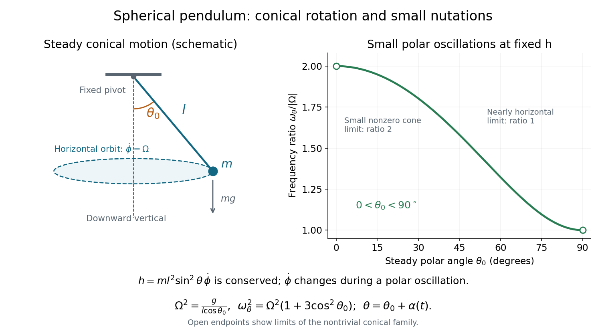

<h1 id="10/unlettered-continuation/solution">Solution</h1>

↑ **Parent:** [Unlettered continuation](../unlettered-continuation.md)

**Fixed-angular-momentum form.** Eliminating $\dot\phi$ using the conserved [angular momentum](../../../../angular-momentum.md) $h$ gives

$$
\boxed{\ddot\theta=\frac{h^2}{m^2l^4}\frac{\cos\theta}{\sin^3\theta}-\frac gl\sin\theta.}
$$

Equivalently, the polar motion has [effective potential](../../../../effective-potential.md)

$$
V_{\mathrm{eff}}(\theta)=\frac{h^2}{2ml^2\sin^2\theta}-mgl\cos\theta,
\qquad ml^2\ddot\theta=-V_{\mathrm{eff}}'(\theta).
$$

For the steady [conical pendulum](../../../../conical-pendulum.md) at $\theta_0$, $\ddot\theta=0$, so

$$
\boxed{h^2=m^2gl^3\frac{\sin^4\theta_0}{\cos\theta_0},\qquad
h=\pm m\sqrt{gl^3}\frac{\sin^2\theta_0}{\sqrt{\cos\theta_0}}.}
$$

The sign of $h$ agrees with the sign of $\Omega$; substituting $h=ml^2\sin^2\theta_0\Omega$ verifies the constant-angle result in part (d).

**Period of small polar oscillations.** Put $\theta=\theta_0+\alpha(t)$, with $|\alpha|\ll1$ and $h$ held fixed. This is the appropriate [small nutation about a conical pendulum](../../../../small-nutation-about-a-conical-pendulum.md); keeping $\dot\phi$ fixed instead would violate the [angular momentum](../../../../angular-momentum.md) constraint during the oscillation. If

$$
f(\theta)=\frac{h^2}{m^2l^4}\frac{\cos\theta}{\sin^3\theta}-\frac gl\sin\theta,
$$

then $f(\theta_0)=0$ and

$$
f'(\theta_0)=-\frac{h^2}{m^2l^4}\left(\frac1{\sin^2\theta_0}+\frac{3\cos^2\theta_0}{\sin^4\theta_0}\right)-\frac gl\cos\theta_0
=-\frac gl\frac{1+3\cos^2\theta_0}{\cos\theta_0}.
$$

The [linearization](../../../../linearization.md) is $\ddot\alpha+\omega_\theta^2\alpha=0$, giving

$$
\boxed{\omega_\theta^2=\frac gl\frac{1+3\cos^2\theta_0}{\cos\theta_0}
=\Omega^2(1+3\cos^2\theta_0),\qquad
T_\theta=2\pi\sqrt{\frac{l\cos\theta_0}{g(1+3\cos^2\theta_0)}}.}
$$

Since $0<\theta_0<\pi/2$, the coefficient is positive and these small polar oscillations are stable. To first order, $\dot\phi=\Omega(1-2\alpha\cot\theta_0)$, making the compensating change in azimuthal [angular velocity](../../../../angular-velocity.md) explicit. The limit $\omega_\theta/|\Omega|\to2$ as $\theta_0\to0$ concerns radial modulation of a small nonzero circular orbit; the exactly planar $h=0$ pendulum is a different, degenerate limit of these polar coordinates.

**[Figure 3](#10/unlettered-continuation/image-conical-motion-and-the-frequency-of-small-polar-oscillations-at-fixed-vertical-angular-momentum). Conical motion and the frequency of small polar oscillations at fixed vertical angular momentum**. Original schematic of the [spherical pendulum](../../../../spherical-pendulum.md) and a plot of $\omega_\theta/|\Omega|=\sqrt{1+3\cos^2\theta_0}$ on the nontrivial conical-orbit interval. Open endpoints denote limits, not additional constant-angle solutions.

## ↑ Ancestors (12)

1. [Unlettered continuation](../unlettered-continuation.md)
2. [10](../../10.md)
3. [2015 resit](../../../2015-resit-split.md)
4. [Past exam of the physics 1 paper of the University of Oxford](../../../split.md)
5. [Physics 1 paper of the University of Oxford](../../../../physics-1-paper-of-the-university-of-oxford.md)
6. [Year 1 of the physics course of the University of Oxford](../../../../year-1-of-the-physics-course-of-the-university-of-oxford.md)
7. [Physics course of the University of Oxford](../../../../physics-course-of-the-university-of-oxford.md)
8. [Undergraduate course of the University of Oxford](../../../../undergraduate-course-of-the-university-of-oxford.md)
9. [Course of the University of Oxford](../../../../course-of-the-university-of-oxford.md)
10. [University of Oxford](../../../../university-of-oxford-split.md)
11. [List of universities](../../../../list-of-universities.md)
12. [Codex Wiki](../../../../split.md)
