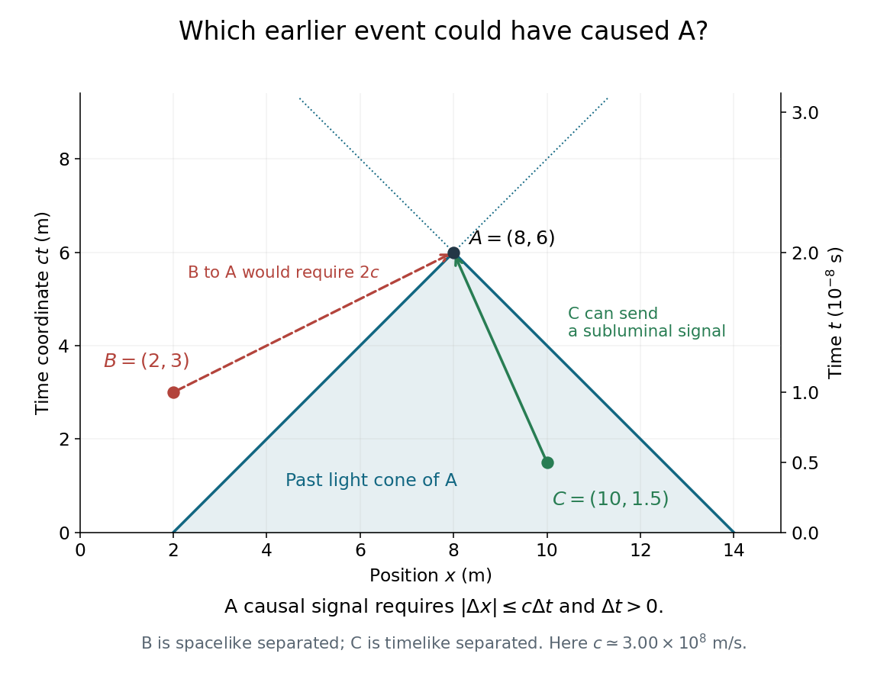

<h1 id="7/solution">Solution</h1>

↑ **Parent:** [7](../7.md)

Plot [position](../../../position.md) $x$ horizontally and $ct$ vertically, with equal length scales, so vacuum light rays have slopes $\pm1$. A possible cause of the [spacetime event](../../../event-relativity.md) $A$ must lie on or inside its [past light cone](../../../past-light-cone.md), with $\Delta t=t_A-t_{\mathrm{cause}}>0$. Equivalently, [causality](../../../causality.md) requires $|\Delta x|\leq c\Delta t$.

From $B$ to $A$, $\Delta x=6\,\mathrm m$ and $\Delta t=10^{-8}\,\mathrm s$. Using $c\simeq3.00\times10^8\,\mathrm{m\,s^{-1}}$, the available light-travel distance is only $c\Delta t=3.00\,\mathrm m$. In the $(-,+,+,+)$ [metric signature](../../../metric-signature.md), the [Minkowski interval](../../../minkowski-interval.md) is

$$
s_{BA}^2=(\Delta x)^2-c^2(\Delta t)^2\simeq36-9=27\,\mathrm{m^2}>0.
$$

There is [spacelike separation](../../../spacelike-separation.md), so a signal would need [speed](../../../speed.md) $6\times10^8\,\mathrm{m\,s^{-1}}\simeq2c$:

$$
\boxed{B\text{ cannot cause }A.}
$$

From $C$ to $A$, $\Delta x=-2\,\mathrm m$ and $\Delta t=1.5\times10^{-8}\,\mathrm s$. Now $c\Delta t=4.50\,\mathrm m>|\Delta x|$, giving

$$
s_{CA}^2\simeq4-20.25=-16.25\,\mathrm{m^2}<0.
$$

This is [timelike separation](../../../timelike-separation.md), with a possible signal [velocity](../../../velocity.md) $-2/(1.5\times10^{-8})\simeq-1.33\times10^8\,\mathrm{m\,s^{-1}}$. Therefore

$$
\boxed{C\text{ could cause }A,\text{ though the coordinates alone do not prove that it did.}}
$$

**[Figure 1](#7/image-the-past-light-cone-of-event-a-contains-c-but-excludes-b). The past light cone of event A contains C but excludes B**. Original [spacetime diagram](../../../spacetime-diagram.md) using $ct$ in metres and $c\simeq3.00\times10^8\,\mathrm{m\,s^{-1}}$. The dashed B-to-A segment would require a superluminal signal; the C-to-A segment has a physically allowed subluminal slope.

## ↑ Ancestors (11)

1. [7](../7.md)
2. [2015 resit](../../2015-resit-split.md)
3. [Past exam of the physics 1 paper of the University of Oxford](../../split.md)
4. [Physics 1 paper of the University of Oxford](../../../physics-1-paper-of-the-university-of-oxford.md)
5. [Year 1 of the physics course of the University of Oxford](../../../year-1-of-the-physics-course-of-the-university-of-oxford.md)
6. [Physics course of the University of Oxford](../../../physics-course-of-the-university-of-oxford.md)
7. [Undergraduate course of the University of Oxford](../../../undergraduate-course-of-the-university-of-oxford.md)
8. [Course of the University of Oxford](../../../course-of-the-university-of-oxford.md)
9. [University of Oxford](../../../university-of-oxford-split.md)
10. [List of universities](../../../list-of-universities.md)
11. [Codex Wiki](../../../split.md)
