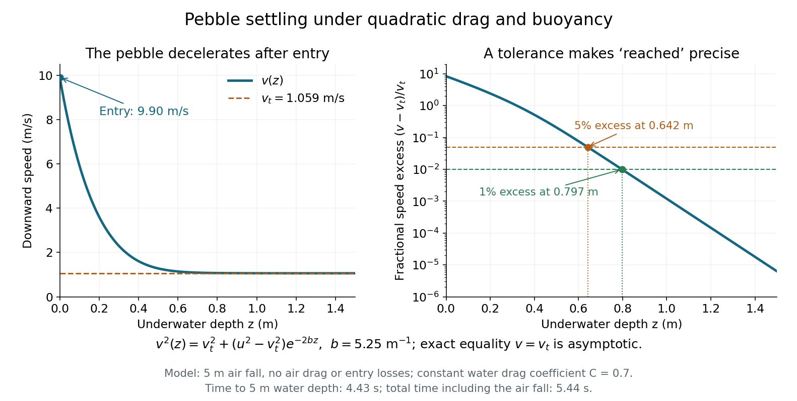

<h1 id="8/a/solution">Solution</h1>

↑ **Parent:** [A](../a.md)

For [superterminal descent under quadratic drag](../../../../superterminal-descent-under-quadratic-drag.md), use $\dot v=v\,dv/dz$ in $\dot v=b(v_t^2-v^2)$. Equivalently,

$$
\frac{d(v^2)}{dz}=-2b(v^2-v_t^2),
\qquad
\boxed{v^2(z)=v_t^2+(u^2-v_t^2)e^{-2bz}.}
$$

The [speed](../../../../speed.md) approaches $v_t$ asymptotically from above. **There is no finite exact distance at which it first equals the limiting speed.** A practical estimate must specify an accuracy. Define “reached” as $v\leq(1+\epsilon)v_t$. Then

$$
\boxed{z_\epsilon=\frac1{2b}\ln\!\left[\frac{u^2/v_t^2-1}{(1+\epsilon)^2-1}\right].}
$$

For one-percent accuracy, $\epsilon=0.01$ gives

$$
\boxed{z_{1\%}\simeq0.797\,\mathrm m\approx0.8\,\mathrm m.}
$$

A five-percent criterion gives $z_{5\%}\simeq0.642\,\mathrm m$. The characteristic decay [length](../../../../length.md) of the excess squared [speed](../../../../speed.md) is $1/(2b)\simeq0.0952\,\mathrm m$, but several such lengths are needed because the entry [speed](../../../../speed.md) is so far above the limiting value. These estimates depend on the stated water-entry idealization; the source gives no finite tolerance or entry-loss model.

**[Figure 2](#8/a/image-the-pebble-slows-from-above-terminal-speed-practical-settling-distances-depend-on-tolerance). The pebble slows from above terminal speed; practical settling distances depend on tolerance**. Original plots of the constant-[quadratic drag](../../../../quadratic-drag.md) model, including [buoyancy](../../../../buoyancy.md), for the given pebble. The right panel uses a logarithmic scale for the fractional excess above [terminal velocity](../../../../terminal-velocity.md); reaching exactly zero excess requires infinite depth in this model.

## ↑ Ancestors (12)

1. [A](../a.md)
2. [8](../../8.md)
3. [2015 resit](../../../2015-resit-split.md)
4. [Past exam of the physics 1 paper of the University of Oxford](../../../split.md)
5. [Physics 1 paper of the University of Oxford](../../../../physics-1-paper-of-the-university-of-oxford.md)
6. [Year 1 of the physics course of the University of Oxford](../../../../year-1-of-the-physics-course-of-the-university-of-oxford.md)
7. [Physics course of the University of Oxford](../../../../physics-course-of-the-university-of-oxford.md)
8. [Undergraduate course of the University of Oxford](../../../../undergraduate-course-of-the-university-of-oxford.md)
9. [Course of the University of Oxford](../../../../course-of-the-university-of-oxford.md)
10. [University of Oxford](../../../../university-of-oxford-split.md)
11. [List of universities](../../../../list-of-universities.md)
12. [Codex Wiki](../../../../split.md)
