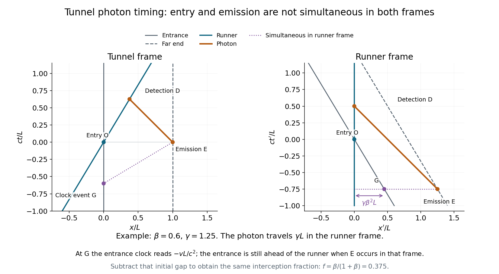

<h1 id="11/b/iv/solution">Solution</h1>

↑ **Parent:** [Iv](../iv.md)

During the photon's runner-frame flight, the tunnel entrance moves left by $v\Delta t'_\gamma=\gamma\beta L$. It began ahead of the runner by $\gamma\beta^2L$, so at detection it lies behind by

$$
d'_{\mathrm{in}}=\gamma\beta L-\gamma\beta^2L=\gamma\beta L(1-\beta).
$$

Divide this distance into the tunnel by the simultaneously measured tunnel length $L/\gamma$:

$$
\boxed{f'=\frac{d'_{\mathrm{in}}}{L/\gamma}=\gamma^2\beta(1-\beta)=\frac{\beta}{1+\beta}=f.}
$$

The runner is stationary in $S'$, but their location relative to the moving tunnel still has this fraction. Omitting the initial entrance gap would incorrectly count the runner's progress from an emission event at which they had not yet entered in this frame. These simultaneous positions give the [tunnel photon timing in two inertial frames](../../../../../tunnel-photon-timing-in-two-inertial-frames.md).

**[Figure 4](#11/b/iv/image-emission-entry-and-detection-in-the-tunnel-and-runner-frames). Emission, entry and detection in the tunnel and runner frames**. Original [spacetime diagrams](../../../../../spacetime-diagram.md) for $v=0.6c$, in units $L=c=1$. Event G is on the entrance clock and simultaneous with far-end emission in the runner frame. The runner-frame diagram shows the entrance initially ahead of the runner, and a photon travel distance $\gamma L$ rather than $L/\gamma$.

## ↑ Ancestors (13)

1. [Iv](../iv.md)
2. [B](../../b.md)
3. [11](../../../11.md)
4. [2015](../../../../2015-split.md)
5. [Past exam of the physics 1 paper of the University of Oxford](../../../../split.md)
6. [Physics 1 paper of the University of Oxford](../../../../../physics-1-paper-of-the-university-of-oxford.md)
7. [Year 1 of the physics course of the University of Oxford](../../../../../year-1-of-the-physics-course-of-the-university-of-oxford.md)
8. [Physics course of the University of Oxford](../../../../../physics-course-of-the-university-of-oxford.md)
9. [Undergraduate course of the University of Oxford](../../../../../undergraduate-course-of-the-university-of-oxford.md)
10. [Course of the University of Oxford](../../../../../course-of-the-university-of-oxford.md)
11. [University of Oxford](../../../../../university-of-oxford-split.md)
12. [List of universities](../../../../../list-of-universities.md)
13. [Codex Wiki](../../../../../split.md)
