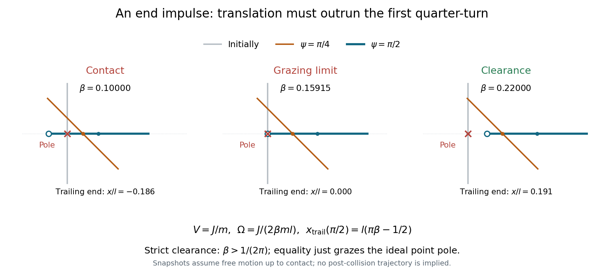

<h1 id="2/solution">Solution</h1>

↑ **Parent:** [2](../2.md)

Idealize the pole and stick as having negligible transverse thickness. Put the pole at the origin, the stick initially along the $y$ axis, and the struck lower end at $y=-l/2$, as in the source diagram. A short horizontal [impulse](../../../impulse.md) $J$ along $+x$ gives the [centre of mass](../../../center-of-mass.md) a constant [speed](../../../speed.md) $V=J/m$. The [angular impulse](../../../angular-impulse.md) about the centre is $Jl/2$, giving constant counterclockwise [angular velocity](../../../angular-velocity.md)

$$
\Omega=\frac{Jl}{2I}=\frac{J}{2\beta ml},\qquad I=\beta ml^2.
$$

The pole exerts no further [force](../../../force-split.md) while the stick moves clear of it. Let $\psi=\Omega t$. The trailing upper end has coordinates

$$
x_{\mathrm{end}}=Vt-\frac l2\sin\psi,\qquad y_{\mathrm{end}}=\frac l2\cos\psi.
$$

The pole can lie on the translating straight stick again only when the stick becomes horizontal: for other orientations, its intersection with $y=0$ is the moving midpoint $x=Vt>0$. At the first horizontal orientation, $\psi=\pi/2$, the trailing end is at

$$
x_{\mathrm{end}}=\frac{\pi V}{2\Omega}-\frac l2=\pi\beta l-\frac l2.
$$

Consequently the [grazing clearance of an impulsively struck rod](../../../grazing-clearance-of-an-impulsively-struck-rod.md) occurs at

$$
\boxed{\beta_{\mathrm{crit}}=\frac1{2\pi}\simeq0.15915.}
$$

For $\beta>1/(2\pi)$ the whole stick has passed the pole by its first horizontal orientation, and the continually advancing centre makes all later passes safe. Equality is the limiting grazing contact of the endpoint; strict avoidance requires the strict inequality. If $\beta<1/(2\pi)$, the pole lies within the stick at that first horizontal pass, so contact occurs before the freely moving trailing end can pass the pole. A uniform thin stick has $\beta=1/12$, below the threshold: sufficient [mass](../../../mass.md) near the ends is needed to increase its [moment of inertia](../../../moment-of-inertia.md) and reduce the rotation relative to translation.

**[Figure 1](#2/image-the-first-quarter-turn-determines-whether-an-impulsively-struck-stick-clears-the-pole). The first quarter-turn determines whether an impulsively struck stick clears the pole**. Original ideal thin-stick constructions below and above $\beta=1/(2\pi)$. The point pole is fixed at the origin; snapshots advance with the [centre of mass](../../../center-of-mass.md). A below-threshold free-motion snapshot illustrates the impending contact, not motion after a real collision.

## ↑ Ancestors (11)

1. [2](../2.md)
2. [2015](../../2015-split.md)
3. [Past exam of the physics 1 paper of the University of Oxford](../../split.md)
4. [Physics 1 paper of the University of Oxford](../../../physics-1-paper-of-the-university-of-oxford.md)
5. [Year 1 of the physics course of the University of Oxford](../../../year-1-of-the-physics-course-of-the-university-of-oxford.md)
6. [Physics course of the University of Oxford](../../../physics-course-of-the-university-of-oxford.md)
7. [Undergraduate course of the University of Oxford](../../../undergraduate-course-of-the-university-of-oxford.md)
8. [Course of the University of Oxford](../../../course-of-the-university-of-oxford.md)
9. [University of Oxford](../../../university-of-oxford-split.md)
10. [List of universities](../../../list-of-universities.md)
11. [Codex Wiki](../../../split.md)
