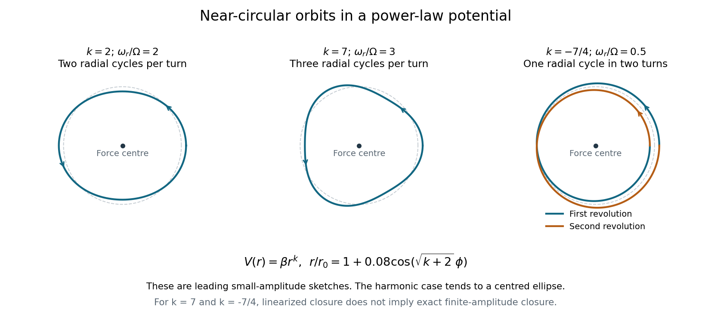

<h1 id="8/d/solution">Solution</h1>

↑ **Parent:** [D](../d.md)

The two positive powers below require $\beta>0$; the negative power requires $\beta<0$, so that the [force](../../../../force-split.md) is attractive. To leading order, $r\simeq r_0[1+\epsilon\cos(\sqrt{k+2}\,\phi+\delta)]$. The azimuthal advance from one radial maximum to the next is

$$
\Delta\phi=\frac{2\pi}{\sqrt{k+2}}.
$$

For $k=2$, $\omega_r/\Omega=2$: there are two radial oscillations per revolution. The [isotropic harmonic oscillator](../../../../isotropic-harmonic-oscillator.md) has orbits that are exact [ellipses](../../../../ellipse.md) centred on the force centre, and the perturbed circle is such an [ellipse](../../../../ellipse.md).

For $k=7$, $\omega_r/\Omega=3$: the leading perturbation has three radial lobes per revolution, with consecutive radial maxima separated by $2\pi/3$. Its small-amplitude sketch is a rounded three-lobed orbit.

For $k=-7/4$, $\omega_r/\Omega=1/2$: the radius completes one oscillation while the body makes two revolutions. The leading curve closes after $\Delta\phi=4\pi$, with a double-wound, generally self-crossing shape; the nearest and furthest points occur in the same spatial direction one revolution apart.

The rational ratios for $k=7$ and $k=-7/4$ describe closure of the linearized near-circular curves. They do not imply that every finite-amplitude orbit closes exactly: higher-order changes in the radial-to-orbital frequency ratio generally produce [apsidal precession](../../../../apsidal-precession.md). [Bertrand's theorem](../../../../bertrand-s-theorem.md) identifies the harmonic potential $k=2$ and the Kepler potential $k=-1$ as the exceptional attractive central potentials with all nearby bounded orbits closed.

**[Figure 2](#8/d/image-leading-near-circular-orbit-shapes-for-the-three-powers-in-question-8). Leading near-circular orbit shapes for the three powers in Question 8**. Original small-amplitude curves $r/r_0=1+0.08\cos(\sqrt{k+2}\,\phi)$. The $k=-7/4$ panel follows two revolutions. For $k=7$ and $k=-7/4$, exact closure of these linearized illustrations is not a claim of exact finite-amplitude closure.

## ↑ Ancestors (12)

1. [D](../d.md)
2. [8](../../8.md)
3. [2015](../../../2015-split.md)
4. [Past exam of the physics 1 paper of the University of Oxford](../../../split.md)
5. [Physics 1 paper of the University of Oxford](../../../../physics-1-paper-of-the-university-of-oxford.md)
6. [Year 1 of the physics course of the University of Oxford](../../../../year-1-of-the-physics-course-of-the-university-of-oxford.md)
7. [Physics course of the University of Oxford](../../../../physics-course-of-the-university-of-oxford.md)
8. [Undergraduate course of the University of Oxford](../../../../undergraduate-course-of-the-university-of-oxford.md)
9. [Course of the University of Oxford](../../../../course-of-the-university-of-oxford.md)
10. [University of Oxford](../../../../university-of-oxford-split.md)
11. [List of universities](../../../../list-of-universities.md)
12. [Codex Wiki](../../../../split.md)
