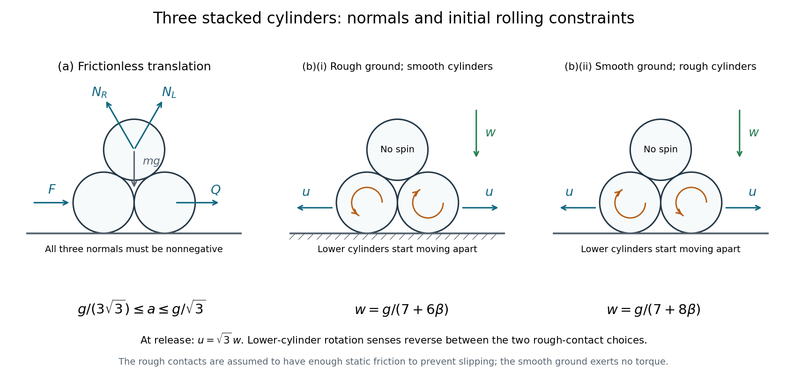

<h1 id="9/b/ii/solution">Solution</h1>

↑ **Parent:** [Ii](../ii.md)

**Smooth ground, rough cylinder contacts.** Write $f$ for the tangential contact [force](../../../../../force-split.md) magnitude at each upper-to-lower contact. On the top cylinder, its tangential components point upward and outward, while their horizontal components and [torques](../../../../../torque.md) cancel by symmetry. For a lower cylinder, the tangential [force](../../../../../force-split.md) has an inward horizontal component $\sqrt3f/2$ and a downward vertical component $f/2$.

The rolling condition is now at the contact between cylinders, not at the ground. At the initial zero [velocity](../../../../../velocity.md), equality of the tangential contact-point [accelerations](../../../../../acceleration.md) gives

$$
R|\alpha|=\frac{\sqrt3u+w}{2}=2w.
$$

Thus $fR=\beta mR^2|\alpha|$ gives $f=2\beta mw$. The lower cylinder's outward translation equation and the top cylinder's downward equation are

$$
mu=\frac N2-\frac{\sqrt3}2f,\qquad mw=mg-\sqrt3N-f.
$$

Using $u=\sqrt3w$ gives $N=2\sqrt3m(1+\beta)w$ and hence

$$
(7+8\beta)w=g,
\qquad
\boxed{a_{\mathrm{top,down}}=\frac{g}{7+8\beta}.}
$$

For solid cylinders this is $g/11$. Here the left lower cylinder rotates clockwise while moving left, and the right rotates counterclockwise while moving right. They may slip freely on the smooth ground, so imposing the ground-rolling relation $R|\alpha|=u$ would be incorrect. No slip at the cylinder contacts requires $\mu_c\geq f/N=\beta/[\sqrt3(1+\beta)]$ initially.

These are the two cases of the [initial acceleration of three stacked cylinders](../../../../../initial-acceleration-of-three-stacked-cylinders.md). As a check, as $\beta\to0$ the rotational contribution disappears in both formulas and they approach the smooth-contact release result $w=g/7$.

**[Figure 3](#9/b/ii/image-three-cylinder-contact-forces-and-the-two-distinct-rolling-constraints-on-release). Three-cylinder contact forces and the two distinct rolling constraints on release**. Original geometry and rotation diagrams. Contact normals in part (a) must remain nonnegative. In part (b), the lower cylinders start moving apart; rough-ground rolling and rough-cylinder rolling produce opposite lower-cylinder rotation senses.

## ↑ Ancestors (13)

1. [Ii](../ii.md)
2. [B](../../b.md)
3. [9](../../../9.md)
4. [2015](../../../../2015-split.md)
5. [Past exam of the physics 1 paper of the University of Oxford](../../../../split.md)
6. [Physics 1 paper of the University of Oxford](../../../../../physics-1-paper-of-the-university-of-oxford.md)
7. [Year 1 of the physics course of the University of Oxford](../../../../../year-1-of-the-physics-course-of-the-university-of-oxford.md)
8. [Physics course of the University of Oxford](../../../../../physics-course-of-the-university-of-oxford.md)
9. [Undergraduate course of the University of Oxford](../../../../../undergraduate-course-of-the-university-of-oxford.md)
10. [Course of the University of Oxford](../../../../../course-of-the-university-of-oxford.md)
11. [University of Oxford](../../../../../university-of-oxford-split.md)
12. [List of universities](../../../../../list-of-universities.md)
13. [Codex Wiki](../../../../../split.md)
