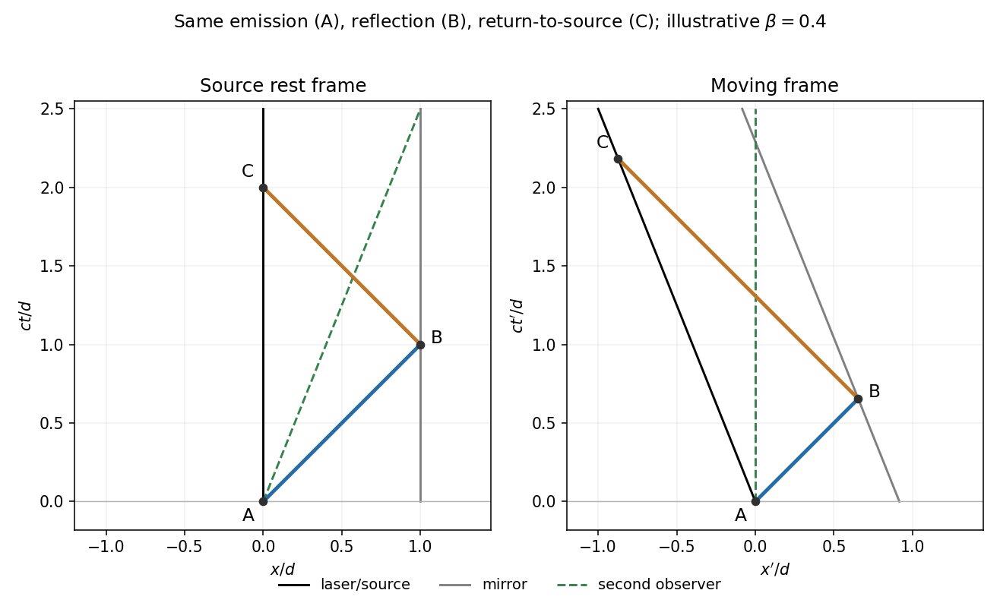

<h1 id="11/a/solution">Solution</h1>

↑ **Parent:** [A](../a.md)

Use emission, reflection and return-to-source events $A,B,C$. In the source-and-mirror rest frame their $(ct,x)$ coordinates are $A=(0,0)$, $B=(d,d)$ and $C=(2d,0)$. The laser and mirror have vertical [worldlines](../../../../world-line.md); the two light rays have slopes $\pm1$ on a diagram with equal spatial and $ct$ scales.

For a frame moving with [velocity](../../../../velocity.md) $+v$ along the outgoing beam, let $\beta=v/c$ and $\gamma=(1-\beta^2)^{-1/2}$. A [Lorentz transformation](../../../../lorentz-transformation.md) gives

$$
B'=(\gamma d(1-\beta),\gamma d(1-\beta)),\qquad C'=(2\gamma d,-2\gamma\beta d).
$$

Both laser and mirror now move towards negative $x'$, with worldlines $x'=-vt'$ and $x'=d/\gamma-vt'$. Light still has slopes $\pm1$. The moving observer's own worldline is $x'=0$; it should not be confused with the moving source worldline.

**[Figure 3](#11/a/image-emission-mirror-reflection-and-return-to-the-original-source-in-the-rest-frame-and-a-moving-lorentz-frame). Emission, mirror reflection and return to the original source in the rest frame and a moving Lorentz frame**.

## ↑ Ancestors (12)

1. [A](../a.md)
2. [11](../../11.md)
3. [2016 resit](../../../2016-resit-split.md)
4. [Past exam of the physics 1 paper of the University of Oxford](../../../split.md)
5. [Physics 1 paper of the University of Oxford](../../../../physics-1-paper-of-the-university-of-oxford.md)
6. [Year 1 of the physics course of the University of Oxford](../../../../year-1-of-the-physics-course-of-the-university-of-oxford.md)
7. [Physics course of the University of Oxford](../../../../physics-course-of-the-university-of-oxford.md)
8. [Undergraduate course of the University of Oxford](../../../../undergraduate-course-of-the-university-of-oxford.md)
9. [Course of the University of Oxford](../../../../course-of-the-university-of-oxford.md)
10. [University of Oxford](../../../../university-of-oxford-split.md)
11. [List of universities](../../../../list-of-universities.md)
12. [Codex Wiki](../../../../split.md)
