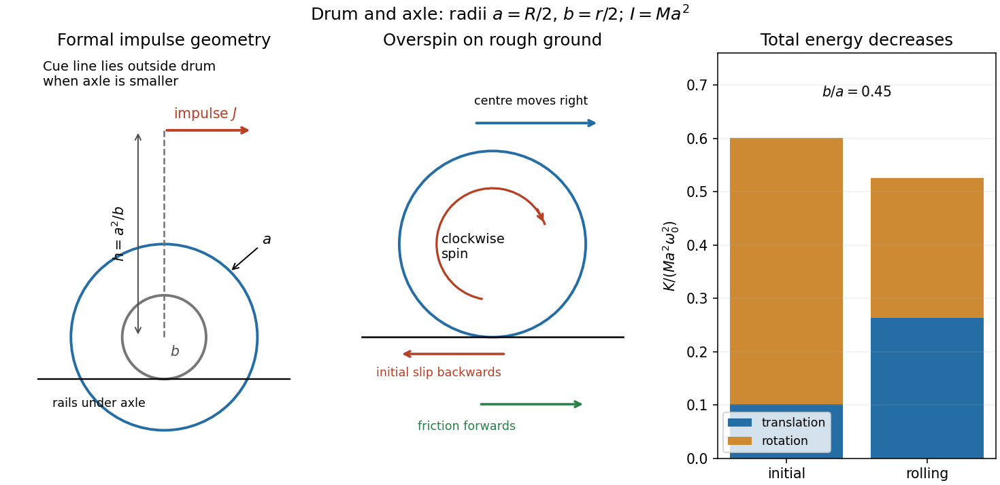

<h1 id="8/iii/solution">Solution</h1>

↑ **Parent:** [Iii](../iii.md)

For the [frictional conversion of spin to rolling](../../../../frictional-conversion-of-spin-to-rolling.md), consider the horizontal slipping stage on the rough surface, whose contact radius is now $a$, and neglect extra vertical impact or height-change energies at the transition. A friction impulse $J_f$ changes $Mv$ by $J_f$ and clockwise spin $I\omega$ by $-aJ_f$. Thus $I\omega+Mav$ is conserved. At the end $v_f=a\omega_f$, giving

$$
\boxed{v_f=\frac{v_0+a\omega_0}{2},\qquad \omega_f=\frac{\omega_0+v_0/a}{2}.}
$$

Because $I=Ma^2$, the final total [kinetic energy](../../../../kinetic-energy.md) is $K_f=Mv_f^2$. Subtraction yields

$$
\boxed{\Delta K=-\frac M4(v_0-a\omega_0)^2=-\frac{M(R-r)^2\omega_0^2}{16}.}
$$

The result is independent of the friction coefficient, provided sufficient contact time allows [rolling without slipping](../../../../rolling-without-slipping.md) to be regained. Initially $v_0=b\omega_0<a\omega_0$, so the contact point slips backwards. Friction acts forwards and can increase translational [kinetic energy](../../../../kinetic-energy.md), while decreasing rotational [kinetic energy](../../../../kinetic-energy.md) by more. A finite vertical drop or inelastic landing would require additional geometric information; the boxed expression describes the horizontal rolling-conversion loss.

**[Figure 1](#8/iii/image-axle-rolling-the-formal-impulse-height-and-friction-driven-conversion-to-rolling-on-the-outer-drum). Axle rolling, the formal impulse height and friction-driven conversion to rolling on the outer drum**.

## ↑ Ancestors (12)

1. [Iii](../iii.md)
2. [8](../../8.md)
3. [2016 resit](../../../2016-resit-split.md)
4. [Past exam of the physics 1 paper of the University of Oxford](../../../split.md)
5. [Physics 1 paper of the University of Oxford](../../../../physics-1-paper-of-the-university-of-oxford.md)
6. [Year 1 of the physics course of the University of Oxford](../../../../year-1-of-the-physics-course-of-the-university-of-oxford.md)
7. [Physics course of the University of Oxford](../../../../physics-course-of-the-university-of-oxford.md)
8. [Undergraduate course of the University of Oxford](../../../../undergraduate-course-of-the-university-of-oxford.md)
9. [Course of the University of Oxford](../../../../course-of-the-university-of-oxford.md)
10. [University of Oxford](../../../../university-of-oxford-split.md)
11. [List of universities](../../../../list-of-universities.md)
12. [Codex Wiki](../../../../split.md)
