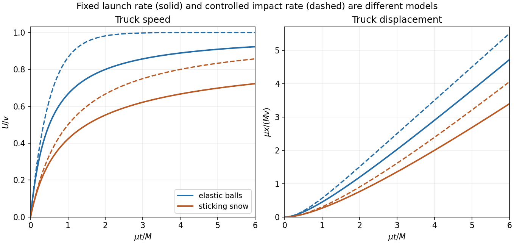

<h1 id="9/solution">Solution</h1>

↑ **Parent:** [9](../9.md)

Let $\lambda=1\,\mathrm{s}^{-1}$ be the launch rate and $\mu=\lambda m$. Treat many small impacts as a continuous momentum flux, justified by $m\ll M$. Write $x(t)$ for truck displacement from its initial position and $U=\dot x$, with $t=0$ at the first impact. First neglect vertical motion, so every projectile has horizontal [velocity](../../../velocity.md) $v$.

A fixed **launch rate** is different from a fixed impact rate on a receding truck. Projectiles reaching the truck at time $t$ were launched at retarded time $s=t-x(t)/v$, after an irrelevant constant initial-flight offset. The [moving-target interception rate](../../../moving-target-interception-rate.md) is therefore

$$
\frac{dN}{dt}=\lambda\left(1-\frac Uv\right).
$$

For an [elastic collision](../../../elastic-collision.md) with a much heavier truck, each ball transfers [momentum](../../../momentum-split.md) approximately $2m(v-U)$. The elastic-ball truck keeps mass $M$, so

$$
M\dot U=\frac{2\mu}{v}(v-U)^2.
$$

Solving from rest and integrating once more gives

$$
\boxed{U(t)=v\left(1-\frac1{1+2\mu t/M}\right),\qquad x(t)=vt-\frac{Mv}{2\mu}\ln\left(1+\frac{2\mu t}{M}\right).}
$$

The rebound reverses the ball's motion relative to the truck; its laboratory velocity $2U-v$ can still be forwards once $U>v/2$. The truck approaches $v$ asymptotically, while its decreasing impact rate prevents exponential approach in laboratory time. The approximation omits the velocity jumps of individual finite-mass impacts.

For sticking snowballs, let $A(t)$ be the instantaneous truck-plus-snow mass, with $A(0)=M$. The [variable-mass system](../../../variable-mass-system.md) obeys

$$
\dot A=\mu(1-U/v),\qquad \frac{d(AU)}{dt}=v\dot A.
$$

Integrating the second equation gives $AU=v(A-M)$. Therefore $A\dot A=\mu M$, and with $z=\sqrt{1+2\mu t/M}$,

$$
\boxed{A=Mz,\quad U=v\left(1-\frac1z\right),\quad x=vt-\frac{Mv}{\mu}(z-1)=\frac{Mv}{2\mu}(z-1)^2.}
$$

Retaining the accumulated mass is necessary even though each individual snowball is small.

For the range calculation, take the intended idealization of horizontal launch from height $h$, no air resistance, and interception possible until the projectile reaches the ground. Its flight time is $\tau=\sqrt{2h/g}$ and horizontal range is $D=v\tau$. If the initial truck distance from the boy is $X_0<D$, substitute $x=D-X_0$ in the last expression. The speed at the range limit is

$$
\boxed{U_{\rm out}=v\frac{a}{1+a},\qquad a=\sqrt{\frac{2\mu(D-X_0)}{Mv}}.}
$$

For an initially nearby truck, $X_0=0$ in this point-target model and $a=\sqrt{2\mu\tau/M}$. A different launch angle or finite interception height changes the available range and must be specified separately.

If instead one idealizes one **impact** each second, regardless of the truck's changing position, the answers are different: elastic balls give $U=v(1-e^{-2\mu t/M})$ and $x=v[t-M(1-e^{-2\mu t/M})/(2\mu)]$; sticking balls give $U=v\mu t/(M+\mu t)$ and $x=vt-(Mv/\mu)\ln(1+\mu t/M)$. Those expressions assume controlled arrival times, whereas the boxed results respect the stated fixed launch rate.

**[Figure 2](#9/image-truck-response-with-a-fixed-launch-rate-contrasted-with-the-different-assumption-of-a-fixed-collision-rate). Truck response with a fixed launch rate, contrasted with the different assumption of a fixed collision rate**.

## ↑ Ancestors (11)

1. [9](../9.md)
2. [2016 resit](../../2016-resit-split.md)
3. [Past exam of the physics 1 paper of the University of Oxford](../../split.md)
4. [Physics 1 paper of the University of Oxford](../../../physics-1-paper-of-the-university-of-oxford.md)
5. [Year 1 of the physics course of the University of Oxford](../../../year-1-of-the-physics-course-of-the-university-of-oxford.md)
6. [Physics course of the University of Oxford](../../../physics-course-of-the-university-of-oxford.md)
7. [Undergraduate course of the University of Oxford](../../../undergraduate-course-of-the-university-of-oxford.md)
8. [Course of the University of Oxford](../../../course-of-the-university-of-oxford.md)
9. [University of Oxford](../../../university-of-oxford-split.md)
10. [List of universities](../../../list-of-universities.md)
11. [Codex Wiki](../../../split.md)
