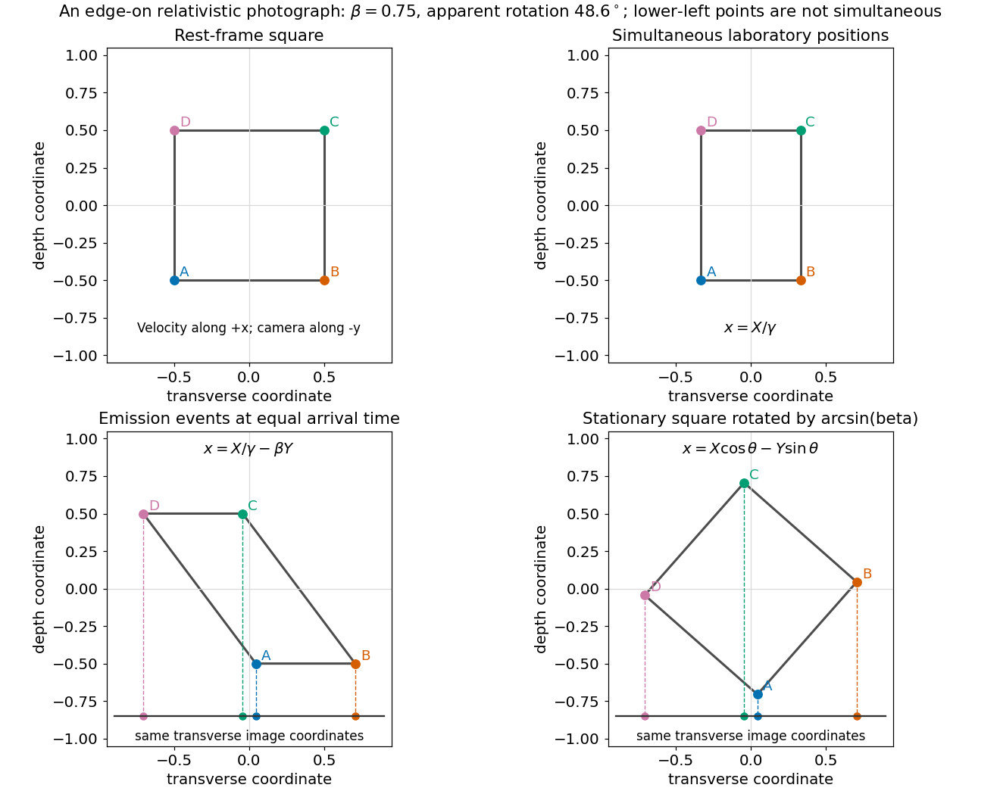
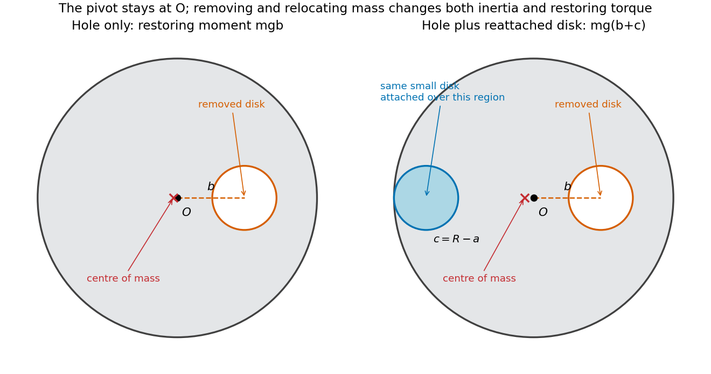
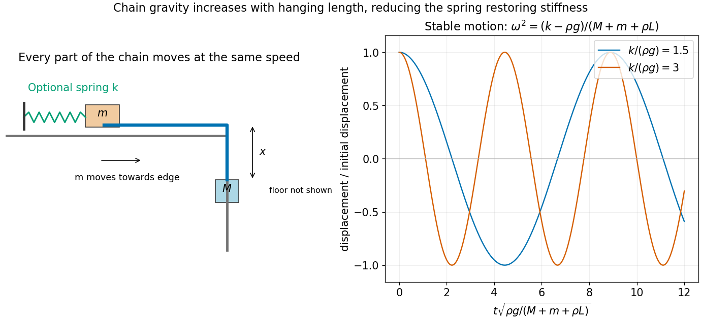
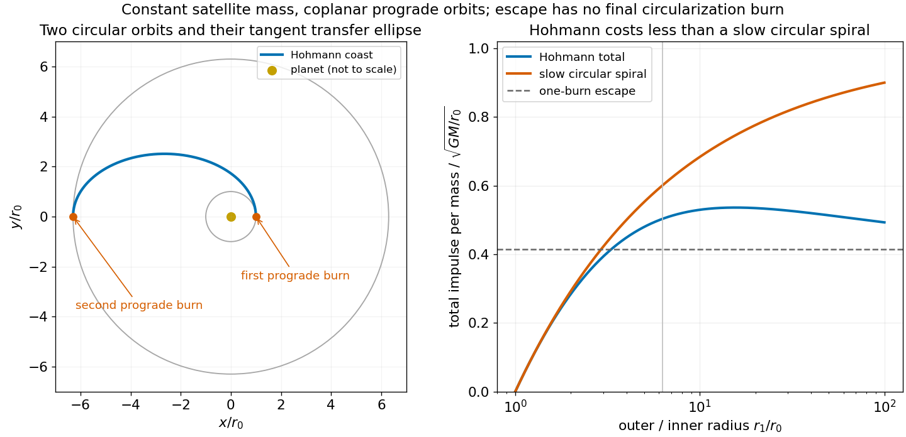

# 2016

↑ **Parent:** [Past exam of the physics 1 paper of the University of Oxford](../past-exam-of-the-physics-1-paper-of-the-university-of-oxford.md)

Source paper: [https://www.whatdotheyknow.com/request/physics_past_exam_papers_2015_16/response/973997/attach/3/Cowell%20Attachment.zip?cookie_passthrough=1](https://www.whatdotheyknow.com/request/physics_past_exam_papers_2015_16/response/973997/attach/3/Cowell%20Attachment.zip?cookie_passthrough=1)

**Table of contents**

- [1](#1)
  - [Solution](#1/solution)
- [2](#2)
  - [Solution](#2/solution)
- [3](#3)
  - [Solution](#3/solution)
- [4](#4)
  - [Solution](#4/solution)
- [5](#5)
  - [Solution](#5/solution)
- [6](#6)
  - [Solution](#6/solution)
- [7](#7)
  - [Solution](#7/solution)
- [8](#8)
  - [Solution](#8/solution)
- [9](#9)
  - [Solution](#9/solution)
- [10](#10)
  - [Solution](#10/solution)
  - [i](#10/i)
    - [Solution](#10/i/solution)
  - [ii](#10/ii)
    - [Solution](#10/ii/solution)
  - [iii](#10/iii)
    - [Solution](#10/iii/solution)
  - [iv](#10/iv)
    - [Solution](#10/iv/solution)
  - [v](#10/v)
    - [Solution](#10/v/solution)
- [11](#11)
  - [Solution](#11/solution)

## 1

↑ **Parent:** [2016](2016.md)

<h3 id="1/solution">Solution</h3>

↑ **Parent:** [1](#1)

Take horizontal motion towards the second projectile as positive. In [projectile motion](../classical-mechanics.md#projectile-motion), both bodies have the same downward [gravitational acceleration](../newton-s-law-of-universal-gravitation.md#gravitational-acceleration), so it cancels from their relative motion. Their coordinates are

$$
x_1=v_1t,\quad z_1=h-\frac12gt^2,\qquad x_2=v_2t\cos\theta,\quad z_2=v_2t\sin\theta-\frac12gt^2.
$$

For a collision at $t>0$, equality of the horizontal coordinates requires $v_2\cos\theta=v_1$. Equality of the heights then requires $v_2t\sin\theta=h$. Hence

$$
\boxed{\theta=\arccos\frac{v_1}{v_2},\qquad t=\frac{h}{\sqrt{v_2^2-v_1^2}}.}
$$

The upward solution requires $v_2>v_1$. A collision strictly above the ground further requires $t<\sqrt{2h/g}$, or $v_2^2-v_1^2>gh/2$. The horizontal target distance does not independently affect the interception geometry. If the first shot is also required to hit that ground target, its parameters satisfy $l=v_1\sqrt{2h/g}$.

## 2

↑ **Parent:** [2016](2016.md)

<h3 id="2/solution">Solution</h3>

↑ **Parent:** [2](#2)

The [centre-of-momentum frame](../special-relativity.md#center-of-momentum-frame) is an [inertial frame](../mathematical-physics.md#inertial-frame) in which the system's total [momentum](../momentum.md) is zero. For nonrelativistic particles with total [mass](../classical-mechanics.md#mass) $M_T$ and total [momentum](../momentum.md) $\mathbf P$, it moves with [velocity](../classical-mechanics.md#velocity) $\mathbf V=\mathbf P/M_T$ relative to the original frame.

Under a [Galilean boost](../special-relativity.md#galilean-transformation) by a constant [velocity](../classical-mechanics.md#velocity) $\mathbf U$, the total [kinetic energy](../energy.md#kinetic-energy) transforms as

$$
K'=\sum_i\frac{m_i}{2}|\mathbf v_i-\mathbf U|^2=K-\mathbf U\cdot\mathbf P+\frac12M_TU^2.
$$

For an isolated collision, [momentum conservation](../momentum.md#momentum-conservation) gives $\Delta\mathbf P=0$, and nonrelativistic [mass](../classical-mechanics.md#mass) conservation gives $\Delta M_T=0$. Therefore

$$
\boxed{\Delta K'=\Delta K.}
$$

An [elastic collision](../classical-mechanics.md#elastic-collision) with $\Delta K=0$ in one [inertial frame](../mathematical-physics.md#inertial-frame) has $\Delta K'=0$ in every [inertial frame](../mathematical-physics.md#inertial-frame). Individual particles' [kinetic energies](../energy.md#kinetic-energy) change under the boost, but the total energy difference between the final and initial states does not. This is the [Galilean invariance of collision elasticity](../classical-mechanics.md#galilean-invariance-of-collision-elasticity).

## 3

↑ **Parent:** [2016](2016.md)

<h3 id="3/solution">Solution</h3>

↑ **Parent:** [3](#3)

In the frame following the turn, the outward inertial [force](../force.md) $mv^2/R$ acts at height $h$ and tends to unload the inner rail. The two upward [normal forces](../force.md#normal-force) satisfy

$$
N_{\mathrm{out}}+N_{\mathrm{in}}=mg,\qquad\frac d2(N_{\mathrm{out}}-N_{\mathrm{in}})=\frac{mv^2h}{R}.
$$

The second equation is [moment balance](../momentum.md#moment-balance) about the midpoint between the rails. Thus

$$
N_{\mathrm{in}}=\frac{mg}{2}-\frac{mv^2h}{Rd},\qquad N_{\mathrm{out}}=\frac{mg}{2}+\frac{mv^2h}{Rd}.
$$

Full contact requires a nonnegative inner [normal force](../force.md#normal-force). Its limiting value is zero, giving the [toppling speed on level rails](../rigid-body-dynamics.md#toppling-speed-on-level-rails)

$$
\boxed{v_0=\sqrt{\frac{gRd}{2h}}.}
$$

For strictly positive contact force on both rails, $v<v_0$. This ideal result assumes level rails, negligible suspension motion and enough lateral contact force to follow the curve; lateral sliding could impose a different limit.

## 4

↑ **Parent:** [2016](2016.md)

<h3 id="4/solution">Solution</h3>

↑ **Parent:** [4](#4)

Let $u_e>0$ be the constant rearward [rocket exhaust speed](../momentum.md#rocket-exhaust-speed), and let $\mathcal M$ denote the rocket's instantaneous [mass](../classical-mechanics.md#mass). Apply [momentum conservation](../momentum.md#momentum-conservation) over a short ejection interval: the remaining rocket gains $\mathcal M\,dv$, while the expelled positive mass $-d\mathcal M$ carries backward relative momentum $u_e\,d\mathcal M$. To first order,

$$
\mathcal M\,dv=-u_e\,d\mathcal M.
$$

Integrating gives the [rocket equation](../momentum.md#rocket-equation)

$$
\boxed{\Delta v=u_e\ln\frac{M}{M-m}.}
$$

This is a [velocity](../classical-mechanics.md#velocity) increment, measured along the thrust direction, for motion in free space without external [forces](../force.md).

For the two-stage vehicle, take $M_1$ and $M_2$ to be the initial masses of the respective stages, each including its fuel $m$. The first burn changes the total mass from $M_1+M_2$ to $M_1+M_2-m$. Discarding the empty first-stage shell of mass $M_1-m$ leaves mass $M_2$; ideal jettison without a relative impulse does not change the [velocity](../classical-mechanics.md#velocity). The second burn then changes $M_2$ to $M_2-m$. Adding the two [rocket equation](../momentum.md#rocket-equation) increments gives

$$
\boxed{\Delta v_{\mathrm{two}}=u_e\ln\frac{M_1+M_2}{M_1+M_2-m}+u_e\ln\frac{M_2}{M_2-m}.}
$$

Here $M_1>m$ and $M_2>m$ leave positive dry masses. Different stage exhaust speeds would multiply their respective logarithms. A [multistage rocket](../momentum.md#multistage-rocket) gains its advantage by avoiding acceleration of the spent first-stage shell during the second burn.

## 5

↑ **Parent:** [2016](2016.md)

<h3 id="5/solution">Solution</h3>

↑ **Parent:** [5](#5)

Choose the cylinder's [velocity](../classical-mechanics.md#velocity) to be $v\hat{\mathbf x}$, and the ball's laboratory [velocity](../classical-mechanics.md#velocity) to be $u(\cos\theta,\sin\theta)$. By [Galilean velocity addition](../special-relativity.md#galilean-velocity-addition), the ball's [velocity](../classical-mechanics.md#velocity) relative to the cylinder is

$$
\mathbf u'=\bigl(u\cos\theta-v,\ u\sin\theta\bigr).
$$

For a suitably centred entry without hitting a wall, the cylinder's axis must be parallel to this relative [velocity](../classical-mechanics.md#velocity). Its oriented [angle](../geometry-and-topology.md#angle) $\alpha$ to the cylinder's direction of travel is therefore

$$
\boxed{\alpha=\operatorname{atan2}(u\sin\theta,u\cos\theta-v).}
$$

Equivalently, $\tan\alpha=u\sin\theta/(u\cos\theta-v)$, with the quadrant chosen from the two components. For $v/u\ll1$,

$$
\boxed{\alpha=\theta+\frac vu\sin\theta+O((v/u)^2).}
$$

Thus the extra tilt relative to the ball's original direction is approximately $(v/u)\sin\theta$. The use of $\operatorname{atan2}$ also covers nearly transverse incidence, where taking an unqualified inverse tangent could select the wrong axis direction.

## 6

↑ **Parent:** [2016](2016.md)

<h3 id="6/solution">Solution</h3>

↑ **Parent:** [6](#6)

Let $\theta$ describe the direction _towards the star_, measured from the Earth's positive direction of motion. The arriving [photon](../quantum-mechanics.md#photon) propagates in the opposite direction, so in the stellar frame its [four-momentum](../special-relativity.md#four-momentum) has

$$
p_x=-\frac{E_\gamma}{c}\cos\theta,\qquad p_y=-\frac{E_\gamma}{c}\sin\theta.
$$

A [Lorentz transformation](../special-relativity.md#lorentz-transformation) into the Earth's frame, moving at $\beta c$ along $x$, gives

$$
E_\gamma'=\gamma E_\gamma(1+\beta\cos\theta),\qquad p_x'=-\frac{\gamma E_\gamma}{c}(\cos\theta+\beta),\qquad p_y'=p_y.
$$

The observed stellar bearing is opposite to the transformed photon [momentum](../momentum.md). Since a [photon](../quantum-mechanics.md#photon) satisfies $|\mathbf p'|=E_\gamma'/c$,

$$
\boxed{\cos\theta'=\frac{\cos\theta+\beta}{1+\beta\cos\theta},\qquad\sin\theta'=\frac{\sin\theta}{\gamma(1+\beta\cos\theta)}.}
$$

This is [relativistic aberration](../mathematical-physics.md#relativistic-aberration). For small $\beta$, $\theta'=\theta-\beta\sin\theta+O(\beta^2)$: stellar directions shift towards the direction of the observer's motion. Keeping the distinction between stellar bearing and photon propagation direction explains the plus signs.

## 7

↑ **Parent:** [2016](2016.md)

<h3 id="7/solution">Solution</h3>

↑ **Parent:** [7](#7)

For a [Lorentz boost](../special-relativity.md#lorentz-boost) along $x$, the [Lorentz transformation](../special-relativity.md#lorentz-transformation) is

$$
t'=\gamma\left(t-\frac{vx}{c^2}\right),\qquad x'=\gamma(x-vt),\qquad y'=y,\quad z'=z,\qquad\gamma=(1-v^2/c^2)^{-1/2}.
$$

To calculate a photograph, compare photons that arrive together, which were generally emitted at different times. Put the lamina in the $xy$ plane, moving along $+x$, and take the distant camera to lie along negative $y$. Let $(X,Y)$ be a material point's coordinates in the lamina's rest frame. At a laboratory time $t$, its position satisfies $x=X/\gamma+vt$, $y=Y$.

The distant-camera approximation makes the variable part of the light travel time $Y/c$. Equal arrival time therefore requires $t+Y/c=\text{constant}$. Choose that constant to be zero. The point's photographed transverse coordinate becomes

$$
x_{\mathrm{image}}=\frac X\gamma-\beta Y.
$$

A stationary lamina rotated in its plane by $\theta$ would instead have the projected coordinate $X\cos\theta-Y\sin\theta$. The two projections agree when

$$
\boxed{\cos\theta=\frac1\gamma,\qquad\sin\theta=\beta,\qquad\theta=\arcsin\frac vc.}
$$

This is [Terrell rotation](../special-relativity.md#terrell-rotation). The shape defined by simultaneous laboratory positions still has [length contraction](../special-relativity.md#length-contraction); the photographic rotation comes from combining that contraction with unequal emission times. Reversing the viewing or motion direction reverses the apparent rotation's sign.

**[Figure 1](#7/image-equal-arrival-time-projection-of-an-edge-on-lamina-agrees-with-a-rotated-square-rather-than-the-simultaneous-contracted-square). Equal-arrival-time projection of an edge-on lamina agrees with a rotated square, rather than the simultaneous contracted square**.

## 8

↑ **Parent:** [2016](2016.md)

<h3 id="8/solution">Solution</h3>

↑ **Parent:** [8](#8)

The [parallel axis theorem](../rigid-body-dynamics.md#parallel-axis-theorem) gives $I=I_{\mathrm{CM}}+Md^2$ for parallel axes separated by $d$, with the reference axis through the [centre of mass](../classical-mechanics.md#center-of-mass). For a plane lamina, the [perpendicular axis theorem](../rigid-body-dynamics.md#perpendicular-axis-theorem) gives $I_z=I_x+I_y$ for mutually perpendicular axes meeting at one point, with $x,y$ in the plane.

Treat the removed material as negative [mass](../classical-mechanics.md#mass). With the hole's centre at $b\hat{\mathbf x}$, its [moment of inertia](../rigid-body-dynamics.md#moment-of-inertia) about $O$ is $m(a^2/2+b^2)$. The remaining [moment of inertia](../rigid-body-dynamics.md#moment-of-inertia) and [centre of mass](../classical-mechanics.md#center-of-mass) are

$$
\boxed{I_1=\frac12MR^2-m\left(\frac12a^2+b^2\right),\qquad\mathbf r_{\mathrm{CM},1}=-\frac{mb}{M-m}\hat{\mathbf x}.}
$$

For a uniform original disk, $m/M=a^2/R^2$. Write $d_1=mb/(M-m)$ and measure $\phi$ from the downward equilibrium direction of its [centre of mass](../classical-mechanics.md#center-of-mass). The [physical pendulum](../mathematical-physics.md#physical-pendulum) then has [Lagrangian](../calculus-of-variations.md#lagrangian)

$$
L_1=\frac12I_1\dot\phi^2+(M-m)gd_1\cos\phi=\frac12I_1\dot\phi^2+mbg\cos\phi.
$$

The [Euler-Lagrange equation](../analysis.md#euler-lagrange-equation) is $I_1\ddot\phi+mbg\sin\phi=0$. For small [oscillations](../wave.md#oscillation), $\sin\phi\simeq\phi$, giving

$$
\boxed{\omega_1=\sqrt{\frac{mbg}{I_1}},\qquad f_1=\frac{\omega_1}{2\pi}.}
$$

Now add the removed small disk on the opposite side, with its centre a distance $c=R-a$ from $O$ so that it is internally tangent to the large disk. The total mass returns to $M$, while its first moment about $O$ is $-m(b+c)\hat{\mathbf x}$. Thus

$$
I_2=I_1+m\left(\frac12a^2+c^2\right)=\frac12MR^2+m(c^2-b^2),\qquad d_2=\frac{m(b+c)}M.
$$

Replacing both the inertia and gravitational restoring moment gives

$$
\boxed{\omega_2=\sqrt{\frac{mg(b+R-a)}{\tfrac12MR^2+m[(R-a)^2-b^2]}},\qquad f_2=\frac{\omega_2}{2\pi}.}
$$

The same first-moment method applies to a general [perforated-disc pendulum](../mathematical-physics.md#perforated-disc-pendulum). The added disk is attached to the lamina and shares its rotation; treating it as a massless patch or updating only the inertia would omit its restoring [torque](../momentum.md#torque).

**[Figure 2](#8/image-removing-an-off-centre-disk-and-reattaching-it-on-the-opposite-side-changes-both-the-pendulum-inertia-and-its-centre-of-mass). Removing an off-centre disk and reattaching it on the opposite side changes both the pendulum inertia and its centre of mass**.

## 9

↑ **Parent:** [2016](2016.md)

<h3 id="9/solution">Solution</h3>

↑ **Parent:** [9](#9)

Let $x$ be the downward displacement of $M$ from its initial position just beyond the table edge. The smaller [mass](../classical-mechanics.md#mass) moves towards the edge by the same distance, and the hanging chain length is $x$. All the chain and both endpoint masses move at speed $\dot x$, so their total moving mass is $\mathcal M=M+m+\rho L$. The hanging chain's [gravitational potential energy](../energy.md#gravitational-energy), relative to the initial configuration, is $-\rho gx^2/2$. Thus the [Lagrangian](../calculus-of-variations.md#lagrangian) for the [chain sliding over a table edge](../lagrangian-mechanics.md#chain-sliding-over-a-table-edge) is

$$
L=\frac12\mathcal M\dot x^2+Mgx+\frac12\rho gx^2.
$$

The [Euler-Lagrange equation](../analysis.md#euler-lagrange-equation) gives $\mathcal M\ddot x=g(M+\rho x)$. Put $\Omega=\sqrt{\rho g/\mathcal M}$. With $x(0)=\dot x(0)=0$, the solution is

$$
\boxed{x(t)=\frac M\rho[\cosh(\Omega t)-1],\qquad\dot x(t)=\frac{M\Omega}\rho\sinh(\Omega t).}
$$

These are also the smaller mass's displacement and speed towards the edge. The formula applies until $M$ reaches the floor, at $t_f=\Omega^{-1}\operatorname{arcosh}(1+\rho y/M)$. Since $y<L$, the smaller mass has not yet reached the edge during this interval. As $\rho\to0$, the result tends to $x=Mg t^2/[2(M+m)]$, as expected for a massless connector.

Let the spring's [spring constant](../elasticity-physics.md#spring-constant) be $k$, and write its extension as $e_0+x$, allowing for an initial extension $e_0$. The new [Lagrangian](../calculus-of-variations.md#lagrangian) is

$$
L_s=\frac12\mathcal M\dot x^2+Mgx+\frac12\rho gx^2-\frac12k(e_0+x)^2.
$$

The specified equilibrium is $x_e=y-y_1$, with $k(e_0+x_e)=g(M+\rho x_e)$. Put $\xi=x-x_e$; the equation becomes

$$
\mathcal M\ddot\xi+(k-\rho g)\xi=0,\qquad\boxed{\omega=\sqrt{\frac{k-\rho g}{M+m+\rho L}},\qquad f=\frac{\omega}{2\pi}.}
$$

The [spring-stabilized chain over a table edge](../lagrangian-mechanics.md#spring-stabilized-chain-over-a-table-edge) oscillates only when $k>\rho g$. More hanging chain increases its own gravitational pull, reducing the effective restoring stiffness. The equilibrium height alone does not determine $k$ without information about the spring's natural length or preload.

**[Figure 3](#9/image-chain-gravity-accelerates-sliding-and-subtracts-from-a-spring-s-restoring-stiffness-stable-oscillations-require-k-greater-than-rho-g). Chain gravity accelerates sliding and subtracts from a spring's restoring stiffness; stable oscillations require k greater than rho g**.

## 10

↑ **Parent:** [2016](2016.md)

<h3 id="10/solution">Solution</h3>

↑ **Parent:** [10](#10)

Put $\mu=GM$. Balancing [Newton's law of universal gravitation](../newton-s-law-of-universal-gravitation.md) with the required [centripetal force](../classical-mechanics.md#centripetal-force) gives $mv_0^2/r_0=\mu m/r_0^2$, hence

$$
\boxed{v_0=\sqrt{\frac\mu{r_0}},\qquad E_0=\frac12mv_0^2-\frac{\mu m}{r_0}=-\frac{\mu m}{2r_0}.}
$$

The [circular Kepler orbit](../celestial-mechanics.md#circular-kepler-orbit) is stable against small radial perturbations: its effective radial potential is $U_{\mathrm{eff}}=J^2/(2mr^2)-\mu m/r$, and at the circular value $J^2=\mu m^2r_0$, $U_{\mathrm{eff}}''(r_0)=\mu m/r_0^3>0$. Here $J$ is the conserved [angular momentum](../momentum.md#angular-momentum).

<h3 id="10/i">i</h3>

↑ **Parent:** [10](#10)

<h4 id="10/i/solution">Solution</h4>

↑ **Parent:** [I](#10/i)

The assumed orbital [energy](../energy.md) is $E=-\mu m/(2a)$. At a point a distance $r$ from the planet,

$$
\frac12mv_e^2-\frac{\mu m}r=-\frac{\mu m}{2a},\qquad\boxed{v_e^2=\mu\left(\frac2r-\frac1a\right).}
$$

This is the [vis-viva equation](../celestial-mechanics.md#vis-viva-equation). The [semi-major axis](../celestial-mechanics.md#semi-major-axis) and radius are measured from the gravitational focus where the planet lies.

<h3 id="10/ii">ii</h3>

↑ **Parent:** [10](#10)

<h4 id="10/ii/solution">Solution</h4>

↑ **Parent:** [Ii](#10/ii)

For the [Hohmann transfer orbit](../celestial-mechanics.md#hohmann-transfer-orbit), the inner and outer circular radii are the ellipse's [pericentre](../celestial-mechanics.md#periapsis) and [apocentre](../celestial-mechanics.md#apoapsis) distances, so $a=(r_0+r_1)/2$. The [vis-viva equation](../celestial-mechanics.md#vis-viva-equation) gives the transfer speed at the inner tangent point,

$$
v_p=\sqrt{\frac\mu{r_0}}\sqrt{\frac{2r_1}{r_0+r_1}}.
$$

Both old and new [velocities](../classical-mechanics.md#velocity) are tangential there, so the required first impulse is prograde, with

$$
\boxed{\Delta v_1=\sqrt{\frac\mu{r_0}}\left(\sqrt{\frac{2r_1}{r_0+r_1}}-1\right).}
$$

<h3 id="10/iii">iii</h3>

↑ **Parent:** [10](#10)

<h4 id="10/iii/solution">Solution</h4>

↑ **Parent:** [Iii](#10/iii)

At the outer tangent point, the [vis-viva equation](../celestial-mechanics.md#vis-viva-equation) gives $v_a=\sqrt{\mu/r_1}\sqrt{2r_0/(r_0+r_1)}$. This is below the outer [circular Kepler orbit](../celestial-mechanics.md#circular-kepler-orbit)'s speed $v_1=\sqrt{\mu/r_1}$. The second impulse is therefore also prograde:

$$
\boxed{\Delta v_2=\sqrt{\frac\mu{r_1}}\left(1-\sqrt{\frac{2r_0}{r_0+r_1}}\right).}
$$

It raises the [pericentre](../celestial-mechanics.md#periapsis) to the outer radius, completing the circularization.

<h3 id="10/iv">iv</h3>

↑ **Parent:** [10](#10)

<h4 id="10/iv/solution">Solution</h4>

↑ **Parent:** [Iv](#10/iv)

In a [quasi-circular spiral transfer](../celestial-mechanics.md#quasi-circular-spiral-transfer), a small tangential thrust $F$ supplies power $Fv_c$ while the orbit stays approximately circular. Differentiating $E=-\mu m/(2r)$ and using $v_c=\sqrt{\mu/r}$ gives

$$
\frac Fm=\frac{\sqrt\mu}{2r^{3/2}}\dot r,\qquad\boxed{\Delta v_{\mathrm{slow}}=\int\frac Fm\,dt=\sqrt\mu\left(\frac1{\sqrt{r_0}}-\frac1{\sqrt{r_1}}\right)=v_0-v_1.}
$$

This is the integrated thrust magnitude per unit constant [mass](../classical-mechanics.md#mass), not the net vector change of orbital [velocity](../classical-mechanics.md#velocity).

For comparison, write $u=\sqrt{r_1/r_0}>1$. Adding the two [Hohmann transfer](../celestial-mechanics.md#hohmann-transfer-orbit) impulses and subtracting the slow-transfer result yields

$$
\frac{\Delta v_H-\Delta v_{\mathrm{slow}}}{v_0}=\frac{u-1}u\left[\frac{\sqrt2(u+1)}{\sqrt{u^2+1}}-2\right]<0.
$$

The bracket is negative because $(u+1)^2<2(u^2+1)$ for $u>1$. Thus **the Hohmann transfer uses less total impulse than the slow circular spiral** for these ideal coplanar transfers. The [Hohmann transfer compared with a slow spiral](../celestial-mechanics.md#hohmann-transfer-compared-with-a-slow-spiral) does not establish a global optimum over every possible transfer family or propulsion constraint.

**[Figure 4](#10/iv/image-two-tangential-hohmann-burns-versus-an-adiabatically-slow-circular-spiral-total-impulse-is-lower-for-the-hohmann-transfer). Two tangential Hohmann burns versus an adiabatically slow circular spiral; total impulse is lower for the Hohmann transfer**.

<h3 id="10/v">v</h3>

↑ **Parent:** [10](#10)

<h4 id="10/v/solution">Solution</h4>

↑ **Parent:** [V](#10/v)

Use the supplied planet [mass](../classical-mechanics.md#mass) $5.9\times10^{24}\,\mathrm{kg}$, $G=6.67430\times10^{-11}\,\mathrm{m^3\,kg^{-1}\,s^{-2}}$, and adopt mean Earth radius $R_E=6371\,\mathrm{km}$. For a [geostationary orbit](../celestial-mechanics.md#geostationary-orbit), use one [sidereal day](../astrophysics.md#sidereal-day), $T\simeq86164\,\mathrm s$. The adopted radius and rotation period follow NASA's fact sheet.[Bulk parameters: volumetric mean radius6371.000km; orbital parameters: sidereal rotation period23.9345hours](../physics-bibliography.md#earth-fact-sheet-by-national-aeronautics-and-space-administration)

$$
r_0=R_E+300\,\mathrm{km}=6.671\times10^6\,\mathrm m,\qquad r_1=\left(\frac{\mu T^2}{4\pi^2}\right)^{1/3}\simeq4.1994\times10^7\,\mathrm m.
$$

The slightly smaller radius than the usual terrestrial value follows from using the question's smaller Earth [mass](../classical-mechanics.md#mass). For coplanar prograde orbits, the preceding formulas give

$$
\Delta v_1\simeq2.410\,\mathrm{km\,s^{-1}},\qquad\Delta v_2\simeq1.459\,\mathrm{km\,s^{-1}},\qquad\boxed{\Delta v_H\simeq3.869\,\mathrm{km\,s^{-1}}.}
$$

The escape transfer has $a\to\infty$, so its first tangential burn reaches the local [escape speed](../energy.md#escape-velocity) $\sqrt{2\mu/r_0}$. No final circularization at infinity is needed:

$$
\boxed{\Delta v_{\mathrm{escape}}=(\sqrt2-1)\sqrt{\frac\mu{r_0}}\simeq3.182\,\mathrm{km\,s^{-1}}.}
$$

Thus the geostationary transfer requires about $0.687\,\mathrm{km\,s^{-1}}$ more total impulse, or about 22 percent more, despite leaving the spacecraft gravitationally bound. Reaching the outer radius and circularizing there are separate requirements. Changing the starting orbit's inclination would add a plane-change cost absent from this calculation.

## 11

↑ **Parent:** [2016](2016.md)

<h3 id="11/solution">Solution</h3>

↑ **Parent:** [11](#11)

Write $m_e$ for the electron [rest mass](../special-relativity.md#invariant-mass) and $\varepsilon=m_ec^2$. The incident positron has total [energy](../energy.md) $E$ and satisfies $p^2c^2=E^2-\varepsilon^2$. Adding the target electron's [four-momentum](../special-relativity.md#four-momentum), the squared total [centre-of-momentum energy](../special-relativity.md#centre-of-momentum-energy) is

$$
W^2=(E+\varepsilon)^2-p^2c^2=2\varepsilon(E+\varepsilon).
$$

At the [fixed-target production threshold](../special-relativity.md#fixed-target-production-threshold), all three final particles are at rest relative to one another, so $W=3M_0c^2$. Consequently

$$
\boxed{E_{\min}=\frac{9M_0^2c^4}{2m_ec^2}-m_ec^2.}
$$

This is the positron's total energy, not its [kinetic energy](../energy.md#kinetic-energy). It assumes $3M_0\ge2m_e$ and addresses kinematic allowance; other [selection rules](../atomic-physics.md#selection-rule) could still forbid a proposed reaction. For $M_0c^2=135\,\mathrm{MeV}$ and $m_ec^2\simeq0.510999\,\mathrm{MeV}$, $E_{\min}\simeq160.494\,\mathrm{GeV}$.

At threshold the three products share the [centre-of-momentum frame](../special-relativity.md#center-of-momentum-frame)'s laboratory [velocity](../classical-mechanics.md#velocity). Their common [Lorentz factor](../special-relativity.md#lorentz-factor) and speed are

$$
\gamma_{\mathrm{CM}}=\frac{E_{\min}+\varepsilon}{3M_0c^2}=\frac{3M_0}{2m_e}\simeq396.283,\qquad\boxed{v=c\sqrt{1-\frac{4m_e^2}{9M_0^2}}\simeq0.999996816\,c.}
$$

For the subsequent [two-photon decay](../physics.md#two-photon-decay), each [photon](../quantum-mechanics.md#photon) has rest-frame energy $E_\gamma^*=M_0c^2/2$. A [Lorentz transformation](../special-relativity.md#lorentz-transformation) of a photon emitted at rest-frame angle $\theta^*$ to the boost gives $E_\gamma=\gamma_{\mathrm{CM}}E_\gamma^*(1+\beta_{\mathrm{CM}}\cos\theta^*)$. Therefore the kinematically allowed laboratory range is

$$
\boxed{\frac{\gamma_{\mathrm{CM}}M_0c^2}{2}(1-\beta_{\mathrm{CM}})\le E_\gamma\le\frac{\gamma_{\mathrm{CM}}M_0c^2}{2}(1+\beta_{\mathrm{CM}}),}
$$

or numerically

$$
\boxed{0.08517\,\mathrm{MeV}\ \lesssim E_\gamma\lesssim\ 5.3498\times10^4\,\mathrm{MeV}.}
$$

The two photon energies in a single event are correlated: their sum is the parent's laboratory energy $\gamma_{\mathrm{CM}}M_0c^2$. When one attains the upper endpoint, the other attains the lower endpoint. Angular distributions and detector acceptance can affect which part of this range is observed.

## ↑ Ancestors (9)

1. [Past exam of the physics 1 paper of the University of Oxford](../past-exam-of-the-physics-1-paper-of-the-university-of-oxford.md)
2. [Physics 1 paper of the University of Oxford](../university-of-oxford.md#physics-1-paper-of-the-university-of-oxford)
3. [Year 1 of the physics course of the University of Oxford](../university-of-oxford.md#year-1-of-the-physics-course-of-the-university-of-oxford)
4. [Physics course of the University of Oxford](../university-of-oxford.md#physics-course-of-the-university-of-oxford)
5. [Undergraduate course of the University of Oxford](../university-of-oxford.md#undergraduate-course-of-the-university-of-oxford)
6. [Course of the University of Oxford](../university-of-oxford.md#course-of-the-university-of-oxford)
7. [University of Oxford](../university-of-oxford.md)
8. [List of universities](../README.md#list-of-universities)
9. [Codex Wiki](../README.md)
