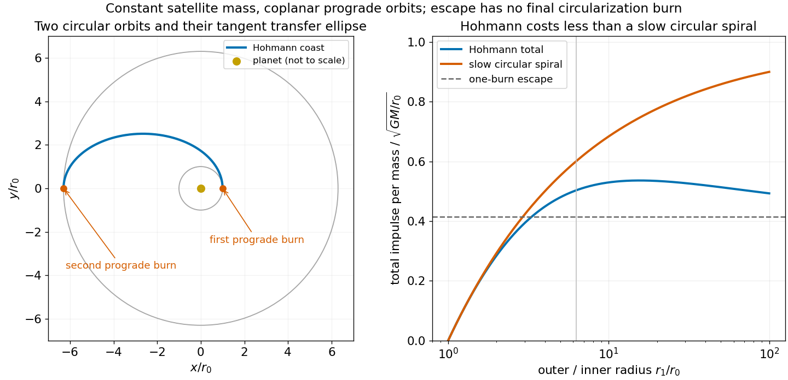

<h1 id="10/iv/solution">Solution</h1>

↑ **Parent:** [Iv](../iv.md)

In a [quasi-circular spiral transfer](../../../../quasi-circular-spiral-transfer.md), a small tangential thrust $F$ supplies power $Fv_c$ while the orbit stays approximately circular. Differentiating $E=-\mu m/(2r)$ and using $v_c=\sqrt{\mu/r}$ gives

$$
\frac Fm=\frac{\sqrt\mu}{2r^{3/2}}\dot r,\qquad\boxed{\Delta v_{\mathrm{slow}}=\int\frac Fm\,dt=\sqrt\mu\left(\frac1{\sqrt{r_0}}-\frac1{\sqrt{r_1}}\right)=v_0-v_1.}
$$

This is the integrated thrust magnitude per unit constant [mass](../../../../mass.md), not the net vector change of orbital [velocity](../../../../velocity.md).

For comparison, write $u=\sqrt{r_1/r_0}>1$. Adding the two [Hohmann transfer](../../../../hohmann-transfer-orbit.md) impulses and subtracting the slow-transfer result yields

$$
\frac{\Delta v_H-\Delta v_{\mathrm{slow}}}{v_0}=\frac{u-1}u\left[\frac{\sqrt2(u+1)}{\sqrt{u^2+1}}-2\right]<0.
$$

The bracket is negative because $(u+1)^2<2(u^2+1)$ for $u>1$. Thus **the Hohmann transfer uses less total impulse than the slow circular spiral** for these ideal coplanar transfers. The [Hohmann transfer compared with a slow spiral](../../../../hohmann-transfer-compared-with-a-slow-spiral.md) does not establish a global optimum over every possible transfer family or propulsion constraint.

**[Figure 4](#10/iv/image-two-tangential-hohmann-burns-versus-an-adiabatically-slow-circular-spiral-total-impulse-is-lower-for-the-hohmann-transfer). Two tangential Hohmann burns versus an adiabatically slow circular spiral; total impulse is lower for the Hohmann transfer**.

## ↑ Ancestors (12)

1. [Iv](../iv.md)
2. [10](../../10.md)
3. [2016](../../../2016-split.md)
4. [Past exam of the physics 1 paper of the University of Oxford](../../../split.md)
5. [Physics 1 paper of the University of Oxford](../../../../physics-1-paper-of-the-university-of-oxford.md)
6. [Year 1 of the physics course of the University of Oxford](../../../../year-1-of-the-physics-course-of-the-university-of-oxford.md)
7. [Physics course of the University of Oxford](../../../../physics-course-of-the-university-of-oxford.md)
8. [Undergraduate course of the University of Oxford](../../../../undergraduate-course-of-the-university-of-oxford.md)
9. [Course of the University of Oxford](../../../../course-of-the-university-of-oxford.md)
10. [University of Oxford](../../../../university-of-oxford-split.md)
11. [List of universities](../../../../list-of-universities.md)
12. [Codex Wiki](../../../../split.md)
