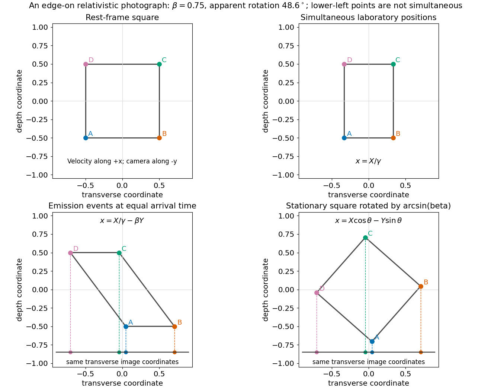

<h1 id="7/solution">Solution</h1>

↑ **Parent:** [7](../7.md)

For a [Lorentz boost](../../../lorentz-boost.md) along $x$, the [Lorentz transformation](../../../lorentz-transformation.md) is

$$
t'=\gamma\left(t-\frac{vx}{c^2}\right),\qquad x'=\gamma(x-vt),\qquad y'=y,\quad z'=z,\qquad\gamma=(1-v^2/c^2)^{-1/2}.
$$

To calculate a photograph, compare photons that arrive together, which were generally emitted at different times. Put the lamina in the $xy$ plane, moving along $+x$, and take the distant camera to lie along negative $y$. Let $(X,Y)$ be a material point's coordinates in the lamina's rest frame. At a laboratory time $t$, its position satisfies $x=X/\gamma+vt$, $y=Y$.

The distant-camera approximation makes the variable part of the light travel time $Y/c$. Equal arrival time therefore requires $t+Y/c=\text{constant}$. Choose that constant to be zero. The point's photographed transverse coordinate becomes

$$
x_{\mathrm{image}}=\frac X\gamma-\beta Y.
$$

A stationary lamina rotated in its plane by $\theta$ would instead have the projected coordinate $X\cos\theta-Y\sin\theta$. The two projections agree when

$$
\boxed{\cos\theta=\frac1\gamma,\qquad\sin\theta=\beta,\qquad\theta=\arcsin\frac vc.}
$$

This is [Terrell rotation](../../../terrell-rotation.md). The shape defined by simultaneous laboratory positions still has [length contraction](../../../length-contraction.md); the photographic rotation comes from combining that contraction with unequal emission times. Reversing the viewing or motion direction reverses the apparent rotation's sign.

**[Figure 1](#7/image-equal-arrival-time-projection-of-an-edge-on-lamina-agrees-with-a-rotated-square-rather-than-the-simultaneous-contracted-square). Equal-arrival-time projection of an edge-on lamina agrees with a rotated square, rather than the simultaneous contracted square**.

## ↑ Ancestors (11)

1. [7](../7.md)
2. [2016](../../2016-split.md)
3. [Past exam of the physics 1 paper of the University of Oxford](../../split.md)
4. [Physics 1 paper of the University of Oxford](../../../physics-1-paper-of-the-university-of-oxford.md)
5. [Year 1 of the physics course of the University of Oxford](../../../year-1-of-the-physics-course-of-the-university-of-oxford.md)
6. [Physics course of the University of Oxford](../../../physics-course-of-the-university-of-oxford.md)
7. [Undergraduate course of the University of Oxford](../../../undergraduate-course-of-the-university-of-oxford.md)
8. [Course of the University of Oxford](../../../course-of-the-university-of-oxford.md)
9. [University of Oxford](../../../university-of-oxford-split.md)
10. [List of universities](../../../list-of-universities.md)
11. [Codex Wiki](../../../split.md)
