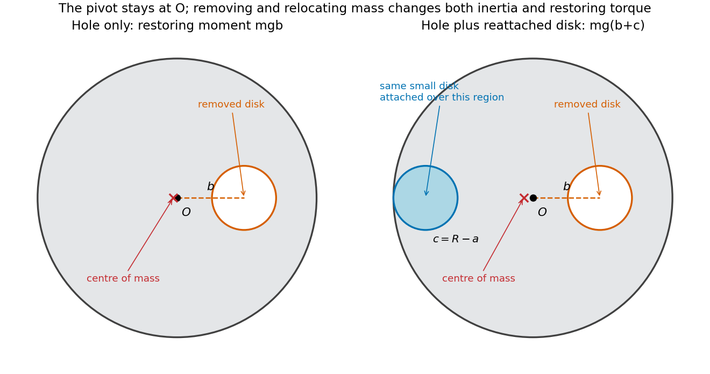

<h1 id="8/solution">Solution</h1>

↑ **Parent:** [8](../8.md)

The [parallel axis theorem](../../../parallel-axis-theorem.md) gives $I=I_{\mathrm{CM}}+Md^2$ for parallel axes separated by $d$, with the reference axis through the [centre of mass](../../../center-of-mass.md). For a plane lamina, the [perpendicular axis theorem](../../../perpendicular-axis-theorem.md) gives $I_z=I_x+I_y$ for mutually perpendicular axes meeting at one point, with $x,y$ in the plane.

Treat the removed material as negative [mass](../../../mass.md). With the hole's centre at $b\hat{\mathbf x}$, its [moment of inertia](../../../moment-of-inertia.md) about $O$ is $m(a^2/2+b^2)$. The remaining [moment of inertia](../../../moment-of-inertia.md) and [centre of mass](../../../center-of-mass.md) are

$$
\boxed{I_1=\frac12MR^2-m\left(\frac12a^2+b^2\right),\qquad\mathbf r_{\mathrm{CM},1}=-\frac{mb}{M-m}\hat{\mathbf x}.}
$$

For a uniform original disk, $m/M=a^2/R^2$. Write $d_1=mb/(M-m)$ and measure $\phi$ from the downward equilibrium direction of its [centre of mass](../../../center-of-mass.md). The [physical pendulum](../../../physical-pendulum.md) then has [Lagrangian](../../../lagrangian.md)

$$
L_1=\frac12I_1\dot\phi^2+(M-m)gd_1\cos\phi=\frac12I_1\dot\phi^2+mbg\cos\phi.
$$

The [Euler-Lagrange equation](../../../euler-lagrange-equation.md) is $I_1\ddot\phi+mbg\sin\phi=0$. For small [oscillations](../../../oscillation.md), $\sin\phi\simeq\phi$, giving

$$
\boxed{\omega_1=\sqrt{\frac{mbg}{I_1}},\qquad f_1=\frac{\omega_1}{2\pi}.}
$$

Now add the removed small disk on the opposite side, with its centre a distance $c=R-a$ from $O$ so that it is internally tangent to the large disk. The total mass returns to $M$, while its first moment about $O$ is $-m(b+c)\hat{\mathbf x}$. Thus

$$
I_2=I_1+m\left(\frac12a^2+c^2\right)=\frac12MR^2+m(c^2-b^2),\qquad d_2=\frac{m(b+c)}M.
$$

Replacing both the inertia and gravitational restoring moment gives

$$
\boxed{\omega_2=\sqrt{\frac{mg(b+R-a)}{\tfrac12MR^2+m[(R-a)^2-b^2]}},\qquad f_2=\frac{\omega_2}{2\pi}.}
$$

The same first-moment method applies to a general [perforated-disc pendulum](../../../perforated-disc-pendulum.md). The added disk is attached to the lamina and shares its rotation; treating it as a massless patch or updating only the inertia would omit its restoring [torque](../../../torque.md).

**[Figure 2](#8/image-removing-an-off-centre-disk-and-reattaching-it-on-the-opposite-side-changes-both-the-pendulum-inertia-and-its-centre-of-mass). Removing an off-centre disk and reattaching it on the opposite side changes both the pendulum inertia and its centre of mass**.

## ↑ Ancestors (11)

1. [8](../8.md)
2. [2016](../../2016-split.md)
3. [Past exam of the physics 1 paper of the University of Oxford](../../split.md)
4. [Physics 1 paper of the University of Oxford](../../../physics-1-paper-of-the-university-of-oxford.md)
5. [Year 1 of the physics course of the University of Oxford](../../../year-1-of-the-physics-course-of-the-university-of-oxford.md)
6. [Physics course of the University of Oxford](../../../physics-course-of-the-university-of-oxford.md)
7. [Undergraduate course of the University of Oxford](../../../undergraduate-course-of-the-university-of-oxford.md)
8. [Course of the University of Oxford](../../../course-of-the-university-of-oxford.md)
9. [University of Oxford](../../../university-of-oxford-split.md)
10. [List of universities](../../../list-of-universities.md)
11. [Codex Wiki](../../../split.md)
