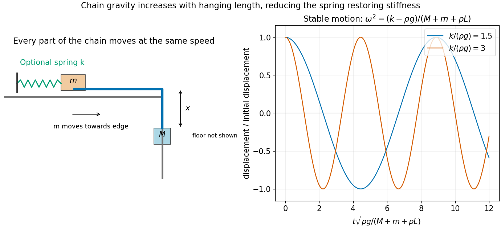

<h1 id="9/solution">Solution</h1>

↑ **Parent:** [9](../9.md)

Let $x$ be the downward displacement of $M$ from its initial position just beyond the table edge. The smaller [mass](../../../mass.md) moves towards the edge by the same distance, and the hanging chain length is $x$. All the chain and both endpoint masses move at speed $\dot x$, so their total moving mass is $\mathcal M=M+m+\rho L$. The hanging chain's [gravitational potential energy](../../../gravitational-energy.md), relative to the initial configuration, is $-\rho gx^2/2$. Thus the [Lagrangian](../../../lagrangian.md) for the [chain sliding over a table edge](../../../chain-sliding-over-a-table-edge.md) is

$$
L=\frac12\mathcal M\dot x^2+Mgx+\frac12\rho gx^2.
$$

The [Euler-Lagrange equation](../../../euler-lagrange-equation.md) gives $\mathcal M\ddot x=g(M+\rho x)$. Put $\Omega=\sqrt{\rho g/\mathcal M}$. With $x(0)=\dot x(0)=0$, the solution is

$$
\boxed{x(t)=\frac M\rho[\cosh(\Omega t)-1],\qquad\dot x(t)=\frac{M\Omega}\rho\sinh(\Omega t).}
$$

These are also the smaller mass's displacement and speed towards the edge. The formula applies until $M$ reaches the floor, at $t_f=\Omega^{-1}\operatorname{arcosh}(1+\rho y/M)$. Since $y<L$, the smaller mass has not yet reached the edge during this interval. As $\rho\to0$, the result tends to $x=Mg t^2/[2(M+m)]$, as expected for a massless connector.

Let the spring's [spring constant](../../../spring-constant.md) be $k$, and write its extension as $e_0+x$, allowing for an initial extension $e_0$. The new [Lagrangian](../../../lagrangian.md) is

$$
L_s=\frac12\mathcal M\dot x^2+Mgx+\frac12\rho gx^2-\frac12k(e_0+x)^2.
$$

The specified equilibrium is $x_e=y-y_1$, with $k(e_0+x_e)=g(M+\rho x_e)$. Put $\xi=x-x_e$; the equation becomes

$$
\mathcal M\ddot\xi+(k-\rho g)\xi=0,\qquad\boxed{\omega=\sqrt{\frac{k-\rho g}{M+m+\rho L}},\qquad f=\frac{\omega}{2\pi}.}
$$

The [spring-stabilized chain over a table edge](../../../spring-stabilized-chain-over-a-table-edge.md) oscillates only when $k>\rho g$. More hanging chain increases its own gravitational pull, reducing the effective restoring stiffness. The equilibrium height alone does not determine $k$ without information about the spring's natural length or preload.

**[Figure 3](#9/image-chain-gravity-accelerates-sliding-and-subtracts-from-a-spring-s-restoring-stiffness-stable-oscillations-require-k-greater-than-rho-g). Chain gravity accelerates sliding and subtracts from a spring's restoring stiffness; stable oscillations require k greater than rho g**.

## ↑ Ancestors (11)

1. [9](../9.md)
2. [2016](../../2016-split.md)
3. [Past exam of the physics 1 paper of the University of Oxford](../../split.md)
4. [Physics 1 paper of the University of Oxford](../../../physics-1-paper-of-the-university-of-oxford.md)
5. [Year 1 of the physics course of the University of Oxford](../../../year-1-of-the-physics-course-of-the-university-of-oxford.md)
6. [Physics course of the University of Oxford](../../../physics-course-of-the-university-of-oxford.md)
7. [Undergraduate course of the University of Oxford](../../../undergraduate-course-of-the-university-of-oxford.md)
8. [Course of the University of Oxford](../../../course-of-the-university-of-oxford.md)
9. [University of Oxford](../../../university-of-oxford-split.md)
10. [List of universities](../../../list-of-universities.md)
11. [Codex Wiki](../../../split.md)
