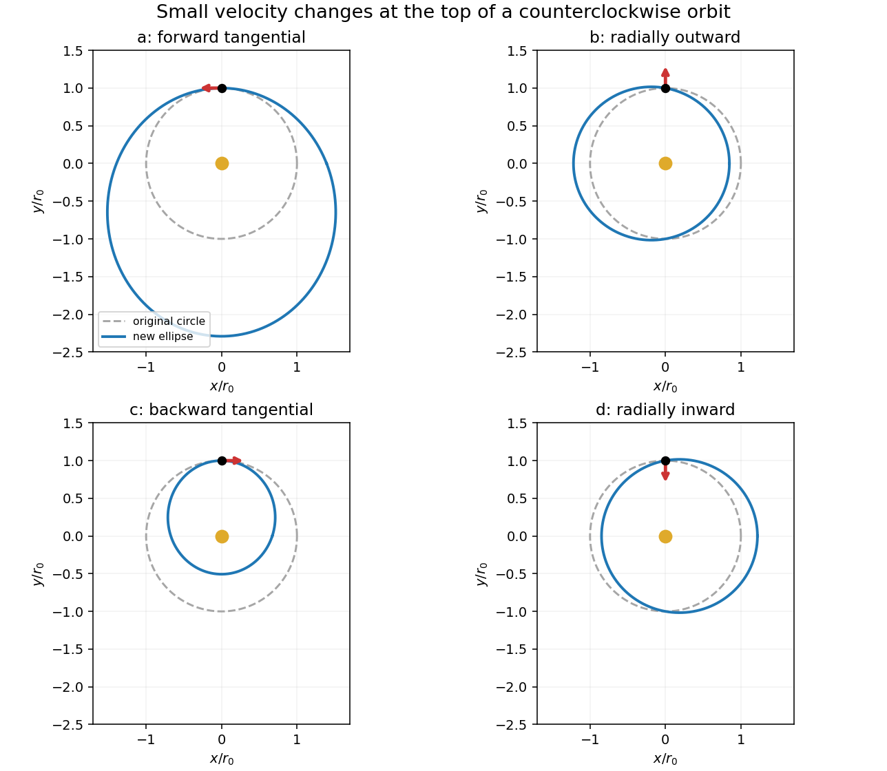
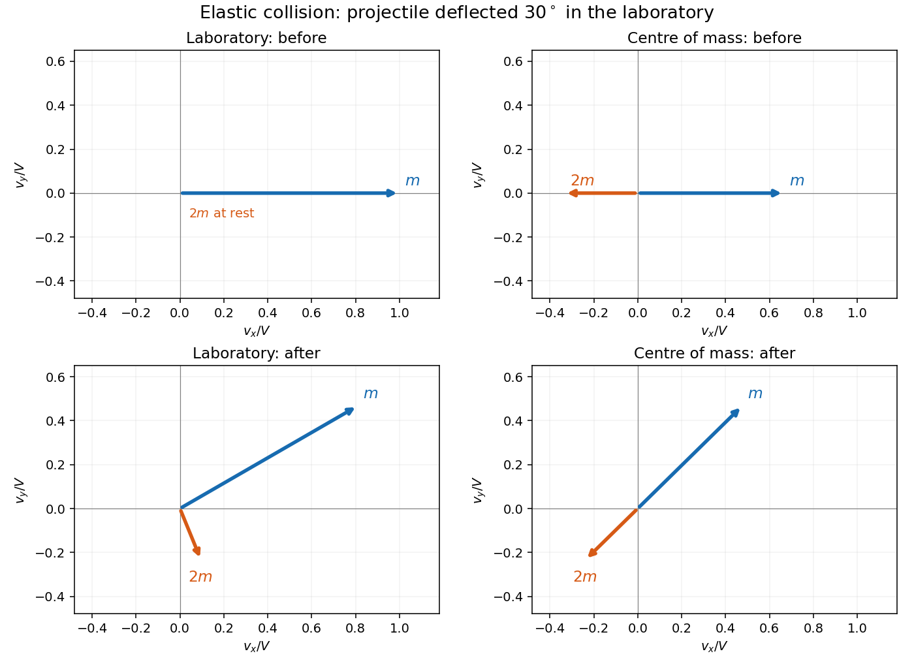
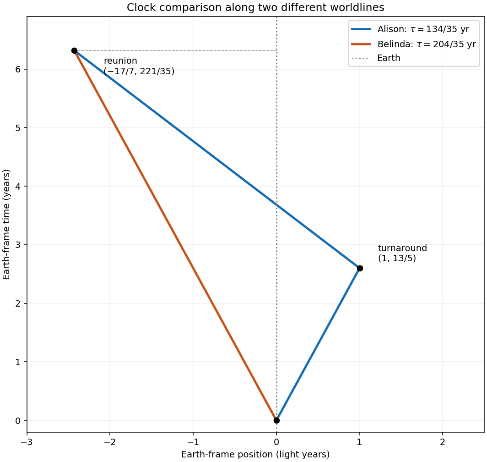
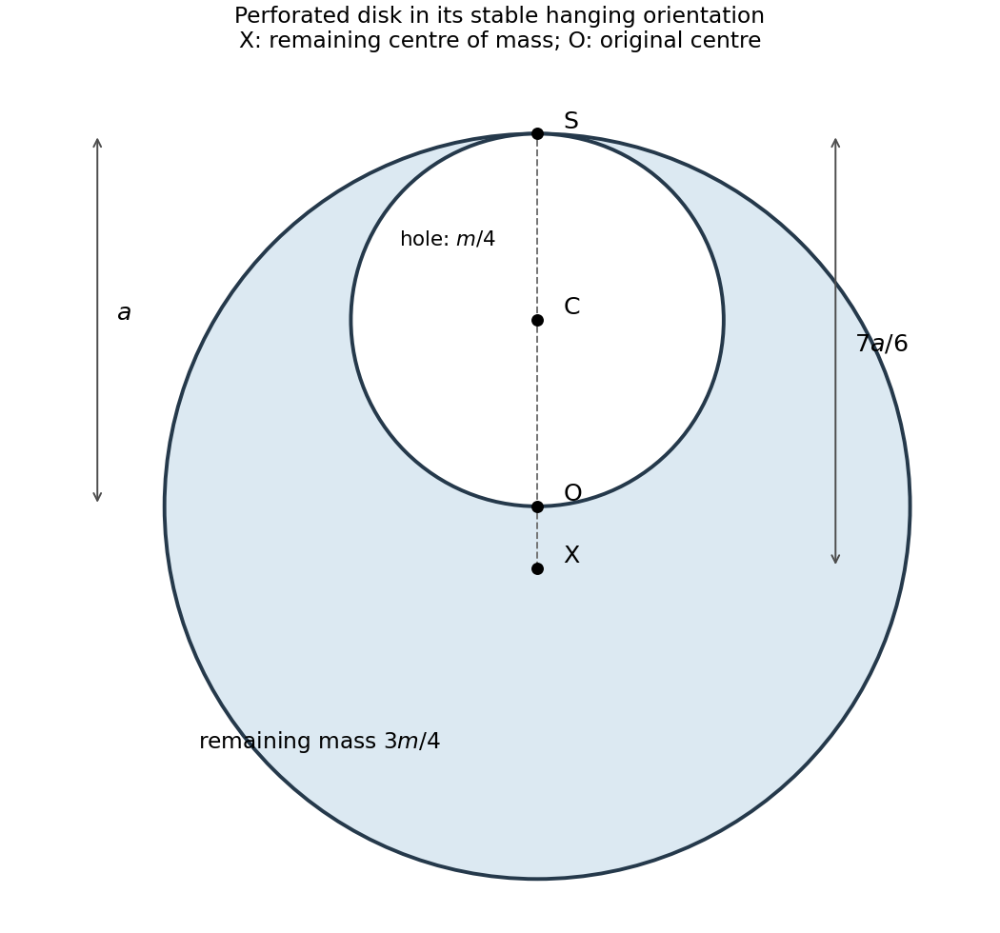

# 2017 resit

↑ **Parent:** [Past exam of the physics 1 paper of the University of Oxford](../past-exam-of-the-physics-1-paper-of-the-university-of-oxford.md)

Source paper: [https://www.whatdotheyknow.com/request/physics_past_papers_21/response/3037379/attach/2/FOI%20202505%20441%20Response.pdf?cookie_passthrough=1](https://www.whatdotheyknow.com/request/physics_past_papers_21/response/3037379/attach/2/FOI%20202505%20441%20Response.pdf?cookie_passthrough=1)

**Table of contents**

- [1](#1)
  - [Solution](#1/solution)
- [2](#2)
  - [a](#2/a)
    - [Solution](#2/a/solution)
  - [b](#2/b)
    - [Solution](#2/b/solution)
  - [c](#2/c)
    - [Solution](#2/c/solution)
  - [d](#2/d)
    - [Solution](#2/d/solution)
- [3](#3)
  - [Solution](#3/solution)
- [4](#4)
  - [Solution](#4/solution)
- [5](#5)
  - [Solution](#5/solution)
- [6](#6)
  - [Solution](#6/solution)
- [7](#7)
  - [Solution](#7/solution)
- [8](#8)
  - [a](#8/a)
    - [Solution](#8/a/solution)
  - [b](#8/b)
    - [Solution](#8/b/solution)
  - [c](#8/c)
    - [Solution](#8/c/solution)
  - [d](#8/d)
    - [Solution](#8/d/solution)
- [9](#9)
  - [a](#9/a)
    - [Solution](#9/a/solution)
  - [b](#9/b)
    - [Solution](#9/b/solution)
  - [c](#9/c)
    - [Solution](#9/c/solution)
  - [d](#9/d)
    - [Solution](#9/d/solution)
- [10](#10)
  - [Solution](#10/solution)
  - [a](#10/a)
    - [Solution](#10/a/solution)
  - [b](#10/b)
    - [Solution](#10/b/solution)
  - [c](#10/c)
    - [Solution](#10/c/solution)
- [11](#11)
  - [a](#11/a)
    - [Solution](#11/a/solution)
  - [b](#11/b)
    - [Solution](#11/b/solution)
  - [c](#11/c)
    - [Solution](#11/c/solution)
  - [d](#11/d)
    - [Solution](#11/d/solution)

## 1

↑ **Parent:** [2017 resit](2017-resit.md)

<h3 id="1/solution">Solution</h3>

↑ **Parent:** [1](#1)

During the short [collision](../classical-mechanics.md#collision), the pivot's [impulse](../classical-mechanics.md#impulse) has zero [torque](../momentum.md#torque) about the pivot, so [angular momentum conservation](../momentum.md#conservation-of-angular-momentum) about that point gives

$$
mvL=I\Omega,\qquad I=\frac{ML^2}{3}.
$$

The bullet stops rather than becoming embedded: immediately after impact only the rod contributes to the [kinetic energy](../energy.md#kinetic-energy). Because this is an [elastic collision](../classical-mechanics.md#elastic-collision),

$$
\frac12mv^2=\frac12I\Omega^2.
$$

Eliminating $\Omega$ yields $mL^2=I$: the projectile mass equals the [effective impact mass of a pivoted body](../rigid-body-dynamics.md#effective-impact-mass-of-a-pivoted-body), $I/L^2$. Hence **the bullet has one third of the rod's mass**, and

$$
\boxed{m=\frac M3,\qquad \Omega=\frac vL.}
$$

Ordinary [momentum conservation](../momentum.md#momentum-conservation) for the bullet and rod together would be incorrect: the fixed pivot supplies an external [impulse](../classical-mechanics.md#impulse). The short-impact approximation neglects the change in [gravitational potential energy](../energy.md#gravitational-energy) during impact.

## 2

↑ **Parent:** [2017 resit](2017-resit.md)

The source's tangential arrows $a,c$ respectively point along and against the original motion; $b,d$ point radially outward and inward. Write $r_0$ for the initial [orbital radius](../dynamical-systems.md#orbital-radius), $v_c=\sqrt{GM/r_0}$ for the [circular orbital speed](../galaxy.md#circular-orbital-speed), and $\delta>0$ for the small added [speed](../classical-mechanics.md#speed). The resulting trajectories follow the [velocity kick on a circular Kepler orbit](../celestial-mechanics.md#velocity-kick-on-a-circular-kepler-orbit) formulas. Here [orbital energy](../celestial-mechanics.md#orbital-energy) includes [kinetic energy](../energy.md#kinetic-energy) and [gravitational potential energy](../energy.md#gravitational-energy); [angular momentum](../momentum.md#angular-momentum) refers to the central object.

**[Figure 1](#2/image-four-kepler-orbits-following-small-tangential-or-radial-velocity-changes). Four Kepler orbits following small tangential or radial velocity changes**.

<h3 id="2/a">a</h3>

↑ **Parent:** [2](#2)

<h4 id="2/a/solution">Solution</h4>

↑ **Parent:** [A](#2/a)

Adding tangential [velocity](../classical-mechanics.md#velocity) along the existing motion increases both [orbital energy](../celestial-mechanics.md#orbital-energy) and [angular momentum](../momentum.md#angular-momentum):

$$
\Delta E=m v_c\delta+\frac12m\delta^2>0,\qquad \Delta L=m r_0\delta>0.
$$

For a sufficiently small kick the [Kepler orbit](../celestial-mechanics.md#kepler-orbit) remains an [ellipse](../euclidean-geometry.md#ellipse). At the kick point its radial [velocity](../classical-mechanics.md#velocity) vanishes and its tangential [speed](../classical-mechanics.md#speed) exceeds the [circular orbital speed](../galaxy.md#circular-orbital-speed), so that point becomes the [pericentre](../celestial-mechanics.md#periapsis). **The ellipse extends farther outward than the original circle.**

<h3 id="2/b">b</h3>

↑ **Parent:** [2](#2)

<h4 id="2/b/solution">Solution</h4>

↑ **Parent:** [B](#2/b)

A radial outward kick has no [angular impulse](../momentum.md#angular-impulse) about the centre. Therefore

$$
\boxed{\Delta L=0,\qquad \Delta E=\frac12m\delta^2>0.}
$$

The initial position is on the outward-moving portion of a bound [elliptic Kepler orbit](../celestial-mechanics.md#elliptic-orbit), between [pericentre](../celestial-mechanics.md#periapsis) and [apocentre](../celestial-mechanics.md#apoapsis), rather than at either turning point. The [eccentricity](../euclidean-geometry.md#eccentricity-of-a-conic) is $e=\delta/v_c$ and the [semilatus rectum](../euclidean-geometry.md#semilatus-rectum) remains $r_0$. The [orbital energy](../celestial-mechanics.md#orbital-energy) change is second order: it vanishes to first order in the impulse but is positive for any nonzero kick.

<h3 id="2/c">c</h3>

↑ **Parent:** [2](#2)

<h4 id="2/c/solution">Solution</h4>

↑ **Parent:** [C](#2/c)

For a small opposing tangential kick,

$$
\Delta E=-m v_c\delta+\frac12m\delta^2<0,\qquad \Delta L=-m r_0\delta<0.
$$

The new tangential [speed](../classical-mechanics.md#speed) is less than the [circular orbital speed](../galaxy.md#circular-orbital-speed), so the kick point is the [apocentre](../celestial-mechanics.md#apoapsis) of an [ellipse](../euclidean-geometry.md#ellipse). **The orbit falls inward from the original circle.** The signs assume $0<\delta\ll v_c$; a large velocity reversal is outside the stated small-impulse regime.

<h3 id="2/d">d</h3>

↑ **Parent:** [2](#2)

<h4 id="2/d/solution">Solution</h4>

↑ **Parent:** [D](#2/d)

The inward radial kick also leaves [angular momentum](../momentum.md#angular-momentum) unchanged and increases [orbital energy](../celestial-mechanics.md#orbital-energy) by $m\delta^2/2$. Its [eccentricity](../euclidean-geometry.md#eccentricity-of-a-conic) and [semi-major axis](../celestial-mechanics.md#semi-major-axis) equal those in case $b$, but the orientation of its [eccentricity vector](../celestial-mechanics.md#eccentricity-vector) is reflected about the initial radius. The satellite initially moves inward on its [ellipse](../euclidean-geometry.md#ellipse), toward [pericentre](../celestial-mechanics.md#periapsis). **Neither radial kick decreases the orbital energy.**

## 3

↑ **Parent:** [2017 resit](2017-resit.md)

<h3 id="3/solution">Solution</h3>

↑ **Parent:** [3](#3)

For planets with negligible [mass](../classical-mechanics.md#mass) compared with the [Sun](../stellar-astrophysics.md#sun), [Kepler's third law](../mathematical-physics.md#kepler-s-third-law) gives $T^2\propto a^3$, where $a$ is the [semi-major axis](../celestial-mechanics.md#semi-major-axis). Relative to [Earth](../planetary-science.md#earth),

$$
\boxed{\frac{a_{\rm Mercury}}{a_\oplus}=0.24^{2/3}\simeq0.386,\qquad
\frac{a_{\rm Jupiter}}{a_\oplus}=11.9^{2/3}\simeq5.21.}
$$

Thus the requested orbital-distance estimates are **about 0.39 and 5.2 times Earth's**. Strictly, the period fixes the [semi-major axis](../celestial-mechanics.md#semi-major-axis), not a time-averaged radius of an arbitrary [eccentric orbit](../celestial-mechanics.md#eccentric-orbit); identifying the two as a mean distance is the usual elementary orbital-size convention.

## 4

↑ **Parent:** [2017 resit](2017-resit.md)

<h3 id="4/solution">Solution</h3>

↑ **Parent:** [4](#4)

In the [pion](../standard-model.md#pion) [rest frame](../mathematical-physics.md#rest-frame), [momentum conservation](../momentum.md#momentum-conservation) makes the [muon](../standard-model.md#muon) and [neutrino](../standard-model.md#neutrino) momenta opposite, with common magnitude $p$. For a massless [neutrino](../standard-model.md#neutrino), $E_\nu=pc$; [energy conservation](../mathematical-physics.md#conservation-of-energy) and the [relativistic energy-momentum relation](../special-relativity.md#energy-momentum-relation) give

$$
E_\mu+pc=m_\pi c^2,\qquad E_\mu^2-p^2c^2=m_\mu^2c^4.
$$

Substitute $pc=m_\pi c^2-E_\mu$ into the second equation. The $E_\mu^2$ terms cancel, leaving

$$
\boxed{E_\mu=\frac{m_\pi^2+m_\mu^2}{2m_\pi}c^2.}
$$

For completeness, the complementary [relativistic two-body decay](../special-relativity.md#relativistic-two-body-decay) energy is $E_\nu=(m_\pi^2-m_\mu^2)c^2/(2m_\pi)$. The result is a total [energy](../energy.md), including the [muon](../standard-model.md#muon) [rest energy](../special-relativity.md#rest-energy), rather than its [kinetic energy](../energy.md#kinetic-energy).

## 5

↑ **Parent:** [2017 resit](2017-resit.md)

<h3 id="5/solution">Solution</h3>

↑ **Parent:** [5](#5)

Treat the ladder as a uniform slender [rigid body](../rigid-body-dynamics.md). While both contacts remain imposed, its [centre of mass](../classical-mechanics.md#center-of-mass) is $(l\sin\theta,l\cos\theta)$, with [speed](../classical-mechanics.md#speed) $l|\dot\theta|$. Its central [moment of inertia](../rigid-body-dynamics.md#moment-of-inertia) is $m(2l)^2/12=ml^2/3$. Adding translational and rotational [kinetic energy](../energy.md#kinetic-energy) gives

$$
K=\frac12ml^2\dot\theta^2+\frac12\frac{ml^2}{3}\dot\theta^2
=\frac23ml^2\dot\theta^2.
$$

Taking the floor as zero [gravitational potential energy](../energy.md#gravitational-energy), the [Lagrangian](../calculus-of-variations.md#lagrangian), [conjugate momentum](../hamiltonian-mechanics.md#canonical-momentum) and [Euler-Lagrange equation](../analysis.md#euler-lagrange-equation) are

$$
\boxed{L=\frac23ml^2\dot\theta^2-mgl\cos\theta,\qquad
p_\theta=\frac43ml^2\dot\theta,\qquad
\ddot\theta=\frac{3g}{4l}\sin\theta.}
$$

The positive sign is appropriate: gravity increases the angle from the vertical. These are the constrained equations of a [frictionless sliding ladder](../lagrangian-mechanics.md#frictionless-sliding-ladder). Real wall contact is unilateral: a wall cannot pull the ladder. Once the computed [normal force](../force.md#normal-force) would become negative, the two-contact model ceases to apply; the question explicitly assumes that contact persists.

## 6

↑ **Parent:** [2017 resit](2017-resit.md)

<h3 id="6/solution">Solution</h3>

↑ **Parent:** [6](#6)

Write $\omega$ for the imposed constant [angular velocity](../rigid-body-dynamics.md#angular-velocity). In inertial polar coordinates, the bead has $v^2=\dot r^2+\omega^2r^2$. Its constrained [Lagrangian](../calculus-of-variations.md#lagrangian) is

$$
L=\frac m2(\dot r^2+\omega^2r^2),\qquad
\ddot r=\omega^2r.
$$

The reduced [Lagrangian](../calculus-of-variations.md#lagrangian) has no explicit time dependence, so its [Lagrangian energy function](../lagrangian-mechanics.md#lagrangian-energy-function) is conserved:

$$
\boxed{J=\dot r\frac{\partial L}{\partial\dot r}-L
=\frac m2(\dot r^2-\omega^2r^2).}
$$

This is the [Jacobi integral](../lagrangian-mechanics.md#jacobi-integral) $J=E-\omega L_z$, since the bead's actual inertial [energy](../energy.md) and axial [angular momentum](../momentum.md#angular-momentum) are

$$
E=\frac m2(\dot r^2+\omega^2r^2),\qquad L_z=m\omega r^2.
$$

The motor maintaining the stick's [angular velocity](../rigid-body-dynamics.md#angular-velocity) supplies [torque](../momentum.md#torque) and does [work](../energy.md#work). Indeed $\dot E=2m\omega^2r\dot r=\omega\dot L_z$, generally nonzero. A time-independent reduced [Lagrangian](../calculus-of-variations.md#lagrangian) therefore need not imply conservation of the bead's inertial [kinetic energy](../energy.md#kinetic-energy) when its imposed constraint is moving.

## 7

↑ **Parent:** [2017 resit](2017-resit.md)

<h3 id="7/solution">Solution</h3>

↑ **Parent:** [7](#7)

Choose upward [velocity](../classical-mechanics.md#velocity) positive during ascent. Gravity and [linear drag](../fluid-mechanics.md#linear-drag) both point downward, giving the [linear differential equation](../differential-equation.md#linear-differential-equation)

$$
m\dot v=-mg-\alpha v,\qquad
v(t)=\left(v_0+\frac{mg}{\alpha}\right)e^{-\alpha t/m}-\frac{mg}{\alpha}.
$$

At the highest point $v=0$, so

$$
\boxed{t_{\max}=\frac m\alpha\log\left(1+\frac{\alpha v_0}{mg}\right).}
$$

The [vertical ascent under linear drag](../fluid-mechanics.md#vertical-ascent-under-linear-drag) time is smaller than $v_0/g$ for $\alpha>0$, because $\log(1+x)<x$. Its zero-drag [limit](../calculus.md#limit-of-a-function) is $v_0/g$, as required by constant-gravity [projectile motion](../classical-mechanics.md#projectile-motion).

## 8

↑ **Parent:** [2017 resit](2017-resit.md)

<h3 id="8/a">a</h3>

↑ **Parent:** [8](#8)

<h4 id="8/a/solution">Solution</h4>

↑ **Parent:** [A](#8/a)

Choose downward [velocity](../classical-mechanics.md#velocity) $v$ positive. The remaining rocket [mass](../classical-mechanics.md#mass) is $m(t)=m_0-\alpha t$, and the upward [rocket thrust](../momentum.md#rocket-thrust) has magnitude $\alpha u$, where $u>0$ is the relative [rocket exhaust speed](../momentum.md#rocket-exhaust-speed). The [rocket equation](../momentum.md#rocket-equation) including gravity is

$$
m\dot v=mg-\alpha u,\qquad
\boxed{\dot v=g-\frac{\alpha u}{m_0-\alpha t}.}
$$

This follows by applying [momentum conservation](../momentum.md#momentum-conservation) to the rocket and its just-expelled [rocket propellant](../momentum.md#rocket-propellant), with gravity supplying the external [impulse](../classical-mechanics.md#impulse). Applying $d(mv)/dt=mg$ to the rocket alone would omit the exhaust [momentum flux](../mathematical-physics.md#momentum-flux).

<h3 id="8/b">b</h3>

↑ **Parent:** [8](#8)

<h4 id="8/b/solution">Solution</h4>

↑ **Parent:** [B](#8/b)

Integrating the [rocket equation](../momentum.md#rocket-equation) with $v(0)=v_0$ gives

$$
\boxed{v(t)=v_0+gt-u\log\frac{m_0}{m_0-\alpha t}.}
$$

This formula holds during the constant-flow burn, while $m_0-\alpha t>0$ and fuel remains. The negative logarithmic term represents the slowing due to upward [rocket thrust](../momentum.md#rocket-thrust).

<h3 id="8/c">c</h3>

↑ **Parent:** [8](#8)

<h4 id="8/c/solution">Solution</h4>

↑ **Parent:** [C](#8/c)

Height decreases at rate $\dot h=-v$. Set $m=m_0-\alpha t$; an antiderivative needed for the [rocket equation](../momentum.md#rocket-equation) is

$$
\int_0^t\log\frac{m_0}{m_0-\alpha s}\,ds
=t-\frac m\alpha\log\frac{m_0}{m}.
$$

Consequently

$$
\boxed{h(t)=h_0-(v_0-u)t-\frac12gt^2
-\frac{u(m_0-\alpha t)}{\alpha}\log\frac{m_0}{m_0-\alpha t}.}
$$

Differentiating this expression recovers $\dot h=-v$ and substituting $t=0$ gives $h(0)=h_0$, which check both the sign and the integration constant.

<h3 id="8/d">d</h3>

↑ **Parent:** [8](#8)

<h4 id="8/d/solution">Solution</h4>

↑ **Parent:** [D](#8/d)

The specified [rocket fuel fraction](../momentum.md#rocket-fuel-fraction) gives $m(T)=2m_0/3$, so $\alpha T=m_0/3$. Imposing $v(T)=0$ yields

$$
T=\frac{u\log(3/2)-v_0}{g}.
$$

Then $h(T)=0$ fixes

$$
h_0=(v_0-u)T+\frac12gT^2+2uT\log(3/2).
$$

Numerically,

$$
\boxed{T\simeq60.07\,\mathrm s,\qquad h_0\simeq1.159\times10^3\,\mathrm m.}
$$

The associated constant [mass loss rate](../mathematical-physics.md#mass-loss-rate) is $\alpha=m_0/(3T)\simeq88.78\,\mathrm{kg\,s^{-1}}$. The initial upward [thrust acceleration](../momentum.md#thrust-acceleration) already exceeds $g$ and increases as [mass](../classical-mechanics.md#mass) falls, so the downward [speed](../classical-mechanics.md#speed) decreases monotonically to zero. This calculation assumes constant lunar [gravitational acceleration](../newton-s-law-of-universal-gravitation.md#gravitational-acceleration), constant relative [rocket exhaust speed](../momentum.md#rocket-exhaust-speed), and negligible [drag](../fluid-mechanics.md#drag-physics).

## 9

↑ **Parent:** [2017 resit](2017-resit.md)

<h3 id="9/a">a</h3>

↑ **Parent:** [9](#9)

<h4 id="9/a/solution">Solution</h4>

↑ **Parent:** [A](#9/a)

For two particles, let $M=m_1+m_2$ and $\mathbf V_{\rm cm}=(m_1\mathbf v_1+m_2\mathbf v_2)/M$. The [centre-of-mass frame](../special-relativity.md#center-of-momentum-frame) velocities are $\mathbf v_i^*=\mathbf v_i-\mathbf V_{\rm cm}$, so $m_1\mathbf v_1^*+m_2\mathbf v_2^*=0$. Thus before and after an isolated [collision](../classical-mechanics.md#collision) the two [momentum](../momentum.md) [vectors](../vector-space.md#vector) are equal and opposite. For an [elastic collision](../classical-mechanics.md#elastic-collision) their common magnitude is also unchanged: only their direction rotates.

The [kinetic energy decomposition about the center of mass](../energy.md#kinetic-energy-decomposition-about-the-center-of-mass) separates unchanged bulk translation from relative motion:

$$
K=\frac12M V_{\rm cm}^2+\frac12\mu|\mathbf v_1-\mathbf v_2|^2,
\qquad \mu=\frac{m_1m_2}{M}.
$$

The [reduced mass](../classical-mechanics.md#reduced-mass) $\mu$ reduces the calculation to one relative [velocity](../classical-mechanics.md#velocity). After solving the geometry in the [centre-of-mass frame](../special-relativity.md#center-of-momentum-frame), add $\mathbf V_{\rm cm}$ to each [velocity](../classical-mechanics.md#velocity) to return to the laboratory. The four panels below illustrate this for the subsequent example.

**[Figure 2](#9/a/image-velocity-vectors-before-and-after-an-elastic-collision-in-laboratory-and-centre-of-mass-frames). Velocity vectors before and after an elastic collision in laboratory and centre-of-mass frames**.

<h3 id="9/b">b</h3>

↑ **Parent:** [9](#9)

<h4 id="9/b/solution">Solution</h4>

↑ **Parent:** [B](#9/b)

For equal [masses](../classical-mechanics.md#mass) $m$, the [reduced mass](../classical-mechanics.md#reduced-mass) is $m/2$. The [kinetic energy](../energy.md#kinetic-energy) of their [centre of mass](../classical-mechanics.md#center-of-mass) cannot be removed by an isolated [collision](../classical-mechanics.md#collision), since total [momentum](../momentum.md) is fixed. Therefore the maximum [energy](../energy.md) available for conversion to internal forms is the initial relative [kinetic energy](../energy.md#kinetic-energy),

$$
\boxed{K_{\rm available}=\frac m4|\mathbf v_1-\mathbf v_2|^2.}
$$

It is attained by a [perfectly inelastic collision](../classical-mechanics.md#perfectly-inelastic-collision) in which the final relative [velocity](../classical-mechanics.md#velocity) is zero. This concerns the convertible initial [kinetic energy](../energy.md#kinetic-energy), not an arbitrary pre-existing internal [energy](../energy.md) reservoir.

<h3 id="9/c">c</h3>

↑ **Parent:** [9](#9)

<h4 id="9/c/solution">Solution</h4>

↑ **Parent:** [C](#9/c)

For [masses](../classical-mechanics.md#mass) $m$ and $2m$, the constant [centre-of-mass velocity](../classical-mechanics.md#center-of-mass-velocity) is $(V/3)\mathbf e_x$. Initially the laboratory [velocities](../classical-mechanics.md#velocity) are $V\mathbf e_x$ and zero, while the [centre-of-mass frame](../special-relativity.md#center-of-momentum-frame) [velocities](../classical-mechanics.md#velocity) are $(2V/3)\mathbf e_x$ and $-(V/3)\mathbf e_x$. After the [elastic collision](../classical-mechanics.md#elastic-collision) they are

$$
\mathbf v_1^*=\frac{2V}{3}(\cos\chi,\sin\chi),\qquad
\mathbf v_2^*=-\frac V3(\cos\chi,\sin\chi).
$$

Adding $(V/3,0)$ produces the lower-left panel's laboratory [velocity vectors](../tangent-vector.md#velocity-vector). The given $30^\circ$ laboratory angle implies

$$
\tan30^\circ=\frac{2\sin\chi}{1+2\cos\chi},\qquad
\boxed{\chi=30^\circ+\arcsin(1/4)\simeq44.48^\circ.}
$$

The [centre-of-mass frame](../special-relativity.md#center-of-momentum-frame) scattering angle is therefore different from the laboratory angle. Reflection across the $x$-axis gives the equally possible negative-angle configuration.

<h3 id="9/d">d</h3>

↑ **Parent:** [9](#9)

<h4 id="9/d/solution">Solution</h4>

↑ **Parent:** [D](#9/d)

Let $u>0$ be the projectile's final [speed](../classical-mechanics.md#speed), taking its deflection above the $x$-axis. [Momentum conservation](../momentum.md#momentum-conservation) gives

$$
\mathbf v_1=u(\cos30^\circ,\sin30^\circ),\qquad
\mathbf v_2=\frac12\bigl(V-u\cos30^\circ,-u\sin30^\circ\bigr).
$$

Substituting these into [kinetic energy conservation](../energy.md#kinetic-energy-conservation), $V^2=u^2+2|\mathbf v_2|^2$, gives $3u^2-2Vu\cos30^\circ-V^2=0$. Its positive root is $u=V(\sqrt3+\sqrt{15})/6$. Hence

$$
\boxed{\mathbf v_1=V\left(\frac{1+\sqrt5}{4},\frac{\sqrt3+\sqrt{15}}{12}\right),\qquad
\mathbf v_2=V\left(\frac{3-\sqrt5}{8},-\frac{\sqrt3+\sqrt{15}}{24}\right).}
$$

These vectors satisfy $\mathbf v_1+2\mathbf v_2=(V,0)$ and $|\mathbf v_1|^2+2|\mathbf v_2|^2=V^2$. For the reflected deflection, reverse both $y$ components.

## 10

↑ **Parent:** [2017 resit](2017-resit.md)

<h3 id="10/solution">Solution</h3>

↑ **Parent:** [10](#10)

[Einstein's postulates](../special-relativity.md#postulates-of-special-relativity) state that the laws of physics have the same form in every [inertial frame](../mathematical-physics.md#inertial-frame), and that light in vacuum has the same [speed of light](../special-relativity.md#speed-of-light) $c$ in every [inertial frame](../mathematical-physics.md#inertial-frame), independently of the motion of its source. For a primed frame moving with [velocity](../classical-mechanics.md#velocity) $v\mathbf e_x$ relative to an unprimed frame, with coincident origins at $t=t'=0$, the [Lorentz transformations](../special-relativity.md#lorentz-transformation) are

$$
\boxed{x'=\gamma(x-vt),\quad t'=\gamma(t-vx/c^2),\quad y'=y,\quad z'=z,\qquad
\gamma=(1-v^2/c^2)^{-1/2}.}
$$

The following [worldlines](../special-relativity.md#world-line) use Earth-frame time in years and distance in light years, so numerically $c=1$. The instantaneous turnaround is the idealized limit of a short acceleration stage; the elapsed [proper time](../special-relativity.md#proper-time) is calculated along each inertial segment.

**[Figure 3](#10/image-earth-frame-worldlines-and-clock-readings-for-the-twins-reunion). Earth-frame worldlines and clock readings for the twins' reunion**.

<h3 id="10/a">a</h3>

↑ **Parent:** [10](#10)

<h4 id="10/a/solution">Solution</h4>

↑ **Parent:** [A](#10/a)

Alison reaches the station at $t_1=1/(5/13)=13/5$ years. Her return [worldline](../special-relativity.md#world-line) is

$$
x_A=1-\frac{12}{13}\left(t-\frac{13}{5}\right)=\frac{17}{5}-\frac{12t}{13},
$$

while Belinda's is $x_B=-5t/13$. Equating them gives

$$
\boxed{T=\frac{221}{35}\,\mathrm{yr}\simeq6.3143\,\mathrm{yr},\qquad
x_{\rm meeting}=-\frac{17}{7}\,\mathrm{ly}.}
$$

This is the elapsed Earth-frame time, measurable by synchronized clocks in that [inertial frame](../mathematical-physics.md#inertial-frame). A signal announcing the reunion reaches a clock physically on Earth later; its light-travel delay is not part of the requested frame-time comparison.

<h3 id="10/b">b</h3>

↑ **Parent:** [10](#10)

<h4 id="10/b/solution">Solution</h4>

↑ **Parent:** [B](#10/b)

Belinda remains in one [inertial frame](../mathematical-physics.md#inertial-frame) with $v=5c/13$, so the [time dilation](../special-relativity.md#time-dilation) factor is $\sqrt{1-v^2/c^2}=12/13$. Her elapsed [proper time](../special-relativity.md#proper-time) is

$$
\boxed{\tau_B=\frac{12}{13}T=\frac{204}{35}\,\mathrm{yr}\simeq5.8286\,\mathrm{yr}.}
$$

The reunion event is shared by both twins, making their clock readings directly comparable without any convention for synchronizing separated moving clocks.

<h3 id="10/c">c</h3>

↑ **Parent:** [10](#10)

<h4 id="10/c/solution">Solution</h4>

↑ **Parent:** [C](#10/c)

Alison's outbound [proper time](../special-relativity.md#proper-time) is $(13/5)(12/13)=12/5$ years. Her return Earth-frame duration is $T-13/5=26/7$ years, with [time dilation](../special-relativity.md#time-dilation) factor $\sqrt{1-(12/13)^2}=5/13$. Adding the two segments,

$$
\boxed{\tau_A=\frac{12}{5}+\frac{26}{7}\frac5{13}
=\frac{134}{35}\,\mathrm{yr}\simeq3.8286\,\mathrm{yr}.}
$$

**Alison is two years younger than Belinda at reunion.** Her turnaround changes [inertial frames](../mathematical-physics.md#inertial-frame), and the faster return segment accumulates less [proper time](../special-relativity.md#proper-time) per unit Earth-frame time. The [twin paradox](../special-relativity.md#twin-paradox) is resolved by comparing the complete [worldlines](../special-relativity.md#world-line), not by applying one constant [time dilation](../special-relativity.md#time-dilation) factor to Alison's whole journey.

## 11

↑ **Parent:** [2017 resit](2017-resit.md)

<h3 id="11/a">a</h3>

↑ **Parent:** [11](#11)

<h4 id="11/a/solution">Solution</h4>

↑ **Parent:** [A](#11/a)

For a planar lamina in the $xy$-plane and three mutually perpendicular axes through one common point, the [perpendicular axis theorem](../rigid-body-dynamics.md#perpendicular-axis-theorem) is $I_z=I_x+I_y$. Indeed $I_z=\int(x^2+y^2)\,dm$, while $I_x=\int y^2\,dm$ and $I_y=\int x^2\,dm$. Planarity and the common axis intersection are essential.

For two parallel axes, one through the [centre of mass](../classical-mechanics.md#center-of-mass) $G$ and one a perpendicular distance $d$ away, the [parallel axis theorem](../rigid-body-dynamics.md#parallel-axis-theorem) is

$$
\boxed{I=I_G+Md^2,}
$$

where $M$ is the total [mass](../classical-mechanics.md#mass). Expanding the squared distance in the defining [moment of inertia](../rigid-body-dynamics.md#moment-of-inertia) integral leaves a cross term proportional to $\int\mathbf r_G\,dm=0$. The second axis need not pass through the body, and uniform [density](../fluid-mechanics.md#density) is not required, but the reference axis for $I_G$ must pass through its [centre of mass](../classical-mechanics.md#center-of-mass).

<h3 id="11/b">b</h3>

↑ **Parent:** [11](#11)

<h4 id="11/b/solution">Solution</h4>

↑ **Parent:** [B](#11/b)

For a uniform disk, the surface [mass density](../fluid-mechanics.md#density) is $\sigma=m/(\pi a^2)$. Integrate concentric annuli of [mass](../classical-mechanics.md#mass) $dm=2\pi\sigma r\,dr$ about the central perpendicular axis:

$$
I_O=\int_0^a r^2(2\pi\sigma r\,dr)
=\frac{\pi\sigma a^4}{2}
=\boxed{\frac12ma^2.}
$$

The result is specific to a uniform thin disk and that axis; it is not the diameter-axis [moment of inertia](../rigid-body-dynamics.md#moment-of-inertia), which is $ma^2/4$ by planar symmetry and the [perpendicular axis theorem](../rigid-body-dynamics.md#perpendicular-axis-theorem).

<h3 id="11/c">c</h3>

↑ **Parent:** [11](#11)

<h4 id="11/c/solution">Solution</h4>

↑ **Parent:** [C](#11/c)

Let $O$ be the original disk centre and $C$ the hole centre. The source geometry has $OS=a$, $OC=CS=a/2$, all collinear. The removed disk has [mass](../classical-mechanics.md#mass) $m/4$, since its [area](../differential-geometry.md#surface-area) is one quarter of the original disk's. Use the [parallel axis theorem](../rigid-body-dynamics.md#parallel-axis-theorem) for both the original disk and the removed disk:

$$
I_S^{\rm full}=\frac12ma^2+ma^2=\frac32ma^2,
\qquad
I_S^{\rm hole}=\frac12\frac m4\left(\frac a2\right)^2+\frac m4\left(\frac a2\right)^2
=\frac{3ma^2}{32}.
$$

Subtracting the missing material's [moment of inertia](../rigid-body-dynamics.md#moment-of-inertia) gives

$$
\boxed{I_S=\frac{45ma^2}{32}.}
$$

Here $m$ continues to denote the original unperforated disk [mass](../classical-mechanics.md#mass); the earring itself has [mass](../classical-mechanics.md#mass) $3m/4$.

**[Figure 4](#11/c/image-equilibrium-geometry-and-mass-subtraction-for-a-perforated-disk-physical-pendulum). Equilibrium geometry and mass subtraction for a perforated-disk physical pendulum**.

<h3 id="11/d">d</h3>

↑ **Parent:** [11](#11)

<h4 id="11/d/solution">Solution</h4>

↑ **Parent:** [D](#11/d)

Take the positive coordinate from $O$ toward $S$. The [centre of mass](../classical-mechanics.md#center-of-mass) of the remaining material has coordinate

$$
x_X=\frac{m(0)-(m/4)(a/2)}{3m/4}=-\frac a6.
$$

Thus $SX=a+a/6=7a/6$. If $\phi$ is the small angular displacement from the stable hanging orientation, gravity gives [torque](../momentum.md#torque) $-(3m/4)g(7a/6)\sin\phi$ about the suspension point. The [physical pendulum](../mathematical-physics.md#physical-pendulum) equation is

$$
I_S\ddot\phi=-\frac{7mga}{8}\sin\phi.
$$

Using the [small-angle approximation](../geometry-and-topology.md#small-angle-approximation) $\sin\phi\simeq\phi$ gives [simple harmonic motion](../classical-mechanics.md#simple-harmonic-motion) with

$$
\boxed{\omega^2=\frac{(3m/4)g(7a/6)}{45ma^2/32}
=\frac{28g}{45a},\qquad \omega=\sqrt{\frac{28g}{45a}}.}
$$

Both the reduced [mass](../classical-mechanics.md#mass) and displaced [centre of mass](../classical-mechanics.md#center-of-mass) matter; changing only the [moment of inertia](../rigid-body-dynamics.md#moment-of-inertia) would give an incorrect [frequency](../wave.md#frequency).

## ↑ Ancestors (9)

1. [Past exam of the physics 1 paper of the University of Oxford](../past-exam-of-the-physics-1-paper-of-the-university-of-oxford.md)
2. [Physics 1 paper of the University of Oxford](../university-of-oxford.md#physics-1-paper-of-the-university-of-oxford)
3. [Year 1 of the physics course of the University of Oxford](../university-of-oxford.md#year-1-of-the-physics-course-of-the-university-of-oxford)
4. [Physics course of the University of Oxford](../university-of-oxford.md#physics-course-of-the-university-of-oxford)
5. [Undergraduate course of the University of Oxford](../university-of-oxford.md#undergraduate-course-of-the-university-of-oxford)
6. [Course of the University of Oxford](../university-of-oxford.md#course-of-the-university-of-oxford)
7. [University of Oxford](../university-of-oxford.md)
8. [List of universities](../README.md#list-of-universities)
9. [Codex Wiki](../README.md)
