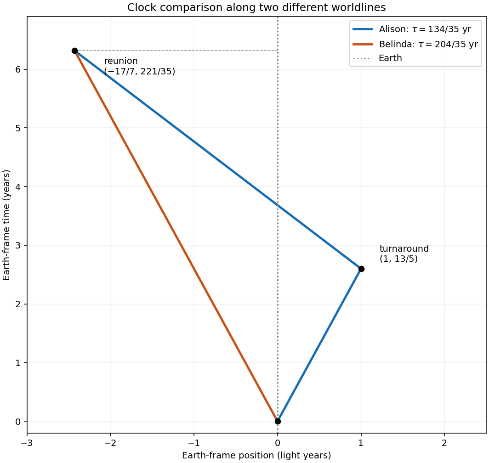

<h1 id="10/solution">Solution</h1>

↑ **Parent:** [10](../10.md)

[Einstein's postulates](../../../postulates-of-special-relativity.md) state that the laws of physics have the same form in every [inertial frame](../../../inertial-frame.md), and that light in vacuum has the same [speed of light](../../../speed-of-light.md) $c$ in every [inertial frame](../../../inertial-frame.md), independently of the motion of its source. For a primed frame moving with [velocity](../../../velocity.md) $v\mathbf e_x$ relative to an unprimed frame, with coincident origins at $t=t'=0$, the [Lorentz transformations](../../../lorentz-transformation.md) are

$$
\boxed{x'=\gamma(x-vt),\quad t'=\gamma(t-vx/c^2),\quad y'=y,\quad z'=z,\qquad
\gamma=(1-v^2/c^2)^{-1/2}.}
$$

The following [worldlines](../../../world-line.md) use Earth-frame time in years and distance in light years, so numerically $c=1$. The instantaneous turnaround is the idealized limit of a short acceleration stage; the elapsed [proper time](../../../proper-time.md) is calculated along each inertial segment.

**[Figure 3](#10/image-earth-frame-worldlines-and-clock-readings-for-the-twins-reunion). Earth-frame worldlines and clock readings for the twins' reunion**.

## ↑ Ancestors (11)

1. [10](../10.md)
2. [2017 resit](../../2017-resit-split.md)
3. [Past exam of the physics 1 paper of the University of Oxford](../../split.md)
4. [Physics 1 paper of the University of Oxford](../../../physics-1-paper-of-the-university-of-oxford.md)
5. [Year 1 of the physics course of the University of Oxford](../../../year-1-of-the-physics-course-of-the-university-of-oxford.md)
6. [Physics course of the University of Oxford](../../../physics-course-of-the-university-of-oxford.md)
7. [Undergraduate course of the University of Oxford](../../../undergraduate-course-of-the-university-of-oxford.md)
8. [Course of the University of Oxford](../../../course-of-the-university-of-oxford.md)
9. [University of Oxford](../../../university-of-oxford-split.md)
10. [List of universities](../../../list-of-universities.md)
11. [Codex Wiki](../../../split.md)
